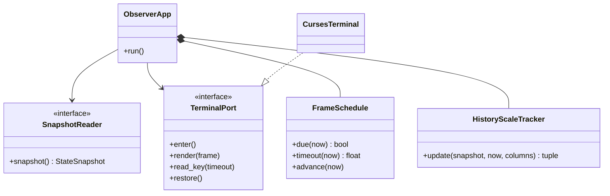
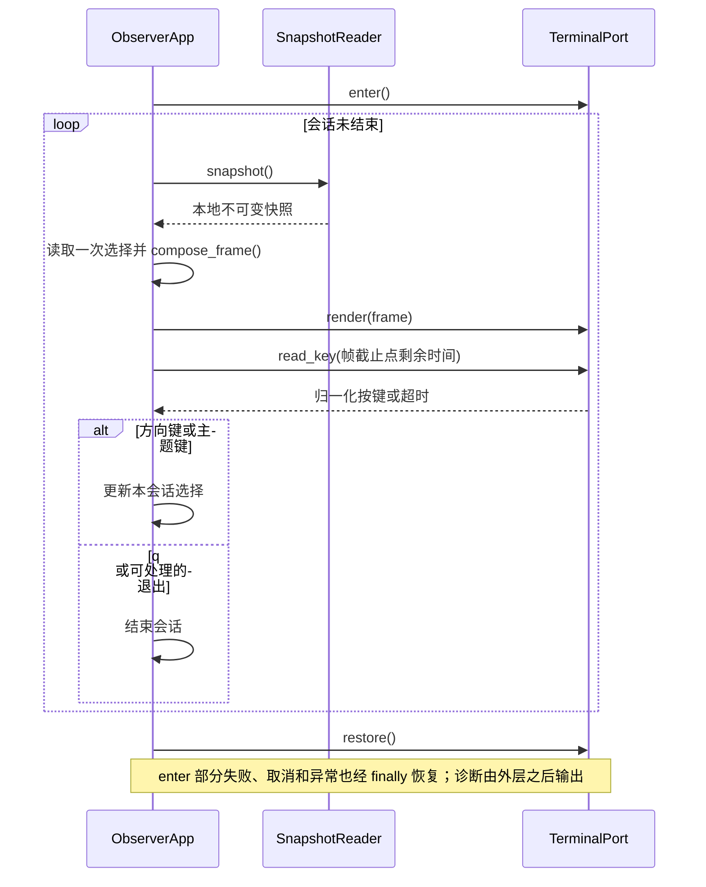

# Application Shell 模块设计

- 关联需求：dev-0 / REQ-001、REQ-005、REQ-006，需求说明 v1.24；AC-101～106、AC-110、AC-111、AC-113、AC-114、AC-501～504；共享布局约束关联 AC-202/203/207/301/304/605/607/608/613/614/616。
- 关联需求补充：dev-1 / REQ-001，需求说明 v1.3，AC-101～114。
- 修订：v2.3，2026-11-16；在图前集中说明核心类、对象职责及其时序别名。
- 整体设计：[组件边界与依赖](architecture.md)。
- 相关代码：`src/joi_observer/cli.py`、`__main__.py`、`tui/app.py`、`tui/layout.py`。
- 关联模块：[TUI 客户端](tui-client.md)、[配置](configuration.md)、[错误日志](error-logging.md)；状态和调度共享 `data/models.py`、`data/state.py`、`monitor.py`。
- 当前阶段：dev-0 的布局、主题和帧调度是保留基线；dev-1 本轮为 R2 设计及接口骨架，下面的新启动与生命周期规则由 R4 接线，不能解释为已实现。旧阶段交接历史路径为 `docs/dev-workflow/dev-0/REQ-006/handoff-r4.md`、`handoff-r5.md`；当前工作区未包含这些文件，不作为本轮验证证据。

## 职责与边界

dev-1 / REQ-002 的 Web 入口由同机容器单独启动。页面生命周期、浏览器键位和像素断点见 [Web 数据通道](web.md)和 [Neon Grid 页面](web-dashboard.md)。本模块的终端尺寸、退出键及 TTY 探测只用于宿主 TUI。

本模块负责命令分派、TUI 进入全屏前的检查、客户端接线、终端恢复、只读刷新和终端容量判定。常驻服务与客户端是不同进程：服务拥有唯一的 MonitorState、Monitor 和 ErrorLog；TUI 只接收白名单展示元数据和不可变快照，不加载监控配置、不创建采集器。

现有 ApplicationRuntime 的采集装配与清理移交 [CollectorRuntime 与常驻服务](collector-service.md)，复用 build_hardware_sources、build_docker_collectors、build_vllm_collectors 及既有外部端口。全部配置容器和模型参与采集，不按可见行数裁剪。TUI 端使用 [IPC 客户端](ipc.md)的本地快照缓存；不会以传输失败为理由回退到独立采集。

服务组合根只配对状态声明与采集来源，不拆解或转换业务载荷。公共结果分型、spec 匹配和失败接收规则统一见[Monitor 与内存状态](monitor-state.md#collection-results)。客户端只持有传输解码后的视图值，不跨进程直接共享 Python 状态对象。

目标是 Ubuntu Server 24.04 amd64 / Python 3.12+。使用标准库 `asyncio` 协调任务、`curses` 管理终端。`curses` 只在生产后端 `enter()` 中延迟导入，使模块导入、配置加载及非终端离线测试不依赖终端初始化。必需验证在本地 Ubuntu 或 WSL Ubuntu 执行，Windows 工作区通过 WSL 运行测试，不要求维护原生 Windows 专用测试或执行 Windows 全量回归。源码无需安装 Windows curses 兼容包；真实终端验收在本地 Ubuntu 或 WSL Ubuntu 完成，不连接任何服务器。

## 类与对象简介

| 图中名称 | 简介 |
| --- | --- |
| `ObserverApp`（对象别名 `App`） | TUI 应用类，负责协调本会话的帧调度、按键处理、只读绘制和终端恢复。 |
| `SnapshotReader`（对象别名 `Cache`） | 快照读取协议，供应用同步读取本地不可变缓存而不执行 I/O。 |
| `TerminalPort`（对象别名 `Terminal`） | 终端操作协议，封装进入全屏、尺寸读取、绘制、读键和恢复。 |
| `CursesTerminal` | `TerminalPort` 的 curses 实现，负责真实终端输入输出及会话状态恢复。 |
| `FrameSchedule` | 会话帧时钟类，按固定起点维护绘制截止时间并跳过过期帧槽。 |
| `HistoryScaleTracker` | 会话历史显示尺度类，独立维护各模型的纵轴档位及迟降计时。 |

## 简化类图



## 关键交互时序图



## uv 安装与开发运行

uv 是安装/开发工具，不加入应用的 Python 运行依赖；应用启动不修改 PATH 或 shell 配置。构建后端、依赖、命令入口和示例资源由 `pyproject.toml` 声明。本轮新命令的目标规则以本文为准，R4 需同步 [README](../../README.md#安装与启动)；不生成或重建离线安装包，不更新既有 GUI 启动/回放入口。

dev-0 / AC-114 的工具安装证据保留在该批次 R4/R5 交接，不能作为本轮服务或布局验证。dev-1 在本地 Ubuntu/WSL 使用当前源码与已有依赖验证命令分派、资源定位及离线终端行为，不生成安装包、不更新历史 GUI/回放，不连接服务器。

## 命令与启动序列

安装入口 `joi-observer` 与包内模块入口均调用 `cli.main()`，R4 需将 main 委派至本轮声明的 `cli.run_command()` 完成新分派；R2 保留旧 main 执行体及既有回归，新增入口是未实现骨架。日常通过 uv 安装后的裸命令启动；开发时也可执行 `uv run python -m joi_observer`，不能假定任意系统 Python 都已安装此包。入口只返回整数退出码，由包装层调用 `SystemExit`；导入模块时不初始化终端、日志、驱动或网络。

| 参数 | 行为 |
| --- | --- |
| 无参数 / `tui` | 检查交互终端，只连接 `/run/joi-observer/snapshot.sock`，收到首个完整合法快照后进入全屏 |
| `[tui] --socket PATH` | 覆盖本机 Unix socket 绝对路径；不接受 URL，不改变采集配置 |
| `service [--config PATH] [--socket PATH]` | 无 TTY 要求，运行宿主机常驻采集服务，配置只加载一次 |
| 默认入口或 `tui --config PATH` | 返回 2，提示 `Use joi-observer service --config PATH.`，不加载文件、不发起连接 |
| `--help` / `-h` | 打印参数说明并返回 0，不需要配置/TTY/服务 |
| `--version` / `-V` | 打印包版本并返回 0，不需要配置/TTY/服务 |
| `--example-config` | 打印随包示例的绝对路径，供复制使用，不加载该示例启动采集 |

普通 TUI 启动严格按以下顺序执行：参数解析 → 交互终端检查 → 创建只读客户端 → 单次连接并接收首帧 → 原子安装元数据与快照 → 构造展示会话 → 全屏运行 → 客户端清理。客户端不查询配置路径，不创建 ErrorLog；当前目录存在非法 YAML 也不影响客户端。服务启动检查与配置错误由[服务设计](collector-service.md)定义。

TUI 的 `stdin`、`stdout` 都必须是 TTY，`TERM` 必须非空且不等于 `dumb`；管道/重定向输出返回 3，提示需要交互终端。`stderr` 可重定向，连接诊断必须发生在未进入全屏或恢复终端之后。服务子命令不使用 curses；Web 由 dev-1 / REQ-002 单独实现。

`ErrorLog.prepare()` 的一次降级提示属于采集服务标准错误输出，不向 TUI 或快照转发。TUI 不读取日志，不输出来源异常或采集诊断。

| 情形 | 退出码 | 控制台行为 |
| --- | --- | --- |
| q 正常退出 | 0 | 仅恢复终端，不补打采集错误 |
| 参数/配置错误 | 2 | 全屏前显示可定位错误；不记录 ERROR 日志 |
| 非交互终端 | 3 | 全屏前显示简短英文提示 |
| 初次连接失败 / 运行中连接中断 / 协议非法 | 4 | 未进入全屏或恢复终端后输出 `Cannot connect to collector service. Run joi-observer again to retry.` |
| 服务启动、实例锁或 socket 错误 | 5 | 服务 stderr 输出 `Collector service could not start.`，不输出原始异常或堆栈 |
| SIGINT / Ctrl+C | 130 | 完成清理，不显示采集诊断 |
| SIGTERM | 143 | 完成相同清理路径 |
| 内部程序错误 | 1 | 先恢复终端，再显示固定 `Observer stopped unexpectedly.`；不输出异常内容或堆栈 |

采集失败属于数据状态，必须由 Monitor 隔离；不能因单个 GPU、挂载点、容器或模型失败而走内部程序错误退出路径。

## 生命周期与异步协作

TUI 运行期拥有一个 SnapshotClient 和一个 ObserverApp。连接及持续收帧位于独立异步任务；同步 `snapshot()` 只读当前缓存，不等待字节、不读取文件、不发起连接。服务首帧可以包含尚未观测的 `—`，但必须有同一生效配置的完整展示元数据；不得先使用本地旧配置绘制再异步替换。

服务在状态更新后合并发布完整快照；无更新时最多间隔 1 秒发布心跳。生产采样间隔为 1～60 秒，发布不额外触发采样。5 秒内未收到首帧或后续完整合法帧即判定连接失败；EOF、传输错误、协议版本错误、实例身份变化也立即失败。一份快照以有序字节流分批读写，零碎字节不重置完整帧超时；不采用应用层分片协议或固定 8 MiB 总量限制。采样周期可能大于 5 秒，服务心跳仍持续，未产生新样本不等于失联。失败后客户端关闭接收任务并退出，不能后台重连；重新运行命令建立新会话。来源 STALE 是快照内容，不中断连接。

绘制接线：compose_frame沿用本模块全部Region和required_size，硬件内部内容委托`widgets.hardware_cells`替换旧通用占位；不增加区域或改行数。ObserverApp的gpu_slots仍只收集collector=gpu的UUID，gpu_inventory不计数；硬件控件根据ViewSelection计算关联色，不负责方向键导航。具体字段、挂载序号、STALE和颜色角色见[硬件设计](hardware.md)。

每条连接固定 `instance_id`、`config_revision` 和展示元数据，后续只接受递增传输序号。服务重启产生新实例；旧连接失效并退出，不把新历史拼到旧会话。新的用户命令读取新元数据并新建选择和历史尺度。慢传输不得阻塞 q、导航、主题或终端恢复。联合黑盒只替换外部采集字节、传输端口、终端和时钟，保留真实服务、客户端与视图编排。

UI 首次绘制发生在读取第一个按键前。正常绘制以 **60 FPS** 为目标，间隔 `P=1/60s`；它是调度目标而非任意终端的实测保证。快照/按键变化在下一个普通绘制机会呈现，尺寸变化可在下一次读键前立即重绘。主机时间至少每秒更新一次，使用带时区的墙钟；采样与帧调度均用各自单调时钟，Monitor 保持配置采样周期，UI 不启动新采集。本期不增加帧率切换或配置项。

### 帧截止点与终端写入

- 以会话单调起点和 `n * P` 维护下一截止点，不能每次在绘制结束时间上再加P而累积漂移。首次与resize紧急绘制后也应推进截止点，避免紧接一次重复普通绘制。
- 读键等待为 `min(50ms, 下一截止点 - 当前时间)`，不能给只接受正超时的read_key传0或负数。读键前发现到期时，必须区分本轮是否已处理过显示机会：本轮尚未绘制，则保留到期deadline、不advance，主动让出事件循环后于下一轮绘制；单调时钟保证该deadline仍到期，不能因周期输入将它持续跳过。本轮已完成绘制，则可跳过随后调度操作跨过的逾期显示槽，沿原始相位advance，并以同一个read_now计算正超时、提供一次read_key机会。这个分支不能反复绘制/让出而绕过输入，也不能在未绘制时一律advance而绕过画面。
- 本轮已绘制标记每轮重置，只在本轮完整帧处理成功后成立；其语义是已服务一次显示机会，将来允许相同帧省略物理写入时也不能误当成未处理。未绘制到期分支保留deadline，因此至多连续经过一次该分支就进入绘制；已绘制跨点分支随后必须服务输入。单独sleep(0)不等于已读取终端按键，完成读键后仍须主动让出事件循环，使立即就绪的输入端口也不饿死采样。连续按键不突破普通帧上限，连续慢帧保持q、导航和主题响应；不使用固定50ms等待替代截止点预算。
- 一次绘制过慢时跳到当前时间之后的首个未来截止点，只取最新快照；不补画漏掉的帧、不排队积压。每个生成的Frame仍只读一次selection，按键不直接修改快照、历史或GPU顺序。
- 同尺寸且cells/theme完全相同的帧可以跳过实际终端输出；变化时由curses差异输出更新。不要把当前erase虚拟窗口误解为每次物理清屏；减少无效输出应基于整帧比较/脏区域，并正确清理旧长文本、过期曲线与旧主题背景。
- 本轮不要求重写为多窗口后端或引入终端同步输出协议。保持一次完整帧提交及原有终端恢复；配色/background更新仍遵守[主题设计](theme.md)。提高显示刷新频率不会增加采样次数，历史曲线只在真实数据、时间桶、尺度或尺寸变化时改变。

当前60Hz修订须用可控单调时钟检查60Hz节拍、连续输入、超预算跳帧及采样次数，并在本地WSL PTY记录绘制耗时/帧间隔和退出响应；当前结果见R4交接；R2/R3/R4/R5历史30Hz结果保留原时点事实，不作为60Hz已验证的依据。PTY吞吐不能代替具体终端窗口实际可见FPS，不保证未测试终端稳定60帧。AC-603/609/612由`tests/test_frame_timing.py`、`tests/test_frame_timing_edges.py`、`test_navigation_app.py`等覆盖；R5的慢绘制截止点跨越和周期输入相邻相位用例共同覆盖两个方向的公平性，必须同时保留并实际记录返修回归，不能仅由其中一方向通过推定另一方向正确。

### 帧时钟和尺度接线

`timing.py`已实现常量`FRAME_RATE=60`、`FRAME_INTERVAL=1/60`和`FrameSchedule(start)`。`due(now)`只读判断到期；`timeout(now)`返回0..50ms的剩余等待；`advance(completion_now)`跳到严格晚于完成时刻的首个原始节拍。同一完成时刻重复advance不额外跳槽，查询不改变状态。起点/时刻拒绝bool、非有限值、负值和早于起点的值；advance另拒绝时间回退，异常不能改变原进度。构造只保存起点和进度，不访问外部时钟；ObserverApp已使用此帧时钟替换原last_draw逻辑。

应用实例拥有一个 `HistoryScaleTracker(metadata.models)`；每个生成帧从 reader 取一次缓存快照、actions 取一次 selection，并用同一单调 now 推进全部模型尺度。`metadata` 为服务投影的 DisplayMetadata，不含 URL 或采集参数；既有纯视图参数名 `config` 可以兼容保留，但其生产输入迁移为该展示结构，不能用伪造 base_url 重建 AppConfig。冻结尺度元组显式传给 `compose_frame(..., history_scales=scales, monotonic_now=now)`，再由布局传给 `vllm_cells`。小窗口使用最近正常图区宽度，尚未有正常帧时使用最小正常布局的图区宽度；主题/模型/resize 不重建尺度。帧时钟每次 run 重新以本次起点调度，不补画上次 run 期间的帧。


图示保留已实现的应用/尺度所有权，dev-1 将模型输入替换为展示元数据；纯布局不能通过模块全局状态保存迟降计时。默认接线的黑盒为 `tests/test_history_app.py`：未选中模型继续迟降、主题/resize/小窗口保持、同实例重入与新实例隔离，输入仅替换外部时钟与只读样本。既有 AppConfig 纯视图用例保持兼容，不因新增 DisplayMetadata 输入而删除。

q 使 UI 正常返回并关闭本会话 IPC；UI 内部异常、进程终止或连接失败均不停止宿主机 Monitor，也不影响其他客户端。连接任务失败时，TUI 运行期取消 UI 并等待其 `finally` 恢复终端，随后才输出固定连接错误。终端 `enter()` 也位于该 `try/finally` 内，覆盖部分初始化失败；`restore()` 幂等且尝试恢复光标、输入回显和原终端显示。可捕获的 SIGINT/SIGTERM 使用同一路径。SIGKILL、断电和终端设备本身失效无法保证恢复。

客户端总体清理预算不超过 1 秒，`run()` 与 `close()` 共享预算，先恢复终端，再有界关闭接收任务和传输；取消不能被误报成来源失败。服务的采集/日志清理有独立预算，见[服务设计](collector-service.md)。清理中的异常不能掩盖原异常。

`ObserverApp` 在 `actions is None` 时从展示模型元组创建默认 `SessionViewActions(metadata.models)`，显式注入原样保留；每帧只读取一次选择并用于整帧。全局退出由应用处理，其他键分派给会话控制器。按键、选择生命周期及服务页脚统一见[模型导航](navigation.md)。

布局从 `services.VLLM_SERVICE` 取得一次描述，同时用于当前服务标题、入口及 `footer_text(service)`，避免分别拼装不同服务的文案。服务描述和页脚接口契约见[导航设计](navigation.md#服务入口与键位呈现)。

## 可验证的字符容量

下列数字均是终端字符列/行，未套用 HTML 像素尺寸。最低列数为 **120**。以总可绘制高度 H 直接平分，页眉、切换位、键位、边框和间距都包含在各自半页预算内：

```text
lower_rows = H // 2
upper_rows = H - lower_rows
grouped_rows = 2 * gpu_count + 2 * gpu_group_count + max(0, gpu_group_count - 1)
hardware_minimum = max(3 * gpu_count + 2, grouped_rows + 2, 15)
minimum_rows = max(36, 2 * (3 + hardware_minimum) - 1)
header_rows = 6 if upper_rows >= hardware_minimum + 6 else 3
hardware_rows = upper_rows - header_rows
docker_row = header_rows + 12
docker_capacity = max(0, hardware_rows - 15)
```

上半区为每张 GPU 预算 3 行，另加 2 行边框。`gpu_group_count` 是本帧实际显示的 GPU 组头数。如果各组的设备、标题与组间横线合计需要更多行，按实际需要确定高度。右侧至少需要 15 行，包括 Host Resources 6 行、Storage 6 行、Docker 外壳 3 行。Storage 底边的下一行就是 Docker 顶边。能再容纳 6 行页眉时显示像素字标，其余可用尺寸显示 3 行紧凑页眉。奇数页高多出的一行归上半区。下半区至少 18 行，包括服务窗口 16 行、服务入口和键位提示各 1 行。

| GPU 槽数（未注明时按无组头计算） | 最小尺寸 | 首次显示完整字标的尺寸 |
| --- | --- | --- |
| 0～4 | 120×36 | 120×41 |
| 5（四卡组加单卡组） | 120×39 | 120×45 |
| 5（五个独立单卡组） | 120×57 | 120×63 |
| 6 | 120×45 | 120×51 |
| 10 | 120×69 | 120×75 |

`required_size` 接受 `gpu_count`、`mount_count`、`container_count` 和可选的 `gpu_group_count`（默认 0）。各计数均为非负整数，组数至多等于 GPU 槽数。挂载点和容器数量仅校验输入，不参与高度计算。容器不设固定数量上限；挂载点第 4 项起不增加尺寸，由配置层忽略采集且展示层不绘制。

正常 Frame 固定返回以下 **8 个命名区域**；`Region` 描述矩形，可有或无边框。宽度分配沿用 GPU 左、主机右和服务全宽的结构。

| Region.name | 起始行 | 高度 | 说明 |
| --- | --- | --- | --- |
| `header` | 0 | header_rows | 品牌及主题置顶，倒数第二行显示主机信息和时间，末行绘制全宽分隔线 |
| `gpu` | header_rows | hardware_rows | GPU 所有已知槽位，上半区内 |
| `host` | header_rows | 6 | Host Resources四行内容：CPU标签/数值、CPU条、RAM标签/容量、RAM条；无额外下间距 |
| `storage` | header_rows + 6 | 6 | 在区域内第 2～4 行（零基）绘制 3 个挂载点，第 5 行是 Storage 底边 |
| `docker` | docker_row | upper_rows − docker_row | 容器从区域内第 2 行（零基）起依次排列，最后一行为边框 |
| `service` | upper_rows | lower_rows − 2 | 服务窗口标题、边框、模型、指标、历史和内部留白 |
| `service_switch` | H − 2 | 1 | 独立的 vLLM / WebUI 切换位，WebUI 禁用 |
| `footer` | H − 1 | 1 | 键位提示 |

### HTML 对齐的字符适配

完整页眉左上角的 `Joi::Observer` 字标使用 59 列 × 4 行画布，字面占前三行，末行留白。阴影位置改为空格，修订的 J 下钩、原版 s 和原版 v 的字面笔画均保留原字符与坐标。字符分色由[主题设计](theme.md#color-roles)定义。完整页眉在第 4 行（零基）显示主机信息和时钟，第 5 行绘制横线。紧凑页眉在第 0 行显示文字品牌，第 1 行显示主机信息和时钟，第 2 行绘制横线。两种横线均使用 muted 角色，以 `─` 填满第 0 列至最后一列，硬件面板从横线的下一行开始。两种布局的主题名称均位于第 0 行右缘，按 `t` 切换。

主机信息行沿用HostInfo.hostname字段承载固定设备标签H3C R5300 G6，紧随` / `及HostInfo.system发行版本。组合根`_local_host_info()`只在启动装配时读取本地os-release：按`/etc/os-release`、`/usr/lib/os-release`顺序尝试，打开或读取发生OSError时尝试下一候选；首个读取成功的文件一次解析，缺字段或空文件不与低优先级文件合并。只使用文件实际提供的字段，优先非空PRETTY_NAME，缺失或空值时组合NAME与VERSION_ID，名称/版本缺失或空值分别用Ubuntu/—。显式提供的字面值Linux是有效名称，不能当成库默认值丢弃；空文件、全部候选读取失败或所选文件UTF-8解码失败显示Ubuntu —。解析沿用标准库已核对的字段赋值、引号及五类转义规则，不执行shell、不使用标准库注入的Linux默认字段或全局缓存，不新增依赖。该读取不使用platform.release内核版本、不读取DMI、不发起网络探测；布局自身仍为纯函数，显式HostInfo注入接口保持。合计左区最多`C-19-2`列，按终端显示宽度裁切；右侧19列固定为传入本机aware墙钟的`YYYY-MM-DD HH:MM:SS`，右端同为C，中间至少空两格。不把时间转换成UTC，不追加设计稿模拟的CST，不使用采样时间。控制字符和双向控制符先净化，宽字符/组合字符不得穿越时钟保护区。

上述主机信息读取在 dev-1 中只由采集服务执行一次，结果进入 DisplayMetadata.hostname/system；TUI 使用服务元数据，不重新读取自己的 os-release，Web 容器也不拿容器发行信息覆盖宿主信息。该展示行为由 R4 从旧 `_local_host_info()` 接线迁移，读取规则与回退保持不变。

面板标题复用上边框行，保持既有内缩，不增加布局高度。正式标题与颜色角色、HTML 边框/表面的采用范围统一见[主题设计](theme.md#color-roles)。

水平分区按Neon Grid参考稿接近3:2：`gpu_width=floor((columns−1)*3/5)`；GPU从0列起，空1列，Host/Storage/Docker共用右侧余宽。120列时GPU外宽71，右侧起点72/外宽48；140列时分别83与84/56。横向调整不改变上面的高度公式、GPU槽数规则或Docker容量。

硬件面板内部坐标、数值精度及状态位置统一见[硬件显示设计](hardware.md#硬件显示与模型关联)；硬件条字形及配色统一见[主题设计](theme.md#hardware-bars)。

服务区外矩形由上方 Region 表分配。模型列表、详情行列、留白、分隔与图高只在[vLLM 固定槽位](vllm.md#vllm-layout)维护；compose_frame 和 vllm_cells 共用该契约。

固定半页和最低终端尺寸优先；统一字体/字符边框替代浏览器字号及像素边框，不以多行ASCII大数字消耗历史高度。逐模型状态、GPU状态位、真实单位与未知值的保留是可靠监控需要的适配；不为模仿HTML而移除这些字段或复制模拟参数。不能以“终端适配”为由继续保留可以实现但未同步的数值左排、三列负载或两列同行指标。

以 5 张 GPU 为例，H=42 时使用紧凑页眉，Docker 可见 3 项。H=43 或 44 时仍使用紧凑页眉，可见 4 项。H=45 时切至完整页眉，可见 2 项。H=48 时可见 3 项。模型窗口、服务入口与键位提示在这些尺寸下始终合计占 H//2 行。

GPU 槽位身份与生命周期见[硬件发现设计](hardware.md#gpu-发现调度与资源生命周期)。本模块按已知槽位数量计算容量；无已知 GPU 时按一个空态槽分配，首次发现后重新计算最低尺寸。

Storage 的内容容量由 Region 表固定。0 项显示空态，未占用的内容行留白；窗口增高、失败/恢复或容器数量变化不改变其高度。采集对象的取用与校验见[配置设计](configuration.md#configuration-fields)，内容状态见[硬件显示设计](hardware.md#硬件显示与模型关联)。

Docker 填充右侧剩余高度，只显示配置前 `docker_capacity` 项；全部容器仍保留、仍采集、仍按对象记录实际采集错误，隐藏本身不是错误。面板内容少时允许留白，不缩短面板，不把余高让给 Storage。容量大于 0 且配置为空时显示空态；容量为 0 时不画条目或空态文字，避免占用边框。隐藏项无提示、无省略号/更多标记、无隐藏数量、无滚动分页；窗口变大重新显示时读取同一最新快照。失败项保持原位置，后续项不能补位。

Docker 条目内部名称、状态槽及失败替换规则统一见[Docker 行布局](docker.md#docker-row)。

模型总数不增加页面最小高度；模型列表的可见窗口由[vLLM 固定槽位](vllm.md#vllm-layout)和[导航](navigation.md)协调。所有内容必须限制在自己的区域内，不能仅依赖整屏裁切，否则 Docker 末尾项会覆盖下半区。

仅低于基础尺寸时显示 `Enlarge terminal to at least 120x39`（数字随 GPU 容量）和 `q Quit`；Docker 溢出不触发该提示，也不触发局部提示。极小终端只裁切提示，q 仍可退出；恢复尺寸后立即重绘。Monitor 不因缩放、隐藏、主题或模型选择改变采集节奏。长名称按终端显示宽度截断而不换行；颜色和模型面板分别遵循[主题](theme.md)与[vLLM](vllm.md#vllm-view)设计。

## 只读呈现与诊断隔离

`compose_frame()` 生成不可变 Frame，包含 TextCell 和 Region；不附带异常类型、原因或堆栈。布局只读取 StateSnapshot 的指标、stale 和对象身份，不渲染内部 sampled_at/history 时间。墙钟只用于顶部当前时间。

`TextCell` 的角色、字体标记和终端绘制机制统一见[主题设计](theme.md#font-rendering)；vLLM 数字强调的选择范围见[vLLM 指标与状态](vllm.md#vllm-values)。布局只传递呈现属性，不在正文中插入 ANSI 转义。

失败、恢复和模型类型切换均不改变区域矩形；具体状态槽分别见[硬件](hardware.md#硬件显示与模型关联)、[Docker](docker.md#docker-row)和[vLLM](vllm.md#vllm-values)。通用 `format_metric()` 规定：真实 0 是 0；未知/无观测是 `—`；不适用是 `N/A`。界面不重新计算吞吐、延迟或 Total。全屏禁止错误弹窗、诊断列表、最后成功时间、堆栈及设计稿的模拟标记。

## 接口与验证依据

| 接口 | 公开行为测试 | 验收 |
| --- | --- | --- |
| `main` / CLI 依赖端口 | `tests/test_cli.py` 保留参数/非TTY/安全错误及清理覆盖；配置与日志的旧默认入口场景迁移到 service，客户端新增无配置启动、禁止本地采集、连接失败与手动重试 | dev-1 AC-102/111/112/113 |
| `run_command` | `tests/test_client_cli_contract.py`：纯 TUI 分派、service 独立配置、参数迁移、无本地采集、连接错误与退出码 | dev-1 AC-101/102/112/113 |
| `TuiClientSession` / `SnapshotClient` | `tests/test_client_session.py`、`tests/test_ipc_client.py`：离线字节接收、原子缓存、无 I/O snapshot、连接失败后退出、慢传输取消与终端恢复 | dev-1 AC-103/105/107/108/109/112 |
| DisplayMetadata → 真实视图 | `tests/test_display_metadata_view.py`：服务元数据模型顺序、列表/详情名称、端口、长名称和 GPU 关联；保留 AppConfig 输入兼容 | dev-1 AC-104/105/106/107/114 |
| `required_size` | `tests/test_tui.py`：GPU容量、非负整数边界、容器不限量且不增高、挂载点尾项不增高 | AC-106 |
| `compose_frame` / `format_metric` | 标题/值槽/STALE、偶数及奇数半页、8区边界、Storage固定及无补位、两种页眉的 Docker 可见前缀、零行与空态、失败恢复稳定 | AC-101/106/110/207/304/607/608 |
| HTML外壳 / `compose_frame` | `tests/test_html_shell_layout.py`：两主题/多宽右边缘、主机与非UTC时钟分色、Unicode/ANSI保护、完整面板标题角色、7种Docker生命周期/未知/STALE固定槽、容量0与空配置 | REQ-006排版与颜色契约 |
| `ObserverApp.run` / `TerminalPort` | 初次绘制、q、部分进入异常、绘制异常、Ctrl+C、小窗口退出、缩放恢复、键位只分派展示操作 | AC-103/104/106 |
| `SessionViewActions` / 默认 `ObserverApp` | `tests/test_navigation.py`、`tests/test_navigation_app.py`、`tests/test_navigation_pty.py`：真实控制器、默认接线、只读采样隔离、失败/缩放保持、真实方向键、页脚与禁用入口 | AC-501～504 |
| `ServicePresentation` / `footer_text` / `compose_frame` | `tests/test_service_footer.py`：服务描述冻结、同描述驱动标题/当前入口/导航提示、其余全局文字不变 | AC-504及用户补充 |
| 服务 / 客户端运行期 | `tests/test_tui.py` 等旧联合测试保留慢来源响应性与真实状态覆盖；同生命周期断言迁移为单客户端退出后采集和另一客户端继续，补充慢传输、失联恢复终端、新实例历史隔离 | dev-1 AC-101～109/111/112 |
| uv 工具安装与命令入口 | 新 shell、未激活环境、不同工作目录、命令/示例资源定位及离线 TUI 启停；已有 R4/R5 历史证据，布局边界变更后须重新验证 | AC-114 |

保留回归入口：`python -m pytest tests/test_cli.py tests/test_tui.py tests/test_shell_edges.py`。新增客户端、服务、协议测试与实际执行结果见[dev-1 REQ-001 R2交接](../dev-workflow/dev-1/REQ-001/handoff-r2.md)。R4 只能因接口迁移或已确认变化调整旧入口和相应断言；未变更功能必须继续通过，不能删除、跳过、弱化断言或用 mocked 业务结果掩盖回归。所有必需验证在本地 Ubuntu/WSL 执行，禁止服务器连接；传输依赖使用离线端口替身。

现有PTY输入、终端恢复、最低尺寸、边界与缩放测试继续保留，涵盖奇偶半页、Storage/Docker区域和可见条目；返修后按影响范围重跑。当前整体观感已由用户在R5确认，GUI-006-001关闭，详见R5交接。历史`verify_pty.py` / `verify_uv_install.py`中以5容器抬高到120×38的版本不再适用：无GPU最低120×36，5GPU最低120×39；这些旧JSON不改写为新通过，新证据须注明当前需求及源码版本。`tests/test_terminal_pty.py`的Esc/方向键时限测试只针对终端适配器，不因布局改写。上述验证不授权连接服务器。

## 修订说明

v2.3 按更新后的 R2 模板增加图前类与对象简介，合并同一元素的类名和时序别名，不改变接口或行为契约。

v2.2 按更新后的 R2 模板统一整体设计引用、简化类图和关键交互时序；原业务与测试契约继续保留。

v2.0 固定 dev-1 的服务/TUI 分离、单次连接、元数据原子接收、终端恢复和测试迁移边界。以下 dev-0 修订是历史记录，其中同生命周期和安装包验证不再定义本轮目标。

v1.15按用户反馈同步静态设备标签、本地os-release发行版本及回退、斜线分隔、Storage路径正文色和主题切换整帧重绘；不自动更改TERM或扩大采集范围。

以下v1.1～v1.5记录保留各次设计时点的范围和实施状态；其中“待R4”等文字不代表当前实现状态。当前状态以本文顶部及REQ-006交接为准。

v1.1 按用户要求将安装/开发工具明确为 uv：正式使用 `uv tool install`，项目开发使用 `uv run`，新增 AC-114 的本地安装验证场景。CLI 接口、配置查找和既有黑盒用例不变；本次只修改文档，未重新运行业务测试或执行安装。

v1.2 依据需求 v1.12 废止固定 16 行服务区和按容器数增高的旧公式，定义全页上下各半、独立服务切换行、Storage 固定 3 内容行与 Docker 仅显示可容纳前缀。接口签名保留，Frame 增加 `service_switch` 区域。同步目标注释及黑盒断言，保留 R4/R5 既有执行代码与历史证据，供 R4 实现新契约。

v1.3 衔接REQ-002：保留已实现的v1.12几何与运行期，明确硬件来源/发现器、共享State、纯控件和序号身份接线；新增入口仍待R4实现，R2不修改既有执行流程。

v1.4 同步公共 CollectionResult 与两个具体结果子类，硬件/Docker/普通 State 只迁移类型，保持已有行为。vLLM 采集、accumulator、State 专支及下述组合/呈现接线继续留待 R4，不能将类型迁移或接口声明视为业务实现。

v1.5 衔接 REQ-005：新增默认会话控制器契约、精确键位文字和当前服务角色；保留已实现的终端输入、半页布局和监控运行逻辑。REQ-004 的以下接线已随 `83aad39` 合并，先前版本的“待实现”描述是设计阶段历史状态。

## REQ-004 vLLM 接线契约（已合并）

来源组装与端口所有权见本文“职责与边界”；结果接收统一遵循[状态设计](monitor-state.md#collection-results)。`compose_frame` 的可选 `monotonic_now` 用于离线历史时钟，生产缺省取 `time.monotonic()`；datetime 参数仅负责页眉时间，二者不可混用。在 service Region 内调用纯 `vllm_cells`，服务内部契约见[vLLM](vllm.md#vllm-view)。集成与首帧验证使用离线 HTTP 端口。

## REQ-006 配色衔接

`compose_frame` 在正常和小窗口两条路径都把同一次 selection 的主题传入 Frame；终端后端消费该元数据。字段兼容、硬件条、能力降级、字体、刷新和颜色恢复均以[主题设计](theme.md)为唯一详细定义。帧调度由本模块负责，配色切换不触发采集或重建运行期。
