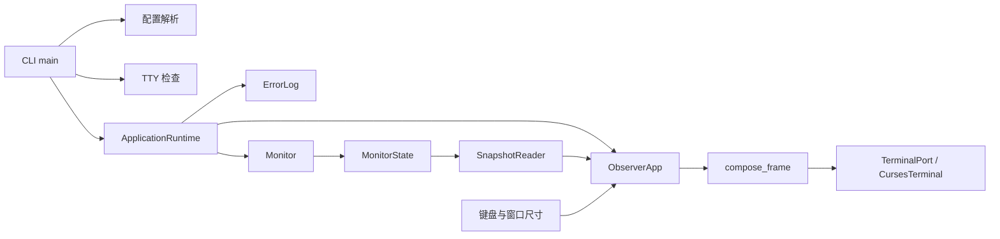

# Application Shell 模块设计

- 关联需求：dev-0 / REQ-001，需求说明 v1.12；AC-101～106、AC-110、AC-111、AC-113、AC-114；共享布局约束关联 AC-207/301/304/605/607/608。
- 修订：v1.3，2026-10-30；沿用已验收半页布局，补充REQ-002硬件接线。
- 相关代码：`src/joi_observer/cli.py`、`__main__.py`、`tui/app.py`、`tui/layout.py`。
- 关联模块：[配置](configuration.md)、[错误日志](error-logging.md)；状态和调度共享 `data/models.py`、`data/state.py`、`monitor.py`。

## 职责与边界

本模块负责命令参数、进入全屏前的检查、运行期资源组装、终端恢复、只读刷新和终端容量判定。REQ-001的v1.12公共基础已由R4实现并经R5验收。本轮R2保留执行代码，为REQ-002声明硬件组装和绘制接线，业务实现交由R4。REQ-002～004提供具体采集器，REQ-005/006完成模型导航与完整主题，均复用本模块的生命周期和容量约束。

目标是 Ubuntu Server 24.04 amd64 / Python 3.12+。使用标准库 `asyncio` 协调任务、`curses` 管理终端。`curses` 只在生产后端 `enter()` 中延迟导入，保证 Windows 能导入骨架并运行不依赖终端的测试。源码无需安装 Windows curses 兼容包；真实终端验收需在本地 WSL Ubuntu 或以后获得许可的目标环境进行，不连接任何服务器。



## uv 安装与开发运行

正式使用采用 `uv tool install`，由 uv 创建持久的独立工具环境，并将 `pyproject.toml` 的 `[project.scripts]` 入口放入用户工具命令目录。首次完成 PATH 配置后，新开终端可直接运行 `joi-observer`，不要求激活项目 `.venv`，也不要求进入源码目录。uv 属于安装/开发工具，不加入应用的 Python 运行依赖。[uv 工具说明](https://docs.astral.sh/uv/concepts/tools/)

以下安装契约保持不变，假定用户已安装 uv，并将源码放在本地目录：

```bash
uv tool install --python 3.12 /path/to/joi-observer
uv tool update-shell
```

`uv tool update-shell` 负责把工具命令目录加入受支持的 shell 配置，首次执行后重新打开终端；项目不在每次启动时修改 PATH 或 shell 配置。用户随后通过 `joi-observer --example-config` 找到示例，复制到 `~/.joi-observer/config.yaml` 并修改，日常直接运行 `joi-observer`。配置查找规则保持不变；其他目录若存在高优先级 `config.yaml`，仍按既定规则处理。

源码开发采用项目环境：在项目根目录运行 `uv run --python 3.12 joi-observer`；测试使用 `uv run --python 3.12 --extra test pytest`。uv 自动准备/同步项目环境，开发者不需要先手动激活。该环境与 `uv tool install` 创建的工具环境分离；安装后的工具需要重新安装才能采用新的本地源码版本。[uv 项目运行说明](https://docs.astral.sh/uv/concepts/projects/run/)

`pyproject.toml` 继续声明构建后端、Python 版本、依赖、命令入口和示例资源，无需为了使用 uv 更换构建后端。R4 已生成项目 `uv.lock`；本次布局设计不解析依赖或修改锁文件。项目锁文件用于开发环境；不能假定工具安装自动复用同一项目环境或锁定结果。

AC-114 的本地安装验证使用预先准备好的 uv、Python 和离线依赖：安装工具并完成一次 PATH 配置，打开未激活虚拟环境的新 shell，在无项目 `config.yaml` 的其他目录验证 `joi-observer --version`、`--example-config` 的命令解析与资源可读性。有效配置进入/退出 TUI 的验证接入离线采集端口或禁用网络的本地测试环境，检查确实不依赖源码当前目录或 `VIRTUAL_ENV`。不能用 `uv run` 代替此工具安装验收，因为那不能证明裸命令可用。已有结果见 REQ-001 的 R4/R5 交接与历史证据；本次未重新安装，也不把旧布局通过结果计作新布局验证。这不构成服务器连接授权。

## 命令与启动序列

安装入口 `joi-observer` 与包内模块入口均调用 `cli.main()`。日常通过 uv 安装后的裸命令启动；开发时也可执行 `uv run python -m joi_observer`，不能假定任意系统 Python 都已安装此包。入口只返回整数退出码，由包装层调用 `SystemExit`；导入模块时不初始化终端、日志、驱动或网络。

| 参数 | 行为 |
| --- | --- |
| 无参数 | 按配置查找规则读取用户配置，通过检查后直接进入全屏 |
| `--config PATH` | 指定唯一配置，缺失或无效不回退 |
| `--help` | 打印参数说明并返回 0，不需要配置/TTY |
| `--version` | 打印包版本并返回 0，不需要配置/TTY |
| `--example-config` | 打印随包示例的绝对路径，供复制使用，不加载该示例启动采集 |

普通启动严格按以下顺序执行：参数解析 → 配置查找与完整验证 → 交互终端检查 → 组装运行期 → 日志预检查 → 全屏运行 → 资源清理。缺配置时必须同时显示需要准备的配置路径与示例文件位置；具体配置搜索顺序见配置模块。未知参数/配置错误不会创建日志文件或采集器。

`stdin`、`stdout` 都必须是 TTY，`TERM` 必须非空且不等于 `dumb`；管道/重定向输出返回 3，提示需要交互终端。首版不提供非交互监控输出、Web 页面或菜单模式。`stderr` 可重定向，但仍只接受全屏前的配置诊断或一次日志初始化提示。

`ErrorLog.prepare()` 失败只输出一次英文 `Error log unavailable; monitoring will continue.`，随后继续运行。该提示不是日志记录；运行中的日志写入问题由日志模块静默处理，不再次通知 UI 或控制台。

| 情形 | 退出码 | 控制台行为 |
| --- | --- | --- |
| q 正常退出 | 0 | 仅恢复终端，不补打采集错误 |
| 参数/配置错误 | 2 | 全屏前显示可定位错误；不记录 ERROR 日志 |
| 非交互终端 | 3 | 全屏前显示简短英文提示 |
| SIGINT / Ctrl+C | 130 | 完成清理，不显示采集诊断 |
| SIGTERM | 143 | 完成相同清理路径 |
| 内部程序错误 | 1 | 先恢复终端，再显示固定 `Observer stopped unexpectedly.`；不输出异常内容或堆栈 |

采集失败属于数据状态，必须由 Monitor 隔离；不能因单个 GPU、挂载点、容器或模型失败而走内部程序错误退出路径。

## 生命周期与异步协作

`ApplicationRuntime` 是唯一组合根。先构建初始只读快照，让 UI 可显示 `—`，再并发执行 `Monitor.run(stop_event)` 与 `ObserverApp.run()`。一个会话只创建一个 MonitorState、一个 Monitor 和一个 ErrorLog；界面不拥有采集器或写状态接口。

REQ-002接线：`build_hardware_sources(config)`无IO创建CPU/RAM/前三挂载与GPU发现器；静态spec纳入同一个State，静态来源交Monitor后调用`register_discovery`。由host/cpu、host/ram取代host/local占位，保留Docker/vLLM占位与注入RuntimeComponents路径。GPU发现和首次采集只能由Monitor.run/poll发起，不在CLI预检查、构造或渲染时执行。

绘制接线：compose_frame沿用本模块全部Region和required_size，硬件内部内容委托`widgets.hardware_cells`替换旧通用占位；不增加区域或改行数。ObserverApp的gpu_slots仍只收集collector=gpu的UUID，gpu_inventory不计数；硬件控件根据ViewSelection计算关联色，不负责方向键导航。具体字段、挂载序号、STALE和颜色角色见[硬件设计](hardware.md)。

`RuntimeComponents` 允许注入真实 Monitor、ObserverApp 与日志端口的组合，注入时二者仍须共享同一个 MonitorState。这使联合黑盒测试能够使用真实调度和 UI 入口，仅替换外部采集源、终端与文件日志边界；不能把组合根编排替换为返回预定结果的 mock。

UI 首次绘制发生在读取第一个按键前。键盘等待上限 50ms，正常绘制最多 10Hz，快照变化最迟在下一绘制周期可见；尺寸变化在下一次读键前立即重绘，不受普通绘制节流限制。主机当前时间至少每秒更新一次，使用本机带时区的墙钟，不使用样本时间。采样调度使用单调时间，其节奏由 Monitor 独立控制。UI 的刷新、主题与模型选择不启动新采集。

q 使 UI 正常返回，组合根通知/停止 Monitor；UI 内部异常同样停止 Monitor。Monitor 的非采集类内部异常取消 UI，让 UI 的 `finally` 恢复终端。终端 `enter()` 也位于该 `try/finally` 内，覆盖部分初始化失败；`restore()` 幂等且必须尝试恢复光标、输入回显和原终端显示。协程取消、可捕获的 SIGINT/SIGTERM 使用同一路径。SIGKILL、断电和终端设备本身失效无法保证恢复。

总体清理预算不超过 1 秒，`run()` 与 `close()` 共享预算；采集端口必须合作取消，底层同步操作必须有超时，不能等待无限阻塞线程退出。日志关闭不向 stdout/stderr 输出积压记录，也不要求补写停机时尚未落盘的事件。清理中的异常不能掩盖原异常。

`ViewActions` 只接受 t/up/down/left/right，供 REQ-005/006 实现只读选择；q 由应用全局处理。Enter、p 没有行为，首版左右键不能进入 WebUI。没有鼠标主题操作。键位区只保留 `↑↓ Models`、`t Theme`、`q Quit`。

## 可验证的字符容量

下列数字均是终端字符列/行，未套用 HTML 像素尺寸。最低列数为 **120**。以总可绘制高度 H 直接平分，页眉、切换位、键位、边框和间距都包含在各自半页预算内：

```text
lower_rows = H // 2
upper_rows = H - lower_rows
hardware_rows = upper_rows - 2
minimum_rows = max(36, 2 * (2 + max(3 * max(gpu_count, 1) + 2, 16)) - 1)
docker_capacity = max(0, upper_rows - 18)
```

上半区包含 2 行页眉；硬件最低高度取 GPU 与右侧面板所需高度的较大值。GPU 每卡 3 行，面板边框另 2 行；右侧最低 16 行由 Host Resources 5 行、间距 1 行、Storage 6 行、间距 1 行、Docker 外壳 3 行组成。Docker 允许零内容行，不因需要显示某个容器而增加最小高度。下半区最低 18 行，由服务窗口至少 16 行、独立服务切换位 1 行、键位 1 行组成。页高为奇数时，多出的 1 行留给上半区。

| GPU 槽数 | 最小尺寸（与挂载点/容器数量无关） |
| --- | --- |
| 0～4 | 120×36 |
| 5（主要场景） | 120×37 |
| 6 | 120×43 |
| 10 | 120×67 |

保留 `required_size(gpu_count, mount_count, container_count)` 的关键字参数签名，三个计数都必须是非负整数，bool 和小数非法；后两项仅校验输入，不参与高度计算。容器不设固定数量上限；挂载点第 4 项起不增加尺寸，由配置层忽略采集且展示层不绘制。

正常 Frame 固定返回以下 **8 个命名区域**；`Region` 描述矩形，可有或无边框。宽度分配沿用 GPU 左、主机右和服务全宽的结构。

| Region.name | 起始行 | 高度 | 说明 |
| --- | --- | --- | --- |
| `header` | 0 | 2 | 品牌、主题、主机和当前时间 |
| `gpu` | 2 | upper_rows − 2 | GPU 所有已知槽位，上半区内 |
| `host` | 2 | 5 | Host Resources；第 7 行为右侧间距 |
| `storage` | 8 | 6 | 内容固定在第 10～12 行；第 14 行为右侧间距 |
| `docker` | 15 | upper_rows − 15 | 内容从第 17 行起，到 upper_rows − 2；最后一行为边框 |
| `service` | upper_rows | lower_rows − 2 | 服务窗口标题、边框、模型、指标、历史和内部留白 |
| `service_switch` | H − 2 | 1 | 独立的 vLLM / WebUI 切换位，WebUI 禁用 |
| `footer` | H − 1 | 1 | 键位提示 |

两半之间不另加预算外行。H=44/48/42 时 Docker 内容容量分别为 4/6/3 行；H=36 且 GPU 槽数不超过 4 时容量为 0。H=37 的主要 5 GPU 场景中，Docker 可见 1 行，下半区仍有完整 18 行；最小尺寸并不承诺显示所有容器。

GPU 槽位按成功发现的设备身份在会话内保持稳定顺序，新设备追加；采集失败或暂时消失不删除已知槽位，因此不会因故障缩短面板。未发现任何 GPU 时用一个空态槽。成功发现的实际卡数不硬编码；若首次发现比初始空态更多的 GPU，容量提示可随已知数量增加而变化。

Storage 内容区始终 3 行，标题/边框另计。0 项在内容区显示空态，1～2 项保留余下内容空行；仅前三项参与采集与显示，前项失败不得以第四项补位。窗口增高、失败/恢复或容器数量变化不改变其高度。

Docker 填充右侧剩余高度，只显示配置前 `docker_capacity` 项；全部容器仍保留、仍采集、仍按对象记录实际采集错误，隐藏本身不是错误。面板内容少时允许留白，不缩短面板，不把余高让给 Storage。容量大于 0 且配置为空时显示空态；容量为 0 时不画条目或空态文字，避免占用边框。隐藏项无提示、无省略号/更多标记、无隐藏数量、无滚动分页；窗口变大重新显示时读取同一最新快照。失败项保持原位置，后续项不能补位。

模型列表在服务窗口内随选择滚动，窗口高度随半页高度变化，模型总数不增加最小高度。上半区不提供方向键滚动；GPU 槽位不能因模型选择隐藏。所有内容必须限制在自己的区域内，不能仅依赖整屏裁切，否则 Docker 末尾项会覆盖下半区。

仅低于基础尺寸时显示 `Enlarge terminal to at least 120x37`（数字随 GPU 容量）和 `q Quit`；Docker 溢出不触发该提示，也不触发局部提示。极小终端只裁切提示，q 仍可退出；恢复尺寸后立即重绘。Monitor 不因缩放、隐藏、主题或模型选择改变采集节奏。长名称按终端显示宽度截断而不换行；详细颜色和模型面板仍由后续需求设计。

## 只读呈现与诊断隔离

`compose_frame()` 生成不可变 Frame，包含 TextCell 和 Region；不附带异常类型、原因或堆栈。布局只读取 StateSnapshot 的指标、stale 和对象身份，不渲染内部 sampled_at/history 时间。墙钟只用于顶部当前时间。

每个对象/面板预留 5 字符状态位：正常留空，失败仅 `STALE`。失败、恢复和模型类型切换均不改变区域矩形。通用 `format_metric()` 规定：真实 0 是 0；未知/无观测是 `—`；不适用是 `N/A`。具体吞吐/延迟派生和单位由后续模型模块提供，界面不重新计算。全屏禁止错误弹窗、诊断列表、最后成功时间、堆栈及设计稿的模拟标记。

## 接口与验证依据

| 接口 | 公开行为测试 | 验收 |
| --- | --- | --- |
| `main` / `CliDependencies` | `tests/test_cli.py`：直接启动、缺配置、显式路径、非法配置、重新读取配置、非TTY、帮助、日志初始化失败、退出清理 | AC-104/105/110/111/113 |
| `required_size` | `tests/test_tui.py`：GPU容量、非负整数边界、容器不限量且不增高、挂载点尾项不增高 | AC-106 |
| `compose_frame` / `format_metric` | 标题/值槽/STALE、偶数及奇数半页、8区边界、Storage固定及无补位、Docker 4→6→3行/零行/空态/无溢出提示、失败恢复稳定 | AC-101/106/110/207/304/607/608 |
| `ObserverApp.run` / `TerminalPort` | 初次绘制、q、部分进入异常、绘制异常、Ctrl+C、小窗口退出、缩放恢复、键位只分派展示操作 | AC-103/104/106 |
| `ApplicationRuntime` / `RuntimeComponents` | `tests/test_tui.py`联合真实Monitor/State/UI：慢采集仍绘制和q退出、键盘异常使采集取消/关闭、终端恢复先于日志关闭；采样时序另见调度测试 | AC-102/103/104 |
| uv 工具安装与命令入口 | 新 shell、未激活环境、不同工作目录、命令/示例资源定位及离线 TUI 启停；已有 R4/R5 历史证据，布局边界变更后须重新验证 | AC-114 |

离线命令：`python -m pytest tests/test_cli.py tests/test_tui.py tests/test_shell_edges.py`。配置解析与屏幕生成没有被替换；运行期/终端替身只隔离操作系统、驱动和终端。上述REQ-001回归应保持通过；REQ-002增加`test_hardware_view.py`验证硬件公开入口及compose_frame目标行为，其骨架/尚未接线失败单独记录在REQ-002交接中，不使用skip/xfail掩盖。

现有 PTY 输入和终端恢复测试保留。R4 必须按新最小尺寸重跑边界与缩放，并记录奇偶半页、Storage/Docker 区域和可见条目；还需结合后续需求做整体视觉验收。历史 `verify_pty.py` / `verify_uv_install.py` 以 5 容器抬高到 120×38，已不符合新规则：无 GPU 的生产外壳新最小为 120×36，5 GPU 场景为 120×37。旧 JSON 验证资料保留为历史，不改写成新通过；新增证据应标注需求 v1.12 和源码版本。`tests/test_terminal_pty.py` 的 Esc/方向键时限测试只针对终端适配器，不因布局改写。该计划不授权连接服务器。

## 修订说明

v1.1 按用户要求将安装/开发工具明确为 uv：正式使用 `uv tool install`，项目开发使用 `uv run`，新增 AC-114 的本地安装验证场景。CLI 接口、配置查找和既有黑盒用例不变；本次只修改文档，未重新运行业务测试或执行安装。

v1.2 依据需求 v1.12 废止固定 16 行服务区和按容器数增高的旧公式，定义全页上下各半、独立服务切换行、Storage 固定 3 内容行与 Docker 仅显示可容纳前缀。接口签名保留，Frame 增加 `service_switch` 区域。同步目标注释及黑盒断言，保留 R4/R5 既有执行代码与历史证据，供 R4 实现新契约。

v1.3 衔接REQ-002：保留已实现的v1.12几何与运行期，明确硬件来源/发现器、共享State、纯控件和序号身份接线；新增入口仍待R4实现，R2不修改既有执行流程。
