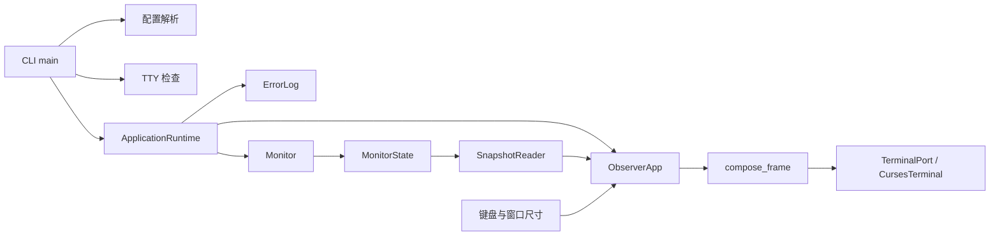
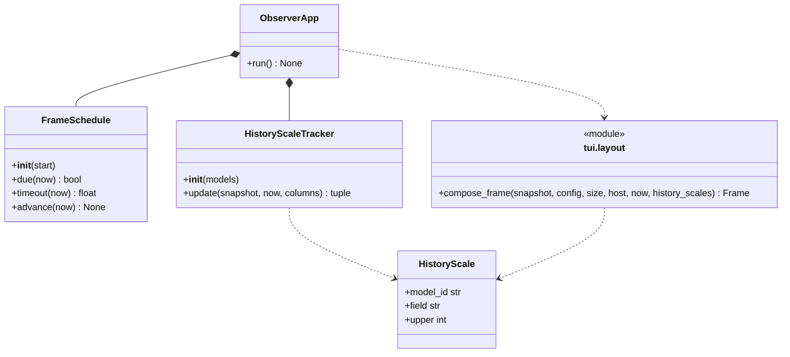

# Application Shell 模块设计

- 关联需求：dev-0 / REQ-001、REQ-005、REQ-006，需求说明 v1.24；AC-101～106、AC-110、AC-111、AC-113、AC-114、AC-501～504；共享布局约束关联 AC-202/203/207/301/304/605/607/608/613/614/616。
- 修订：v1.21，2026-11-05；集中维护启动、终端生命周期、整页几何、页眉与帧调度；模块内部呈现和配色规则改为引用所属设计，行为不变。
- 相关代码：`src/joi_observer/cli.py`、`__main__.py`、`tui/app.py`、`tui/layout.py`。
- 关联模块：[配置](configuration.md)、[错误日志](error-logging.md)；状态和调度共享 `data/models.py`、`data/state.py`、`monitor.py`。
- 当前阶段：REQ-006布局、Frame主题、帧时钟和历史尺度接线已由R4实现。输入/绘制公平性沿用AC-603/609/612与原始帧相位；本轮按用户反馈同步设备标签、发行版本与显示细节。R5-006-001/002返修及当前复验证据见[REQ-006 R4交接](../dev-workflow/dev-0/REQ-006/handoff-r4.md)及[R5交接](../dev-workflow/dev-0/REQ-006/handoff-r5.md)。

## 职责与边界

本模块负责命令参数、进入全屏前的检查、运行期资源组装、终端恢复、只读刷新和终端容量判定。REQ-001 的 v1.12 公共基础已实现并通过验收；REQ-002 硬件与 REQ-003 Docker 来源共用唯一的 MonitorState、Monitor 和 ErrorLog。REQ-004 提供 vLLM 采集，REQ-005 已完成模型导航，REQ-006 已实现完整主题及显示调度，均复用本模块的生命周期与容量约束；当前验收状态以对应交接单为准。

ApplicationRuntime 通过 build_hardware_sources、build_docker_collectors 和 build_vllm_collectors 组装三类来源，将全部采集器及其状态声明接入同一套状态与调度，并注册 GPU 发现器。docker_command_factory 与 vllm_http_factory 分别替换外部命令和 HTTP IO；全部配置容器和模型参与采集，不按可见行数裁剪。每个模型使用独立端口，空 models 不调用 HTTP 工厂；Monitor 负责关闭所有来源端口。构造与 prepare_log 不执行采集命令或 HTTP 请求；注入 RuntimeComponents 时直接使用已有组件，不创建额外来源。详见[本机硬件](hardware.md)、[Docker](docker.md)与[vLLM](vllm.md)。

组合根只配对状态声明与采集来源，不拆解或转换业务载荷。公共结果分型、spec 匹配和失败接收规则统一见[Monitor 与内存状态](monitor-state.md#collection-results)。

目标是 Ubuntu Server 24.04 amd64 / Python 3.12+。使用标准库 `asyncio` 协调任务、`curses` 管理终端。`curses` 只在生产后端 `enter()` 中延迟导入，使模块导入、配置加载及非终端离线测试不依赖终端初始化。必需验证在本地 Ubuntu 或 WSL Ubuntu 执行，Windows 工作区通过 WSL 运行测试，不要求维护原生 Windows 专用测试或执行 Windows 全量回归。源码无需安装 Windows curses 兼容包；真实终端验收在本地 Ubuntu 或 WSL Ubuntu 完成，不连接任何服务器。



## uv 安装与开发运行

安装与日常使用命令统一见 [README](../../README.md#安装与启动)。uv 是安装/开发工具，不加入应用的 Python 运行依赖；应用启动不修改 PATH 或 shell 配置。构建后端、依赖、命令入口和示例资源由 `pyproject.toml` 声明，项目开发锁文件与已安装工具环境分开管理。

AC-114 的本地安装验证使用预先准备好的 uv、Python 和离线依赖：安装工具并完成一次 PATH 配置，打开未激活虚拟环境的新 shell，在无项目 `config.yaml` 的其他目录验证 `joi-observer --version`、`--example-config` 的命令解析与资源可读性。有效配置进入/退出 TUI 的验证接入离线采集端口或禁用网络的本地测试环境，检查确实不依赖源码当前目录或 `VIRTUAL_ENV`。不能用 `uv run` 代替此工具安装验收，因为那不能证明裸命令可用。已有结果见 REQ-001 的 R4/R5 交接与历史证据；本次未重新安装，也不把旧布局通过结果计作新布局验证。这不构成服务器连接授权。

## 命令与启动序列

安装入口 `joi-observer` 与包内模块入口均调用 `cli.main()`。日常通过 uv 安装后的裸命令启动；开发时也可执行 `uv run python -m joi_observer`，不能假定任意系统 Python 都已安装此包。入口只返回整数退出码，由包装层调用 `SystemExit`；导入模块时不初始化终端、日志、驱动或网络。

| 参数 | 行为 |
| --- | --- |
| 无参数 | 按配置查找规则读取用户配置，通过检查后直接进入全屏 |
| `--config PATH` | 指定唯一配置，缺失或无效不回退 |
| `--help` | 打印参数说明并返回 0，不需要配置/TTY |
| `--version` | 打印包版本并返回 0，不需要配置/TTY |
| `--example-config` | 打印随包示例的绝对路径，供复制使用，不加载该示例启动采集 |

普通启动严格按以下顺序执行：参数解析 → 配置查找与完整验证 → 交互终端检查 → 组装运行期 → 日志预检查 → 全屏运行 → 资源清理。缺配置时必须同时显示需要准备的配置路径与示例文件位置；具体配置搜索顺序见配置模块。未知参数/配置错误不会创建日志文件或采集器。

`stdin`、`stdout` 都必须是 TTY，`TERM` 必须非空且不等于 `dumb`；管道/重定向输出返回 3，提示需要交互终端。首版不提供非交互监控输出、Web 页面或菜单模式。`stderr` 可重定向，但仍只接受全屏前的配置诊断或一次日志初始化提示。

`ErrorLog.prepare()` 失败只输出一次英文 `Error log unavailable; monitoring will continue.`，随后继续运行。该提示不是日志记录；运行中的日志写入问题由日志模块静默处理，不再次通知 UI 或控制台。

| 情形 | 退出码 | 控制台行为 |
| --- | --- | --- |
| q 正常退出 | 0 | 仅恢复终端，不补打采集错误 |
| 参数/配置错误 | 2 | 全屏前显示可定位错误；不记录 ERROR 日志 |
| 非交互终端 | 3 | 全屏前显示简短英文提示 |
| SIGINT / Ctrl+C | 130 | 完成清理，不显示采集诊断 |
| SIGTERM | 143 | 完成相同清理路径 |
| 内部程序错误 | 1 | 先恢复终端，再显示固定 `Observer stopped unexpectedly.`；不输出异常内容或堆栈 |

采集失败属于数据状态，必须由 Monitor 隔离；不能因单个 GPU、挂载点、容器或模型失败而走内部程序错误退出路径。

## 生命周期与异步协作

`ApplicationRuntime` 是唯一组合根。先构建初始只读快照，让 UI 可显示 `—`，再并发执行 `Monitor.run(stop_event)` 与 `ObserverApp.run()`。一个会话只创建一个 MonitorState、一个 Monitor 和一个 ErrorLog；界面不拥有采集器或写状态接口。

REQ-002接线：`build_hardware_sources(config)`无IO创建CPU/RAM/前三挂载与GPU发现器；静态spec纳入同一个State，静态来源交Monitor后调用`register_discovery`。由host/cpu、host/ram取代host/local占位；REQ-004也已接入全部vLLM模型，RuntimeComponents注入路径仍保留。GPU发现和首次采集只能由Monitor.run/poll发起，不在CLI预检查、构造或渲染时执行。

绘制接线：compose_frame沿用本模块全部Region和required_size，硬件内部内容委托`widgets.hardware_cells`替换旧通用占位；不增加区域或改行数。ObserverApp的gpu_slots仍只收集collector=gpu的UUID，gpu_inventory不计数；硬件控件根据ViewSelection计算关联色，不负责方向键导航。具体字段、挂载序号、STALE和颜色角色见[硬件设计](hardware.md)。

`RuntimeComponents` 允许注入真实 Monitor、ObserverApp 与日志端口的组合，注入时二者仍须共享同一个 MonitorState。这使联合黑盒测试能够使用真实调度和 UI 入口，仅替换外部采集源、终端与文件日志边界；不能把组合根编排替换为返回预定结果的 mock。

UI 首次绘制发生在读取第一个按键前。正常绘制以 **60 FPS** 为目标，间隔 `P=1/60s`；它是调度目标而非任意终端的实测保证。快照/按键变化在下一个普通绘制机会呈现，尺寸变化可在下一次读键前立即重绘。主机时间至少每秒更新一次，使用带时区的墙钟；采样与帧调度均用各自单调时钟，Monitor 保持配置采样周期，UI 不启动新采集。本期不增加帧率切换或配置项。

### 帧截止点与终端写入

- 以会话单调起点和 `n * P` 维护下一截止点，不能每次在绘制结束时间上再加P而累积漂移。首次与resize紧急绘制后也应推进截止点，避免紧接一次重复普通绘制。
- 读键等待为 `min(50ms, 下一截止点 - 当前时间)`，不能给只接受正超时的read_key传0或负数。读键前发现到期时，必须区分本轮是否已处理过显示机会：本轮尚未绘制，则保留到期deadline、不advance，主动让出事件循环后于下一轮绘制；单调时钟保证该deadline仍到期，不能因周期输入将它持续跳过。本轮已完成绘制，则可跳过随后调度操作跨过的逾期显示槽，沿原始相位advance，并以同一个read_now计算正超时、提供一次read_key机会。这个分支不能反复绘制/让出而绕过输入，也不能在未绘制时一律advance而绕过画面。
- 本轮已绘制标记每轮重置，只在本轮完整帧处理成功后成立；其语义是已服务一次显示机会，将来允许相同帧省略物理写入时也不能误当成未处理。未绘制到期分支保留deadline，因此至多连续经过一次该分支就进入绘制；已绘制跨点分支随后必须服务输入。单独sleep(0)不等于已读取终端按键，完成读键后仍须主动让出事件循环，使立即就绪的输入端口也不饿死采样。连续按键不突破普通帧上限，连续慢帧保持q、导航和主题响应；不使用固定50ms等待替代截止点预算。
- 一次绘制过慢时跳到当前时间之后的首个未来截止点，只取最新快照；不补画漏掉的帧、不排队积压。每个生成的Frame仍只读一次selection，按键不直接修改快照、历史或GPU顺序。
- 同尺寸且cells/theme完全相同的帧可以跳过实际终端输出；变化时由curses差异输出更新。不要把当前erase虚拟窗口误解为每次物理清屏；减少无效输出应基于整帧比较/脏区域，并正确清理旧长文本、消失柱子与旧主题背景。
- 本轮不要求重写为多窗口后端或引入终端同步输出协议。保持一次完整帧提交及原有终端恢复；配色/background更新仍遵守[主题设计](theme.md)。提高显示刷新频率不会增加采样次数，历史柱只在真实数据、时间桶、尺度或尺寸变化时改变。

当前60Hz修订须用可控单调时钟检查60Hz节拍、连续输入、超预算跳帧及采样次数，并在本地WSL PTY记录绘制耗时/帧间隔和退出响应；当前结果见R4交接；R2/R3/R4/R5历史30Hz结果保留原时点事实，不作为60Hz已验证的依据。PTY吞吐不能代替具体终端窗口实际可见FPS，不保证未测试终端稳定60帧。AC-603/609/612由`tests/test_frame_timing.py`、`tests/test_frame_timing_edges.py`、`test_navigation_app.py`等覆盖；R5的慢绘制截止点跨越和周期输入相邻相位用例共同覆盖两个方向的公平性，必须同时保留并实际记录返修回归，不能仅由其中一方向通过推定另一方向正确。

### 帧时钟和尺度接线

`timing.py`已实现常量`FRAME_RATE=60`、`FRAME_INTERVAL=1/60`和`FrameSchedule(start)`。`due(now)`只读判断到期；`timeout(now)`返回0..50ms的剩余等待；`advance(completion_now)`跳到严格晚于完成时刻的首个原始节拍。同一完成时刻重复advance不额外跳槽，查询不改变状态。起点/时刻拒绝bool、非有限值、负值和早于起点的值；advance另拒绝时间回退，异常不能改变原进度。构造只保存起点和进度，不访问外部时钟；ObserverApp已使用此帧时钟替换原last_draw逻辑。

应用实例拥有一个`HistoryScaleTracker(config.models)`；每个生成帧从reader取一次快照、actions取一次selection，并用同一单调now推进全部模型尺度。冻结尺度元组显式传给`compose_frame(..., history_scales=scales, monotonic_now=now)`，再由布局传给`vllm_cells`。小窗口使用最近正常图区宽度，尚未有正常帧时使用最小正常布局的图区宽度；不能为小窗口销毁尺度。主题/模型/resize/同实例再次run保持会话，新的应用实例独立。帧时钟每次run重新以本次起点调度，不补画上次run期间的帧。



图示为当前已实现的所有权及传递关系：应用拥有尺度控制器，并显式传递冻结尺度。纯布局不能通过模块全局状态保存迟降计时。默认接线的黑盒为`tests/test_history_app.py`：未选中模型继续迟降、主题/resize/小窗口保持、同实例重入与新实例隔离，输入仅替换外部时钟与只读样本。

q 使 UI 正常返回，组合根通知/停止 Monitor；UI 内部异常同样停止 Monitor。Monitor 的非采集类内部异常取消 UI，让 UI 的 `finally` 恢复终端。终端 `enter()` 也位于该 `try/finally` 内，覆盖部分初始化失败；`restore()` 幂等且必须尝试恢复光标、输入回显和原终端显示。协程取消、可捕获的 SIGINT/SIGTERM 使用同一路径。SIGKILL、断电和终端设备本身失效无法保证恢复。

总体清理预算不超过 1 秒，`run()` 与 `close()` 共享预算；采集端口必须合作取消，底层同步操作必须有超时，不能等待无限阻塞线程退出。日志关闭不向 stdout/stderr 输出积压记录，也不要求补写停机时尚未落盘的事件。清理中的异常不能掩盖原异常。

`ObserverApp` 在 `actions is None` 时创建默认 `SessionViewActions(config.models)`，显式注入原样保留；每帧只读取一次选择并用于整帧。全局退出由应用处理，其他键分派给会话控制器。按键、选择生命周期及服务页脚统一见[模型导航](navigation.md)。

布局从 `services.VLLM_SERVICE` 取得一次描述，同时用于当前服务标题、入口及 `footer_text(service)`，避免分别拼装不同服务的文案。服务描述和页脚接口契约见[导航设计](navigation.md#服务入口与键位呈现)。

## 可验证的字符容量

下列数字均是终端字符列/行，未套用 HTML 像素尺寸。最低列数为 **120**。以总可绘制高度 H 直接平分，页眉、切换位、键位、边框和间距都包含在各自半页预算内：

```text
lower_rows = H // 2
upper_rows = H - lower_rows
hardware_rows = upper_rows - 2
minimum_rows = max(36, 2 * (2 + max(3 * max(gpu_count, 1) + 2, 16)) - 1)
docker_capacity = max(0, upper_rows - 18)
```

上半区包含2行页眉；硬件最低高度取GPU与右侧面板所需高度的较大值。GPU每卡仍3行、面板边框另2行；右侧最低16行现在由Host Resources 6行、Storage 6行、间距1行、Docker外壳3行组成。Host增加的第4内容行使用原Host/Storage之间的1行留白，两面板相邻而不额外占行。Docker 允许零内容行，不因需要显示某个容器而增加最小高度。下半区最低 18 行，由服务窗口至少 16 行、独立服务切换位 1 行、键位 1 行组成。页高为奇数时，多出的 1 行留给上半区。

| GPU 槽数 | 最小尺寸（与挂载点/容器数量无关） |
| --- | --- |
| 0～4 | 120×36 |
| 5（主要场景） | 120×37 |
| 6 | 120×43 |
| 10 | 120×67 |

保留 `required_size(gpu_count, mount_count, container_count)` 的关键字参数签名，三个计数都必须是非负整数，bool 和小数非法；后两项仅校验输入，不参与高度计算。容器不设固定数量上限；挂载点第 4 项起不增加尺寸，由配置层忽略采集且展示层不绘制。

正常 Frame 固定返回以下 **8 个命名区域**；`Region` 描述矩形，可有或无边框。宽度分配沿用 GPU 左、主机右和服务全宽的结构。

| Region.name | 起始行 | 高度 | 说明 |
| --- | --- | --- | --- |
| `header` | 0 | 2 | 品牌、主题、主机和当前时间 |
| `gpu` | 2 | upper_rows − 2 | GPU 所有已知槽位，上半区内 |
| `host` | 2 | 6 | Host Resources四行内容：CPU标签/数值、CPU条、RAM标签/容量、RAM条；无额外下间距 |
| `storage` | 8 | 6 | 内容固定在第 10～12 行；第 14 行为右侧间距 |
| `docker` | 15 | upper_rows − 15 | 内容从第 17 行起，到 upper_rows − 2；最后一行为边框 |
| `service` | upper_rows | lower_rows − 2 | 服务窗口标题、边框、模型、指标、历史和内部留白 |
| `service_switch` | H − 2 | 1 | 独立的 vLLM / WebUI 切换位，WebUI 禁用 |
| `footer` | H − 1 | 1 | 键位提示 |

### HTML 对齐的字符适配

页眉保持两行，不增加预算外留白。row0 左侧为 `Joi::Observer`，右侧显示当前 `Theme: {name} [t]`，按实际文本宽度使两种主题名称的右端都等于全页列数 C。Theme 为不可点击的状态说明；配色由[主题角色表](theme.md#color-roles)定义，交互见[导航](navigation.md)。

row1沿用HostInfo.hostname字段承载固定设备标签H3C R5300 G6，紧随` / `及HostInfo.system发行版本。组合根`_local_host_info()`只在启动装配时读取本地os-release：按`/etc/os-release`、`/usr/lib/os-release`顺序尝试，打开或读取发生OSError时尝试下一候选；首个读取成功的文件一次解析，缺字段或空文件不与低优先级文件合并。只使用文件实际提供的字段，优先非空PRETTY_NAME，缺失或空值时组合NAME与VERSION_ID，名称/版本缺失或空值分别用Ubuntu/—。显式提供的字面值Linux是有效名称，不能当成库默认值丢弃；空文件、全部候选读取失败或所选文件UTF-8解码失败显示Ubuntu —。解析沿用标准库已核对的字段赋值、引号及五类转义规则，不执行shell、不使用标准库注入的Linux默认字段或全局缓存，不新增依赖。该读取不使用platform.release内核版本、不读取DMI、不发起网络探测；布局自身仍为纯函数，显式HostInfo注入接口保持。合计左区最多`C-19-2`列，按终端显示宽度裁切；右侧19列固定为传入本机aware墙钟的`YYYY-MM-DD HH:MM:SS`，右端同为C，中间至少空两格。不把时间转换成UTC，不追加设计稿模拟的CST，不使用采样时间。控制字符和双向控制符先净化，宽字符/组合字符不得穿越时钟保护区。

面板标题复用上边框行，保持既有内缩，不增加布局高度。正式标题与颜色角色、HTML 边框/表面的采用范围统一见[主题设计](theme.md#color-roles)。

水平分区按Neon Grid参考稿接近3:2：`gpu_width=floor((columns−1)*3/5)`；GPU从0列起，空1列，Host/Storage/Docker共用右侧余宽。120列时GPU外宽71，右侧起点72/外宽48；140列时分别83与84/56。横向调整不改变上面的高度公式、GPU槽数规则或Docker容量。

硬件面板内部坐标、数值精度及状态位置统一见[硬件显示设计](hardware.md#硬件显示与模型关联)；硬件条字形及配色统一见[主题设计](theme.md#hardware-bars)。

服务区外矩形由上方 Region 表分配。模型列表、详情行列、留白、分隔与图高只在[vLLM 固定槽位](vllm.md#vllm-layout)维护；compose_frame 和 vllm_cells 共用该契约。

固定半页和最低终端尺寸优先；统一字体/字符边框替代浏览器字号及像素边框，不以多行ASCII大数字消耗历史高度。逐模型状态、GPU状态位、真实单位与未知值的保留是可靠监控需要的适配；不为模仿HTML而移除这些字段或复制模拟参数。不能以“终端适配”为由继续保留可以实现但未同步的数值左排、三列负载或两列同行指标。

两半之间不另加预算外行。H=44/48/42 时 Docker 内容容量分别为 4/6/3 行；H=36 且 GPU 槽数不超过 4 时容量为 0。H=37 的主要 5 GPU 场景中，Docker 可见 1 行，下半区仍有完整 18 行；最小尺寸并不承诺显示所有容器。

GPU 槽位身份与生命周期见[硬件发现设计](hardware.md#gpu-发现调度与资源生命周期)。本模块按已知槽位数量计算容量；无已知 GPU 时按一个空态槽分配，首次发现后重新计算最低尺寸。

Storage 的内容容量由 Region 表固定。0 项显示空态，未占用的内容行留白；窗口增高、失败/恢复或容器数量变化不改变其高度。采集对象的取用与校验见[配置设计](configuration.md#configuration-fields)，内容状态见[硬件显示设计](hardware.md#硬件显示与模型关联)。

Docker 填充右侧剩余高度，只显示配置前 `docker_capacity` 项；全部容器仍保留、仍采集、仍按对象记录实际采集错误，隐藏本身不是错误。面板内容少时允许留白，不缩短面板，不把余高让给 Storage。容量大于 0 且配置为空时显示空态；容量为 0 时不画条目或空态文字，避免占用边框。隐藏项无提示、无省略号/更多标记、无隐藏数量、无滚动分页；窗口变大重新显示时读取同一最新快照。失败项保持原位置，后续项不能补位。

Docker 条目内部名称、状态槽及失败替换规则统一见[Docker 行布局](docker.md#docker-row)。

模型总数不增加页面最小高度；模型列表的可见窗口由[vLLM 固定槽位](vllm.md#vllm-layout)和[导航](navigation.md)协调。所有内容必须限制在自己的区域内，不能仅依赖整屏裁切，否则 Docker 末尾项会覆盖下半区。

仅低于基础尺寸时显示 `Enlarge terminal to at least 120x37`（数字随 GPU 容量）和 `q Quit`；Docker 溢出不触发该提示，也不触发局部提示。极小终端只裁切提示，q 仍可退出；恢复尺寸后立即重绘。Monitor 不因缩放、隐藏、主题或模型选择改变采集节奏。长名称按终端显示宽度截断而不换行；颜色和模型面板分别遵循[主题](theme.md)与[vLLM](vllm.md#vllm-view)设计。

## 只读呈现与诊断隔离

`compose_frame()` 生成不可变 Frame，包含 TextCell 和 Region；不附带异常类型、原因或堆栈。布局只读取 StateSnapshot 的指标、stale 和对象身份，不渲染内部 sampled_at/history 时间。墙钟只用于顶部当前时间。

`TextCell` 的角色、字体标记和终端绘制机制统一见[主题设计](theme.md#font-rendering)；vLLM 数字强调的选择范围见[vLLM 指标与状态](vllm.md#vllm-values)。布局只传递呈现属性，不在正文中插入 ANSI 转义。

失败、恢复和模型类型切换均不改变区域矩形；具体状态槽分别见[硬件](hardware.md#硬件显示与模型关联)、[Docker](docker.md#docker-row)和[vLLM](vllm.md#vllm-values)。通用 `format_metric()` 规定：真实 0 是 0；未知/无观测是 `—`；不适用是 `N/A`。界面不重新计算吞吐、延迟或 Total。全屏禁止错误弹窗、诊断列表、最后成功时间、堆栈及设计稿的模拟标记。

## 接口与验证依据

| 接口 | 公开行为测试 | 验收 |
| --- | --- | --- |
| `main` / `CliDependencies` | `tests/test_cli.py`：直接启动、缺配置、显式路径、非法配置、重新读取配置、非TTY、帮助、日志初始化失败、退出清理 | AC-104/105/110/111/113 |
| `required_size` | `tests/test_tui.py`：GPU容量、非负整数边界、容器不限量且不增高、挂载点尾项不增高 | AC-106 |
| `compose_frame` / `format_metric` | 标题/值槽/STALE、偶数及奇数半页、8区边界、Storage固定及无补位、Docker 4→6→3行/零行/空态/无溢出提示、失败恢复稳定 | AC-101/106/110/207/304/607/608 |
| HTML外壳 / `compose_frame` | `tests/test_html_shell_layout.py`：两主题/多宽右边缘、主机与非UTC时钟分色、Unicode/ANSI保护、完整面板标题角色、7种Docker生命周期/未知/STALE固定槽、容量0与空配置 | REQ-006排版与颜色契约 |
| `ObserverApp.run` / `TerminalPort` | 初次绘制、q、部分进入异常、绘制异常、Ctrl+C、小窗口退出、缩放恢复、键位只分派展示操作 | AC-103/104/106 |
| `SessionViewActions` / 默认 `ObserverApp` | `tests/test_navigation.py`、`tests/test_navigation_app.py`、`tests/test_navigation_pty.py`：真实控制器、默认接线、只读采样隔离、失败/缩放保持、真实方向键、页脚与禁用入口 | AC-501～504 |
| `ServicePresentation` / `footer_text` / `compose_frame` | `tests/test_service_footer.py`：服务描述冻结、同描述驱动标题/当前入口/导航提示、其余全局文字不变 | AC-504及用户补充 |
| `ApplicationRuntime` / `RuntimeComponents` | `tests/test_tui.py`联合真实Monitor/State/UI：慢采集仍绘制和q退出、键盘异常使采集取消/关闭、终端恢复先于日志关闭；采样时序另见调度测试 | AC-102/103/104 |
| uv 工具安装与命令入口 | 新 shell、未激活环境、不同工作目录、命令/示例资源定位及离线 TUI 启停；已有 R4/R5 历史证据，布局边界变更后须重新验证 | AC-114 |

离线命令：`python -m pytest tests/test_cli.py tests/test_tui.py tests/test_shell_edges.py`。配置解析与屏幕生成没有被替换；运行期/终端替身只隔离操作系统、驱动和终端。REQ-001～005已合并的采集/退出等非呈现行为继续回归；REQ-006当前实现与验证记录在R4/R5交接，R2记录只保留当时的未实现基线。REQ-002最初骨架/未接线记录同样保留为历史，不使用skip/xfail掩盖当前差异。

现有PTY输入、终端恢复、最低尺寸、边界与缩放测试继续保留，涵盖奇偶半页、Storage/Docker区域和可见条目；返修后按影响范围重跑。当前整体观感已由用户在R5确认，GUI-006-001关闭，详见R5交接。历史`verify_pty.py` / `verify_uv_install.py`中以5容器抬高到120×38的版本不再适用：无GPU最低120×36，5GPU最低120×37；这些旧JSON不改写为新通过，新证据须注明当前需求及源码版本。`tests/test_terminal_pty.py`的Esc/方向键时限测试只针对终端适配器，不因布局改写。上述验证不授权连接服务器。

## 修订说明

v1.15按用户反馈同步静态设备标签、本地os-release发行版本及回退、斜线分隔、Storage路径正文色和主题切换整帧重绘；不自动更改TERM或扩大采集范围。

以下v1.1～v1.5记录保留各次设计时点的范围和实施状态；其中“待R4”等文字不代表当前实现状态。当前状态以本文顶部及REQ-006交接为准。

v1.1 按用户要求将安装/开发工具明确为 uv：正式使用 `uv tool install`，项目开发使用 `uv run`，新增 AC-114 的本地安装验证场景。CLI 接口、配置查找和既有黑盒用例不变；本次只修改文档，未重新运行业务测试或执行安装。

v1.2 依据需求 v1.12 废止固定 16 行服务区和按容器数增高的旧公式，定义全页上下各半、独立服务切换行、Storage 固定 3 内容行与 Docker 仅显示可容纳前缀。接口签名保留，Frame 增加 `service_switch` 区域。同步目标注释及黑盒断言，保留 R4/R5 既有执行代码与历史证据，供 R4 实现新契约。

v1.3 衔接REQ-002：保留已实现的v1.12几何与运行期，明确硬件来源/发现器、共享State、纯控件和序号身份接线；新增入口仍待R4实现，R2不修改既有执行流程。

v1.4 同步公共 CollectionResult 与两个具体结果子类，硬件/Docker/普通 State 只迁移类型，保持已有行为。vLLM 采集、accumulator、State 专支及下述组合/呈现接线继续留待 R4，不能将类型迁移或接口声明视为业务实现。

v1.5 衔接 REQ-005：新增默认会话控制器契约、精确键位文字和当前服务角色；保留已实现的终端输入、半页布局和监控运行逻辑。REQ-004 的以下接线已随 `83aad39` 合并，先前版本的“待实现”描述是设计阶段历史状态。

## REQ-004 vLLM 接线契约（已合并）

来源组装与端口所有权见本文“职责与边界”；结果接收统一遵循[状态设计](monitor-state.md#collection-results)。`compose_frame` 的可选 `monotonic_now` 用于离线历史时钟，生产缺省取 `time.monotonic()`；datetime 参数仅负责页眉时间，二者不可混用。在 service Region 内调用纯 `vllm_cells`，服务内部契约见[vLLM](vllm.md#vllm-view)。集成与首帧验证使用离线 HTTP 端口。

## REQ-006 配色衔接

`compose_frame` 在正常和小窗口两条路径都把同一次 selection 的主题传入 Frame；终端后端消费该元数据。字段兼容、硬件条、能力降级、字体、刷新和颜色恢复均以[主题设计](theme.md)为唯一详细定义。帧调度由本模块负责，配色切换不触发采集或重建运行期。
