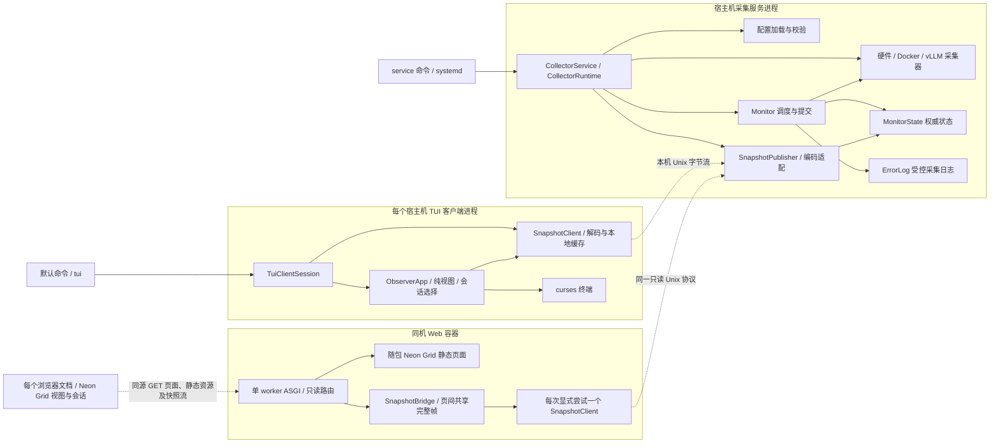

# Joi Observer 整体设计

本设计覆盖 dev-1 的宿主机采集、TUI、同机 Web 容器与内网浏览器。v1.7（2026-11-19）明确 Web 停机与 IPC 客户端的交接，以及容器升级后确认可用版本的时机。业务范围见[需求说明 v1.5](../dev-workflow/dev-1/requirements.md)。宿主机实现已通过 [REQ-001 R5 验收](../dev-workflow/dev-1/REQ-001/handoff-r5.md)，Web 实现以 [REQ-002 R2 交接](../dev-workflow/dev-1/REQ-002/handoff-r2.md)为设计起点。

## 组件图

图中实线表示同一进程内的组件调用或依赖，虚线表示跨进程协议依赖。每条连接消费不可变值，不跨进程共享 Python 对象。框表示部署/生命周期边界，不表示线程。

## 组件职责与模块索引

| 组件 | 所有权与关键边界 | 模块设计 |
| --- | --- | --- |
| 命令入口及应用外壳 | 分派服务与客户端；帮助不构造运行期；恢复终端后输出诊断 | [应用外壳](application-shell.md) |
| 启动配置 | 仅服务启动时加载一次，变更须重启；客户端不读取监控配置 | [配置](configuration.md) |
| 服务与运行期 | 独占实例锁、全部采集资源、权威状态和发布生命周期；不依赖 TUI 存活 | [常驻采集服务](collector-service.md) |
| 硬件、Docker、vLLM 来源 | 只由服务调用；沿用原身份、单位、数值和失败规则 | [硬件](hardware.md)、[Docker](docker.md)、[vLLM](vllm.md) |
| Monitor / State | 唯一业务统计与写入者；内存中维护最新值及约 60 秒历史；更新通知不做传输 | [状态](monitor-state.md) |
| ErrorLog | 独立处理来源失败分类、限频与轮转；正常指标不持久化 | [错误日志](error-logging.md) |
| IPC 与编解码 | 白名单快照及配套元数据；完整帧分批读写、验证后原子安装；无业务写接口 | [本机协议](ipc.md) |
| TUI 会话 | 连接一次、缓存无 I/O 读取；独立主题、选择和尺度；q 只结束本会话 | [TUI 客户端](tui-client.md)、[导航](navigation.md)、[主题](theme.md) |
| Web 应用与快照桥 | 一条宿主订阅服务同时打开的页面，每次 HTTP 数据流只属于一次宿主连接尝试 | [Web 数据通道](web.md) |
| 浏览器 | 每个文档保存自己的显示状态、主题及模型选择，收齐全帧后绘制 Neon Grid | [页面设计](web-dashboard.md) |
| Web 容器 | 独立管理 Web 进程、静态资源及内网端口，以读者组身份访问专用 IPC 目录 | [同机部署](web-deployment.md) |

## 设计说明

服务统一持有有效配置、采集器、Monitor、MonitorState 和 ErrorLog。客户端数量、模型选择、主题和窗口尺寸都不进入采样调度输入。采样间隔由配置限制为 1～60 秒，默认 1 秒；超时字段独立。Monitor/State 的数学及离线短周期测试保留，不因进程拆分而复制到客户端。

服务先取得实例锁并校验配置，完成监听绑定后再启动调度。State 更新经常量时间通知唤醒发布，同轮更新合并，空闲时一秒完整心跳；首次订阅只消费仍有效的最近已发布快照，过期缓存等待下一次正常发布。完整快照带服务实例身份和同一生效配置的展示元数据，客户端完整验证后替换本地不可变缓存。详细时序归属服务、IPC 和 TUI 模块文档，本页不重复帧字段及模块算法。

正常指标和历史只在内存中。历史继续约 60 秒；保留原来的零、未知、N/A、局部 STALE、失败缺口及身份规则。IPC 不发送配置原文、URL、Docker 真实查询目标、日志路径或原始异常；显示名称和 GPU 关联由服务投影，TUI/Web 不重建监控配置。

运行中的发布/客户端故障不能停止 Monitor；局部来源失败不等于服务连接失败。客户端首次连接失败或运行中失联后停止尝试，TUI 恢复终端并退出，Web 等待用户刷新。发布器内部致命故障不自动重建，服务维持采集并报告固定诊断，由管理员显式重启恢复访问。启动失败与运行中故障的资源回收分别见服务模块。

每个传输方向的工作缓冲和待发数量有界，完整快照大小随实际对象和最近 60 秒历史变化。Web 复用已有 IPC 契约，以日常配置验证整帧传输、超时与回收。

Web 进程在宿主采集服务不可用时也能提供页面。每次启动装载同版 HTML、CSS 和 JS。页面资源就绪后，对同源 `/api/live` 发起一次流式 GET。Web 桥取得 IPC 客户端已验证的信封与对应正文，将单行 JSON 加换行后供各页共享。新的发布序号可以更新画面，发布时间前进才延长等待期限。响应头已发、正文尚未写时，可以在原期限内改用同一连接的新鲜首行。慢页先写完整条在途记录，再取最新帧。最后一页离开或 IPC 失效时，桥释放这次连接的资源。

浏览器用成功数据响应的时间参考识别积压并显示估计 UTC，各来源的 STALE 由宿主给出。已显示数据的健康标签页从后台恢复时，若脚本暂停超过原期限，先收起旧仪表，在有限时间内由原读取器接收新鲜发布。已确认失联或离开时已关闭的数据流只能由新文档重新打开。历史图以最近可信帧校准本地时钟，以已显示的右缘作下限，按秒步进，必要时停步等宿主追平。连续有效样本平滑过渡，失败处保留缺口。详见[数据通道](web.md)和[页面设计](web-dashboard.md)。

Web 停机时撤销订阅、等自己的任务结束，并等待 IPC 客户端的有界关闭返回。底层传输的收尾由客户端负责。

Web 从选定发行版的公开文件和锁定依赖构建。固定部署目录保存现场参数及已验证版本的部署配置。候选镜像启动并通过成品核对后才成为现行版，发布失败时可按上一版配置和镜像恢复。Compose 的有效配置决定发布端口、读者组及专用 IPC 目录的只读挂载。Web 进程没有监控配置、Docker socket 或 GPU 设备，内网访问边界由部署者设置。

## 接口与验证依据

宿主边界由 `tests/test_service_contract.py`、`test_ipc_protocol.py`、`test_ipc_client.py`、`test_client_session.py` 和 `test_client_cli_contract.py` 覆盖。`test_snapshot_pipeline.py` 复用原始离线样本贯通真实采集、State、协议、客户端和 TUI。Web 侧以同一协议验证 ASGI 路由、并发订阅、页面和容器声明。两阶段的运行记录分别见 [REQ-001 验收](../dev-workflow/dev-1/REQ-001/handoff-r5.md)和 [REQ-002 设计交接](../dev-workflow/dev-1/REQ-002/handoff-r2.md)。

既有配置安全、采集解析、数值、单位、状态、日志、布局、主题、导航、历史和终端断言继续保留；只迁移接口装配及已确认变化的预期，见 [测试迁移记录](../dev-workflow/dev-1/REQ-001/test-migration.md)。所有测试禁止本地或远程服务器连接，以原始来源和传输端口替身隔离环境，不替换被测业务结果。当前骨架失败不表示测试成功，也不妨碍 R2 记录明确的未实现基线。
