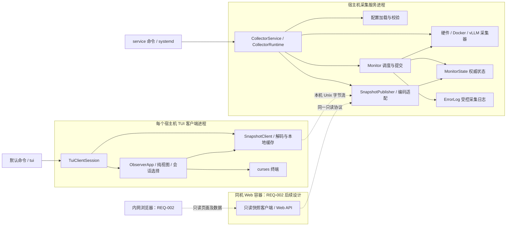

# Joi Observer 整体设计

- 关联需求：dev-1 [REQ-001](../dev-workflow/dev-1/requirements.md#req-001-宿主机常驻采集服务与-tui-客户端)，需求说明 v1.3；为后续 REQ-002 保留共享数据边界。
- 修订：v1.2，2026-11-16；恢复组件图后的组件职责与模块索引，类与对象简介仅放在模块文档中。
- 设计范围：本文维护已确认的组件契约，REQ-001 当前实现与验证进展见 [R4 交接](../dev-workflow/dev-1/REQ-001/handoff-r4.md)；Web 页面/容器属于后续 REQ-002，图中只列约定依赖。

## 组件图

图中实线表示同一进程内的组件调用或依赖，虚线表示跨进程协议依赖。每条连接消费不可变值，不跨进程共享 Python 对象。框表示部署/生命周期边界，不表示线程。

## 组件职责与模块索引

| 组件 | 所有权与关键边界 | 模块设计 |
| --- | --- | --- |
| 命令入口及应用外壳 | 分派服务与客户端；帮助不构造运行期；恢复终端后输出诊断 | [应用外壳](application-shell.md) |
| 启动配置 | 仅服务启动时加载一次，变更须重启；客户端不读取监控配置 | [配置](configuration.md) |
| 服务与运行期 | 独占实例锁、全部采集资源、权威状态和发布生命周期；不依赖 TUI 存活 | [常驻采集服务](collector-service.md) |
| 硬件、Docker、vLLM 来源 | 只由服务调用；沿用原身份、单位、数值和失败规则 | [硬件](hardware.md)、[Docker](docker.md)、[vLLM](vllm.md) |
| Monitor / State | 唯一业务统计与写入者；内存中维护最新值及约 60 秒历史；更新通知不做传输 | [状态](monitor-state.md) |
| ErrorLog | 独立处理来源失败分类、限频与轮转；正常指标不持久化 | [错误日志](error-logging.md) |
| IPC 与编解码 | 白名单快照及配套元数据；完整帧分批读写、验证后原子安装；无业务写接口 | [本机协议](ipc.md) |
| TUI 会话 | 连接一次、缓存无 I/O 读取；独立主题、选择和尺度；q 只结束本会话 | [TUI 客户端](tui-client.md)、[导航](navigation.md)、[主题](theme.md) |
| Web 与浏览器 | 后续只读消费者，不获得采集权限；刷新恢复和会话故障锁存待 REQ-002 细化 | [Web 共享边界](web.md) |

## 设计说明

服务统一持有有效配置、采集器、Monitor、MonitorState 和 ErrorLog。客户端数量、模型选择、主题和窗口尺寸都不进入采样调度输入。采样间隔由配置限制为 1～60 秒，默认 1 秒；超时字段独立。Monitor/State 的数学及离线短周期测试保留，不因进程拆分而复制到客户端。

服务先取得实例锁并校验配置，完成监听绑定后再启动调度。State 更新经常量时间通知唤醒发布，同轮更新合并，空闲时一秒完整心跳；首次订阅只消费仍有效的最近已发布快照，过期缓存等待下一次正常发布。完整快照带服务实例身份和同一生效配置的展示元数据，客户端完整验证后替换本地不可变缓存。详细时序归属服务、IPC 和 TUI 模块文档，本页不重复帧字段及模块算法。

正常指标和历史只在内存中。历史继续约 60 秒；保留原来的零、未知、N/A、局部 STALE、失败缺口及身份规则。IPC 不发送配置原文、URL、Docker 真实查询目标、日志路径或原始异常；显示名称和 GPU 关联由服务投影，TUI/Web 不重建监控配置。

运行中的发布/客户端故障不能停止 Monitor；局部来源失败不等于服务连接失败。客户端首次连接失败或运行中失联后停止尝试，TUI 恢复终端并退出，Web 等待用户刷新。发布器内部致命故障不自动重建，服务维持采集并报告固定诊断，由管理员显式重启恢复访问。启动失败与运行中故障的资源回收分别见服务模块。

每个传输方向使用有界工作缓冲和有界待发数量，完整快照不设任意 8 MiB 业务上限。总快照内存随实际对象及历史增长，取消和编解码工作也有生命周期约束；这不是无限容量承诺。大快照 CPU、内存、响应性和实际吞吐需 R4 以离线容量及本地终端验证确认。

Web 仅是内网只读消费者，不实现登录、网络策略或远程管理。后续容器只能取得专用 Unix 数据通道权限，不能挂载 Docker socket、GPU、配置目录或宿主根目录；浏览器不直接访问采集服务或被监控对象。REQ-001 不提前声明页面、容器和浏览器 API 已实现。

## 接口与验证依据

整体边界由 `tests/test_service_contract.py`、`test_ipc_protocol.py`、`test_ipc_client.py`、`test_client_session.py` 和 `test_client_cli_contract.py` 覆盖；`test_snapshot_pipeline.py` 复用原始离线样本贯通真实采集、State、协议、客户端和 TUI。详细验收映射、失败基线与 [R2 交接](../dev-workflow/dev-1/REQ-001/handoff-r2.md) 一起维护。

既有配置安全、采集解析、数值、单位、状态、日志、布局、主题、导航、历史和终端断言继续保留；只迁移接口装配及已确认变化的预期，见 [测试迁移记录](../dev-workflow/dev-1/REQ-001/test-migration.md)。所有测试禁止本地或远程服务器连接，以原始来源和传输端口替身隔离环境，不替换被测业务结果。当前骨架失败不表示测试成功，也不妨碍 R2 记录明确的未实现基线。
