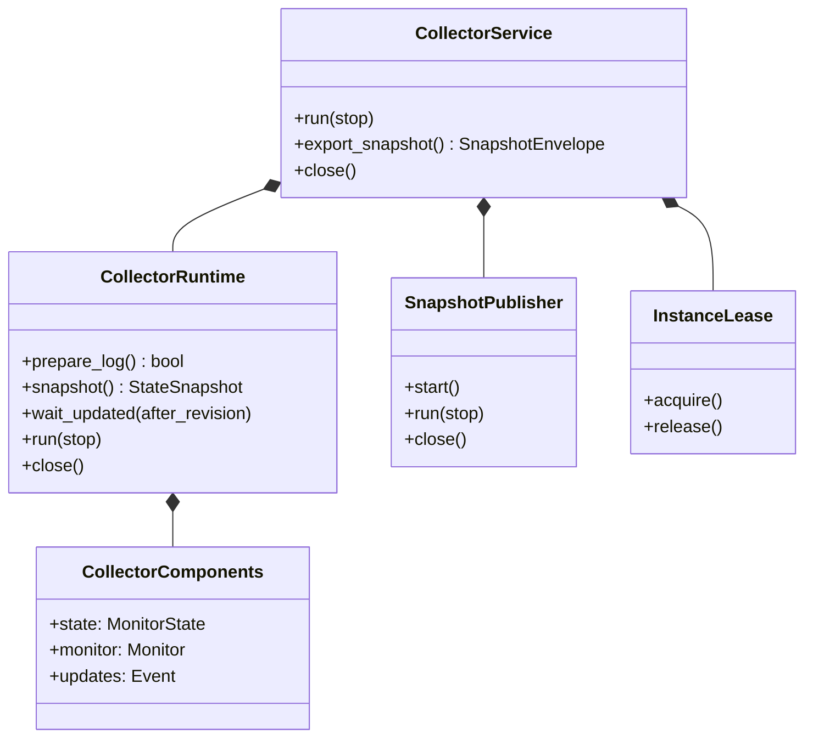
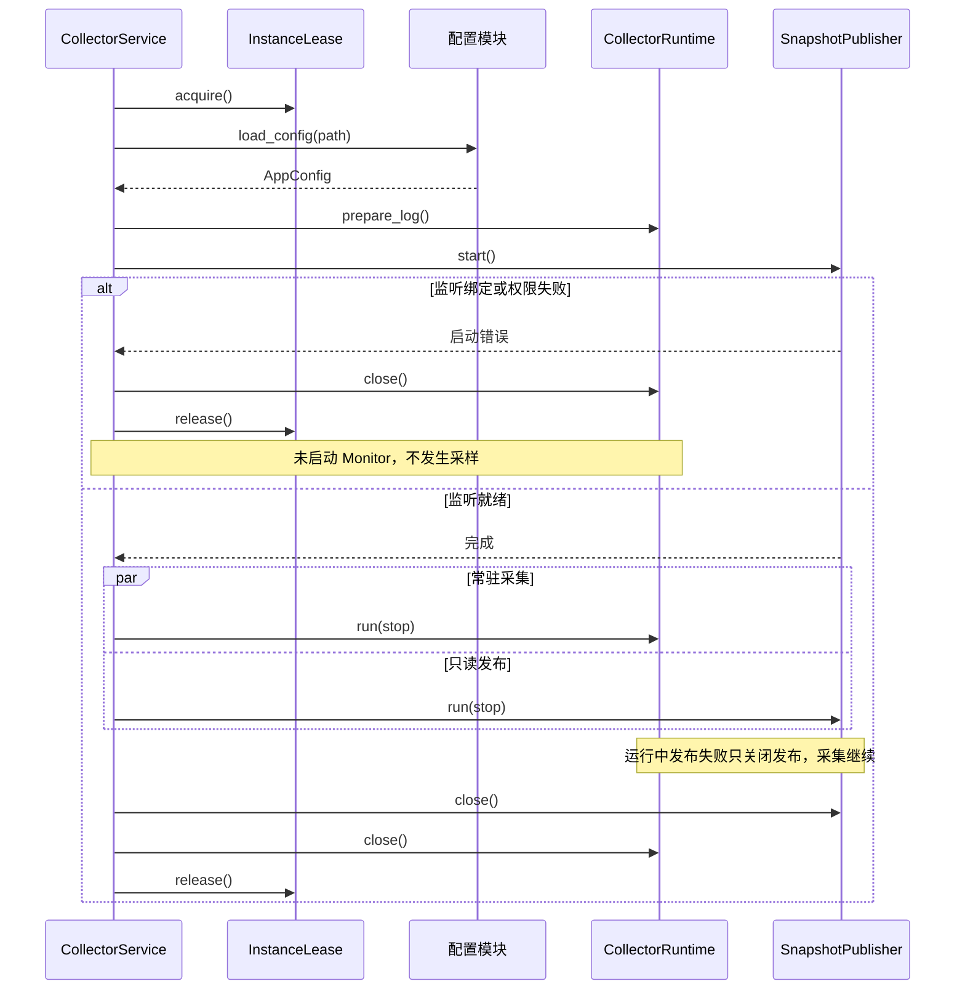

# 常驻采集服务与运行期设计

- 关联需求：dev-1 / REQ-001，需求说明 v1.3，AC-101～104、AC-107～113；向 REQ-002 提供共享数据能力。
- 修订：v1.3，2026-11-16；在图前集中介绍核心类及对象别名，保留既有服务生命周期与发布契约。
- 整体设计：[整体组件与进程边界](architecture.md)。
- 相关代码：`src/joi_observer/runtime.py`、`service.py`、`ipc/server.py`、`deploy/systemd/joi-observer.service`。
- 关联模块：[IPC](ipc.md)、[应用外壳](application-shell.md)、[配置](configuration.md)、[状态](monitor-state.md)、[错误日志](error-logging.md)。

## 职责与范围

采集装配复用原运行期的硬件、Docker、vLLM 工厂及清理契约，不构造 ObserverApp、不接收主题或模型选择，也不检查 TTY；默认持续采样，零客户端时不暂停。

发布侧只读取已有快照并发送字节，不能持有 Collector 的采集或控制端口；后续 Web 容器只挂载专用 IPC 目录，不取得宿主采集权限。

## 类与对象简介

| 图中名称 | 简介 |
| --- | --- |
| `CollectorService`（`Service`） | 常驻服务生命周期类，协调启动配置、实例锁、采集运行期与只读发布器的启停。 |
| `CollectorRuntime`（`Runtime`） | 采集组合根类，独占采集器、调度器、权威状态和日志，并提供快照及更新通知。 |
| `CollectorComponents` | 冻结的依赖容器，将同一运行期的状态、调度器、日志和更新事件交由组合根管理。 |
| `SnapshotPublisher`（`Publisher`） | 只读发布类，管理监听和客户端传输，将已有完整快照发布给本机读者。 |
| `InstanceLease`（`Lease`） | 本地实例锁类，通过独占文件锁保证宿主机只有一个采集服务持有采集权。 |
| `Config`（配置模块） | 时序图中的 `config` 模块角色，负责加载和校验用户配置并返回冻结的 `AppConfig`。 |

## 简化类图

## 关键交互时序图

## 生命周期与失效隔离

1. `joi-observer service --config /etc/joi-observer/config.yaml` 是无终端常驻命令；前台运行便于 systemd 管理，不自行 fork/daemonize。默认 `joi-observer` 只启动 TUI 客户端。
2. 参数/配置路径选择后，服务获取固定 `/run/joi-observer/service.lock`，再读取并校验配置一次。无效配置、冲突实例不创建采集器。`run(stop)` 在预置停止状态下不取得锁、不读取配置或采样。
3. 创建新的 `instance_id` 和 `config_revision`，均为每次启动新生成的 UUID 字符串。后者代表本次生效配置会话，不暴露配置内容的哈希，也不要求相同文件跨重启保持相同 revision。
4. 复用既有来源工厂创建全部静态对象、GPU 发现器和唯一状态；准备错误日志，构建白名单元数据。日志目录不可写时启动前向 stderr 提示一次，采集继续，详细规则复用错误日志设计。
5. 先 `await publisher.start()` 完成监听绑定，再并发运行 `publisher.run(stop)` 与 `runtime.run(stop)`。`start()` 成功后幂等，不重复绑定；已启动的 `run()` 不能再次调用底层 listener.start。单独使用发布器时，尚未 start 的 run 可以自行启动，但预置 stop 不绑定。初始快照可含尚未观测的 None；首次采样不作为启动成功前置条件。首次绑定/权限失败属于启动失败，在启动 Monitor 前清理并抛 ServiceStartError。成功运行后的发布故障按下述隔离规则处理。
6. 配置文件在运行期间不再读取；正常采集更新不改变固定元数据。GPU 动态发现仍只更新快照中的设备信息及顺序。状态更新后在下一可运行事件循环轮次合并发布；无更新时距上次发布最多一秒发完整心跳快照。单位、窗口、未知值、失败缺口原样沿用 State，不在客户端重新差分。
7. SIGINT/SIGTERM 或 stop 请求停止发布和采样；先关闭客户端连接，随后以同一个一秒预算停止 Monitor/来源/日志，最后释放锁。发布器自身清理至多 250ms。部分启动失败、重复 close 也必须安全。

来源失败由 Monitor 隔离为对象 STALE；一个客户端 EOF、发送失败、发送输入或背压只关闭该客户端，均不触发服务停止。采样与 UI/发布频率独立；客户端数量、可见容量、主题和模型选择从不改变采样对象或相位。

运行中的编码、接受连接或发布主任务失败，关闭发布器及其所有客户端，停止发布尝试，但 **Monitor、权威状态和采集日志继续运行**。不自动重建发布器，不将原始异常发给客户端；通过 on_warning 最多一次报告固定文本 `Snapshot publishing stopped; collection continues. Restart collector service to restore access.`。部署者显式重启采集服务恢复数据访问，旧客户端仍需手动重新运行/刷新。该情况下 systemd 仍看到采集进程存活，诊断从服务 journal 查看；不能把发布不可用解释为采集已停止。只有运行期自身内部错误或明确停止请求才结束采集服务。

CLI 的 `CommandDependencies.service_factory` 接收两个位置参数，生产装配须用 wrapper 将 socket 传给关键字参数，例如 `lambda path, endpoint: CollectorService(path, endpoint=endpoint, on_warning=warn)`。`warn` 只将两类固定安全诊断写入 CLI stderr：日志准备降级、运行中发布停止，每类至多一次；正常采集错误仍进 ErrorLog，回调异常不得停止 Monitor。不要把 `CollectorService` 类直接放入该双位置参数工厂。`run(stop)` / `close()` 与 `ServiceSessionPort` 对齐，服务不接管 TUI 会话或终端恢复。

无效配置仍抛 `ConfigError`，入口退出 2；预期启动权限/锁/socket 失败归一为 `ServiceStartError`（重复实例使用其子类 `ServiceAlreadyRunning`），入口退出 5 并打印固定 `Collector service could not start.`。未预期程序错误退出 1，不泄漏堆栈或原始异常。连接错误退出 4 仅属于客户端，服务端采集来源 STALE 不映射为整体连接错误。SIGINT/SIGTERM 分别保留 130/143；正常 stop 为 0。

## 更新通知、只读发布与资源边界

`CollectorComponents` 增加 `updates: asyncio.Event`，装配真实 Monitor 时传 `on_update=updates.set`。已有 Monitor 回调在采集结果提交之后执行，发现注册也随该轮有效提交唤醒；回调只能置位，不编码、不发送、不等待读者。`CollectorRuntime.wait_updated(after_revision)` 先检查实际 revision，必要时才等待通知；清除事件与再次检查必须防丢通知，已经发生的更新不能等到下一心跳才被看到。这个新增接口不改变原采样算法，内部离线测试仍可使用加速时钟/短间隔，生产 sample_interval 的 1～60 秒由配置边界控制。

`SnapshotPublisher(source, listener, wait_updated=runtime.wait_updated)` 的 source 是 `CollectorService.export_snapshot`，同步、无 I/O。`start()` 只准备监听，不调用 source、不启动采样或发布；`run()` 在监听就绪后生成初始完整帧，更新后下一可运行事件循环轮次取得最新 State 快照并生成递增 sequence；同轮多对象提交合并，不为每个客户端分别调用 source。无更新时一秒心跳照样读取 State，反映历史自然过期和窗口指标变化。新连接优先取得最近仍有效的完整帧，不触发额外采样或 source 调用。

首帧发送前使用注入的宿主 monotonic `clock()` 检查 `published_at`；缓存发布年龄超过现有 `FRAME_TIMEOUT=5s` 时不作为新会话首帧发送，保持连接等待下一次正常发布，仍由客户端五秒首帧总预算约束，不延长期限、不追加 source 或重试连接。判定依据是发布年龄，不是来源 sampled_at：60 秒采样配置或局部 STALE 只要心跳正常，仍可有效显示。此检查只约束开始发送首帧时的缓存选择，不承诺安装时数据年龄恒小于五秒；后续传输/验证仍遵守完整帧期限。

每次发布编码一次，所有会话共享不可变 bytes。大快照编码必须通过受控异步适配执行，避免长时间占用采集/按键事件循环；例如在工作线程中处理已冻结的 envelope。至多一项编码在途，后续更新只置 dirty 标记，当前编码结束后再按需要读取最新状态，不排编码队列。编码工作不得读取可变 MonitorState 或修改状态。等待编码必须可取消，取消后丢弃迟到结果；退出不能因等待默认线程池排空而突破一秒清理预算。具体 worker 由 R4 选择并验证，不把简单调用 asyncio.to_thread 等同于已满足取消/退出契约。

采用 Unix 有序字节流，仍是一份完整快照，长度头为 8 字节无符号大端整数。完整帧可以分多次读写，单次写入至多 `IO_CHUNK_BYTES=65536` 字节并让出事件循环；这是缓冲策略，不是按时间拆历史，也不引入分片编号/组装协议。完整快照没有 8 MiB 业务大小上限，不限制配置数量、不裁剪对象或历史；线格式能表达的长度与实际机器资源边界见 IPC 设计。客户端只有收全并验证后才原子安装缓存。

每客户端最多一帧在途和一帧待发送；待发送只保留最新完整帧，不能排成长队。已开始发送的帧必须发完或断开连接，不能中途替换正文。整帧的全部写入/drain 共用两秒总预算，零碎进展不重置预算；超时只断开该客户端，健康客户端和 Monitor 继续。该期限是慢客户端隔离，并非字节容量限制；极大快照仍需在实际部署资源内验证吞吐。最多 64 个同时连接，超限仅关闭新连接，后续手动新会话可重试；此限制不限制被采集对象数量。正常更新不等于逐条事件日志，健康读者在发布机会得到最新状态；慢读者允许跳过被更新替换的待发帧，不能据此伪造历史。

读端只监视 EOF 或首个输入字节；收到任意字节立即关闭该连接。无请求方法、路径、命令名、配置更新、按需采样、文件访问、Docker 操作或远程执行分派器。允许连接 socket 所需的 Unix 写权限表示建立字节流的能力，不表示拥有业务写接口。

## 本机权限、实例锁与残留处理

- 固定锁与 socket 位于服务专有目录 `/run/joi-observer`；目录模式 `0750`，所有者为 `joi-observer` 服务账户，组为 `joi-observer-readers`。读者不能创建、替换或删除目录项。
- socket 模式 `0660`；专用只读组用于 TUI 用户与后续 Web 容器 GID。不得赋予这些客户端 Docker socket、GPU 设备、采集配置或任意宿主目录访问权限。
- `InstanceLease` 以 `O_NOFOLLOW` 打开或以 `0600` 创建普通锁文件，使用 `flock(LOCK_EX|LOCK_NB)`；冲突报 `ServiceAlreadyRunning`。不通过 socket 连接探活，不因改 `--socket` 而改固定锁路径。显式测试路径仅用于离线临时目录。
- 释放时只关闭 fd，不 unlink 锁文件，以免两个进程锁住不同 inode。进程崩溃由内核释放锁；重启先重新取得同一锁，再验证残留项属于本服务账户且是 socket，才可移除。
- 拒绝符号链接、非普通锁文件、非 socket 的 endpoint 和不安全的父目录；不覆盖未知文件。清理 socket 时核对本实例持有的 inode，不能删除被替换的文件。
- 不实施系统级用户认证、登录或防火墙配置。具有宿主机管理员/服务账户权限者本来就能修改配置和采集环境，不把 IPC 文件权限描述为针对这类管理员的隔离边界。

## systemd 部署声明

交付的 `deploy/systemd/joi-observer.service` 为 R4 接线后的安装模板；本轮没有安装或启动它。固定虚拟环境为 `/opt/joi-observer/.venv`，配置为 `/etc/joi-observer/config.yaml`。不生成离线安装包，也不更改历史 GUI/回放入口。

部署者创建无交互登录的 `joi-observer` 服务账户及 `joi-observer-readers` 专用组，安装源码/环境并设置服务文件的读取权限。监控配置只供服务账户读取（例如 `0600`）；`logging.directory` 默认为 `/var/lib/joi-observer`，由 unit 的 `StateDirectory` 准备。需要访问 Docker 的采集服务账户单独取得既有 Docker 访问权限；需要 GPU 的服务账户单独取得目标机器设备权限。这些权限不授予只读组。

unit 使用 `RuntimeDirectoryMode=0750`、`UMask=0077`，服务绑定后再将 socket 调整为 `0660`；未完成权限设置前不得接受连接。`RuntimeDirectoryPreserve=yes` 保留锁 inode 和崩溃残留供下次安全检查，重启系统后由 `/run` 生命周期重建。`StandardInput=null` 明确无交互终端要求。

实现完成后，将 unit 放到 `/etc/systemd/system/joi-observer.service`，执行 `systemctl daemon-reload` 和 `systemctl enable --now joi-observer` 实现开机自启；使用 `systemctl stop/restart/status joi-observer` 和 `journalctl -u joi-observer` 管理和检查。更改监控配置后需 `restart`；升级代码前停止服务，更新环境后再启动，正常监控历史不保留。部署命令只作为说明，不在设计阶段执行。

`Restart=on-failure` 仅允许 systemd 恢复采集服务；客户端已判失败仍保持终止状态，不因服务重启自动恢复。`TimeoutStopSec=3` 给一秒应用清理预算及进程退出留余量。不要同时手动运行另一个服务；锁冲突明确失败。服务不管理网络策略，Unix IPC 不监听 TCP。

## 接口与验证依据

| 接口或行为 | 代码与黑盒用例 | 验收 |
| --- | --- | --- |
| 无终端/无客户端采样；关闭来源 | `CollectorRuntime`；`test_runtime_samples_without_terminal_or_clients_and_stops_owned_resources` | AC-101、103 |
| 读取快照不采样 | `test_runtime_snapshot_reads_do_not_schedule_samples_or_mutate_revision`；既有 Monitor/State 测试 | AC-102、104 |
| 监听启动与首帧时效 | `test_publisher_explicit_start_binds_once_without_reading_source`、`test_service_bind_failure_never_starts_sampling_and_releases_resources`、`test_new_reader_waits_for_normal_publication_when_cached_frame_is_expired` | AC-101、107、112 |
| 更新驱动与空闲心跳 | `test_runtime_wait_updated_uses_real_monitor_notifications_without_sampling`、`test_state_changes_publish_before_heartbeat_and_preserve_failure_recovery`；无变化心跳由多客户端发布用例覆盖 | AC-102、105、109 |
| 多客户端、输入拒绝、慢客户端隔离 | `SnapshotPublisher`；`test_two_clients_share_publications_and_disconnect_is_isolated`、`test_client_input_is_rejected_without_invoking_commands`、`test_slow_client_is_closed_while_healthy_client_continues` | AC-102、103、110 |
| 服务运行中关闭一个客户端 | `test_service_client_disconnect_does_not_stop_sampling_or_other_reader`，真实服务/运行期/Monitor 与内存传输 | AC-102、103 |
| 发布失败与大快照不停止采集 | `test_running_publisher_failure_closes_connections_but_sampling_continues`、`test_large_service_snapshot_keeps_all_history_and_sampling_after_delivery`、`test_large_complete_snapshot_is_sent_as_bounded_byte_writes_without_truncation` | AC-101、103、104 |
| 配置冻结、重启新实例及历史 | `CollectorService`；`test_running_config_is_frozen_and_restart_creates_fresh_instance_history` | AC-107、108、113 |
| 无效配置、重复实例 | `test_invalid_service_config_does_not_construct_runtime`、`test_instance_lock_conflict_then_manual_reacquire`、`test_instance_lock_rejects_symbolic_link` | AC-111、113 |

测试入口为 `tests/test_service_contract.py`，以真实 Monitor/MonitorState 和离线来源验证运行期，字节传输由内存 Listener/Peer 替身隔离；不替换发布器、服务或状态计算结果。锁测试只操作临时文件，无本地服务器连接。未变更的原有配置、采集、状态、日志和 TUI 回归继续保留，R4 迁移时改变装配入口而保留有效断言。

本轮骨架方法抛 `NotImplementedError` 属于预期未实现基线，不作为测试成功条件。R4 仍需离线验证 Unix OS 适配器的绑定/权限/残留与分帧行为（替换 OS 调用），用本地 PTY 验证 TUI 退出恢复，并检查 systemd unit 的语法与运行参数。真正部署时的账户/设备权限和 systemd 开机行为不由本轮内存测试证明。遵守禁止连接任何服务器的约束，不以实际服务器连通替代上述验证。

2026-11-13 在本地 WSL Ubuntu 24.04 执行 unit 静态检查：先以 `install -m 0644` 将模板复制到 `~/projects/tmp/joi-observer-unit-check/joi-observer.service`，再执行 `systemd-analyze verify`。返回码 1，唯一报告为 `/opt/joi-observer/.venv/bin/joi-observer` 尚未安装、不可执行；没有 unit 语法告警。直接检查 Windows 挂载路径时另有 DrvFS 映射出的 executable/world-writable 告警，复制到 WSL 原生文件系统后消失。没有创建假安装路径、安装 unit 或启动服务，不能把该结果写成完整部署验证通过。

## 修订说明

v1.3，2026-11-16：按更新后的 R2 规范在图前合并类与对象介绍，标明时序别名对应的类或模块角色；图示和接口契约不变。

2026-11-16：按更新后的 R2 规范收敛核心类图并补启动/退出关键时序；明确 SnapshotPublisher.start 作为监听就绪屏障，避免监听和 Monitor 同启造成绑定失败后已采样。业务实现仍留 R4。
