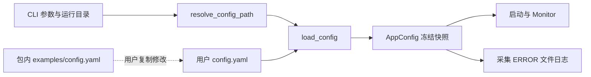

# Configuration 模块设计

- 关联需求：dev-0 / REQ-001，AC-105、AC-106、AC-107、AC-109、AC-113；为 REQ-002～REQ-005 提供配置载体，并衔接 AC-207、AC-301、AC-304。
- 修订：v1.1，2026-10-29；依据 requirements.md v1.12。
- 相关代码：`src/joi_observer/config.py`、`src/joi_observer/examples/config.yaml`。
- 关联模块：启动与终端、采样调度、采集错误日志。

本文定义 v1.12 需求的目标契约。本次 R2 修订仅更新文档、公开接口注释、示例注释和黑盒测试，保留已有 R4/R5 实现；当前解析代码仍校验全部挂载点、只返回前 5 个容器，需由 R4 后续同步。历史 R5 通过记录对应旧数量契约，不能作为本次新契约已实现的证据。

## 模块职责与范围

只在启动时选择并读取用户 YAML，验证字段，返回不可变配置。读取不访问任何监控目标，不创建日志目录、不修改 YAML、不热重载。安装示例是复制材料，绝不能成为缺少用户配置时的运行回退。采集器使用已验证的配置，展示层不读取或解析文件。

## 配置选择与失败处理

按 `--config PATH`、当前目录 `config.yaml`、`~/.joi-observer/config.yaml` 的顺序选择。显式相对路径以当前目录为基准，`~` 按运行用户展开。只选择第一个存在的候选；其内容非法、无读取权限或为目录都直接报错，不能改用低优先级文件。显式路径不存在同样报错。

未找到默认文件时，报告尝试过的当前目录路径、用户目录期望路径以及安装包内示例的实际位置。提示发生在进入全屏前，不初始化采集、不记录 ERROR、不自动复制文件。读取成功也不证明 GPU、挂载点、容器或 URL 可用。

`ConfigError` 统一提供绝对文件路径、字段路径和可取得的 YAML 行列。错误文本为英文，包含定位及修复原因；不直接回显 YAML 源行或敏感值。字段路径使用零起始数组索引，如 `models[1].id`；YAML 行列从 1 开始。日志目录的可写性失败属于启动降级，由日志模块处理，不能作为配置错误阻断 TUI。

## 字段契约

YAML 顶层须为 mapping；`{}` 有效，空文件、null、标量和列表无效。先检查完整 YAML 文档，再进行应用层字段校验。完整文档须无语法错误、重复 YAML key、不支持的标签、递归别名或无法构造的标准类型标量；这一步覆盖第 4 个及以后的挂载点，不因应用层忽略而跳过。所有实际纳入的字段层次拒绝未知字段及隐式转换字符串/布尔值。

挂载点先取原始列表前 3 项，再校验这 3 项的路径、类型及唯一性。其余合法 YAML 值忽略应用层语义，既不产生超量错误，也不采集、不显示；不能筛选出“前三个有效路径”或用后续项替换前面的非法/采集失败项。例如 `['/', '/data', '/srv', null]` 返回前三项，而 `['/', null, '/srv', '/data']` 必须定位第二项为配置错误；第四项若为 `!!int ""`，仍须报告其 YAML 标量构造错误。初始空列表仍是空态，不自动补足 3 个对象。

容器列表完整校验并保留，不设固定数量上限。第 6、10 等后续项的缺字段、未知字段或重复 ID 均按普通配置错误处理，不能因其当前不可见而忽略。所有纳入容器均参与采集；只有展示层可按 Docker 内容区域行数隐藏末尾项。配置模块不读取终端尺寸，不按可见数量裁剪，不因列表超出显示容量而报错。

| 字段 | 默认值 | 有效范围与语义 |
| --- | --- | --- |
| `sample_interval` | `1.0` | 有限数字，0.1～60 秒，包含端点；bool 非数字 |
| `collection_timeout` | `3.0` | 同上；可大于间隔，同一对象由调度器保证不重叠 |
| `mount_points` | `["/", "/data"]` | 仅前 3 项校验并纳入：有序、互异的 POSIX 绝对路径，禁止 `..`、控制字符和首尾空白；其余忽略应用层语义，完整 YAML 校验仍覆盖；`[]` 为关闭挂载项 |
| `containers` | `[]` | 不设固定数量上限；所有项逐项验证并完整保留，每项必填 `id`、`name`；显示容量不影响采集对象列表，不修改源文件 |
| `models` | `[]` | 有序模型列表；每项必填 `id`、`type`、`name`、`base_url`，可选 `gpu_ids` |
| `logging.directory` | `~/.joi-observer` | 运行平台绝对路径或 `~`、`~/...`；展开后返回 Path，不创建；不展开环境变量或 `~other` |
| `logging.max_bytes` | `10000000` | 整数且至少 1024 字节；十进制 10 MB 默认阈值，保证可容纳一条有界日志 |
| `logging.backup_count` | `3` | 正整数，禁止 0，确保轮转始终有界 |

`id` 长度 1～64，符合 `[A-Za-z0-9][A-Za-z0-9_.-]{0,63}`；在所属完整列表内唯一，容器第 6 项及以后也参与重复检查。跨 `containers` / `models` 的同名 ID 不冲突，因为采集器是对象标识的一部分。`name` 是 1～128 个可打印字符，不含控制字符或首尾空白；模型同名不同 ID 保持独立。容器 name 使用真实名称或完整 ID，不从 Compose 项目推断。

模型类型固定为 `chat`、`embedding`、`reranker`。`base_url` 只接受 HTTP/HTTPS origin，允许尾部单个 `/` 并在返回值中去掉；禁止用户凭据、查询、片段以及 `/v1`、`/metrics` 等路径。后续 vLLM 适配器根据直接服务 origin 访问约定指标端点；本模块不进行连通性或服务身份验证。URL 本身不能可靠识别 LiteLLM，因此部署说明明确要求用户填直接 vLLM 地址。

`gpu_ids` 缺省为 `[]`，表示映射未知。可显式填写 GPU 索引字符串或 GPU UUID，各项为 1～128 个非空白可打印字符且不重复。配置阶段不查询设备、不猜测关联；具体映射匹配契约由 REQ-002/REQ-005 延续。本示例保留未知，避免把文档设备映射误当作当前实机事实。

返回值全部为冻结 dataclass 与 tuple。直接构造 dataclass 只是声明数据，并不代表通过校验；生产组合入口应始终使用 `load_config`。

## 示例来源与使用

示例随 wheel 包含于 `joi_observer/examples/config.yaml`。用户可通过 CLI 报告的绝对示例位置手工复制到 `~/.joi-observer/config.yaml` 或自己的工作目录，然后编辑。示例注释说明挂载点仅前三项、容器全部采集但显示受面板容量限制；本次不更改示例监控目标。不会自动安装驱动、更改 Docker 权限或创建监控服务。

三个模型名和回环端口来自本地 `D:\Documents\llm_server\Ubuntu_Server_03_显卡驱动.md` 的 8.2、9.3 节；`Ubuntu_Server_04_服务部署.md` 的 3.3 节仅交叉核对路由，不采用 LiteLLM 作为采集入口。上述资料只读查看，未访问 URL、执行部署命令或确认服务在线。容器默认留空，用户按真实部署填写。

## 接口与验证依据

| 接口或符号 | 代码与注释位置 | 关联验收与黑盒用例 |
| --- | --- | --- |
| `resolve_config_path` | `config.py` 同名函数 | AC-113；显式/工作目录/用户目录优先级、缺少文件、目录误配和禁止回退 |
| `load_config` / `ConfigError` | `config.py` 同名函数与异常 | AC-105、AC-106及衔接AC-207/301；挂载点前三项、完整容器列表及重复 ID、重启读取变更、三类模型、非法字段/数值/YAML/URL |
| `LogConfig` | `config.py` 同名数据类 | AC-107、AC-109；默认日志路径、展开、自定义目录和轮转边界、不创建文件 |
| `example_config_path` | `config.py` 同名函数 | AC-113；资源存在，复制后可读取三个模型 |

测试入口：`python -m pytest tests/test_config.py tests/test_config_boundaries.py`。测试使用 pytest 临时目录和本地字符串样本，替换 home 以隔离真实用户文件；实际调用现有 `load_config`，不 mock 被测结果。运行需要本地可用的 PyYAML 和 pytest。更新后的测试期待新数量契约，旧实现未同步造成的断言失败须明确记为设计与实现版本差异，不能用 xfail 掩盖，也不能误报为导入/环境失败。

`test_config.py` 覆盖挂载点 0～3 项和超量截断、合法 YAML 尾项的应用层忽略、前三项错误不补位，以及容器 0/1/5/6/10 项完整保留、后续项全部参与结构及 ID 检查；保持源文件不变。配置快照只保存前三个挂载点，因此后续采集器不能取得第四项作为失败补位；实际采集范围及 Docker 隐藏项持续更新仍需启动组合根/REQ-002/REQ-003 集成测试验证。

`test_config_boundaries.py` 保留 R5-001 的全部非法标准标量、精确字段/行列、脱敏和完整文档校验场景。原第六容器现在是正常纳入项，仍保留相同输入和断言；另扩展到真正忽略的第四挂载点及其嵌套非法标量，防止先截断 YAML 节点树而绕过历史修复。`_YAML_VALUE_ERRORS` 的异常归一、整文档节点遍历和原有 CLI 安全退出测试不因数量规则变更而削弱。

本模块自动化验证不涵盖真实终端启动、wheel 安装后的资源定位、日志目录权限降级或任何采集行为；由启动/日志契约测试和 R4 的 Ubuntu 离线集成补足。具体运行结果以 REQ-001 的 R2 交接单为准。

## 修订说明

v1.1 根据需求 v1.12 将挂载点纳入范围固定为前 3 项，将容器改为完整保留及校验，明确配置/采集范围与显示容量分离；保留全部 YAML 安全边界，并把忽略尾项回归扩展到挂载点。公开 API、默认采样/超时、用户配置查找、日志配置及三类模型配置结构均保持不变；现有业务逻辑留待 R4 同步。
