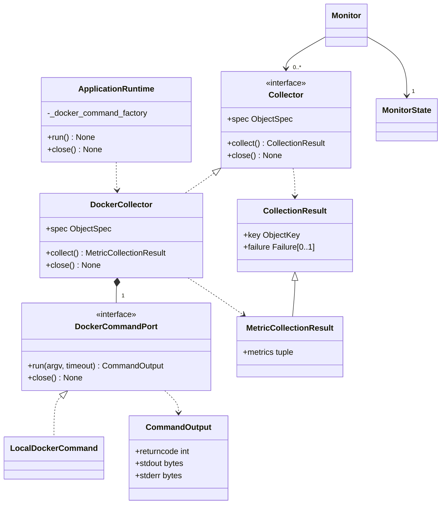

# Docker 容器采集模块设计

- 关联需求：dev-0 / REQ-003、REQ-006，requirements.md v1.16，AC-301～304及HTML外壳排版；依赖 REQ-001 的配置、调度、状态、日志与布局。
- 修订：v1.3，2026-11-05；保留采集身份、命令边界和逐行显示契约，公共结果、全页容量与配色改为引用所属模块；行为不变。
- 相关代码：`src/joi_observer/collectors/docker.py`、`config.py::ContainerConfig`、`cli.py::ApplicationRuntime`。
- 关联模块：[配置](configuration.md)、[Monitor / State](monitor-state.md)、[错误日志](error-logging.md)、[应用外壳](application-shell.md)。

## 职责与范围

每个显式配置项独立读取一个本机容器的生命周期，输出 `MetricCollectionResult`；公共结果分型由[Monitor / State](monitor-state.md#collection-results)定义。全量配置参与采集，显示层使用[应用外壳容量规则](application-shell.md#可验证的字符容量)。模块不依赖终端，不写状态或日志，不发现其他容器，不读取资源统计、容器日志或业务负载，不执行启停、重启或权限修改。

本文维护 Docker 专属的读取、身份匹配、取消和逐行展示规则；配置输入校验、通用状态与日志、全页布局和主题分别引用对应模块。

## 类图



图为目标依赖结构，接口实现使用 Python 结构化 Protocol。每个采集器独占一个命令端口，避免关闭一项影响其他项。原始命令输出仅在采集模块内解析，不进入快照或日志。

## 读取边界与实现取舍

采用本机 Docker CLI 的单对象 inspect，不增加 Python Docker SDK 依赖，不解析面向人的 `docker ps` 表格。CLI 可返回停止容器，格式模板只输出身份与生命周期。命令使用参数数组，不经 shell：

```text
docker --host unix:///var/run/docker.sock container inspect --format <template> -- <config.name>
```

模板固定为代码中的 `DOCKER_INSPECT_TEMPLATE`：

```text
{"Id":{{json .Id}},"Name":{{json .Name}},"State":{"Status":{{json .State.Status}}}}
```

`LocalDockerCommand.run` 只接受上述形状、模板和非空目标，其他操作或远端 host 在创建子进程前拒绝。子进程环境复制当前环境后删除所有 `DOCKER_*`，设置 `LC_ALL=C`、`LANG=C`，不改变父环境；这样配置 context、host、TLS 或 API 版本变量不改变本机目标。stdin 为 DEVNULL，stdout/stderr 为 PIPE，禁止继承终端输出。即便目标字符串含 shell 元字符，也只是 `--` 后的单个参数，不拼接执行。

本期固定常规本机 `/var/run/docker.sock`，不自动查找 rootless socket、不回退到 context、不执行 sudo。无 CLI、无 socket、权限不足均通过采集失败链路报告，不能阻断其他来源。CLI、模板与权限在真实部署中尚未验证；本地适配契约不代表已经读取过实际 Docker。

每次 collect 只发起一次命令，不重试、不缓存永久失败、不持久缓存解析后的 ID。标准输出和错误输出分别最多 65,536 字节；两条流须并发限量读取。恰好上限可接受，超过即终止、回收进程并抛 `DockerOutputLimitError`，不能依赖无界 `communicate()` 收完才检查。CLI 格式本身避免输出环境变量、挂载、healthcheck 结果等不需要的内容。

<a id="docker-identity"></a>

## 身份与结果契约

状态 key 恒为 `ObjectKey("docker", ContainerConfig.id)`，查询目标为 `ContainerConfig.name`，不同配置 id 指向同一目标时分别保留、分别采集。字段输入校验见[配置契约](configuration.md#configuration-fields)，实际对象身份在以下响应解析阶段核验。

成功输出必须是严格 UTF-8 的单个 JSON 对象，允许前后空白；拒绝数组、多个对象、重复 JSON key、缺失/类型错误字段及无效状态。`Id` 必须是 64 位小写十六进制；`Name` 必须只有一个前导 `/`，后面为非空、无空白/控制字符且不再包含 `/` 的可打印名称。

- 配置目标是 64 位小写十六进制时，按完整 ID 比较，只能匹配响应 `Id`，不能被同名但不同 ID 的容器替代。
- 其他目标按名称与响应 `Name` 去掉唯一前导 `/` 后精确比较，不做大小写折叠、子串或 Compose 名推断。
- Docker 接受短 ID 前缀不代表本工具接受；只有响应名称确实等于该短字符串时才算名称匹配。配置带前导 `/` 不自动归一化。
- 名称目标每次重新查询，因此可以跟随同名重建的新 ID；完整 ID 目标不能跟随重建改绑。合法响应不匹配配置身份，按对象未找到处理。

`State.Status` 仅接受下列精确小写值，成功结果为 `MetricCollectionResult(key, (Metric("state", value),))`，指标无单位；初始 ObjectSpec 为相同字段且值 `None`。结果与 spec 的匹配统一遵守[公共结果契约](monitor-state.md#collection-results)。

| 原始值 | 展示值 |
| --- | --- |
| created | Created |
| running | Running |
| paused | Paused |
| restarting | Restarting |
| removing | Removing |
| exited | Exited |
| dead | Dead |

`Exited`、`Dead` 等生命周期均可成功，不因退出码或健康状态生成错误。`Running` 不表示应用健康。额外 JSON 字段忽略；`Health`、`State.Error`、环境内容不影响生命周期，也不能透传。未知状态或状态缺失属于解析失败，不能伪造 `Running`、0 或把任意文字写进 TUI。

## 失败、恢复与取消

所有预期失败返回 `MetricCollectionResult(key, failure=...)`，Failure 使用下列目录，固定受控 reason 不含原始 stdout/stderr/异常。公共失败、保值、历史缺口与恢复通知由[Monitor / State](monitor-state.md#collection-results)负责；本模块不重复实现这些行为。TUI 状态优先级见[逐行展示](#docker-row)。

| 输入或事件 | kind / code |
| --- | --- |
| CLI 非零且 stderr 含 `permission denied`；或 PermissionError | permission / access.denied |
| CLI 非零且 stderr 含 `no such container` 或 `no such object`；或响应身份不符 | not_found / object.not_found |
| 非零的其他 CLI 错误；FileNotFoundError / 其他 OSError | unavailable / source.unavailable |
| 成功输出格式/字段/状态非法；任一流超限 | parse / response.invalid |
| 底层 TimeoutError；Monitor 超时 | timeout / collection.timeout |
| 未预料的程序异常 | 交给 Monitor 归一为 unexpected / collector.unexpected |

先检查输出上限。非零退出不解析 stdout；stderr 按 ASCII 不区分大小写的上述固定短语分类，权限规则优先于不存在，未识别错误保守归为 unavailable。成功退出时 stderr 不改变合法 stdout 结果。错误分类不使用动态消息作为 code，不扩充日志目录；原文不写入 Failure.reason。离线样本是构造的契约样本，未知 CLI 版本/文案的精细分类仍需之后获授权验证。

每个来源独立受 `collection_timeout` 约束，默认 3 秒；底层端口也收到该有限正超时值（int/float，拒绝 bool）。Monitor 的超时到达后取消仍应传播，不能包装成权限或不可用。底层超时、取消、流超限和 close 必须停止并 await 回收在途进程，取消/close 清理预算 250 ms；不使用无限阻塞线程，清理不打印、不追加采集错误。close 主动取消在途 run，其调用方收到 CancelledError，close 返回前完成进程和读取任务清理，不返回终止退出码作为新采样。close 幂等，关闭后 run 拒绝；Monitor 保证同一采集器无重叠调用，端口无需支持多个同时命令。

## 生产组装

`build_docker_collectors(containers, timeout=..., command_factory=...)` 按完整配置顺序创建独立采集器，空配置返回空 tuple 且不创建端口。默认工厂创建 LocalDockerCommand；工厂、采集器构造与 prepare_log 都不执行命令。

`ApplicationRuntime._components()`已调用该工厂，以全部spec替换Docker静态模板，并把全部采集器交给同一个Monitor；硬件、Docker与已合并的vLLM共享唯一State/Log和只读reader。传入RuntimeComponents时沿用注入组件，不创建额外采集器。`docker_command_factory`只隔离外部命令，不能替换采集结果或另建一套状态。

<a id="docker-row"></a>

## 逐行展示

面板容量、可见前缀、空配置/零容量以及缩放行为统一见[应用外壳](application-shell.md#可验证的字符容量)。每个可见容器占一行，名称显示配置的 `ContainerConfig.id`；`ContainerConfig.name` 仅作为实际容器查询目标。有可用内容行且未配置容器时，空态文案为 `No containers configured`。

内容左端 `L=region.column+2`、右端 `R=region.column+region.width-2`（不含 R）。状态固定占 `[R-14,R)`，全部生命周期、未知 `—` 和 `STALE` 均按文字宽度右对齐到 R。显示的配置 ID 在 `[L,R-15)` 内单行裁切，始终留一格间隔；不因状态短或未知收回预留宽度，长 ID 不能覆盖状态。状态变化、失败恢复及 resize 不会重排配置前缀或增加行。

STALE 优先替换旧生命周期，只显示该状态文字，无错误原因或时间；初始无对象/无状态使用 `—`。成功 Exited/Dead 仍显示生命周期，不误报采集失败。状态新鲜性及颜色角色统一遵守[主题角色表](theme.md#color-roles)，本模块不维护另一份颜色映射。

## 接口与验证依据

| 接口/边界 | 黑盒入口 | 覆盖 |
| --- | --- | --- |
| parse_inspect | `tests/test_docker.py` | 七种状态、名称/完整 ID、重建、误匹配、JSON/字段边界、失败目录、输出净化 |
| DockerCollector / build_docker_collectors | 同上 | 固定单次只读命令、全量顺序、重复目标不同 id、无 IO 构造、失败恢复、取消、关闭 |
| LocalDockerCommand | `tests/test_docker_command.py` | 仅替换 asyncio 子进程创建端口；参数/环境、原始字节、并发排空、两流上限、超时/取消/close 回收 |
| Collector→Monitor→State→Frame/Log | `tests/test_docker_integration.py` | 真实采集业务入口与离线命令样本；隐藏项采样/日志、容量变化、恢复及错误净化 |
| 固定状态右边缘与角色 | `tests/test_html_shell_layout.py`、`tests/test_docker_integration.py` | 配置 ID 显示、全7种生命周期、初始未知、STALE、长 ID、两主题、多宽、14格槽内统一右对齐；核对主题角色和外壳容量契约 |
| ApplicationRuntime | 同上 | 用fake命令与终端运行真实生产组装，验证全部容器实际采样及隔离、恢复、退出清理 |
| 配置与容量 | `tests/test_config.py`、`test_config_boundaries.py`、`test_tui.py`、`test_integration.py` | 复用 REQ-001 的 1/5/6/10 项完整保留、空态、0 容量、半页、配置不修改等测试 |

运行入口：`python -m pytest tests/test_docker.py tests/test_docker_command.py tests/test_docker_integration.py`，以及全量 `python -m pytest`。所有 Docker IO 使用离线替身；不运行实际 docker、不访问 Unix socket 或网络。现有两个生产首帧测试增加 pending command 工厂，保持首次采样前的断言，并为 R4 接入后继续隔离真实 IO。

测试不以 NotImplementedError 为成功条件。REQ-003 最初 R2 的业务骨架/未接线失败是历史基线，实际命令与当时结果见[历史R2交接](../dev-workflow/dev-0/REQ-003/handoff-r2.md)；当前验证分别覆盖采集、运行期接线及本节逐行展示契约，不把业务失败当作导入/环境错误。

后续集成待验证：真实 Docker CLI 与模板、Unix socket 权限和错误文案、真实进程取消的时限。当前仅验证离线协议和本地公共 TUI；不得将样本结果表述为实机验证，也不因交接自动获得服务器连接授权。
