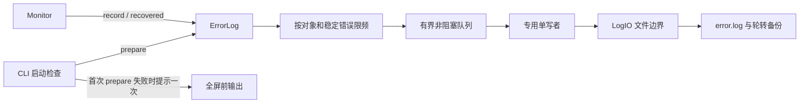

# 采集错误日志模块设计

- 关联需求：dev-0 / REQ-001，AC-107～AC-112；需求说明 v1.9。
- 修订：v1.1，2026-10-28；按用户要求日志时间采用服务器本地时间，不附带时区信息；业务仍为R2骨架。
- 相关代码：[error_log.py](../../src/joi_observer/error_log.py)、[test_error_log.py](../../tests/test_error_log.py)。
- 关联模块：[配置](configuration.md)、[调度与状态](monitor-state.md)。

## 职责与依赖

只接收 Monitor 已分类的真实采集失败，将诊断追加到用户配置目录的 `error.log`。
日志不属于监控快照，不向 TUI、stdout/stderr 或 root logger 传播。启动/退出、正常采样、
恢复、无负载、已知不支持/不适用字段、成功取得的 Exited 状态均没有日志事件。

构造器无文件/线程副作用。CLI 配置校验完成后调用一次 `prepare()`，实际创建目录并以
追加方式打开文件检查，不用仅检查权限位的方式代替真实打开。False 只触发 CLI 全屏前
的一次英文提示，监控照常启动。不得换到临时、XDG、项目目录，不修改 YAML。
运行中后续错误可重新尝试 prepare/append；失败记录丢弃，不补写；恢复本身不写日志。

## 错误类别、数据边界和限频

`Failure(kind, code, reason)` 是诊断类型；不能进入只读 UI 快照。`reason` 仅允许采集器
给出受控文案，日志最终仍只根据下面的 kind/code 输出固定原因，避免异常正文携带
凭据、请求/响应内容或模型输入输出。原始异常、HTTP body、stderr 和指标快照不得入队。

| kind | code | 日志 reason |
| --- | --- | --- |
| timeout | collection.timeout | Collection timed out. |
| permission | access.denied | Permission denied. |
| not_found | object.not_found | Configured object was not found. |
| parse | response.invalid | Invalid collection response. |
| unavailable | source.unavailable | Data source is unavailable. |
| unexpected | collector.unexpected | Unexpected collector failure. |

未知代码或 kind/code 不匹配统一为最后一行，不记录输入代码及自由文本。后续采集器
需要精确区分解析阶段等原因时，扩展此目录及测试；不得把动态时间、响应值、URL 纳入代码。
collector 为 `[a-z][a-z0-9_.-]*` 最多 32 字符，object_id 为不含控制字符的 Unicode
字符串最多 128 字符，均使用稳定身份而非地址或错误文本；
配置模型使用稳定 id，挂载点/GPU 身份由采集契约产生。JSON 使用 ensure_ascii=False，UTF-8
编码后的单行上限 1024 字节；超长身份属于编程错误，不通过截断制造对象身份碰撞。

限频键为 `(collector, object_id, normalized_kind, normalized_code)`，使用单调时钟，
不受日志墙钟校时影响。同一持续故障中，0 秒首次立即入队，1～59 秒抑制，60 秒可再入队；
不同对象、新错误立即入队。保存每种错误的时间，A→B→A 不绕过 A 的间隔。
`recovered` 清除该对象全部指纹，重发故障立即记录，恢复本身不入队。部分字段失败时
Monitor 不调用 recovered；历史成功样本或无关对象恢复也不能清除此对象的限频状态。

`record` 返回 True 只表示成功接纳，False 表示限频、队满或关闭；不宣称已落盘。
接纳时预占指纹时间，IO 失败撤销本次预占，下一次新的采样错误可立即重试；队满不预占。
写入完成回传故障轮次和事件序号，旧故障的失败回调不能撤销新轮次的预占。

## 文件、容量和响应性

文件格式为逐行 JSON，恰含 `time`（服务器本地时间，`YYYY-MM-DD HH:MM:SS`）、
`level: ERROR`、`collector`、`object_id`、`kind`、`code`、`reason`。例如
`"time": "2026-10-28 18:00:00"`，精确到秒，不附带时区名、UTC偏移或Z后缀，
日期与时间用空格分隔。采用采集失败发生时的服务器本地时间，不转换成UTC，也不用
异步写线程实际落盘时间代替发生时间。Monitor内部的datetime可保留时区信息，
日志序列化只写本地年月日时分秒；60秒限频仍由单调时间控制。

不添加正常指标、原始异常、traceback 或非 ERROR 记录。默认单文件
10,000,000 字节（十进制 10 MB），3 份备份；配置阈值至少 1024，
备份数至少 1。追加后会超过阈值时先轮转，等于阈值允许写入，备份为 `.1` 到 `.N`，
最旧淘汰。从空日志开始且文件仅由本实例写入时，当前文件加备份最多占
`(N+1) × max_bytes`；启动前已有超阈值文件先轮转而不截断，它可能使过渡期间
总容量超过此值，随后按同一备份规则淘汰。首版同一日志路径只允许一个写入进程；
多实例需分别配置日志目录，不承诺跨进程轮转协调。

默认队列容量 256 条，不含当前正在写入的一条。每条最多 1024 字节；队满丢弃新事件，
不记录“丢弃日志”、不提示，不阻塞采集/界面。单个专用守护线程串行文件写入，避免占用
采集线程池；只能轮转和写入目标日志文件，不访问服务器。各采样周期不等待 flush。
`flush(timeout=1)` 仅作为测试屏障/退出手段：已成功处理或失败丢弃均算排空；超时 False。
`close(timeout=1)` 停止接纳，等待有界后丢弃未开始记录，幂等且无终端输出；终端恢复不能
无限等待文件系统。系统调用本身不可强制取消，已经开始的单次本地写入可能稍后完成，
守护线程不阻止进程退出。真实文件系统长期阻塞的行为须在 R4/R5 本地集成验证。

## 接口与验证依据

| 接口 | 黑盒范围 | 关联验收 |
| --- | --- | --- |
| prepare / FileLogIO | 自定义缺失目录、追加保留旧日志、失败静默 | AC-107、AC-111 |
| record / recovered | GPU/挂载/Docker/vLLM 身份，0/59/60 秒、新对象、新错误、恢复、墙钟变化 | AC-108、AC-112 |
| record → 文件 | 固定 ERROR 字段、无时区的服务器本地时间字符串、安全原因目录，不输出控制台 | AC-108、AC-110 |
| FileLogIO.append | 达阈值轮转、只保留指定备份、新错误持续可写 | AC-109 |
| LogIO 注入 / flush / close | 初始化失败、运行中失败后重试、慢磁盘、队列满、有界退出 | AC-111 |

运行入口为仓库根目录 `python -m pytest tests/test_error_log.py`。只用临时目录和可注入
文件 IO；不 mock 限频/轮转业务，不连接服务。R2 断言期待已实现后的正确行为，未实现入口
抛 NotImplementedError 为正常业务基线，不使用 xfail。实际执行结果记录在 REQ-001 交接单。
正常采样/N/A/Exited 不产生日志、UI 不显示日志以及“全屏前仅提示一次”的跨模块行为由
Monitor/CLI 测试覆盖；真实终端恢复、磁盘权限与文件系统异常仍须后续离线集成验证。

## 修订说明

v1.1 采纳用户对日志time的修订：使用服务器本地 `YYYY-MM-DD HH:MM:SS`，去掉原先
带时区ISO-8601的落盘约定。同步ErrorLog/Monitor接口注释和既有日志黑盒断言；测试
使用固定+08:00的内部样本并期待无时区的本地时间字符串，不依赖测试机时区。
