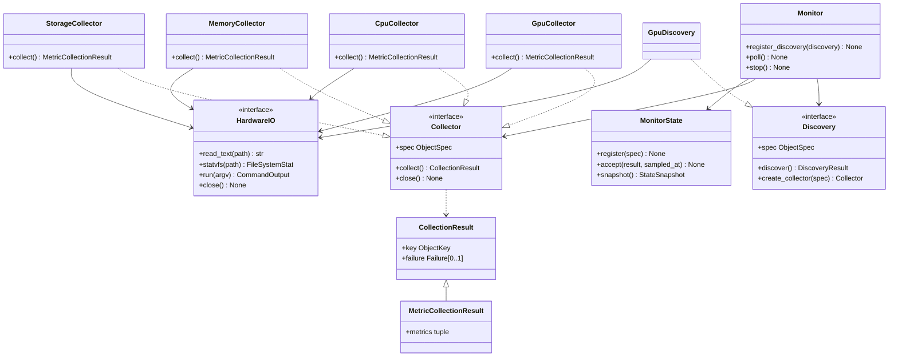

# 本机硬件模块设计

- 关联需求：dev-0 / REQ-002、REQ-006，AC-201～AC-207；共享 AC-101～AC-103、AC-108、AC-110、AC-112、AC-606～AC-608及HTML布局修订。
- 修订：v1.11，2026-11-05；本页集中维护采集口径、面板内部坐标、数字精度与GPU匹配；分段条字形及终端配色统一引用[主题设计](theme.md#hardware-bars)，不改变行为。
- 当前阶段：硬件采集与公共结果类型已实现并合并；REQ-006的行列、紧凑容量、右对齐和用户精度修订已由R4实现。2026-11-04按R5建议同步阶段措辞，不改变接口或显示契约；当前验证见[REQ-006 R4交接](../dev-workflow/dev-0/REQ-006/handoff-r4.md)与[R5交接](../dev-workflow/dev-0/REQ-006/handoff-r5.md)，旧布局测试结果仍仅作为历史证据。
- 代码：`collectors/hardware.py`、`collectors/base.py`、`monitor.py`、`tui/widgets.py`；组合接线在 `cli.py`、`tui/layout.py`。
- 关联设计：[Monitor/State](monitor-state.md)、[配置](configuration.md)、[应用外壳](application-shell.md)、[错误日志](error-logging.md)。

## 职责和范围

运行在被监控 Ubuntu 主机上，只读采集 NVIDIA GPU、整机 CPU/RAM 和配置前三个挂载点。采用已有 `Collector → Monitor → MonitorState → TUI`；不增加数据库、采样日志、网络流量、磁盘 IO、逐进程指标或服务控制。

REQ-002 负责硬件数据与按当前 `ViewSelection` 计算的 GPU 关联高亮。方向键修改选择由 [REQ-005 导航控制器](navigation.md) 完成，完整主题颜色映射由 REQ-006 完成；本模块提供对应语义颜色角色。Docker 与 vLLM 采集已分别随 REQ-003/004 合并。

保留已合并的配置、状态、调度、日志和半页布局。当前公共 CollectionResult 仅含 key/failure，硬件各 collect 返回携带 metrics 的 MetricCollectionResult；导航不改变结果类型或原业务算法。

## 核心结构



发现器报告不可变声明，只有 Monitor 注册对象、创建新来源并提交状态。发现器和每个来源独占一个 IO 端口；关闭一张卡不会关闭其他卡。TUI 只有不可变快照，不持有上述接口。

## 身份、字段与单位

所有模板值初始为 `None`；成功的 `MetricCollectionResult(key, metrics)` 覆盖模板，已知不支持字段显式 `None`。局部失败以 `MetricCollectionResult(key, valid_metrics, failure=...)` 保留成功字段；整体失败使用 `MetricCollectionResult(key, failure=...)`。failure 只能按关键字传入。Collector 协议仍返回公共基类，Monitor 的超时/未知异常可用无载荷 `CollectionResult(key, failure=...)`；成功公共基类不合法。普通硬件 ObjectSpec 只匹配 MetricCollectionResult，不接受 VllmCollectionResult。具体字段以代码目录为准，不让布局根据字段顺序猜含义。

| 对象 key | 字段与存储单位 | 身份与展示规则 |
| --- | --- | --- |
| `host/cpu` | `cpu_percent`，% | 整机，独立采样与失败状态 |
| `host/ram` | `ram_used_bytes`、`ram_total_bytes`，B；`ram_percent`，% | 与 CPU 隔离，Host 标题汇总失败状态 |
| `storage/mount-0`～`mount-2` | `used_bytes`、`total_bytes`，B；`used_percent`，% | 序号按有效配置，界面显示配置原路径；长路径不会突破 ObjectKey 的128字符上限 |
| `gpu_inventory/local` | `device_count`，整数 | 面板级发现状态，不是设备，不计入 GPU 槽与最小高度 |
| `gpu/<完整 UUID>` | `index`、`name`；`utilization_percent`，%；`memory_used_bytes`、`memory_total_bytes`，B；`temperature_c`，°C；`power_w`，W | UUID为会话身份，可靠 index 为显示编号，name 来自采集 |

新 UUID 按发现顺序追加，已有 UUID 不因枚举顺序、模型选择、失败或热移除而重排/删除。新卡可能提高基础最小高度；故障本身不能改变布局。设备数不硬编码为5。使用通用 `Metric`/`ObjectSpec`/`MetricCollectionResult` 和 `MonitorState`，不另建硬件专用可变状态。GPU inventory 的展示结果也由 MetricCollectionResult 承载；DiscoveryResult 的发现声明结构不因本次分型改变。

## 数值口径

### CPU 与 RAM

CPU 从 `/proc/stat` 的整机 `cpu` 行取 `user nice system idle iowait irq softirq steal` 八个累计 tick；不能累加逐核心行，不能把 `guest/guest_nice` 重复计入 total。设 `total` 为八项和，`busy=total-idle-iowait`，两次连续有效样本的 `cpu_percent=100×Δbusy/Δtotal`。无需除以核心数或按计划采样秒数换算。

首次、总 tick 无增长、任一参与计数回退及失败后首个成功样本都没有可比较区间，返回成功的 `None`，不伪造0、不记错误。回退/无增量的当前样本作为新基线；失败清空基线。Monitor超时会取消当前读取，CPU须捕获CancelledError清基线后原样重抛，不能跨超时计算。可比较区间忙 tick 无增长时真值是0。计数回退的处理也覆盖 Linux 文档说明的 iowait 可能下降，不把它误记为驱动故障。必要字段缺失、重复 aggregate 行或非法数字为解析失败。

RAM 使用 `/proc/meminfo` 的 `MemTotal`、`MemAvailable`（kB×1024）。`used=total-available`，`percent=100×used/total`；不采用 `MemFree`，不与显存/KV Cache 混合。`total>0` 且 `0<=available<=total`；缺失/重复必要键、非法单位或数值均失败，不用其他字段估算。CPU 与 RAM 分来源，任何一方失败不阻止另一方刷新。

### 挂载点容量

只创建有效配置的前三项，失败不能用第四项补位；`build_hardware_sources` 对手工构造 AppConfig 也防御性使用 `[:3]`。0项不创建 Storage 采集器，不记错误。

每次读 `/proc/self/mountinfo`，解析 ` - ` 分隔符前第5字段并解码 Linux 路径转义。配置和挂载路径只进行 POSIX 词法规范化，保留配置原文用于显示；不跟随符号链接、不使用父目录/最长前缀匹配。目标必须本身是精确挂载点，普通 `/data` 目录不能因存在或能调用 statvfs 就当成已挂载。

只有精确匹配后才调用 statvfs，再读 mountinfo 检查对应 mount ID、major:minor、root、挂载路径未变化。重复同路径挂载记录视作无法可靠确定目标，返回 `source.unavailable`，不能依赖文本顺序猜顶层挂载；bind mount 的唯一精确挂载记录正常支持。可观察到的卸载/替换导致本轮容量丢弃。前后检查无法证明极短的卸载又恢复（ABA）未发生，R4 可用打开目录的 mount ID 加强绑定；当前不承诺原子文件系统快照。

采用 `f_frsize×f_blocks` 为总容量，`f_frsize×(f_blocks-f_bfree)` 为已用；使用率为已用/总量。保留块包含在总量中，不能把 `f_bavail` 的普通用户可用口径混入百分比分母。`f_frsize>0`、`f_blocks>0`、`0<=f_bfree<=f_blocks`；不支持以0总量冒充有效容量。

### NVIDIA 数据

使用已安装的 `nvidia-smi` 只读查询，无 Python GPU 依赖。固定参数如下；以 argv 调用，不使用 shell：

```text
nvidia-smi --query-gpu=index,uuid --format=csv,noheader,nounits
nvidia-smi --query-gpu=index,uuid,name,utilization.gpu,memory.used,memory.total,temperature.gpu,power.draw --format=csv,noheader,nounits --id=<完整 UUID>
```

发现查询只枚举身份，逐卡查询通过 UUID 定位。查询字段或可用性随本地驱动存在差异时按下述规则处理，不回退为模拟数据，不按型号猜固定容量。

- GPU 利用率直接使用驱动 `%`，含义是采样周期内有 kernel 执行的时间比例，不能用显存比例代替。`memory.used/total` 按 MiB×1024² 转字节，温度为°C，功率为W。
- `power.draw` 是驱动最近测得的整板功率；较新设备可能是1秒平均，UI只标W，不承诺瞬时值。
- 逐卡查询必须一行、列数正确、UUID精确匹配。身份/结构错误整卡失败；单字段解析失败省略该字段，提交其他有效字段，State保留坏字段旧值并标整卡STALE。显存used/total作为关联容量组：任一容量实际解析失败时两者均省略，不能混合新旧样本产生8/4GiB等无效组合；已知N/A仍可独立返回None。
- `N/A`、`[N/A]`、`[Not Supported]` 是明确不可用标记，字段返回None且不记错误。空字段、`[Unknown Error]`、NaN/Infinity、越界值是解析失败。不能把任何括号文本都当“不支持”。
- index为非负整数；利用率0～100；温度和功率为非负有限数；显存总量>0且0≤已用≤总量。used>total时同时省略两项容量，保留其他有效字段。
- 成功的空CSV代表无卡。针对 CLI 的无设备响应，精确匹配独立的 `No devices were found` 且退出码0或6时也归一成功无卡；不是按所有非零退出码或包含关键字来猜无卡。该特殊输出目前仅有离线契约样本，目标驱动待用户部署后核对。
- 非零返回且不符合无设备特例为整体失败；缺少命令/驱动不可用为 `source.unavailable`。stderr和原始错误文本均不进入State/日志。

## GPU 发现、调度与资源生命周期

`Monitor.register_discovery(discovery)` 在首次 poll/run 前调用，无 IO，注册 inventory 模板；重复key拒绝，调度开始或停止后再注册拒绝。发现器按配置周期独立运行，遵守现有超时、不重入、忙时跳槽规则。

`DiscoveryResult.inventory` 走既有 accept/日志/recovered/通知流程；成功的 specs 是本轮完整枚举声明，失败必须为空。Monitor 先校验整个结果和工厂输出，再注册新卡：重复声明、模板改变、跨发现器/静态来源冲突或错误工厂输出使本轮 inventory 归一 `collector.unexpected`，不得半轮污染状态；已创建但未采用的资源关闭。

只为新UUID调用一次同步、无IO的 `create_collector`。新卡注册后立即发起首采，之后保留自己的周期原点；重复发现不重置历史、状态、采样相位或重新构造来源。已知卡不在最新清单中也不删除，独立UUID查询会标记故障并允许自动恢复。inventory失败只显示面板状态，不批量覆盖每张卡的结果。

stop须取消发现任务及所有静态/动态来源，关闭每个已创建资源；迟到发现不得创建来源、注册或提交。Monitor现有关闭逻辑只枚举初始来源，R4必须改为覆盖动态来源，整体退出预算仍为1秒，不串行叠加每个对象的预算。

## 失败与日志

| 情况 | kind / code | 状态行为 |
| --- | --- | --- |
| IO或调度超时 | timeout / collection.timeout | 当前对象STALE，CPU基线失效 |
| PermissionError | permission / access.denied | 仅受影响对象失败 |
| 未挂载/路径不存在/明确设备不存在 | not_found / object.not_found | 不回退父文件系统、不删除旧卡 |
| 结构、字段、数值非法 | parse / response.invalid | 按整对象/字段失败粒度保值 |
| 缺少命令、驱动不可用、其他受控IO故障、挂载发生变化或歧义 | unavailable / source.unavailable | 保值，后续自动重试 |
| 工厂/发现协议违反或未预期异常 | unexpected / collector.unexpected | 由Monitor隔离，不能泄漏异常 |

复用 REQ-001 已登记错误码和固定日志原因模板，不新建日志体系。首次失败立即ERROR，相同对象/错误60秒限频，恢复不记日志。CPU无基线、GPU已知不支持、成功无卡、未配置挂载点均成功无错误。界面仅固定槽STALE，无时间/原因/错误码；历史失败留缺口。

## 本地 IO 与接线

`HardwareIO` 只返回原始文本、statvfs计数、命令输出；测试替换此边界，不替换被测数值计算。`LocalHardwareIO` 将潜在阻塞的文件/statvfs调用放入可终止本地worker，nvidia-smi使用异步子进程。输出每路≤1 MiB，固定操作白名单、无shell，timeout取配置；取消和close须250ms内终止/回收自己创建的子进程。不能以无限阻塞线程宣称满足取消，也不执行任何网络请求。

不新增运行依赖或更改uv锁文件；R4若发现本地worker成本不适合0.1秒最小采样，可在维持隔离/取消契约的前提下使用有界常驻worker，仍不能让慢挂载阻塞其他来源。上述IO与资源回收要求属于已合并REQ-002契约；本轮REQ-006复用采集实现，只修订呈现目标。其原设计/验收证据见REQ-002交接。

`build_hardware_sources(config)` 无IO地组装CPU、RAM、前三挂载及发现器。`ApplicationRuntime._components` 已移除host/local占位、把静态spec加入同一State，交静态来源给Monitor后注册发现器。导入、`--help`、缺配置、构造阶段不能执行硬件查询。vLLM模型来源已随REQ-004接入同一State/Monitor，RuntimeComponents注入通道保留。

## 硬件显示与模型关联

`widgets.hardware_cells` 已由compose_frame调用，只生成GPU/Host/Storage区域内的文字和状态槽，不重复绘制边框。区域坐标、边框、最小尺寸与面板外壳高度由layout.py负责，完整分配见[应用外壳容量契约](application-shell.md#可验证的字符容量)。下文只定义区域内部的零基字符坐标、字段精度和关联匹配；颜色角色统一见[主题设计](theme.md#color-roles)。

每个区域内容边界记为`L=column+2`、`R=column+width-2`，R为排他边界。右对齐指可见文字末端恰到指定边界，不依赖先前内容长度。状态槽所在行健康时留空；Storage状态只占标题行，不挤占挂载内容行。

| 区域 | 内容安排 |
| --- | --- |
| GPU每槽第1行 | row+1+3i；编号靠L、最多10格，名字随后；显存槽`[L+12,R−12)`，温度槽`[R−10,R)`均右对齐 |
| 第2行 | 条从L起、宽`floor((width−4)/2)`；空1格后紧接百分比；功率在`[R−10,R)`右对齐，数值与W之间一空格 |
| 第3行 | 仅在`[R−5,R)`保留STALE，健康留空；不把状态挤回首行 |
| Host row+1 | CPU标签靠L，百分比固定1位小数并在`[L+4,R)`右对齐，如30.0% |
| Host row+2 | CPU条从L起，宽`floor((width−4)/2)`，不重复显示比例 |
| Host row+3 | RAM标签靠L，GiB/TiB整数已用/总量组在`[L+4,R)`右对齐；不添加百分比文字 |
| Host row+4 | RAM条与CPU条等宽、同左端；保持既有布局，不添加百分比文字 |
| Storage标题row | 仅当前3个配置挂载点任一对象stale时，在`[R−5,R)`显示一次STALE；其余情况留空 |
| Storage row+2～row+4 | 路径靠L；紧凑容量与固定1位小数的百分比组在`[L+2,R)`右对齐，内容行不预留状态槽 |

GPU编号最多10格，之后至少一空格；名字只使用编号之后、显存之前的剩余空间，可以为空。有名字时和相邻内容至少各留一空格，显存与温度之间保留两格。超长Unicode名字或编号在自身槽内裁切，不能覆盖数值组。GPU条及百分比不进入最右温度/功率组。Storage路径只裁数值组左侧剩余空间，至少与数值隔一格；健康、失败与恢复均使用完整内容右缘。120列时GPU的R=69，显存槽14～56、温度/功率槽59～68、第三行状态位64～68；Host/Storage的R=118，Host值槽78～117、Storage值槽76～117、Storage标题状态位113～117。

常规数值保持现有精度和文本，温度如`60°C`、功率如`100 W`。超出自身值槽时，先用最多3位有效数字的科学记数压缩，保留指数和单位；例如极大容量仍能辨别已用/总量及GiB/TiB，极大温度/功率仍能辨别°C/W。原始指标与`capacity_text`输出不变，任意精度整数不能先转float溢出。科学记数仍放不下时只在该槽显示明确的`…`，不能截掉指数/单位伪装成较小完整值，也不能用`—`、`0`或`N/A`表示槽位不足。先保留身份/标签/状态，再安排数值，不能向左挤占它们。

CPU和Storage已有百分比文本固定保留1位小数，如`30.0%`、`0.0%`、`100.0%`，未知仍为`—`；这只改变面板文本，不改变CPU累计tick采样或百分比口径。RAM保留容量行与下行条，不添加百分比文字。条的字形、取整与公开`percentage_bar`兼容语义，以及配色和终端降级统一见[硬件分段条、轨道与配色能力](theme.md#hardware-bars)。

容量仍采用GiB/TiB二进制单位，已用和总量使用同一单位（总量≥1TiB切TiB，按原始容量选单位）。GPU及Storage的TiB保留1位小数；RAM的GiB/TiB以及Storage的GiB数值从原始字节直接按ROUND_HALF_UP舍入为整数，不先舍入到1位小数后再次舍入。例如所用单位下1.49显示1、1.5显示2，真实0显示0。不以显示后的整数重新计算RAM或Storage使用率。

GPU、RAM、Storage的容量组合共用一个末尾单位。GPU例如`4.0 / 16.0 GiB`，单边未知为`— / 16.0 GiB`或`4.0 / — GiB`，真实0为`0.0`。RAM与Storage的GiB对应显示`4 / 16 GiB`、`— / 16 GiB`或`4 / — GiB`，真实0为`0`；RAM的TiB同样为整数，例如`1 / 2 TiB`，Storage的TiB仍为`1.0 / 2.0 TiB`。所有组合两边未知均为`— / —`。`capacity_text`公开返回仍是例如`('4.0 GiB', '16.0 GiB')`，其1位小数语义、既有formatter边界和二进制换算不变；RAM/Storage整数只属于对应面板的组合呈现。

Storage完整数值组为`1 / 4 GiB · 25.0%`，TiB例如`1.0 / 4.0 TiB · 25.0%`，未知为`— / — · —`，整体贴内容右缘。各字段及未知片段的颜色语义见[颜色值与显示角色](theme.md#color-roles)。

inventory首次未知显示—，成功0卡且从未有槽显示 `No NVIDIA GPUs`，失败在GPU面板标题状态槽STALE，不能显示成“检测到0卡”。有旧槽时保留所有旧槽。Host的CPU/RAM任一失败在标题预留位STALE；Storage前三个配置挂载点任一失败时仅在Storage标题右上角显示一次STALE，全部恢复后清除。缺少对象或尚未采样本身不视为stale；无配置和第4个起的挂载点不参与标题状态。各挂载仍独立保留已有值、更新和记录错误，标题不新增原因或数量。长路径/名称按终端字符宽度裁切，优先保住指标与状态，不增加行。

`linked_gpu_ids` 只读配置中当前模型的显式gpu_ids；缺省选择第一模型，未知选择或空映射清空高亮。完整UUID精确匹配可用于旧卡；索引只匹配本次已采样且非STALE的唯一index，规范十进制字符串（`4`，非`04`）。出现重复的当前index时不以索引猜映射。UUID前缀、名称、显存和负载均不作为依据。切换只改变编号/填充/百分比的role，不改变GPU顺序、状态、历史或采样次数。

REQ-005 默认控制器仅输出合法模型 id（空配置为 None）；同一帧模型详情与硬件关联使用同一选择值。模型服务失败不撤销显式映射，GPU 自身过期索引仍按上面的安全匹配规则处理。不修改本模块的未知 id 兼容行为，不新增 GPU 焦点或滚动。导航贯穿视图的黑盒覆盖见 `tests/test_navigation.py`。

Storage采用序号key。为保留REQ-001已有通用快照，缺少序号对象时兼容读取旧路径key，序号优先；旧host/local仍汇总通用字段和STALE。无index字段的旧GPU对象或纯十进制空槽沿用`GPU {key}`标签、首行旧状态槽与次行`name: value`通用指标，不要求其具备新生产schema的显存/温度槽；存在index模板即走新硬件契约，None时显示GPU —，不得退回UUID标签。生产只建立新schema，这些只读兼容不用于GPU发现或真实设备身份推断。既有共享测试保持原公共行为断言，不以硬件接线为由跳过。

## 验证依据与边界

| 入口 | 黑盒测试 | 覆盖 |
| --- | --- | --- |
| CPU/RAM/Storage/GPU collect，GPU discover，工厂 | `tests/test_hardware.py` | AC-201～204/207；原始离线文本、IO错误、计数、挂载真实性、字段/单位/恢复 |
| Monitor.register_discovery/poll/stop | `tests/test_hardware_monitor.py` | 动态来源、发现原子性、独立周期/故障、真实State及ErrorLog、关闭 |
| percentage_bar/capacity_text/linked_gpu_ids/hardware_cells/compose_frame | `tests/test_hardware_view.py` | AC-201～207；值与颜色、固定布局、无映射清空、长路径、只读展示 |
| 新行列与右对齐 | `tests/test_html_hardware_layout.py`、`tests/test_hardware_view_edges.py` | 3:2区域、GPU三行分组、Host四内容行、共享容量、右边缘/状态槽/Unicode无覆盖；只读快照与纯控件真实运行 |
| ApplicationRuntime.prepare_log/run/close | `tests/test_hardware_runtime.py` | 生产组合根到Frame，原始IO/终端替身，五卡最小尺寸、前三挂载、q退出与资源回收 |
| 实际curses字符位置 | `tests/test_hardware_pty.py` | 本地PTY真实屏幕的区域与显存/温度/功率列；先完成退出和资源回收，再报告新布局断言差异 |
| 既有Monitor/State/日志/CLI/配置/终端 | 原有全部tests | REQ-001回归、超时/键位响应、错误限频、Storage3行与半页布局 |

测试断言正确业务行为，不以NotImplementedError为成功、不使用xfail掩盖未实现。REQ-002当时结果见[历史R2交接](../dev-workflow/dev-0/REQ-002/handoff-r2.md)；REQ-006的[R2交接](../dev-workflow/dev-0/REQ-006/handoff-r2.md)保留HTML呈现未实现时的基线，当前实现、用户精度修订和验证结果见其R4/R5交接。布局断言失败仍按业务问题处理；导入/环境错误独立报告，不包装为采集或启动超时。

以下两段保留REQ-002原设计时点的离线材料与当时待验事项，不表示本轮重新执行硬件命令或需要重写已合并采集器。

REQ-002当时使用本机 `nvidia-smi --help` / `--help-query-gpu`（v596.47）核对字段及index/UUID/功率语义，并读取本地Ubuntu手册 `proc_stat(5)`、`proc_meminfo(5)`、`proc_pid_mountinfo(5)`。原文保存到本需求evidence，属于已安装工具的离线材料，不代表目标服务器驱动615.71.09经过实测。部署文件仅作为已有目标环境背景，不从其GPU数量推定当前设备数。

REQ-002原阶段列有本地Linux适配/worker超时取消/无输出泄漏、Frame呈现和运行期接线验证，后续阶段结果以该需求R4/R5交接为准；最终目标GPU驱动输出、无卡返回码、权限、挂载状态没有现场验证。所有自动化保持离线，禁止连接服务器；未来部署验收须由用户安排。此限制不阻止本设计交接R3。

## 修订说明

v1.11将v1.9/v1.10的硬件条呈现修订归拢至[主题设计](theme.md#hardware-bars)，本页保留采集、数字和面板内部几何契约；删除重复说明，不改变实现。

v1.8仅按用户反馈调整Storage路径和空配置文字为text；保持数值组右缘、标题STALE、颜色分层和全部精度/数据契约。

v1.7按用户后续修订覆盖v1.6中RAM精度保持不变的约定：RAM的GiB/TiB整数、CPU/Storage固定1位百分比仅属于面板显示。RAM不添加百分比文字，公开`capacity_text`/`percentage_bar`、GPU与采样/计算口径均保持；Storage TiB仍1位小数。

v1.6由用户在REQ-006 R4的实际GUI复核中直接修订，取代旧逐挂载行STALE槽及Storage GiB一位小数的呈现约定。状态对象、日志、采集、公开`capacity_text`与GPU/RAM精度均不改变；实施与复验证据见REQ-006 R4交接。

v1.1 仅同步公共结果分型：硬件具体 collect 及 inventory 状态采用 MetricCollectionResult，公共 Collector/Monitor 接口仍依赖 CollectionResult，failure 仅关键字传参。上述 REQ-002 初次 R2 验证规划保留其历史语境，后续实现与验收记录见原 REQ-002 R4/R5 交接；本次迁移不改写历史交接、不改变硬件算法，也不提前实现 vLLM accumulator 或运行期接线。
