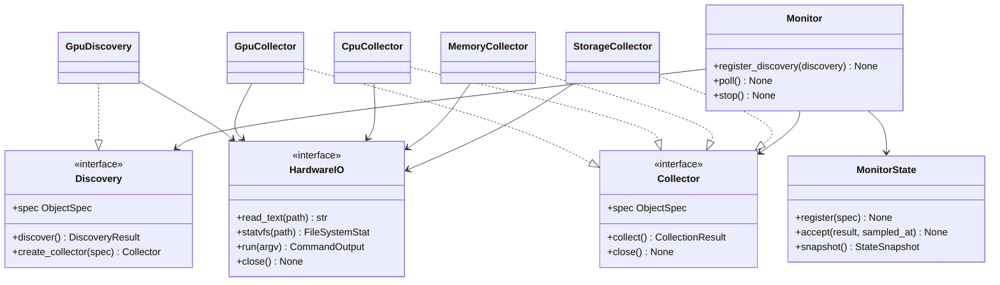

# 本机硬件模块设计

- 关联需求：dev-0 / REQ-002，AC-201～AC-207；共享 AC-101～AC-103、AC-108、AC-110、AC-112、AC-606～AC-608。
- 修订：v1.0，2026-10-30；依据 [requirements.md](../dev-workflow/dev-0/requirements.md) v1.12。
- 阶段：R2。接口和黑盒预期已经声明，具体采集、计算、动态调度及硬件绘制由 R4 实现。
- 代码：`collectors/hardware.py`、`collectors/base.py`、`monitor.py`、`tui/widgets.py`；组合接线在 `cli.py`、`tui/layout.py`。
- 关联设计：[Monitor/State](monitor-state.md)、[配置](configuration.md)、[应用外壳](application-shell.md)、[错误日志](error-logging.md)。

## 职责和范围

运行在被监控 Ubuntu 主机上，只读采集 NVIDIA GPU、整机 CPU/RAM 和配置前三个挂载点。采用已有 `Collector → Monitor → MonitorState → TUI`；不增加数据库、采样日志、网络流量、磁盘 IO、逐进程指标或服务控制。

REQ-002 负责硬件数据与按当前 `ViewSelection` 计算的 GPU 关联高亮。方向键修改选择由 REQ-005 完成，完整主题颜色映射由 REQ-006 完成；本需求提供对应语义颜色角色，不提前实现上述交互。Docker/vLLM 仍保留既有占位，不因接入硬件启动后续需求的采集。

保留 REQ-001 已实现的配置、状态、调度、日志和半页布局；R2 仅增加待实现入口、值类型、注释、设计与测试。原有运行路径不会提前调用新骨架。

## 核心结构



发现器报告不可变声明，只有 Monitor 注册对象、创建新来源并提交状态。发现器和每个来源独占一个 IO 端口；关闭一张卡不会关闭其他卡。TUI 只有不可变快照，不持有上述接口。

## 身份、字段与单位

所有模板值初始为 `None`；成功结果覆盖模板，已知不支持字段显式 `None`。具体字段以代码目录为准，不让布局根据字段顺序猜含义。

| 对象 key | 字段与存储单位 | 身份与展示规则 |
| --- | --- | --- |
| `host/cpu` | `cpu_percent`，% | 整机，独立采样与失败状态 |
| `host/ram` | `ram_used_bytes`、`ram_total_bytes`，B；`ram_percent`，% | 与 CPU 隔离，Host 标题汇总失败状态 |
| `storage/mount-0`～`mount-2` | `used_bytes`、`total_bytes`，B；`used_percent`，% | 序号按有效配置，界面显示配置原路径；长路径不会突破 ObjectKey 的128字符上限 |
| `gpu_inventory/local` | `device_count`，整数 | 面板级发现状态，不是设备，不计入 GPU 槽与最小高度 |
| `gpu/<完整 UUID>` | `index`、`name`；`utilization_percent`，%；`memory_used_bytes`、`memory_total_bytes`，B；`temperature_c`，°C；`power_w`，W | UUID为会话身份，可靠 index 为显示编号，name 来自采集 |

新 UUID 按发现顺序追加，已有 UUID 不因枚举顺序、模型选择、失败或热移除而重排/删除。新卡可能提高基础最小高度；故障本身不能改变布局。设备数不硬编码为5。已有通用 `Metric`/`ObjectSpec`/`CollectionResult` 和 `MonitorState` 足够，不另建硬件专用可变状态。

## 数值口径

### CPU 与 RAM

CPU 从 `/proc/stat` 的整机 `cpu` 行取 `user nice system idle iowait irq softirq steal` 八个累计 tick；不能累加逐核心行，不能把 `guest/guest_nice` 重复计入 total。设 `total` 为八项和，`busy=total-idle-iowait`，两次连续有效样本的 `cpu_percent=100×Δbusy/Δtotal`。无需除以核心数或按计划采样秒数换算。

首次、总 tick 无增长、任一参与计数回退及失败后首个成功样本都没有可比较区间，返回成功的 `None`，不伪造0、不记错误。回退/无增量的当前样本作为新基线；失败清空基线。Monitor超时会取消当前读取，CPU须捕获CancelledError清基线后原样重抛，不能跨超时计算。可比较区间忙 tick 无增长时真值是0。计数回退的处理也覆盖 Linux 文档说明的 iowait 可能下降，不把它误记为驱动故障。必要字段缺失、重复 aggregate 行或非法数字为解析失败。

RAM 使用 `/proc/meminfo` 的 `MemTotal`、`MemAvailable`（kB×1024）。`used=total-available`，`percent=100×used/total`；不采用 `MemFree`，不与显存/KV Cache 混合。`total>0` 且 `0<=available<=total`；缺失/重复必要键、非法单位或数值均失败，不用其他字段估算。CPU 与 RAM 分来源，任何一方失败不阻止另一方刷新。

### 挂载点容量

只创建有效配置的前三项，失败不能用第四项补位；`build_hardware_sources` 对手工构造 AppConfig 也防御性使用 `[:3]`。0项不创建 Storage 采集器，不记错误。

每次读 `/proc/self/mountinfo`，解析 ` - ` 分隔符前第5字段并解码 Linux 路径转义。配置和挂载路径只进行 POSIX 词法规范化，保留配置原文用于显示；不跟随符号链接、不使用父目录/最长前缀匹配。目标必须本身是精确挂载点，普通 `/data` 目录不能因存在或能调用 statvfs 就当成已挂载。

只有精确匹配后才调用 statvfs，再读 mountinfo 检查对应 mount ID、major:minor、root、挂载路径未变化。重复同路径挂载记录视作无法可靠确定目标，返回 `source.unavailable`，不能依赖文本顺序猜顶层挂载；bind mount 的唯一精确挂载记录正常支持。可观察到的卸载/替换导致本轮容量丢弃。前后检查无法证明极短的卸载又恢复（ABA）未发生，R4 可用打开目录的 mount ID 加强绑定；当前不承诺原子文件系统快照。

采用 `f_frsize×f_blocks` 为总容量，`f_frsize×(f_blocks-f_bfree)` 为已用；使用率为已用/总量。保留块包含在总量中，不能把 `f_bavail` 的普通用户可用口径混入百分比分母。`f_frsize>0`、`f_blocks>0`、`0<=f_bfree<=f_blocks`；不支持以0总量冒充有效容量。

### NVIDIA 数据

使用已安装的 `nvidia-smi` 只读查询，无 Python GPU 依赖。固定参数如下；以 argv 调用，不使用 shell：

```text
nvidia-smi --query-gpu=index,uuid --format=csv,noheader,nounits
nvidia-smi --query-gpu=index,uuid,name,utilization.gpu,memory.used,memory.total,temperature.gpu,power.draw --format=csv,noheader,nounits --id=<完整 UUID>
```

发现查询只枚举身份，逐卡查询通过 UUID 定位。查询字段或可用性随本地驱动存在差异时按下述规则处理，不回退为模拟数据，不按型号猜固定容量。

- GPU 利用率直接使用驱动 `%`，含义是采样周期内有 kernel 执行的时间比例，不能用显存比例代替。`memory.used/total` 按 MiB×1024² 转字节，温度为°C，功率为W。
- `power.draw` 是驱动最近测得的整板功率；较新设备可能是1秒平均，UI只标W，不承诺瞬时值。
- 逐卡查询必须一行、列数正确、UUID精确匹配。身份/结构错误整卡失败；单字段解析失败省略该字段，提交其他有效字段，State保留坏字段旧值并标整卡STALE。显存used/total作为关联容量组：任一容量实际解析失败时两者均省略，不能混合新旧样本产生8/4GiB等无效组合；已知N/A仍可独立返回None。
- `N/A`、`[N/A]`、`[Not Supported]` 是明确不可用标记，字段返回None且不记错误。空字段、`[Unknown Error]`、NaN/Infinity、越界值是解析失败。不能把任何括号文本都当“不支持”。
- index为非负整数；利用率0～100；温度和功率为非负有限数；显存总量>0且0≤已用≤总量。used>total时同时省略两项容量，保留其他有效字段。
- 成功的空CSV代表无卡。针对 CLI 的无设备响应，精确匹配独立的 `No devices were found` 且退出码0或6时也归一成功无卡；不是按所有非零退出码或包含关键字来猜无卡。该特殊输出目前仅有离线契约样本，目标驱动待用户部署后核对。
- 非零返回且不符合无设备特例为整体失败；缺少命令/驱动不可用为 `source.unavailable`。stderr和原始错误文本均不进入State/日志。

## GPU 发现、调度与资源生命周期

`Monitor.register_discovery(discovery)` 在首次 poll/run 前调用，无 IO，注册 inventory 模板；重复key拒绝，调度开始或停止后再注册拒绝。发现器按配置周期独立运行，遵守现有超时、不重入、忙时跳槽规则。

`DiscoveryResult.inventory` 走既有 accept/日志/recovered/通知流程；成功的 specs 是本轮完整枚举声明，失败必须为空。Monitor 先校验整个结果和工厂输出，再注册新卡：重复声明、模板改变、跨发现器/静态来源冲突或错误工厂输出使本轮 inventory 归一 `collector.unexpected`，不得半轮污染状态；已创建但未采用的资源关闭。

只为新UUID调用一次同步、无IO的 `create_collector`。新卡注册后立即发起首采，之后保留自己的周期原点；重复发现不重置历史、状态、采样相位或重新构造来源。已知卡不在最新清单中也不删除，独立UUID查询会标记故障并允许自动恢复。inventory失败只显示面板状态，不批量覆盖每张卡的结果。

stop须取消发现任务及所有静态/动态来源，关闭每个已创建资源；迟到发现不得创建来源、注册或提交。Monitor现有关闭逻辑只枚举初始来源，R4必须改为覆盖动态来源，整体退出预算仍为1秒，不串行叠加每个对象的预算。

## 失败与日志

| 情况 | kind / code | 状态行为 |
| --- | --- | --- |
| IO或调度超时 | timeout / collection.timeout | 当前对象STALE，CPU基线失效 |
| PermissionError | permission / access.denied | 仅受影响对象失败 |
| 未挂载/路径不存在/明确设备不存在 | not_found / object.not_found | 不回退父文件系统、不删除旧卡 |
| 结构、字段、数值非法 | parse / response.invalid | 按整对象/字段失败粒度保值 |
| 缺少命令、驱动不可用、其他受控IO故障、挂载发生变化或歧义 | unavailable / source.unavailable | 保值，后续自动重试 |
| 工厂/发现协议违反或未预期异常 | unexpected / collector.unexpected | 由Monitor隔离，不能泄漏异常 |

复用 REQ-001 已登记错误码和固定日志原因模板，不新建日志体系。首次失败立即ERROR，相同对象/错误60秒限频，恢复不记日志。CPU无基线、GPU已知不支持、成功无卡、未配置挂载点均成功无错误。界面仅固定槽STALE，无时间/原因/错误码；历史失败留缺口。

## 本地 IO 与接线

`HardwareIO` 只返回原始文本、statvfs计数、命令输出；测试替换此边界，不替换被测数值计算。`LocalHardwareIO` 将潜在阻塞的文件/statvfs调用放入可终止本地worker，nvidia-smi使用异步子进程。输出每路≤1 MiB，固定操作白名单、无shell，timeout取配置；取消和close须250ms内终止/回收自己创建的子进程。不能以无限阻塞线程宣称满足取消，也不执行任何网络请求。

不新增运行依赖或更改uv锁文件；R4若发现本地worker成本不适合0.1秒最小采样，可在维持隔离/取消契约的前提下使用有界常驻worker，仍不能让慢挂载阻塞其他来源。真实底层资源回收须在本地Ubuntu验证，R2不声称现有骨架已满足。

`build_hardware_sources(config)` 无IO地组装CPU、RAM、前三挂载及发现器。R4在 `ApplicationRuntime._components` 移除host/local占位、把静态spec加入同一State，交静态来源给Monitor后注册发现器。导入、`--help`、缺配置、构造阶段不能执行硬件查询。Docker/vLLM占位和RuntimeComponents注入通道保留。

## 硬件显示与模型关联

`widgets.hardware_cells` 只生成既有GPU/Host/Storage区域内的文字和状态槽；R4在compose_frame中替换通用占位内容，不重复绘制。区域坐标、边框、最小尺寸继续由layout.py负责。GPU每卡3行，Host外壳5行，Storage外壳6行/内容3行；5GPU最低120×37，0～4GPU最低120×36，Docker总数不参与高度公式。

| 区域 | 内容安排 | 语义颜色 |
| --- | --- | --- |
| GPU每槽第1行 | GPU编号、裁切名称、固定STALE槽 | 关联编号primary，否则muted；名称text |
| 第2行 | 分段条占可用内宽约一半，百分比紧邻条末 | 关联填充/百分比primary，否则muted；轨道muted |
| 第3行 | 显存已用/总量、温度、功耗 | 显存muted，其余text |
| Host内部3行 | CPU条与比例、RAM条与比例、RAM已用/总量 | 填充secondary；轨道muted；RAM已用muted，总量text |
| Storage row+2～row+4 | 每行配置路径、已用/总量、比例、固定STALE槽 | text/muted；无amber |

百分比先按ROUND_HALF_UP保留1位小数再去尾零，条的填充数使用同一显示百分比四舍五入到字符格；未知保留空轨道和—。容量以GiB/TiB二进制单位保留1位小数；已用和总量使用同一单位（总量≥1TiB切TiB）。不重新计算不同口径的使用率。

inventory首次未知显示—，成功0卡且从未有槽显示 `No NVIDIA GPUs`，失败在GPU面板标题状态槽STALE，不能显示成“检测到0卡”。有旧槽时保留所有旧槽。Host的CPU/RAM任一失败在标题预留位STALE；挂载逐行STALE。长路径/名称按终端字符宽度裁切，优先保住指标与状态，不增加行。

`linked_gpu_ids` 只读配置中当前模型的显式gpu_ids；缺省选择第一模型，未知选择或空映射清空高亮。完整UUID精确匹配可用于旧卡；索引只匹配本次已采样且非STALE的唯一index，规范十进制字符串（`4`，非`04`）。出现重复的当前index时不以索引猜映射。UUID前缀、名称、显存和负载均不作为依据。切换只改变编号/填充/百分比的role，不改变GPU顺序、状态、历史或采样次数。

Storage采用序号key。为保留REQ-001已有通用快照，缺少序号对象时兼容读取旧路径key，序号优先；旧host/local仍汇总通用字段和STALE。无index字段的旧GPU对象或纯十进制空槽沿用`GPU {key}`标签与`name: value`通用指标；存在index模板即走新硬件契约，None时显示GPU —，不得退回UUID标签。生产只建立新schema，这些只读兼容不用于GPU发现或真实设备身份推断。既有共享测试保持原公共行为断言，不以硬件接线为由跳过。

## 验证依据与边界

| 入口 | 黑盒测试 | 覆盖 |
| --- | --- | --- |
| CPU/RAM/Storage/GPU collect，GPU discover，工厂 | `tests/test_hardware.py` | AC-201～204/207；原始离线文本、IO错误、计数、挂载真实性、字段/单位/恢复 |
| Monitor.register_discovery/poll/stop | `tests/test_hardware_monitor.py` | 动态来源、发现原子性、独立周期/故障、真实State及ErrorLog、关闭 |
| percentage_bar/capacity_text/linked_gpu_ids/hardware_cells/compose_frame | `tests/test_hardware_view.py` | AC-201～207；值与颜色、固定布局、无映射清空、长路径、只读展示 |
| ApplicationRuntime.prepare_log/run/close | `tests/test_hardware_runtime.py` | 生产组合根到Frame，原始IO/终端替身，五卡最小尺寸、前三挂载、q退出与资源回收 |
| 既有Monitor/State/日志/CLI/配置/终端 | 原有全部tests | REQ-001回归、超时/键位响应、错误限频、Storage3行与半页布局 |

测试断言正确业务行为，不以NotImplementedError为成功、不使用xfail掩盖未实现。本阶段失败可分为新骨架未实现与现有Frame尚未接线；导入/环境错误单独记录。执行结果与证据见 [REQ-002 R2交接](../dev-workflow/dev-0/REQ-002/handoff-r2.md)。

本次使用本机 `nvidia-smi --help` / `--help-query-gpu`（v596.47）核对字段及index/UUID/功率语义，并读取本地Ubuntu手册 `proc_stat(5)`、`proc_meminfo(5)`、`proc_pid_mountinfo(5)`。原文保存到本需求evidence，属于已安装工具的离线材料，不代表目标服务器驱动615.71.09经过实测。部署文件仅作为已有目标环境背景，不从其GPU数量推定当前设备数。

尚需R4的本地Linux适配/worker超时取消/无输出泄漏测试、实际Frame呈现和运行期接线验证；最终目标GPU驱动输出、无卡返回码、权限、挂载状态没有现场验证。所有自动化保持离线，禁止连接服务器；未来部署验收须由用户安排。此限制不阻止本设计交接R3。
