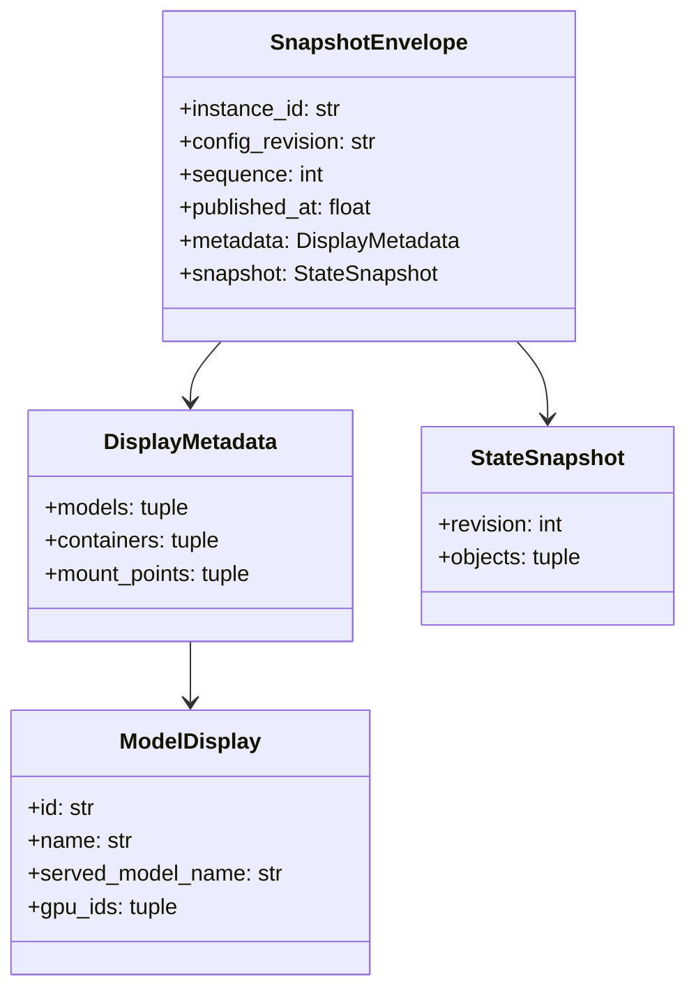
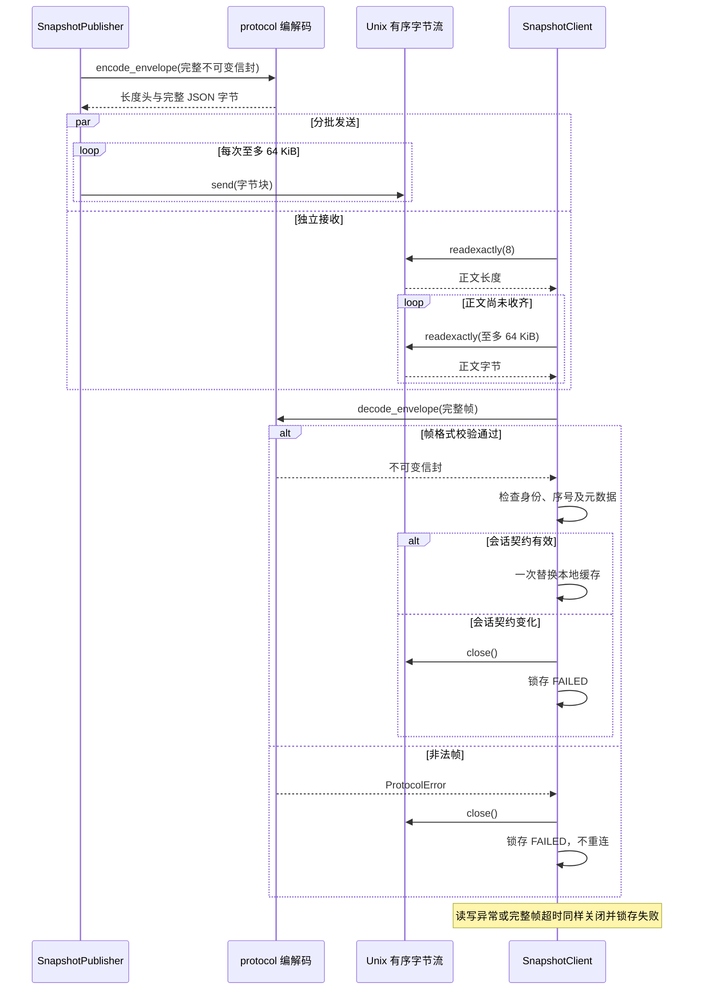

# 本机只读快照通道

- 关联需求：dev-1 [REQ-001](../dev-workflow/dev-1/requirements.md#req-001-宿主机常驻采集服务与-tui-客户端)；同时为 REQ-002 提供共享边界。
- 修订：v1.4，2026-11-19，明确 Web 读取同一已验证发布的正文及日常验证范围。
- 整体设计：[整体组件与进程边界](architecture.md)。
- 代码：[protocol.py](../../src/joi_observer/ipc/protocol.py)、[server.py](../../src/joi_observer/ipc/server.py)、[client.py](../../src/joi_observer/ipc/client.py)。
- 相关设计：[服务运行期](collector-service.md)、[状态](monitor-state.md)、[应用外壳](application-shell.md)、[配置](configuration.md)。

## 职责与协作

宿主服务通过 AF_UNIX / SOCK_STREAM 向 TUI 及同机 Web 容器推送已采集的全量快照。通道没有请求方法，没有采样触发、参数修改或远程管理操作。选择 Unix 域套接字以便按本地用户组控制访问，并使 Web 仅挂载专用通信目录，不接触 Docker socket、GPU 或配置目录。连接的写权限只代表可连接该 socket，不能解释为业务写权限。

## 类与对象简介

| 图中名称 | 简介 |
| --- | --- |
| `SnapshotEnvelope` | 不可变传输信封，将服务实例身份、发布序号、展示元数据和完整状态快照绑定为一次原子视图。 |
| `DisplayMetadata` | 不可变展示元数据类，保存客户端所需的主机标签、对象顺序、名称、端口及关联信息。 |
| `ModelDisplay` | 单模型展示值类，保存稳定 id、列表及详情名称和 GPU 关联等脱敏展示字段。 |
| `StateSnapshot` | 不可变状态视图类，携带同一读取时刻的对象指标、历史和状态更新序号。 |
| `SnapshotPublisher`（`Publisher`） | 服务端发布类，把已有快照编码后向本机只读连接发送有序字节。 |
| `Codec`（`protocol` 编解码） | 时序图中的纯函数角色，由 `encode_envelope` 和 `decode_envelope` 完成白名单校验及帧与信封的转换。 |
| `Stream`（Unix 有序字节流） | 时序图中的传输角色，由服务端 `PeerPort` 和客户端 `ReceiveStream` 表达同一连接的写入与读取边界。 |
| `SnapshotClient`（`Client`） | 只读接收客户端类，验证完整信封后原子替换本地缓存并维护连接状态。 |
| `ProtocolError` | 安全协议异常类，用固定诊断表示非法或不兼容输入，不携带收到的正文。 |

## 简化类图

## 关键交互时序图

MonitorState 仍是唯一指标计算者。发布者只调用其 `snapshot()`，封装当前固定元数据与发布序号；不按客户端数读取采集源。封装时先取得 `published_at=clock()`，随后在同一事件循环、没有 await 的同步段读取 `runtime.snapshot()`：采样提交不能夹入两步之间，State 用稍后的时钟裁剪旧历史，因此不会因发布时刻稍晚而使 60 秒边界点被协议拒绝。客户端收到完整合法帧后一次替换缓存；同步 `snapshot()` 只读该缓存。每帧均携带元数据，避免分两次请求造成旧名称/新数据混用。全量替换也避免客户端补历史、拼接差分或建立另一套统计基线。

## 帧、发布与时间

| 项目 | 契约 |
| --- | --- |
| 帧格式 | 8 字节无符号大端 body 长度，紧跟一个 UTF-8 JSON 对象；长度不含前缀 |
| 版本 | `protocol_version=1`，不兼容版本立即失败，不尝试猜测/降级 |
| body 大小 | 不设置完整快照的固定业务字节上限，超过原 8 MiB 仍是合法完整快照；零长度非法。无符号 64 位长度仅是格式表达范围，不是可承载容量承诺 |
| 分批读写 | `IO_CHUNK_BYTES=65536`，单次传输读写不超过该值。先读 8 字节头，再分批读取正文；不得按声明总长一次性预分配内存或调用一次 readexactly |
| 发布 | 首帧立即生成；State 更新后在下一可运行事件循环轮次合并生成全量帧；无更新时最多每 1 秒发送一次完整快照心跳，不以固定 1 Hz 限制数据更新 |
| 序号 | 服务实例内 `sequence` 从 1 严格递增；与 `snapshot.revision` 分离，客户端可跳号、不可倒退或重复 |
| 时间 | `published_at` 为宿主单调秒。同一实例内允许两个新序号有相同的发布时间。对象与历史沿用该时间域 |
| 超时 | 一次连接/首个完整帧最多 5 秒；之后自上一完整合法帧起 5 秒未收到完整帧即失败，零碎字节不延长预算 |
| 断开 | EOF、读写异常、超时、协议错误均结束当前连接，禁止后台重试 |
| 客户端请求 | 客户端无需发送任何字节；收到非空上行数据时服务端关闭该客户端，不能分派动作 |

同宿主 TUI 使用与服务相同的 monotonic 时间域，继续使用既有扫描历史坐标。Web 桥保留宿主时间戳，在成功的 HTTP 流响应头中给出同域的发头时刻。浏览器用最近可信完整帧校准绘图时钟，仅对已经画出的右缘保留单调下限，按一秒步进裁切近 60 秒。HTTP 新鲜度判定与页眉的估计 UTC 各有独立依据。见[数据通道](web.md)和[浏览器时间映射](web-dashboard.md#近-60-秒曲线)。

新读者的首帧优先使用最近已发布缓存；开始发送前发布年龄超过五秒的缓存不发送，等待下一次正常发布，且不因加入读者额外读取 source/采样。等待包含在客户端原首帧总期限内，不视为自动重连。这个发布时效判定不依据来源 sampled_at，也不改写来源的 STALE。具体入口和可控时钟见服务设计。

分批读写只是有序字节流的传输方式，不按时间切分历史，不增加分片编号、拼装请求或另一套应用层消息协议。一份快照仍含同一时刻的全部元数据、对象及最近约 60 秒历史。接收端收齐全部正文并通过完整验证后才替换缓存；半个正文不是可显示的半份快照。总数据量及完整快照所需内存仍随实际对象数增长；单次 64 KiB 缓冲限制不能被描述为总内存恒定或无限容量保证。

宿主发布和 IPC 接收沿用 REQ-001 已实现的异步编解码适配。worker 只处理不可变输入，每次最多一项在途，主事件循环安装已验证的结果。取消后丢弃迟到结果，清理遵守原预算。

Web 用 `SnapshotClient(..., retain_body=True)` 订阅。`wire_publication()` 同步读出同一已验证序号的 `(SnapshotEnvelope, bytes)`，正文已移除 8 字节长度头。先完成协议白名单、身份、元数据与序号校验，再把两者一起公开。客户端失败或关闭时同时作废。TUI 沿用默认的 `envelope()` 和 `snapshot()`，只保留绘制所需的解码结果。Web 桥在协议边界之外将正文封成 NDJSON，转发和合法排版换行的处理见[Web 数据通道](web.md)。

服务发布序号可因慢读者跳跃。每客户端至多一份在途完整帧和一份最新待发帧；待发帧可由新帧替换，已开始发送的帧须完成或关闭连接，不能在 body 中途换入新帧。编码一次的不可变 bytes 可在客户端之间共享，不能为每个客户端重新采集或编码。同轮更新合并只减少重复发布，不改变 Monitor 的采样次数、对象或相位。无订阅时采集与状态更新照常运行，首次新连接获取已发布的最近完整帧。

单个慢读者、断开或发送失败只关闭该连接。已成功启动之后若发生编码/发布主任务/监听 accept 内部故障，则关闭本发布器及其连接，报告一次固定安全错误，Monitor 继续；不自动重启发布器，管理员显式重启服务恢复发布。首次监听绑定失败则在启动 Monitor 前报告启动错误并清理。不能通过停止正在工作的 Monitor、截断监控对象或缩短历史来制造成功。失败客户端仍按无自动重连规则退出。整帧全部写入共用两秒总预算，零碎进展不重置；该慢读者判定及恢复边界见[服务设计](collector-service.md)。

## 原子配置与服务身份

`instance_id` 与 `config_revision` 是服务启动时各自生成的随机 UUID 字符串，不使用配置内容哈希，不携带文件路径。相同配置重启也生成新值；一次运行中即使配置文件变化也不变。元数据只从成功加载的不可变 AppConfig 投影一次。

同连接若任一标识改变，客户端按协议失效处理并退出/停在错误状态，绝不把新历史接到旧历史。同连接还要求 `metadata` 值全等、`published_at` 不倒退、`snapshot.revision` 不倒退；GPU 动态发现属于 snapshot 内容，不修改固定 metadata。新进程/明确手动新连接从空缓存开始接收全量帧；不能因旧服务恢复自行新建连接。`snapshot.revision` 只反映状态写入；历史在窗口之外过期时，快照内容可在相同 revision 下变化，客户端不能仅凭 revision 跳过全量替换。

## JSON 白名单

对象字段与 Python 冻结数据类同名，枚举 `ModelType` 序列化为其字符串值。下表所有字段均必需；没有值时显式传 `null`，不得通过缺字段改变语义。数组转换回 tuple，禁止动态类型反序列化或 pickle。

| JSON 层 | 允许字段 |
| --- | --- |
| 顶层 | `protocol_version, instance_id, config_revision, sequence, published_at, metadata, snapshot` |
| metadata | `hostname, system, mount_points, containers, models` |
| metadata.containers[] | `id` |
| metadata.models[] | `id, type, name, served_model_name, gpu_ids, explicit_port, effective_port` |
| snapshot | `revision, objects` |
| objects[] | `key, metrics, stale, sampled_at, history` |
| key | `collector, object_id` |
| metrics[] / history[].metrics[] | `name, value, unit, applicable` |
| history[] | `sampled_at, metrics`（整个 metrics 可为 null，表示失败缺口） |

元数据保持配置顺序与所有对象。模型 `served_model_name` 在服务端填入配置值或 `name` 回退值，客户端不再猜测；同名不同 id 保持独立。GPU 关联原样保留。模型端口由 `base_url` 投影：列表只使用 `explicit_port`；详情使用 `effective_port`，缺省为 HTTP 80 / HTTPS 443。URL 主机、路径、凭据与 scheme 不传输。Docker 只传配置 id，不传真实采集目标 name。挂载点是用户需要的显示标签，最多三项；日志目录、其他宿主文件路径不传输。主机标签保持既有 HostInfo 语义。

快照字段另受公开指标白名单约束，不允许将任意字段包装成 Metric 传出：

| 对象 | 允许指标 |
| --- | --- |
| host/cpu | `cpu_percent` |
| host/ram | `ram_used_bytes, ram_total_bytes, ram_percent` |
| gpu_inventory/local | `device_count` |
| gpu/完整 UUID | `index, name, utilization_percent, memory_used_bytes, memory_total_bytes, temperature_c, power_w` |
| storage/mount-0..2 | `used_bytes, total_bytes, used_percent` |
| docker/配置 id | `state` |
| vllm/配置 id | `running, waiting, total, decode_rate, prefill_rate, rate, ttft_seconds, queue_seconds, latency_seconds, kv_cache_percent` |

单位、适用性和值遵循 [硬件](hardware.md)、[Docker](docker.md)、[vLLM](vllm.md) 已有契约，不由客户端重算。浮点指标使用有限 JSON number，字符串和 null 保持原类型。**所有整数 Metric.value（包括 0）统一使用 `{"integer":"规范十进制字符串"}`**，history 内也采用相同形式；解码恢复精确 Python int，不能改成 float、截断或科学记数文本。序号、版本、revision、端口等结构字段仍使用其原有 JSON 整数形式。

整数 tag 仅允许一个 `integer` key，值须为 ASCII 十进制整数：允许单个前导负号，不允许加号、空白、前导零或 `-0`。普通 `0`/`42` JSON 整数不能出现在 Metric.value 中，以免小整数与大整数存在两种线格式；true 也不是整数。使用有界位数组转换，保留既有 `10**5000`、`10**10000` 边界，不调用全局 `sys.set_int_max_str_digits` 关闭解释器限制。这里的 tag 只是传输表示，不改变指标业务语义，也不改变现有视图的数值格式化算法。

Web 的 NDJSON 行保留相同整数标签，浏览器按十进制精确值排版，避免把超过 `2**53` 的整数转换成 JavaScript Number 而丢失精度。数值 `0`、`null` 与 `applicable=false` 必须区分，非适用字段 value 必须为 null。字符串仅用于既有指标（如 GPU 名称、Docker 生命周期），不能容纳原始响应或错误详情。见[页面指标映射](web-dashboard.md#指标映射)。

未知命名空间、未知指标、重复 JSON key、重复对象 key、重复模型/容器 id、重复指标名和额外字段一律拒绝；`true` 不是合法序号或数值。配置模型、容器、挂载点须与对应静态对象一一对应，GPU 允许按发现顺序动态出现；GPU discovery 尚未成功时允许没有 GPU 对象。协议允许没有 host/gpu_inventory 对象的空状态夹具，存在时必须匹配公开 key 和指标白名单；生产的首屏模板仍由运行期完整创建。时间有限非负，sampled_at 不晚于 published_at；history 按时间严格递增，每对象至多 602 点，保留 `[published_at-60, published_at]` 内的点，不插值、不补零。严格递增沿用 `MonitorState.accept()` 对同一对象拒绝相等或回退时间的既有规则；不同对象允许相同时间。所有历史裁剪与业务均值先由 State 产生，协议只验证不重算。

编码和解码都验证完整结构。编码只显式取白名单，禁止把 AppConfig、CollectionResult、Failure、异常或状态内部 accumulator 直接通用序列化。解码错误统一为 `ProtocolError`，可显示固定安全原因，不能把收到的字节/任意错误文本放进终端或浏览器。无完整合法帧前不构造可显示的部分会话。

## 接口与验证依据

REQ-002 的跨层验证使用示例中的 Chat、Embedding、Reranker 与日常硬件、容器数据。宿主复用具体的普通用例，包括 `test_fragmented_wire_is_installed_atomically_and_old_value_stays_immutable`、`test_same_revision_heartbeat_replaces_cache_when_history_expires` 和 `test_raw_sources_through_snapshot_transport_keep_original_values_and_frame_contracts`。完整执行清单见 [Web R2 交接](../dev-workflow/dev-1/REQ-002/handoff-r2.md)。

下表归档 REQ-001 的协议覆盖范围，包含该批次已完成的容量边界验证。[REQ-001 验收](../dev-workflow/dev-1/REQ-001/handoff-r5.md)

| 接口 | 契约与验证入口 |
| --- | --- |
| `build_metadata` | `tests/test_ipc_protocol.py`：名称回退、同名独立 id、GPU 关联/顺序、HTTP/HTTPS 端口、敏感配置排除、空配置；AC-107/113/114 |
| `encode_envelope` / `decode_envelope` | 同文件使用独立 JSON fixture，验证精度/单位/缺口与深不可变、8 字节长度、白名单与时窗、整数 tag、既有极大整数及超过旧 8 MiB 的完整快照；AC-104/107/109/110 |
| 发布者 | `tests/test_service_contract.py` 与服务设计：无客户端持续采集、多读者、慢读者隔离和只读上行；AC-101/102/103/110 |
| 接收者 | `tests/test_ipc_client.py`：首帧/正文分批原子接入、每次读取有界、不按声明总长预分配、大快照完整安装、本地缓存、不重连、服务实例失效；AC-105/108/112 |

禁止连接服务器的项目规则也覆盖本机 listener：黑盒验证用内存字节流替换 OS 端口，使用真实协议/服务/客户端待实现入口，不能模拟被测编解码结果。现有状态、采集解析、单位和窗口回归继续复用。R2 新测试实际结果由 [R2 交接单](../dev-workflow/dev-1/REQ-001/handoff-r2.md) 统一记录；NotImplementedError 表示业务实现基线，不能写成通过断言或 xfail 来隐藏。

目标机的运行目录权限、容器挂载与内网可达性属于部署现场核对。项目内使用内存传输验证数据和生命周期。[Web 部署](web-deployment.md)

## 修订说明

v1.4 将已验证正文作为 Web 订阅可选的只读视图，沿用原有线格式和宿主 TUI 接口。REQ-002 与 REQ-001 各自的执行范围见上节。

v1.3，2026-11-16：集中介绍两图中的类和对象，并明确 `Codec`、`Stream` 是协作角色而非新增类；原有传输和验证契约不变。

2026-11-16：按更新后的 R2 图文规范补充核心类图、关键交互时序和整体设计入口；原有接口行为、数值及测试契约不因图面修订改变。

v1.1 采纳 R2-REV-001～003 及用户后续决定：取消完整快照的任意 8 MiB 上限；保留有界流式读写而不引入应用层分片；更新驱动发布并保留一秒无更新心跳；明确极大整数的精确线格式与黑盒回归。历史按最近约 60 秒保留，配置采样间隔现为 1～60 秒；602 点仍是底层状态的既有防御上界，不因生产采样下限提高而删除低间隔离线数学测试。
