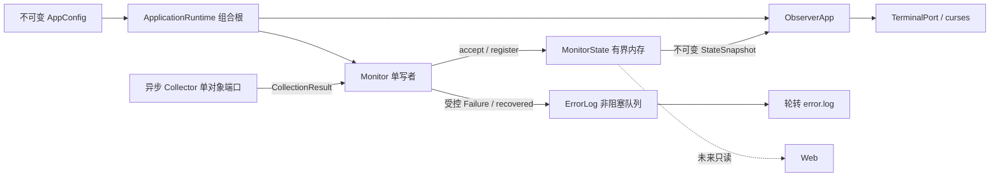
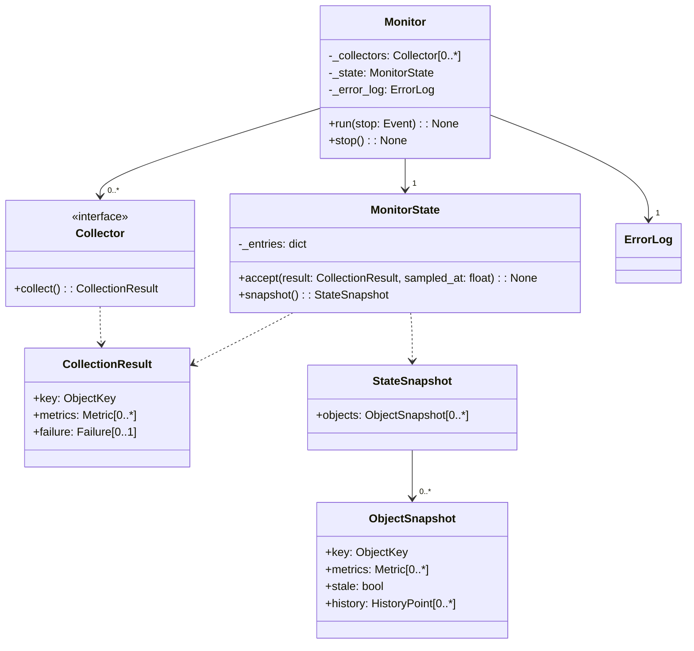

# Monitor 与内存状态设计

- 关联需求：dev-0 / REQ-001，AC-101～AC-104、AC-108、AC-110～AC-112；为后续采集与展示提供共享边界。
- 修订：v1.6，2026-10-30；补充 REQ-003 单容器结果与调度接入，依据 requirements.md v1.12。
- 相关代码：`src/joi_observer/collectors/base.py`、`monitor.py`、`data/models.py`、`data/state.py`。
- 关联模块：[配置](configuration.md)、[应用外壳](application-shell.md)、[错误日志](error-logging.md)。

## 范围与结构

REQ-001 设计应用运行的公共基础；当前分支已同步 v1.12 的配置/布局规则，本轮 WSL 基线测试通过。具体硬件、Docker、vLLM IO 属于REQ-002～REQ-004，复用同一调度、配置和失败处理；REQ-005～REQ-006完成模型联动与视觉细节。未来Web只读同一状态，不建立第二套采样。

采用 Python 3.12+ 的 src 布局。将原规划的包内 `config.yaml` 改为 `config.py` 与 `examples/config.yaml`，区分解析代码、随包示例和用户配置。新增 `cli.py`、`error_log.py`、`tui/layout.py`；此时不建立无内容的 `web/`、具体采集器或主题文件。

安装与开发环境统一使用 uv：日常以 `uv tool install` 安装后直接调用命令，项目开发使用 `uv run`，两者均无需每次手动激活环境。命令、PATH 和安装验收详见[应用外壳设计](application-shell.md#uv-安装与开发运行)；此约定不改变采集和状态接口。

## UML 类图

类图只保留采集、调度、状态、日志和快照的核心关系。实线箭头表示可导航关联，虚线箭头表示类型依赖；端点数字表示多重性，连线不添加文字标签。`+`为公有成员，`-`为私有成员，`[0..1]`表示可为空。

`MonitorState._entries`是按ObjectKey保存当前数据与历史的状态表。CollectionResult是一次采集的结果；StateSnapshot及其中的ObjectSnapshot是交给界面的只读视图。快照可以共享不可变数据，因此使用普通关联。

调度记录、状态条目、指标和历史点等细节不单独展开；完整类型及方法签名保留在代码注释中。图中未列出时间参数、运行标记、时钟回调、日志内部结构和辅助操作。此处精简的是设计视图，现有接口骨架和行为契约不变。

## 对象身份与依赖边界

`ObjectKey(collector, object_id)` 联合唯一。来源命名空间使用 `host`、`gpu`、`storage`、`docker`、`vllm`；主机固定 `local`，GPU 使用可靠设备标识，Docker/模型使用配置 `id`，挂载点可用配置序号标识 `mount-0`、`mount-1`（路径作为展示字段）。重启可以重新建状态，故挂载点序号无需跨配置修改持久化。名称不是主键，同名不同服务不合并。

单对象 `Collector` 无 UI 引用、不写状态、不记日志。独立调度粒度必须至少隔离单 GPU、挂载点、容器和模型。REQ-002 的 GPU 发现/批量读取可以共享底层读取，不能让单卡字段失败误报所有卡；发现失败必须有 GPU 面板状态位，不能伪造设备。设备发现和字段表的具体契约由 REQ-002 补充，组合根通过 `register` 纳入对象。

配置层只纳入前3个挂载点，但保留全部容器及其顺序。Monitor/MonitorState不得接收按屏幕容量截断的容器列表；Docker只在生成Frame时取可见前缀。隐藏容器持续采集、保留当前状态及历史，真实失败照常写日志；单纯隐藏不属于失败。窗口缩放只改变可见行数，不增减来源或重置状态，重新可见时立即显示现有快照。

`CollectionResult` 是已解析的语义结果，不携带原始 HTTP 响应或异常；正常停止的容器、0、无延迟观测和已知不支持指标都是成功。只有实际采集失败带 `Failure`。日志原因分类详见错误日志模块。硬件百分比、vLLM 计数器和窗口均值不在公共调度器计算，D-001 的 vLLM 0.31.0 指标核对留给 REQ-004。

REQ-003 具体使用 `ObjectKey("docker", config.id)` 和唯一 `Metric("state", None/规范状态)`。每个 DockerCollector 独占本机命令端口，失败返回空 metrics 与既有 Failure，取消原样传播；无需修改本模块算法。全部采集器由组合根注册并交给 Monitor，隐藏项同样更新状态与日志。详见 [Docker 设计](docker.md)，真实采集入口到 Frame/Log 的联合测试为 `tests/test_docker_integration.py`。

## 采样节奏、超时与关闭

每个来源具有独立任务、下次到期槽和超时。启动时立即采样，之后按 `start + n × sample_interval` 发起，默认 1 秒；超时默认 3 秒。来源仍在运行时跳过该槽，无排队、补采或重叠。例：在 0 秒发起的请求到 2.2 秒才结束，1、2 秒的槽跳过，下一次最早 3 秒发起；其他来源仍在 0、1、2、3 秒正常采集。

`poll()` 是可确定性测试的非阻塞迭代，不等待采集完成；每次至少让出一次事件循环。`run()` 循环调用内部调度迭代，完成与停止通知处理延迟最多 50ms，空闲时等待而非忙循环。外部不可在 `run()` 期间并发调用 `poll()`。UI 独立运行，主题/导航/时钟刷新只读状态，不创建采集任务。正常周期内完成的数据在下一次 UI 刷新可见（UI 刷新间隔见外壳文档）。

每个采集任务使用独立超时，超时转换为 `timeout/collection.timeout`，未知异常或返回错误对象 key 转为 `unexpected/collector.unexpected`，不带原始异常。超时来源置 STALE，其他来源继续；取消属于关闭而非采集失败。库同步阻塞调用不得直接放在事件循环中；实际 IO 适配器需采用可取消异步 IO、底层超时或可终止子进程，不能把无限阻塞工作简单丢进线程而声称可以取消。

采集器取消/close 应在 250ms 内清理。`Monitor.stop()` 独立调用时最多等待 1 秒，停止后不提交迟到结果；组合根退出总预算同为 1 秒，首先保证终端恢复，再协调 Monitor 取消与日志关闭，将剩余预算传给日志，不能把两者的 1 秒上限串行相加。超过协议预算的适配器属于实现缺陷，不能把这一前提当作已验证的真实环境能力。SIGINT/SIGTERM 走清理路径；SIGKILL、断电等不可恢复路径不作保证。

## 状态与历史契约

`ObjectSpec` 提供首屏字段模板，初始 `None` 展示 `—`，初始不 STALE；首次失败仍为 `—`，只填预留 STALE 槽。成功值 0 正常保留；不适用字段用 `applicable=False`，视图显示 N/A。成功结果必须覆盖声明字段，未知/缺失字段需要显式 None；失败允许局部有效字段更新，遗漏字段保留最后有效值，整对象标记 STALE。

状态持有最近结果、上一次成功样本及单调时间、故障状态和最多 60 秒历史。失败打断可比较基线，不能跨故障插值或延续成新观测。历史失败点为 `metrics=None`，不能补 0；部分失败保守留下缺口，后续按字段细分历史可扩展。只保存原始语义值，不在本模块把 Token 计数当成速率。REQ-004 将定义所需基线和计数器重置语义。

每对象历史同时受时间与条数限制：保留闭区间 `[now-60, now]`，默认最多 602 点，与配置的最小 0.1 秒周期相匹配。写入时裁剪，读取时进一步过滤过期点，不修改 revision；长时间无新样本不会让过期历史继续显示。数据对象数由配置与设备决定，历史不会随运行时长无限增长。会话内 GPU 槽位只增加不因失败缩减，热移除仍保留原位置并标 STALE，真实热插拔发现规则由 REQ-002 延续。

展示快照由冻结 dataclass、tuple、不可变标量构成，与后续写入隔离；不含 Failure、异常文本或最后成功时间诊断。内部 `sampled_at` 仅用于计算，不得显示到 TUI。单调时钟用于节奏/限频/历史；服务器本地墙上时间用于顶部当前时间及日志发生时间，内部datetime可保留时区，日志time只输出 `YYYY-MM-DD HH:MM:SS`，不附带时区信息、不转换成UTC。系统校时不能导致负速率或绕过限频。

Monitor 是唯一状态写入者，提交成功后发一次轻量通知。日志入队失败或被限频不影响状态提交、STALE 更新或采样频率。成功采样调用日志 `recovered` 清除该对象故障轮次；恢复本身不写日志。读者不会直接持有可变内部状态，未来 Web 也遵守此契约。

## 接口与验证依据

| 接口 | 契约位置 | 黑盒验证 |
| --- | --- | --- |
| Collector.collect/close | `collectors/base.py` | 离线可等待/失败/取消的 Source 端口，隔离所有外部 IO |
| Monitor.poll/run/stop | `monitor.py` | `tests/test_monitor.py`：即时/自定义周期、慢源不阻塞、不重叠、超时隔离、未知异常清洗、取消关闭 |
| MonitorState.accept/snapshot | `data/state.py` | `tests/test_state.py`：首次未知、失败保值/缺口、0/不适用、恢复、不可变视图、时间及点数上限、非法提交原子性 |
| ObjectKey/CollectionResult/StateSnapshot | `data/models.py` | 顺序/稳定身份、注册幂等、快照不暴露故障原因 |
| Monitor→ErrorLog | 同上及 `error_log.py` | 61次失败仍提交61次；日志限频由真实日志模块测试另行验证，不 mock 被测调度结果 |
| Monitor/State→Frame | `tests/test_integration.py` | 十个容器持续采集，显示容量4→6→3时仅变可见前缀；隐藏对象失败仍记日志，重新可见读取当前STALE状态 |

入口为 `python -m pytest tests/test_state.py tests/test_monitor.py tests/test_integration.py`。节奏测试注入单调时钟；超时使用本机事件循环，采集端口使用离线样本，不连接服务。已有实现继续保留，当前这些测试通过；REQ-003 的新采集骨架失败与公共代码回归分开记录。历史结果见 REQ-001 交接，本轮结果见 [REQ-003 R2 交接](../dev-workflow/dev-0/REQ-003/handoff-r2.md)。

本轮已在本地 WSL 复验当前尺寸边界及既有终端测试，不依赖 v1.9 的历史记录证明当前行为。真实GPU、Docker、vLLM采集器仍待后续需求接入，权限/输出未实机验证。

## 修订说明

v1.3 采纳用户对类图的修正：移除按数据流绘制的箭头，用可导航关联、类型依赖和独占组合表达静态关系；快照之间不再使用组合。两张互补类图补齐Monitor/MonitorState的持有成员、调度/内存记录及公共数据类型，并同步两种私有记录的骨架声明。没有改变公开方法签名、验收条件或业务行为。

v1.4 按用户反馈精简为单张类图，删除连线标签、非关键成员及细节类的展开，保留核心对象关联与参数/返回类型依赖。完整接口注释和代码结构保持不变。

v1.5 对应需求v1.12：限定有效挂载来源为前三项，容器来源与状态完整保留，Docker可见容量只作用于Frame；补充隐藏对象采集/日志/缩放的离线联合测试。核心类图和公开方法签名不变。

v1.6 对应 REQ-003：补齐 Docker 的 state 字段和组合根接入引用；保留 Monitor/MonitorState 现有实现、生命周期和错误目录。
