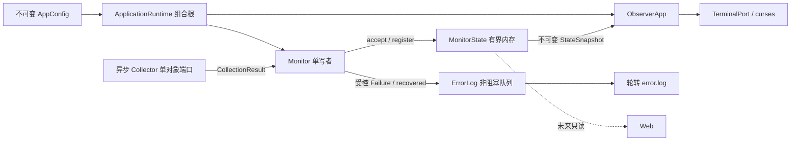
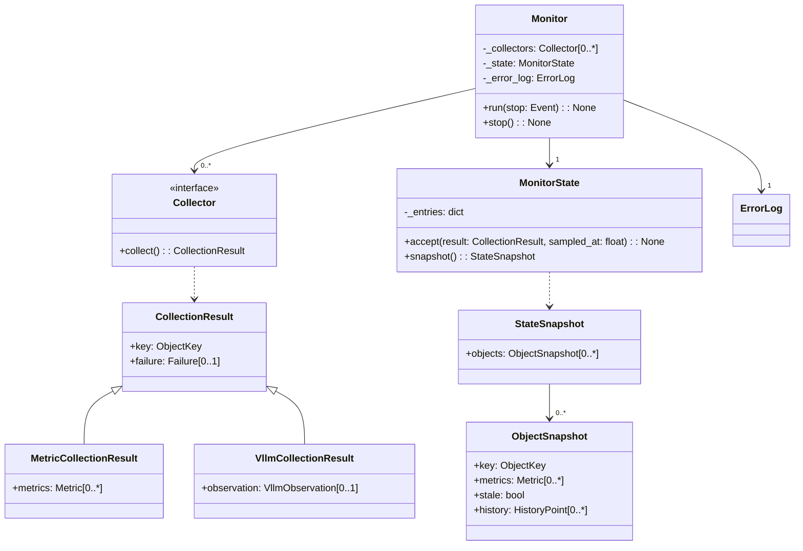

# Monitor 与内存状态设计

- 关联需求：dev-0 / REQ-001～REQ-004；AC-101～AC-104、AC-108、AC-110～AC-112、AC-201～AC-207、AC-301～AC-304、AC-401～AC-412。
- 修订：v1.8，2026-11-05；统一公共结果与 spec 匹配契约，将 vLLM 状态接合并入正文，指标算法引用 vLLM 设计；行为不变。
- 相关代码：`src/joi_observer/collectors/base.py`、`monitor.py`、`data/models.py`、`data/state.py`。
- 关联模块：[配置](configuration.md)、[应用外壳](application-shell.md)、[错误日志](error-logging.md)。

## 范围与结构

本模块维护采集调度、公共结果分型与内存状态契约。硬件、Docker 与 vLLM 来源复用同一调度和失败处理；采集结果由 Monitor 统一写入唯一的 MonitorState，展示层只读快照。来源识别与指标算法由各采集模块定义，选择与主题属于展示层。未来 Web 只读同一状态对象，不建立第二套采样。

配置加载和应用组合入口分别见[配置设计](configuration.md)与[应用外壳设计](application-shell.md)，不在本模块重复维护目录、安装或启动步骤。

## UML 类图

类图只保留采集、调度、状态、日志和快照的核心关系。实线箭头表示可导航关联，虚线箭头表示类型依赖；端点数字表示多重性，连线不添加文字标签。`+`为公有成员，`-`为私有成员，`[0..1]`表示可为空。

`MonitorState._entries` 是按 ObjectKey 保存当前数据与历史的状态表。结果类型的构造和匹配规则见[公共结果与 spec 匹配](#collection-results)。按既定图面偏好省略 Monitor/MonitorState 到 CollectionResult 的依赖线。StateSnapshot 及其中的 ObjectSnapshot 是交给界面的只读视图；快照可以共享不可变数据，因此使用普通关联。

调度记录、状态条目、指标和历史点等细节不单独展开；完整类型及方法签名保留在代码注释中。图中未列出时间参数、运行标记、时钟回调、日志内部结构和辅助操作。此处精简的是设计视图，现有接口骨架和行为契约不变。

## 对象身份与依赖边界

`ObjectKey(collector, object_id)` 联合唯一；名称不是主键，同名不同服务不合并。具体 key 与来源身份分别见[硬件设计](hardware.md#身份字段与单位)、[Docker 身份](docker.md#docker-identity)和[vLLM 配置与身份](vllm.md#3-配置身份与版本)。重启重建状态，不要求跨配置持久化。

单对象`Collector`无UI引用、不写状态、不记日志。CPU、RAM、单GPU、挂载点、容器和模型独立调度。REQ-002采用独立Discovery端口，组合根在首次poll/run前调用`Monitor.register_discovery`，由Monitor注册inventory和新发现对象；发现器不能直接写State。失败只影响inventory，旧卡继续独立查询；新UUID追加、消失保槽。完整接口、结果原子校验、工厂与关闭规则见[硬件设计](hardware.md#gpu-发现调度与资源生命周期)。

有效来源集合由[配置契约](configuration.md#configuration-fields)及发现器决定，不受[显示容量](application-shell.md#可验证的字符容量)影响。隐藏对象仍持续采集、保留状态与历史并记录真实失败；隐藏本身不是失败。缩放不增减来源或重置状态，重新可见时读取现有快照。

## 公共结果与 spec 匹配

公共结果采用以下冻结类型；三个构造器的 `failure` 都只能按关键字传入：

| 类型与位置 | 构造签名 | 用途 |
| --- | --- | --- |
| `data/models.py::CollectionResult` | `CollectionResult(key, *, failure=None)` | 仅 key/failure；Monitor 可为任意对象创建无载荷公共失败，成功基类结果无效 |
| `data/models.py::MetricCollectionResult` | `MetricCollectionResult(key, metrics=(), *, failure=None)` | 普通 ObjectSpec、硬件和 Docker 的平面指标 |
| `data/vllm.py::VllmCollectionResult` | `VllmCollectionResult(key, observation=None, *, failure=None)` | VllmSpec 对应的模型语义观测 |

Collector 协议返回 CollectionResult，Monitor/MonitorState 接受公共基类；具体采集器返回对应子类。公共 `data/models.py` 不引用 vLLM 类型。任何结果都不携带原始 HTTP 响应或异常；正常停止的容器、0、无延迟观测和已知不支持指标都是成功具体结果，只有实际采集失败带 Failure。硬件百分比、vLLM 计数器和窗口均值不在公共调度器计算。

`ObjectSpec` 提供静态 Metric 模板，只接收 MetricCollectionResult；成功结果必须覆盖模板，未知或已知不支持字段显式为 None。即使普通 spec 的 key 使用旧 `vllm` 命名空间，也不自动切换分支。`VllmSpec` 携带模型类型、期望服务名和静态 Metric 模板，只接收 VllmCollectionResult，由 State 内 VllmAccumulator 验证观测并生成完整显示指标；完整失败允许 observation=None 且 failure 非空，局部失败保留有效观测字段。

Monitor 产生的无载荷公共失败按目标 spec 处理，对两种 spec 均有效；公共基类 failure=None、具体结果类型不匹配或内容非法时均原子拒绝，不修改状态。分支选择依据注册的 spec 类型，不依据命名空间字符串。

## 采样节奏、超时与关闭

每个来源具有独立任务、下次到期槽和超时。启动时立即采样，之后按 `start + n × sample_interval` 发起，默认 1 秒；超时默认 3 秒。来源仍在运行时跳过该槽，无排队、补采或重叠。例：在 0 秒发起的请求到 2.2 秒才结束，1、2 秒的槽跳过，下一次最早 3 秒发起；其他来源仍在 0、1、2、3 秒正常采集。

`poll()` 是可确定性测试的非阻塞迭代，不等待采集完成；每次至少让出一次事件循环。`run()` 循环调用内部调度迭代，完成与停止通知处理延迟最多 50ms，空闲时等待而非忙循环。外部不可在 `run()` 期间并发调用 `poll()`。UI 独立运行，主题/导航/时钟刷新只读状态，不创建采集任务。正常周期内完成的数据在下一次 UI 刷新可见（UI 刷新间隔见外壳文档）。

每个采集任务使用独立超时，超时转换为 `timeout/collection.timeout`，未知异常或返回错误对象 key 转为 `unexpected/collector.unexpected`，不带原始异常，并按[公共失败路径](#collection-results)提交。超时来源置 STALE，其他来源继续；取消属于关闭而非采集失败。库同步阻塞调用不得直接放在事件循环中；实际 IO 适配器需采用可取消异步 IO、底层超时或可终止子进程，不能把无限阻塞工作简单丢进线程而声称可以取消。

采集器取消/close 应在 250ms 内清理。`Monitor.stop()` 独立调用时最多等待 1 秒，停止后不提交迟到结果；组合根退出总预算同为 1 秒，首先保证终端恢复，再协调 Monitor 取消与日志关闭，将剩余预算传给日志，不能把两者的 1 秒上限串行相加。超过协议预算的适配器属于实现缺陷，不能把这一前提当作已验证的真实环境能力。SIGINT/SIGTERM 走清理路径；SIGKILL、断电等不可恢复路径不作保证。

## 状态与历史契约

初始模板值为 None，初始不 STALE；首次失败保留未知值并设置故障状态。展示符号与固定状态位置见[应用外壳](application-shell.md#只读呈现与诊断隔离)。结果校验先遵守[公共结果与 spec 匹配](#collection-results)。

成功值 0 正常保留；不适用字段用 `applicable=False`。具体失败结果允许局部有效字段更新，遗漏字段保留最后有效值，整对象标记 STALE；公共失败不更新任何业务字段。

状态持有最近结果、上一次成功样本及单调时间、故障状态和最多 60 秒历史。失败打断可比较基线，不能跨故障插值或延续成新观测。历史失败点为 `metrics=None`，不能补 0；部分失败也保守留下整点缺口。普通指标直接合并，vLLM 语义观测通过[状态接合](#vllm-state)处理。

每对象历史同时受时间与条数限制：保留闭区间 `[now-60, now]`，默认最多 602 点，与配置的最小 0.1 秒周期相匹配。写入时裁剪，读取时进一步过滤过期点，不修改 revision；长时间无新样本不会让过期历史继续显示。数据对象数由配置与设备决定，历史不会随运行时长无限增长。会话内 GPU 槽位只增加不因失败缩减，热移除仍保留原位置并标 STALE，真实热插拔发现规则由 REQ-002 延续。

展示快照由冻结 dataclass、tuple、不可变标量构成，与后续写入隔离；不含 Failure、异常文本或最后成功时间诊断。内部 `sampled_at` 仅用于计算，不得显示到 TUI。节奏和历史使用单调时钟；日志限频与墙钟格式由[错误日志](error-logging.md)维护，顶部时钟由[应用外壳](application-shell.md)维护。系统校时不能导致负速率或绕过限频。

Monitor 是唯一状态写入者，提交成功后发一次轻量通知。日志入队失败或被限频不影响状态提交、STALE 更新或采样频率。成功采样调用日志 `recovered` 清除该对象故障轮次；恢复本身不写日志。读者不会直接持有可变内部状态，未来 Web 也遵守此契约。

### vLLM 状态接合

每个 VllmSpec 对应由 State 独占的 VllmAccumulator。同一次 `accept` 原子验证观测、推进基线、计算字段、合并保值并写入通用 HistoryPoint；原始累计计数、异常和 HTTP 正文不进入 ObjectSnapshot。各指标组的连续性、速率、延迟窗口及浮点溢出处理统一见[vLLM窗口算法](vllm.md#vllm-windows)，失败影响范围见[vLLM失败契约](vllm.md#8-失败保值与历史缺口)。

`snapshot` 使用同一单调时钟调用 accumulator 的只读窗口投影。过期均值可以变为 None，但不改变 revision、采样状态、基线或旧快照；普通硬件/Docker 状态路径不受该投影影响。

## 接口与验证依据

| 接口 | 契约位置 | 黑盒验证 |
| --- | --- | --- |
| Collector.collect/close | `collectors/base.py` | 离线可等待/失败/取消的 Source 端口，隔离所有外部 IO |
| Monitor.poll/run/stop | `monitor.py` | `tests/test_monitor.py`：即时/自定义周期、慢源不阻塞、不重叠、超时隔离、未知异常清洗、取消关闭 |
| MonitorState.accept/snapshot | `data/state.py` | `tests/test_state.py`：首次未知、失败保值/缺口、0/不适用、恢复、不可变视图、时间及点数上限、非法提交原子性 |
| ObjectKey/CollectionResult/MetricCollectionResult/StateSnapshot | `data/models.py` | 顺序/稳定身份、公共失败、具体结果类型匹配、注册幂等、快照不暴露故障原因 |
| VllmCollectionResult/VllmSpec/VllmAccumulator | `data/vllm.py`、`tests/test_vllm_state.py` | vLLM 类型化结果、原子拒绝、独立窗口与只读投影 |
| Monitor→ErrorLog | 同上及 `error_log.py` | 61次失败仍提交61次；日志限频由真实日志模块测试另行验证，不 mock 被测调度结果 |
| Monitor/State→Frame | `tests/test_integration.py` | 十个容器持续采集，显示容量4→6→3时仅变可见前缀；隐藏对象失败仍记日志，重新可见读取当前STALE状态 |

公共验证入口为 python -m pytest tests/test_state.py tests/test_monitor.py tests/test_integration.py；硬件动态调度验证见 tests/test_hardware_monitor.py，Docker 接入验证见 tests/test_docker_integration.py。节奏测试注入单调时钟，超时使用本机事件循环，采集端口使用离线样本。历史基线及分需求实现、验收结果见各需求交接单；硬件与 Docker 共同接线后的整合回归应单独执行并记录，不能以各自独立验证结果替代。

整合验证覆盖动态调度、全部资源关闭、运行期接线及普通/专用状态分支。使用离线来源；用户回传的 vLLM 采证只作为离线指标证据，不构成运行期联调验证或服务器连接授权。

## 修订说明

v1.8 合并公共结果类型、spec 匹配和 vLLM 状态接合的重复正文；采集身份、窗口算法、时钟格式与展示几何改为引用所属模块，不改变接口或行为。

v1.3 采纳用户对类图的修正：移除按数据流绘制的箭头，用可导航关联、类型依赖和独占组合表达静态关系；快照之间不再使用组合。两张互补类图补齐Monitor/MonitorState的持有成员、调度/内存记录及公共数据类型，并同步两种私有记录的骨架声明。没有改变公开方法签名、验收条件或业务行为。

v1.4 按用户反馈精简为单张类图，删除连线标签、非关键成员及细节类的展开，保留核心对象关联与参数/返回类型依赖。完整接口注释和代码结构保持不变。

v1.5 对应需求v1.12：限定有效挂载来源为前三项，容器来源与状态完整保留，Docker可见容量只作用于Frame；补充隐藏对象采集/日志/缩放的离线联合测试。核心类图和公开方法签名不变。

v1.6 对应 REQ-002、REQ-003：明确 GPU UUID、inventory、CPU/RAM 独立身份及挂载序号，补充 DiscoveryResult/Discovery 与 Monitor.register_discovery 接口、动态来源注册和生命周期约定；补齐 Docker 的 state 字段及组合根接入边界。两类来源复用 Monitor/MonitorState 的状态、调度和错误处理。动态发现及硬件细节见[本机硬件设计](hardware.md)，容器契约见 [Docker 设计](docker.md)。

v1.7 按用户确定的公共基类加两个子类拆分结果类型；公共基类不再引用具体观测类型，failure 统一仅关键字传参。Collector/Monitor/State 接口仍接受公共基类，普通路径迁移为 MetricCollectionResult；VllmCollectionResult 及 accumulator 专支继续作为 R2 契约，不提前实现业务。
