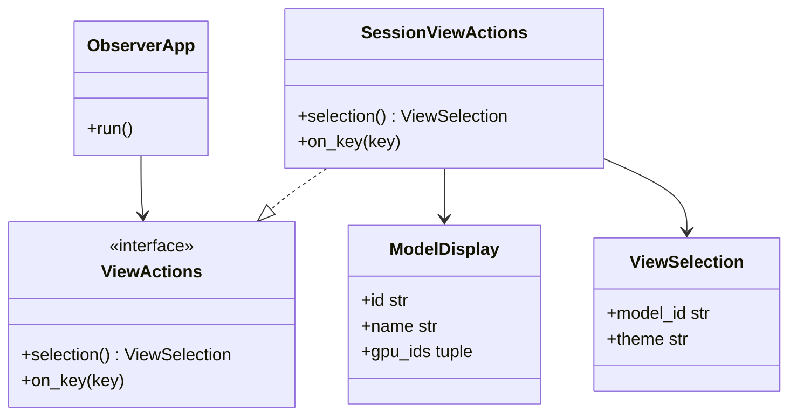
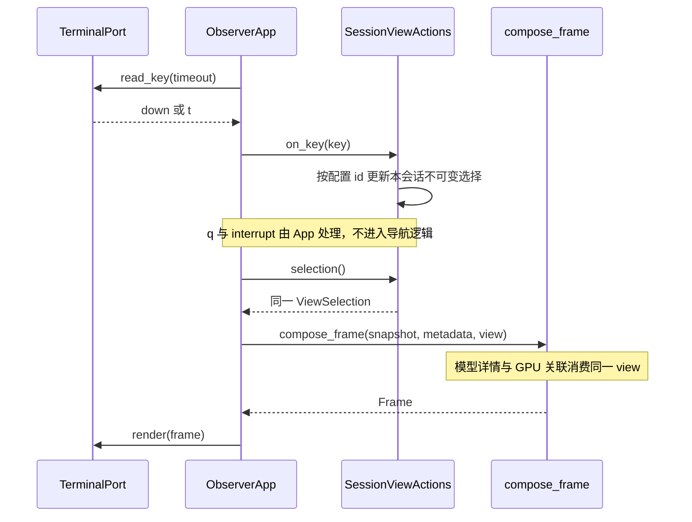

# 模型导航与服务入口设计

- 关联需求：dev-0 / REQ-005、REQ-006，`requirements.md` v1.20，AC-501～504；依赖 REQ-001、REQ-002、REQ-004。
- 关联需求补充：dev-1 / REQ-001，AC-105/106/107/108/114。
- 修订：v2.2，2026-11-16；在图前集中说明导航类、对象别名及纯函数角色。
- 整体设计：[组件边界与依赖](architecture.md)。
- 代码：`src/joi_observer/tui/navigation.py`、`tui/services.py`；复用 `tui/app.py`、`tui/layout.py`、`tui/vllm.py`、`tui/widgets.py`。
- 关联模块：[应用外壳](application-shell.md)、[硬件](hardware.md)、[vLLM](vllm.md)、[配置](configuration.md)、[Monitor / State](monitor-state.md)。
- 当前阶段：REQ-005 已实现并合并，REQ-006 默认主题、HTML 布局和会话接线是既有基线。REQ-005 R2 交接历史路径为 `docs/dev-workflow/dev-0/REQ-005/handoff-r2.md`，REQ-006 阶段交接同属 dev-0；当前工作区未包含这些历史文件，不作为本轮验证证据。

## 职责与已有基础

导航只维护当前 TUI 应用实例的模型选择和主题标识，不参与采集、历史计算、健康判断或 GPU 发现。数据流为 `Collector → Monitor → MonitorState → 本机只读 IPC → TUI 缓存 → 视图`；所有模型无论是否可见或选中均由常驻服务内同一个 Monitor 持续采集。控制器不接收 Monitor、State、SnapshotReader、终端或传输端口。

dev-1 的元数据输入迁移为 R2 目标，现有会话控制逻辑保留供 R4 复用；以下 dev-0 已实现说明及历史验收不代表 IPC 已接通。

当前基线是已合并 REQ-005 的 `0a42646`。以下能力已经存在，REQ-006 复用其公开行为：

| 已有能力 | 所在入口 | 本轮使用方式 |
| --- | --- | --- |
| 不可变选择值、纯布局与半页分区 | `ViewSelection`、`compose_frame` | 每帧将同一个选择值传给模型和 GPU 绘制 |
| 键名归一、全局退出、异步读键与缩放 | `CursesTerminal`、`ObserverApp` | 不重写输入解析器和生命周期 |
| 分类型详情、历史、空态、随选择可见的模型列表 | `vllm_cells` | 不增加第二套滚动状态或指标适配 |
| 显式 GPU 关联映射与稳定硬件槽位 | `linked_gpu_ids`、`hardware_cells` | 选择只改变语义高亮，不改变设备集合 |
| 可注入的会话操作协议 | `ViewActions` | 沿用具体的 `SessionViewActions` |

当前 `ObserverApp` 已在未注入 actions 时创建 SessionViewActions；方向键、默认接线、服务样式和页脚均已完成。REQ-006 同步默认主题、整帧配色、稳定历史和HTML对应的窄模型栏/双统计/四指标布局；这些显示变化不修改 MonitorState。

## 类与对象简介

| 图中名称 | 简介 |
| --- | --- |
| `ViewActions` | 会话操作协议，为应用提供当前选择的只读查询和已归一化按键处理入口。 |
| `SessionViewActions`（对象别名 `Actions`） | 本地导航控制器类，仅维护当前会话的模型选择和主题标识。 |
| `ModelDisplay` | 模型展示元数据值对象，提供稳定 id、显示名称及 GPU 关联字段。 |
| `ViewSelection` | 不可变选择值对象，将同一次读取的模型 id 与主题一起传给各视图。 |
| `ObserverApp`（对象别名 `App`） | TUI 应用类，负责分派按键并在同一帧中传递一致的选择值。 |
| `TerminalPort`（对象别名 `Terminal`） | 终端操作协议，为应用提供异步读键和整帧绘制边界。 |
| `compose_frame`（函数角色别名 `Layout`） | 现有布局纯函数，使用快照、展示元数据及选择值生成完整 Frame。 |

## 简化类图

## 关键交互时序图

服务描述及页脚组合规则见[服务入口与键位呈现](#服务入口与键位呈现)；主题状态由 `ViewSelection.theme` 承载，配色定义见[主题设计](theme.md)。

`SessionViewActions` 接受顺序固定、id 唯一的展示模型元组，生产输入为 `DisplayMetadata.models: tuple[ModelDisplay, ...]`；已有 ModelConfig 测试值可经明确的接口迁移继续复用。控制器只依赖 id、type、name、gpu_ids 等展示字段，不接收 URL 或采集配置。同名、同类型但 id 不同的项仍可分别选择；协议负责接收边界校验，导航不探测端点。

`selection() -> ViewSelection` 只读，`on_key(key: str) -> None` 仅更新会话。实现持有私有配置序号、模型序列和冻结选择值，不公开游标、滚动偏移或可变容器。没有修改配置集合、选择服务、持久化偏好和按健康自动选项的接口。

## 选择与键盘契约

非空配置初始选择第一项，空配置返回 `model_id=None`；新实例的主题取[主题模块的单一默认元数据](theme.md)。非空配置的控制器始终输出合法 id，不向视图输出未知 id。连续读取的值相等，后续操作不能改变已返回的冻结值；不同控制器实例互不影响。

| 归一化输入 | 会话行为 | 应用处理 |
| --- | --- | --- |
| `up` / `down` | 按配置顺序前/后一项；在首/尾停留，不循环；保持主题 | 分派至控制器 |
| `t` | 在[主题模块](theme.md)定义的两个主题之间切换，保留模型 | 全局有效，空列表、小窗口、失败时也可操作 |
| `left` / `right` | 无动作 | 不离开 vLLM，不改变模型或硬件，不发起新来源 |
| `enter` / `p` / `tab` / 其他键 | 无动作 | 不开详情、不暂停、不转移面板焦点 |
| `q` | 控制器直接收到时无动作 | 退出本 TUI 会话并关闭连接，不停止常驻采集 |
| `interrupt` | 控制器直接收到时无动作 | 应用沿用中断和终端恢复路径 |

控制器只识别表中的小写规范键名，不自行解码原始转义序列，也不将 `T`、`Down` 等作为别名。终端已有 CSI、SS3 和 terminfo 方向键支持；残缺输入的有界处理与取消预算不变。

零模型时所有方向键安全、主题可切换；单模型时上下始终停留。选中项首次未采集、STALE、恢复或暂时不在快照中时保持 id；这些状态只影响已有视图的指标和状态槽。模型列表来自当前连接的完整展示元数据，不从成功采样对象反推。不热加载配置，不增加运行时删除模型的迁移规则；服务重启使旧会话退出，用户新建会话后按新元数据重新初始化。

控制器只管理主题标识；终端配色、能力降级和颜色验收归[主题模块](theme.md)，不能仅由标识切换推定终端外观已验证。

## 默认接线与刷新

`ObserverApp.__init__` 继续以 `actions is None` 判断默认路径，从同一连接已确认的 `metadata.models` 创建一个 SessionViewActions；显式注入的 actions 原样保留，包括真假值为 false 的对象。控制器在构造时只做内存初始化，不读快照、不进入终端。选择放在应用内，正式 CLI 和直接实例化应用遵循相同默认行为。

运行期读取选择和分派按键同样不能通过 `if actions` 跳过 falsey 实例；构造完成后默认或注入的控制器均应正常参与。对应 truthy/falsey 两种注入均有黑盒断言。

TUI 运行期收到第一帧后创建 ObserverApp，使用其默认控制器，不在 IPC 客户端或服务端创建第二份选择状态。多个 TUI 会话各有独立控制器；某个会话的主题、选择、尺寸不发送到服务端。单个应用实例重复顺序运行保留其选择；只有新建实例才重置，重复并发运行仍按既有契约拒绝。传输已失败的会话不能靠再次 run 恢复，必须重新执行用户命令建立新客户端。

每次绘制读取一次 `selection()`，将同一值传给整帧的模型详情和 GPU 高亮。按键本身不增加采样或额外普通帧；首次绘制、帧截止点、输入公平性及resize重绘时机统一见[应用外壳](application-shell.md#帧截止点与终端写入)。

刷新、主题、采集失败与 resize 不重建控制器。不足基础尺寸时仍处理方向键和 t，恢复足够尺寸后显示最新选择；小窗口呈现由[应用外壳](application-shell.md#可验证的字符容量)负责。导航不增删或重排GPU槽位。

## 列表、详情与 GPU 关联

控制器仅提供当前模型id，纯视图负责按选择计算可见窗口，控制器不保存第二份滚动状态。模型行位、容量公式、状态槽和可见窗口边界统一见[vLLM固定槽位](vllm.md#vllm-layout)。

右侧详情、单位、历史取 `ObjectKey("vllm", model.id)`。Chat 的 DECODE/PREFILL、TTFT、KV Cache 和 pooling 的 RATE/Avg latency 继续使用 [vLLM 契约](vllm.md)，不复制计算逻辑。切走再切回不清空历史，不把旧样本当新样本，不替换选中故障模型。

列表显示元数据的 `name`，详情标题显示已在服务端完成缺省回退的 `served_model_name`。名称差异或重复不改变选择键；长名称继续按各自槽宽裁切。详情不能用最近成功样本的 model_name 覆盖元数据名称。

GPU关联读取同一选择对应的 `gpu_ids`；UUID/index匹配、过期和未知映射、服务失败下的关联语义统一见[硬件模型关联](hardware.md#硬件显示与模型关联)。导航不复制映射算法。

默认控制器不产生未知id；显式注入外部选择时，各视图沿用上述模块定义的兼容规则，不由导航统一或扩大容错行为。

## 服务入口与键位呈现

服务窗口、服务入口行与页脚的 Region 和全页预算统一见[应用外壳](application-shell.md#可验证的字符容量)。

正常帧在 `service_switch` 同一行保留可见文字 `vLLM  /  WebUI (disabled)`，区分当前服务、分隔符与禁用入口，颜色见[主题设计](theme.md)。不引入可变 service_id、焦点状态、WebUI 页面或鼠标流程。

当前 vLLM 页脚精确为 `↑↓ Select model    t Theme    q Quit`。其中 **Select model 由 vLLM 服务提供**，不是所有服务的固定文案；`↑↓`、四空格间距、`t Theme` 和 `q Quit` 保持全局固定。不声称左右可切换，不显示 Details/Pause/Tab 操作；颜色见[主题设计](theme.md)。

`tui/services.py` 定义不可变 `ServicePresentation(service_id, title, navigation_label)`；当前唯一启用描述是 `VLLM_SERVICE = ("vllm", "vLLM", "Select model")`。这只是静态呈现元数据，不增加服务状态机、配置字段或启用 WebUI。描述由服务定义提供，不从模型数量、模型类型、快照内容或当前文案反推服务身份；空模型时仍使用 vLLM 的提示。

当前 `compose_frame` 内取得一次 `services.VLLM_SERVICE`，用其 title 绘制服务标题和当前服务项，并将**同一描述**交给 `footer_text(service)`。该纯函数只组合 `↑↓ {navigation_label}    t Theme    q Quit`。以后支持其它服务切换时，切换的是当前描述，页脚同步使用对应 navigation_label；本轮不定义未来服务的具体文案或按键行为。`ViewSelection`、`ViewActions` 和模型导航签名不变。

REQ-005 已完成元数据、footer_text 及 compose_frame 接线。测试可替换当前服务的静态导航文字输入来验证绑定，不模拟页脚输出，不据此宣称服务切换已实现。

## 接口与验证依据

| 公开入口 | 黑盒测试 / 复用 | 验收依据 |
| --- | --- | --- |
| `SessionViewActions` | `tests/test_navigation.py`：默认、顺序、边界、0/1模型、同名身份、主题、无动作键、值不可变、实例隔离 | AC-501～503、共同只读约束 |
| 控制器 → 真实纯视图 | 同文件：类型/单位/历史/GPU 联动、长列表与尺寸变化、输入快照保持 | AC-501、502；复用 AC-205/206、401/406/409 |
| 默认 `ObserverApp` / 注入操作 | `tests/test_navigation_app.py`：真实应用循环、同实例再次运行/新实例重置、每帧一次选择读取、刷新/失败/缩放保留、全局操作、禁用入口和页脚 | AC-501～504 |
| `ServicePresentation` / `footer_text` / `compose_frame` | `tests/test_service_footer.py`：冻结描述、vLLM归属、标题/当前入口/导航文案共用描述、全局文字保持、实际Frame接线 | AC-504；用户本轮补充 |
| 控制器与采样隔离 | `tests/test_navigation_app.py`：真实 Monitor/State/VllmCollector 与离线 HTTP 字节端口；按键本身不额外采样，应用运行中 Enter/p 后全部模型仍按调度更新 | AC-501、503、504；共同采样约束 |
| 真实按键 → 默认应用 → Frame | `tests/test_navigation_pty.py`：本地 PTY、curses、箭头/主题/忽略键、q 与终端恢复 | AC-501、503、504 |
| 既有终端适配器 / 固定布局 / 映射边界 | `test_terminal_pty.py`、`test_tui.py`、`test_shell_edges.py`、`test_hardware_view*.py`、`test_vllm_view.py` | 不重复实现已覆盖的解析器、映射和布局算法 |

测试只隔离外部终端、时钟、只读样本或 HTTP 字节来源，不替换控制器的预期结果或 Frame 生成。默认应用测试不手工注入一个假控制器来掩盖接线缺失。PTY 子进程也封锁网络；不运行任何采证脚本，不连接部署服务。

导航贯穿视图的测试以[vLLM呈现契约](vllm.md#vllm-view)为准，排除外边框后分别核对标签、数值及位置，不在导航文档维护第二套格式期待。

dev-1 新增 `tests/test_client_session.py` 验证两个客户端独立主题及关闭，`tests/test_display_metadata_view.py` 验证元数据中的同名不同 id、列表/详情名称和真实 Frame。已有 AppConfig 输入用例继续保留兼容；纯导航模型字段迁移不能删掉顺序、身份或隐藏项覆盖。

在本地 Ubuntu/WSL 运行 `python -m pytest -q tests/test_navigation.py tests/test_navigation_app.py tests/test_navigation_pty.py tests/test_service_footer.py --tb=short`，并在实现后运行既有全量回归。断言期待真实业务行为，不以 skip/xfail 隐藏业务未实现，也不把 NotImplementedError 当通过；PTY 仅沿用非 POSIX 环境保护，本地 Ubuntu 必须实际执行。REQ-005 的骨架和 falsey 注入问题已解决；REQ-006 默认主题及终端接线尚未完成的失败独立记录，导入错误、环境问题或其他业务回归不得归为预期业务失败。

R4 完成迁移后应在本地 Ubuntu/WSL 重跑全部适用用例，验证真实 CLI 的箭头导航、正常/过小/恢复尺寸、q 和终端恢复，并补充多客户端选择隔离及只关闭本会话的断言。使用当前源码及离线外部端口；不生成或重建离线安装包，不使用旧 GUI/回放作为本轮证据，不连接服务器。纯帧测试不能替代真实终端与双主题视觉验证。

## 设计决定

- 新增一个控制器，复用现有两个方法和冻结选择值；不增设展示状态库或更改 MonitorState。
- 默认接线放在 ObserverApp，保证直接构造与 CLI 一致；保留显式依赖注入。
- 沿用无状态可见窗口，避免选择与 resize 各维护一份滚动偏移。
- 本需求只定义服务入口的当前/禁用状态，不为未来 WebUI 预造切换状态机。
- 上下箭头后的文字属于当前服务描述；vLLM 是 Select model，全局主题/退出文字不变。静态描述与服务启用、可切换状态分开。
- 默认主题的测试期待跟随[主题模块](theme.md)的单一默认元数据，显式注入主题不变。历史阶段结果保留原时点事实。

`test_navigation_app.py`的突发输入按[应用外壳帧调度](application-shell.md#帧截止点与终端写入)校验，历史呈现沿用[vLLM历史契约](vllm.md#vllm-history)；应用尺度生命周期由`test_history_app.py`覆盖。输入、采样隔离与显式ViewActions注入继续保留，历史执行记录不改写为当前验证结果。

## 修订说明

v2.2：2026-11-16，按更新后的 R2 模板集中介绍两图中的类与对象，并明确终端协议和布局函数角色，保留导航行为与测试契约。

v2.1：2026-11-16，按更新后的 R2 模板补充整体设计引用、核心类图和关键交互时序，保留业务与测试契约。
