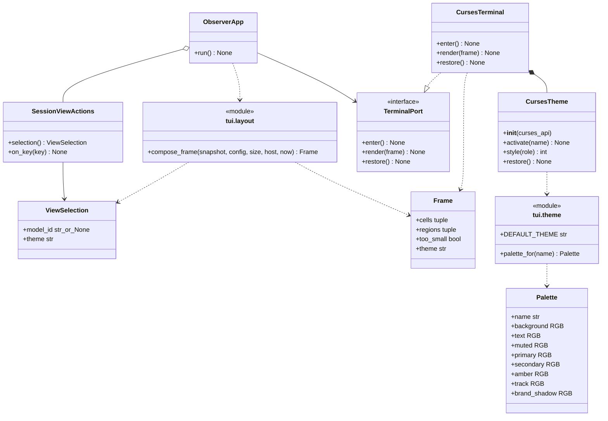

# Neon Grid 主题与终端配色设计

- 关联需求：dev-0 / REQ-006，需求说明 v1.24，AC-601～616；复用 REQ-001～005。
- 修订 v1.16，2026-11-06。为四行像素品牌增加中性灰影线。
- 代码：`src/joi_observer/tui/theme.py`、`layout.py`、`navigation.py`、`app.py`；沿用 `widgets.py`、`vllm.py`、`services.py`。
- 关联模块：[应用外壳](application-shell.md)、[模型导航](navigation.md)、[硬件](hardware.md)、[vLLM](vllm.md)。
- 当前阶段：REQ-006既有配色、Frame传递和终端接线已实现；本次固定色方案取代先前可改色终端的私有RGB色槽方案。原[R4交接](../dev-workflow/dev-0/REQ-006/handoff-r4.md)、[R5交接](../dev-workflow/dev-0/REQ-006/handoff-r5.md)与[R2交接](../dev-workflow/dev-0/REQ-006/handoff-r2.md)保留其对应版本事实，不能代替本次验证。

## 职责与边界

正式界面面向 Ubuntu Terminal，使用全英文、等宽字体、深色背景与紧凑分区，以 Neon Grid 为视觉参考。

本模块维护主题值、颜色角色、整帧配色传递、终端能力降级与会话样式清理，不修改终端调色板。模型选择、主题切换交互和服务页脚由[模型导航](navigation.md)定义；具体布局与数值由对应模块定义。主题切换同时更新实际配色，不能只凭标题名称判断颜色正确。

主题由导航会话持有，生命周期见[模型导航](navigation.md)。本模块只消费主题标识，每次终端 enter 都重新取得自己的配色资源，不访问采集或状态写入接口。

## 核心接口与协作

图中 module 表示真实 Python 模块，不是额外运行期类；图示协作已在当前实现接线。`ObserverApp` 的显式 `ViewActions` 注入能力保留，图中只展开默认控制器。

`theme.DEFAULT_THEME = "hologram"` 是单一默认元数据，`ViewSelection.theme` 使用此常量。切换顺序和会话边界见[模型导航](navigation.md)，呈现时机见[应用外壳](application-shell.md)。

`Frame.theme: str = "hologram"` 追加在现有默认字段之后，保留既有位置参数兼容。`compose_frame` 必须将本帧 `view.theme` 同时用于标题及元数据，正常和 too_small 两条返回路径都传递。终端只读取 `Frame.theme`，不解析标题文字；没有标题的小窗口也能切换背景与键位色。合法状态只取两种小写名；主题查询拒绝其他值，不容忍名称与颜色静默不一致。

## 颜色值与显示角色

下表是保持不变的Palette设计目标，不表示终端会逐项输出这些精确RGB。正式终端使用后文的固定色索引及近似值。

| 角色 | Moonlight | Hologram | 现有绘制语义 |
| --- | --- | --- | --- |
| background | `#080E18` | `#080E18` | 全窗口，包含空白、边框与小窗口提示背景 |
| text | `#D4DDEB` | `#D4DDEB` | 设备标签/正文、GPU名称/温度、CPU数字/RAM总量数字、Storage路径/空态/百分比、未选中模型名称、左栏running数字、右侧RUNNING/WAITING标签、零等待数、STALE、普通生命周期、指标值 |
| muted | `#8A9DB5` | `#8A9DB5` | `::`/系统/时钟、边框/分隔、显存/功率、CPU百分号/RAM已用与共享单位、Storage容量/中点、MODELS标题、模型类型/端口、计数标签、四指标标签/单位、caption/历史尺度文字、未关联GPU填充/编号/百分比、禁用WebUI |
| primary | `#7DDFFF` | `#7B9FFF` | Observer、Theme名称、GPU标题、关联GPU编号/条/百分比、选中模型名称及标记、当前服务、键位、历史柱、fresh Running |
| secondary | `#C6A7FF` | `#E570D0` | Joi、CPU/RAM已填充段、Host/Storage/Docker/vLLM标题、GPU组头右端配置标记、模型详情端口 |
| amber | `#FFA45B` | `#FFA45B` | 仅新鲜的 QUEUED 和大于 0 的等待数 |
| track | `#3E4A5B` | `#3E4A5B` | 仅GPU/CPU/RAM条的未填充段；不替换muted的其他用途 |
| brand_shadow | `#767676` | `#767676` | 四行像素品牌中的细线笔画 |

像素品牌的主体笔画按三个区段着色。`Joi` 使用 secondary，双冒号使用 muted，`Observer` 使用 primary。细线笔画统一使用 brand_shadow。图形内的空格透出页眉背景。紧凑页眉直接显示三个区段并使用相同的主体颜色。页眉的尺寸和切换条件见[应用外壳](application-shell.md#可验证的字符容量)。

`Palette`冻结且所有RGB为tuple，标准0..255通道。`palette_for`是纯查询；未知主题、大小写变体、空白和非字符串均抛ValueError。颜色值与curses色号分离，避免控件依赖终端能力。`CursesTheme.style`的未知角色沿用正文回退，不从文本推断状态。硬件轨道扩展、构造兼容与颜色资源编号统一见下节。

`TextCell`在既有`row/column/text/role`之后追加`bold: bool = False`，保留原有位置参数和默认外观。粗体是独立字体属性，不新增颜色role或改写Palette；哪些服务数值请求粗体由[vLLM 展示契约](vllm.md#10-展示与固定布局)统一定义。本模块负责将请求与颜色属性叠加，具体后端规则见下文。

两主题共享琥珀规则；等待值未知、首次未采集、失败保留的旧正数都不用琥珀，不增感叹号或告警色。RAM总量数字及Storage百分比的“白色”对应text角色，不另建纯白色。硬件未知片段沿各字段原角色，STALE始终为text，不因故障改变数值颜色。对象状态和字段位置分别由[硬件](hardware.md)、[Docker](docker.md)及[vLLM](vllm.md)设计定义。

左栏与右侧等待数字均遵循上述新鲜正值规则，其他等待数字或占位用text；左栏running数字用text。Docker仅在`sampled_at`非None且`stale=False`时将Running显示为primary；其他生命周期、未采样保留值、未知及STALE均为text，Docker状态不使用amber。

## 硬件分段条、轨道与配色能力

本节是硬件条字形、track角色、公开formatter兼容及终端配色降级的唯一详细契约；[硬件设计](hardware.md#硬件显示与模型关联)维护条的位置、宽度、数值精度与GPU关联匹配。

GPU/CPU/RAM在`hardware_cells`绘制时，按`percentage_bar`返回的`len(filled)`和`len(empty)`各画同数量的`▌`；填充与未填充轨道字形一致，每段仍占1字符格，组合宽度仍为原width。公开`percentage_bar`继续返回`█`/`░`，百分比按ROUND_HALF_UP保留1位小数再去尾零，填充数量沿用同一舍入比例换算字符格；不乘2、不增加半格量化，不改GPU利用率文字。

只有未填充段使用上表的track角色；关联GPU填充为primary，未关联GPU填充保留muted，CPU/RAM填充为secondary。0与未知均画全轨道，100%全为填充，未知数值文字仍为`—`。未关联GPU的muted填充不能替换成track；边框、其他灰色文字和vLLM竖向历史柱也不使用track。原条宽、位置、段数、百分比列与三行/四行布局保持。硬件条不设置`TextCell.bold`，低色模式由颜色能力附带的字重不改变字体元数据。

`Palette` 将 track 和 brand_shadow 作为具有默认值的末尾字段，支持原位置参数构造。text、muted、primary、secondary、amber、track 依次使用色对 1～6。品牌影线在固定 256 色且有额外色对时使用第 7 对。各色对共享背景索引。

### 终端能力与颜色资源

| 能力 | 显示策略 | 资源约束 |
| --- | --- | --- |
| COLORS ≥ 256、COLOR_PAIRS ≥ 7 | muted 与 brand_shadow 从标准 xterm 中性灰阶 232..255 选色，其他角色从 16..255 选色。COLOR_PAIRS 为 7 时影线复用 muted | RGB 平方距离最小，同距取小索引。仅选择已有色号 |
| 8～255色且COLOR_PAIRS ≥ 7 | Hologram蓝/Moonlight青；Hologram辅色紫、Moonlight辅色MAGENTA加A_BOLD；正文白、muted白加A_DIM、排队黄、背景黑；track为BLACK加A_BOLD深灰近似 | 品牌影线复用 muted。实际明暗由终端决定 |
| 无色、少于8色或COLOR_PAIRS < 7 | 所有CursesTheme颜色属性为0，含track；独立TextCell.bold仍可请求A_BOLD | 保留文字、数值、选择与退出；不新增诊断提示 |

固定色表为6×6×6色立方（通道0/95/135/175/215/255）及24级灰（8+10n）。各角色由原Palette目标计算得到以下固定索引；表中RGB为标准xterm色表的近似值，不是向终端写入的RGB：

| 角色 | Moonlight固定索引 / 近似RGB | Hologram固定索引 / 近似RGB |
| --- | --- | --- |
| background | 233 / `#121212` | 233 / `#121212` |
| text | 253 / `#DADADA` | 253 / `#DADADA` |
| muted | 247 / `#9E9E9E` | 247 / `#9E9E9E` |
| primary | 117 / `#87D7FF` | 111 / `#87AFFF` |
| secondary | 183 / `#D7AFFF` | 170 / `#D75FD7` |
| amber | 215 / `#FFAF5F` | 215 / `#FFAF5F` |
| track | 239 / `#4E4E4E` | 239 / `#4E4E4E` |
| brand_shadow（COLOR_PAIRS ≥ 8） | 243 / `#767676` | 243 / `#767676` |

因此track的目标仍是`#3E4A5B`，固定256色显示为索引239的标准近似`#4E4E4E`；不能将后者描述为精确目标色。应用只发送色索引选择，不修改0..255调色板，也不通过OSC 4或其他自定义RGB序列补偿差异。终端自定义色表以及bold/dim处理仍可能影响实际观感；`COLORS`与terminfo只是本地能力声明，`can_change_color()`也不是终端客户端真实支持RGB改色的通信实测，本方案不调用它作判定。

### 裸命令启动与TERM初始化

用户直接运行`joi-observer`，不要求命令前加环境变量，也不修改MobaXterm设置、Shell配置或父Shell环境。应用仅在入口环境的`TERM`精确等于`xterm`时尝试使用`xterm-256color`描述：先预检该terminfo可用，确认后只在本进程的curses初始化期间临时替换`TERM`。初始化一结束就在`finally`还原原环境值，初始化抛Python可处理的异常时也必须还原；采集与正常运行期间不保留此环境改动。该选择使用已授权的256色输出方案，不等于程序探测了客户端真实RGB能力。

正常CLI由本应用拥有首次curses初始化；候选terminfo缺失时保持原`xterm`并按其声明能力使用上表的低色/单色回退。输入为其他TERM值或未设置TERM时不替换，保留其原声明能力。部分初始化失败仍执行既有终端恢复，不应通过修改外部配置来补救。

Python的`setupterm`会缓存首次成功结果，后续同进程调用不能视为重新检验另一份terminfo。若外部代码已初始化低于256色的描述，应用保留原描述，不将该缓存误判为扩展能力预检成功。正常CLI首启及同描述会话重入均须验证；不支持运行中由外部改写或删除terminfo。`initscr`必须在临时环境值仍有效时调用，不能只调用`setupterm`后就假定它会忽略原TERM。

## curses 生命周期与字体属性

`CursesTheme(curses_api)` 构造只存依赖；curses 仍只在 `CursesTerminal.enter` 延迟导入。后端每次 enter 建立一个新的配色会话；首帧激活配色，随后每帧按 `Frame.theme` 激活，同主题不重复分配资源。以公开 curses 模块作为外部边界，测试可替换该模块，不需要新依赖或扩展 TerminalPort 的方法签名。

`activate` 首先校验主题，首次有色初始化调用 start_color。切换主题时复用已有色对编号。COLOR_PAIRS 包含保留的色对 0，因此 7 对容量可用编号 1～6，8 对容量可额外使用编号 7。固定 256 色的 muted、track 和 brand_shadow 均使用普通字重。

颜色探测、初始化遇到 curses.error：清空本会话样式并在整次会话降单色，后续 t 仍改变会话名称；不重试失败探测、不暴露半套样式、不写ERROR采集日志。由于没有改写调色板，不存在色槽恢复步骤。其他程序异常正常传播并触发外层终端恢复。未知主题不是设备能力不足，必须抛出。

`render` 顺序为 `activate(frame.theme)` → 仅主题变化时 `screen.clearok(True)` → `screen.bkgd(' ', style('text'))` → `erase()` → 按TextCell的role与bold绘制 → refresh。每个cell使用`style(role) | (A_BOLD if bold else 0)`完整属性，不将上一数字的粗体继承给后续标签；数字变为占位时也恢复原属性。此字体叠加不改变所选颜色角色、色对索引和调色板，低色终端可能将A_BOLD表现为更亮或更粗，实际观感由终端决定，不承诺像素RGB完全相同；单色仍可请求字体强调。同主题帧不强制整帧重绘，继续使用ncurses差分输出；主题变化的整帧刷新避免复用色对索引后留下旧物理屏颜色。背景必须覆盖未绘制空白和长文字缩短后的残留；沿用 resize 容错与底部边界处理。输入解析器、鼠标状态不变：不启用 mousemask、不发送鼠标报告模式，点击主题不切换。键盘仍是全部操作的唯一入口。

`restore` 在endwin前只清空本会话的能力、主题和属性缓存，不读写终端调色板，也不调用init_color恢复颜色。未激活、部分失败及重复调用均安全；随后仍由外层恢复回显、光标、备用屏、终端属性和termios。再次进入不复用本模块上次的样式缓存；这不声称能重置ncurses进程级terminfo缓存。清理不新增持久化或应用偏好。

## 布局复用与视觉验收

全页区域、最低尺寸与各面板容量统一见[应用外壳容量契约](application-shell.md#可验证的字符容量)；页眉内容与本机发行版本读取见[HTML 对齐的字符适配](application-shell.md#html-对齐的字符适配)。主题不增加专用行或改变区域预算。

硬件内部坐标、容量与百分比精度、Storage 状态汇总及GPU匹配统一见[硬件显示设计](hardware.md#硬件显示与模型关联)；模型栏、服务详情、数字强调与留白见[vLLM 展示契约](vllm.md#10-展示与固定布局)；历史算法见[vLLM 历史设计](vllm.md#101-稳定柱状历史与显示尺度)。本节仅追踪HTML元素与这些正式契约的对应关系。

`joi-observer.html` 的初始 Neon Grid 已改为 Hologram，仍是可交互的设计预览；预览的鼠标、模拟数据和保存状态不构成正式 TUI 功能，正式键位、默认行为和新增排版验收以需求v1.15为准。

### 原稿与正式终端的逐项对应

本表仅对照HTML的Neon Grid，不将Amber Relay/Vector Matrix的控件或文案带入。每项都说明采用方式；“适配/保留”不等于声称终端无法实现原稿。

| HTML元素 / CSS入口 | 对应正式内容 / 契约 | 黑盒入口 |
| --- | --- | --- |
| mast / brand | [品牌与页眉](application-shell.md#html-对齐的字符适配)、[颜色角色](#color-roles) | theme_view、html_shell_layout |
| theme-switch | [页眉位置](application-shell.md#html-对齐的字符适配)、[主题交互](navigation.md) | html_shell_layout、navigation_pty |
| hostline | [设备、发行版本与时钟](application-shell.md#html-对齐的字符适配) | html_shell_layout |
| fieldset / legend | [区域外壳](application-shell.md#可验证的字符容量)、[颜色角色](#color-roles) | html_shell_layout |
| neon-top / host-stack | [上半区分配](application-shell.md#可验证的字符容量) | tui、html_hardware_layout |
| gpu-name / gpu-memory | [GPU名称和容量](hardware.md#硬件显示与模型关联) | html_hardware_layout |
| gpu-metric | [GPU温度与功率](hardware.md#硬件显示与模型关联) | html_hardware_layout、hardware_pty |
| gpu-gauge | [条与轨道](#hardware-bars)、[位置及关联](hardware.md#硬件显示与模型关联) | hardware_view、theme_view |
| resource CPU | [CPU呈现](hardware.md#硬件显示与模型关联)、[条与轨道](#hardware-bars) | html_hardware_layout |
| resource RAM | [RAM呈现](hardware.md#硬件显示与模型关联)、[条与轨道](#hardware-bars) | html_hardware_layout |
| storage kvline | [Storage数值、精度与状态](hardware.md#硬件显示与模型关联) | html_hardware_layout、hardware_view |
| docker-row | [Docker条目](docker.md#docker-row) | html_shell_layout、docker_integration |
| rail-title / service-buttons | [模型栏](vllm.md#10-展示与固定布局)、[选择窗口](navigation.md) | vllm_view、navigation |
| counts | [模型负载计数](vllm.md#10-展示与固定布局) | vllm_view |
| neon-detail-heading / route | [详情标题与端口](vllm.md#10-展示与固定布局) | vllm_view、navigation_pty |
| neon-queues | [运行/等待统计](vllm.md#10-展示与固定布局) | vllm_view |
| queue / divider | [分隔线与留白](vllm.md#10-展示与固定布局) | vllm_view、tui |
| neon-metrics | [类型字段、数值强调与槽位](vllm.md#10-展示与固定布局) | vllm_view、theme_view |
| history-block | [历史显示与尺度](vllm.md#101-稳定柱状历史与显示尺度) | history_presentation、vllm_view/pty |
| neon-service-tabs / keybar | [服务入口与键位](navigation.md#服务入口与键位呈现) | service_footer、navigation_app |
| resize / long text / partial values | [整页边界](application-shell.md#可验证的字符容量)、[硬件裁切](hardware.md#硬件显示与模型关联)、[服务裁切](vllm.md#10-展示与固定布局) | html_hardware_layout、vllm_view、html_shell_layout、tui |

### 明确保留的取舍与范围

- 字符格近似像素间距并使用统一字体大小；区域与状态槽按上述正式设计适配，不能为了紧凑而删掉真实状态。
- 继续采用统一背景。HTML的surface/选中底色、独立line颜色仍不引入；边框与分隔采用颜色表中的muted。模型选中标记、服务项与键位采用[导航设计](navigation.md)，不模拟浏览器按钮外框或下划线。
- 终端面板标题使用 GPU、Host Resources、Storage、Docker、vLLM。GPU 组头从模型配置生成，定义见[硬件显示与模型关联](hardware.md#硬件显示与模型关联)。设备与系统信息见[应用外壳](application-shell.md#html-对齐的字符适配)。
- 预览的鼠标交互、状态保存、模拟时区、req/s及请求上限不能作为正式行为或数据来源；分别以导航、应用外壳和vLLM设计为准。
- HTML的NOW值已有上方指标承载，不重复增加字段。历史和数值的真实含义以[vLLM设计](vllm.md)为准。

视觉验证须区分Frame/静态预览、真实终端截图和用户观感确认；单元/PTY通过不代替实际字体与整体观感。R2核对保留其当时的目标契约与失败基线；当前验证见R4/R5交接。GUI确认、安装包和回放只证明各自产物对应版本，不能自动覆盖之后的显示变化。

## 接口与验证依据

| 入口 / 验收 | 黑盒入口与验证边界 |
| --- | --- |
| `palette_for`、默认元数据 / AC-601、603、604 | `test_theme_palette.py`：Palette目标RGB保持、冻结性、非法输入；不将目标值等同固定色近似 |
| `SessionViewActions`、`ObserverApp` / AC-601、602、603 | `test_navigation*.py`保留默认及切换序列、显式注入、实例隔离、按键采样隔离与小窗口；真实PTY逐帧核对固定SGR前景/背景索引、无OSC 4及未启用鼠标报告 |
| `Frame`、`compose_frame` / AC-601、603～608 | `test_theme_view.py`：默认、正常/小窗口传递、所有角色、琥珀边界、三类型/故障/恢复、半页及名称边界 |
| `CursesTheme`、`CursesTerminal` / AC-601～604 | `test_theme_terminal.py`：>=256一律fixed、全部角色索引、拒绝can_change_color/color_content/init_color调用、低色/单色、完整背景、切换与样式清理；`test_terminal_color_profile.py`：候选缺失/失败时TERM恢复、已有低色缓存回退、非xterm描述保持及会话重入 |
| 实际 ncurses / AC-604、606 | 主题/vLLM/导航PTY：输入TERM=xterm直接启动、固定256色SGR与无OSC 4、两次主题切换、正常/过小/恢复尺寸及退出恢复；其他TERM保留声明能力 |
| HTML对应排版 / AC-613～615 | `test_html_hardware_layout.py`、`test_html_shell_layout.py`、硬件/view/navigation/theme相关用例及test_tui：固定右边缘、三层模型项、双统计与四列标签/数值、缩放/裁切/状态保护 |
| 生命周期、非阻塞输入、历史与布局回归 | 沿用 `test_terminal_pty.py`、`test_tui.py`、`test_hardware_view*.py`、`test_vllm_view.py` 等，不改采集与计算预期 |

测试断言期待正确行为，不 xfail、不以 NotImplementedError 为成功。外部终端/时钟/只读输入可替换，监控或主题业务结果不可模拟；所有自动化在本地 WSL Ubuntu-24.04 离线执行，pytest 和 PTY 子进程保留网络禁用。新业务未实现、接口导入错误、环境故障、原有缺陷分开记录。

既有全量、安装包、PTY及GUI记录只证明各自版本，旧私有RGB写色/恢复测试不作为本次固定色方案的通过证据。本次必须核对真实固定SGR输出、未发送OSC 4、TERM初始化范围与异常恢复，并保留既有字形、粗体、布局和键位回归。单元与PTY验证不替代MobaXterm实际观感确认，也不授权服务器联调；本轮不生成安装包或更新GUI回放。帧调度和尺度的所有权仍见应用外壳设计。
