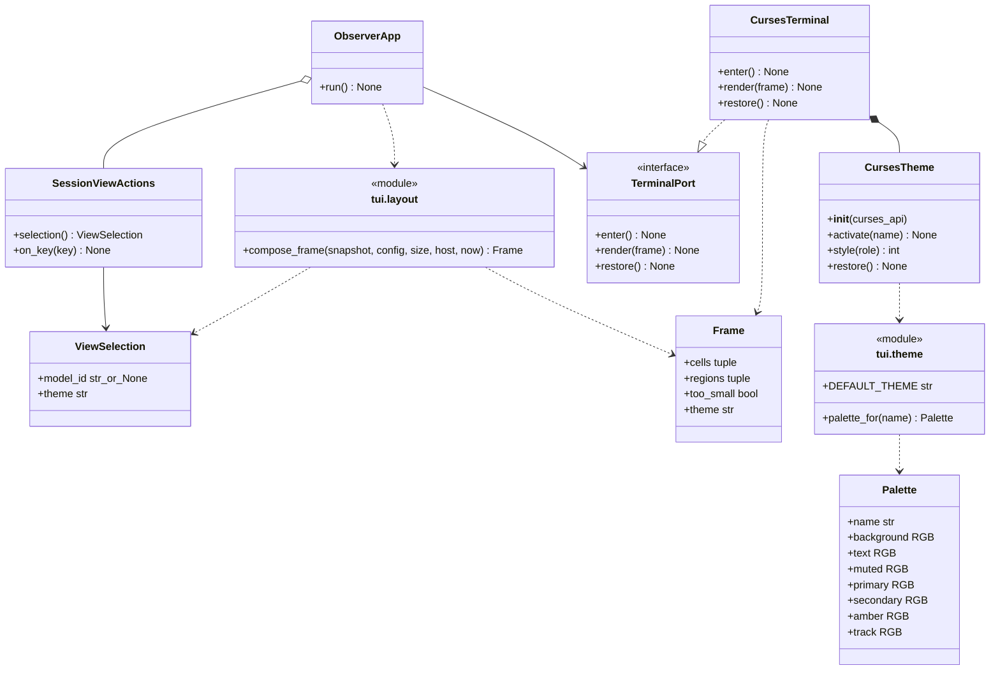

# Neon Grid 主题与终端配色设计

- 关联需求：dev-0 / REQ-006，需求说明 v1.24，AC-601～616；复用 REQ-001～005。
- 修订：v1.12，2026-11-05；硬件填充与轨道统一为▌，新增深灰track角色；保留原五个角色的RGB与编号。Palette末尾默认值兼容旧构造，配色资源扩展为七色槽/六色对；本轮不生成离线包或更新旧GUI回放。
- 代码：`src/joi_observer/tui/theme.py`、`layout.py`、`navigation.py`、`app.py`；沿用 `widgets.py`、`vllm.py`、`services.py`。
- 关联模块：[应用外壳](application-shell.md)、[模型导航](navigation.md)、[硬件](hardware.md)、[vLLM](vllm.md)。
- 当前阶段：REQ-006配色、Frame传递、默认值和终端接线已由R4实现。2026-11-04按R5建议同步实现状态，不改变本设计契约；当前返修与证据见[R4交接](../dev-workflow/dev-0/REQ-006/handoff-r4.md)，审查结论见[R5交接](../dev-workflow/dev-0/REQ-006/handoff-r5.md)。[R2交接](../dev-workflow/dev-0/REQ-006/handoff-r2.md)保留当时骨架与失败基线。

## 职责与边界

REQ-005 已随 `0a42646` 合并：会话选择、t 切换标识、服务页脚、模型与 GPU 联动均已有实现。REQ-006复用这些导航与采集模块，已实现默认Hologram、主题值、整帧传递、终端能力降级、颜色恢复及HTML对应的布局调整。主题切换同时更新实际配色，不能只凭标题名称判断颜色正确；采集和数值计算口径保持。

数据流保持 `Collector → Monitor → MonitorState → TUI`。主题属于 `SessionViewActions` 持有的应用会话；不写 MonitorState、配置或文件，不触发采集，不清空历史，不改变模型选择、GPU 映射、字段或几何。不同应用实例独立；同一应用再次 run 保持选择，但每次终端 enter 都重新取得自己的配色资源。

## 核心接口与协作

图中 module 表示真实 Python 模块，不是额外运行期类；图示协作已在当前实现接线。`ObserverApp` 的显式 `ViewActions` 注入能力保留，图中只展开默认控制器。

`theme.DEFAULT_THEME = "hologram"` 是单一默认元数据，`ViewSelection.theme` 已使用此常量，现有控制器继续复用 ViewSelection。第一次 t 得到 Moonlight，第二次回到 Hologram；空列表、小窗口与 STALE 期间仍有效。下一正常绘制周期可见，遵循[应用外壳](application-shell.md)的目标60 FPS（1/60秒，约16.7ms）截止点调度，不为 t 额外采样或重建终端。

`Frame.theme: str = "hologram"` 追加在现有默认字段之后，保留既有位置参数兼容。`compose_frame` 必须将本帧 `view.theme` 同时用于标题及元数据，正常和 too_small 两条返回路径都传递。终端只读取 `Frame.theme`，不解析标题文字；没有标题的小窗口也能切换背景与键位色。合法状态只取两种小写名；主题查询拒绝其他值，不容忍名称与颜色静默不一致。

## 颜色值与显示角色

| 角色 | Moonlight | Hologram | 现有绘制语义 |
| --- | --- | --- | --- |
| background | `#080E18` | `#080E18` | 全窗口，包含空白、边框与小窗口提示背景 |
| text | `#D4DDEB` | `#D4DDEB` | 设备标签/正文、CPU数字/RAM总量数字、Storage路径/空态/百分比、右侧WAITING标签/0、STALE、非Running生命周期、指标值 |
| muted | `#8A9DB5` | `#8A9DB5` | `::`/系统/时钟、边框/分隔、显存/功率、CPU百分号/RAM已用与共享单位、Storage容量/中点、指标标签/caption、模型计数文字、未关联GPU填充/编号/百分比、禁用WebUI |
| primary | `#7DDFFF` | `#7B9FFF` | Observer、Theme名称、GPU标题、关联GPU编号/条/百分比、选中模型、当前服务、键位、fresh Running |
| secondary | `#C6A7FF` | `#E570D0` | Joi、CPU/RAM已填充段、Host/Storage/Docker/vLLM标题、模型路由 |
| amber | `#FFA45B` | `#FFA45B` | 仅新鲜的 QUEUED 和大于 0 的等待数 |
| track | `#3E4A5B` | `#3E4A5B` | 仅GPU/CPU/RAM条的未填充段；与填充同为▌，不替换muted的其他用途 |

`Palette`冻结且所有RGB为tuple，标准0..255通道；在原字段末尾追加`track: RGB = (62, 74, 91)`，旧位置参数构造仍有效。`palette_for`是纯查询；未知主题、大小写变体、空白和非字符串均抛ValueError。颜色值与curses色号分离，避免控件依赖终端能力。`CursesTheme.style`保留text/muted/primary/secondary/amber并追加track，共六个前景角色；未知角色沿用正文回退，不从文本推断状态。原五个角色的目标值、色槽17～21及色对1～5保持，track使用色槽22/色对6，共用背景色槽16。

`TextCell`在既有`row/column/text/role`之后追加`bold: bool = False`，保留原有位置参数和默认外观。粗体是独立字体属性，不新增颜色role或改写Palette。仅vLLM右侧RUNNING/WAITING值及历史标题上方四列指标值中的真实数字设为True，包括0、科学记数和STALE保留值；`—`、`N/A`、`…`不新增粗体。左栏计数、标签/单位、caption、标题/路由、状态、历史及其他面板保持原样；既有Moonlight低色辅色的A_BOLD近似继续保留。

两主题共享琥珀规则；等待值未知、首次未采集、失败保留的旧正数都不用琥珀。Exited/Restarting 等是正常采集的生命周期文字，STALE 只占既有状态位；不增感叹号、错误行、告警色。映射未知的 GPU 保持 muted，不推断关联。RAM总量数字及Storage百分比的“白色”对应text角色，不另建纯白色。RAM末尾共享单位、CPU百分号用muted；GPU功率用muted并保留W前空格。Docker仅新鲜Running用primary，STALE/未知及其他生命周期用text。

## curses 生命周期与能力边界

`CursesTheme(curses_api)` 构造只存依赖；curses 仍只在 `CursesTerminal.enter` 延迟导入。后端每次 enter 建立一个新的配色会话；首帧激活配色，随后每帧按 `Frame.theme` 激活，同主题不重复分配资源。以公开 curses 模块作为外部边界，测试可替换该模块，不需要新依赖或扩展 TerminalPort 的方法签名。

| 能力 | 显示策略 | 资源约束 |
| --- | --- | --- |
| 可改色、COLORS ≥ 256、COLOR_PAIRS ≥ 7 | 七个私有颜色实现精确RGB，含track #3E4A5B | 色槽16～22，避开基础0..15；六个前景色对1～6共用背景；改色前保存全部原值 |
| 固定256色以上且COLOR_PAIRS ≥ 7 | 标准xterm 16..255最近色；track对应索引239 | RGB平方距离最小，同距取小索引；不读终端自定义0..15色、不改调色板 |
| 8～255色且COLOR_PAIRS ≥ 7 | Hologram蓝/Moonlight青；Hologram辅色紫、Moonlight辅色MAGENTA加A_BOLD；正文白、muted白加A_DIM、排队黄、背景黑；track为BLACK加A_BOLD深灰近似 | 保留原角色映射；不改调色板，不承诺精确RGB |
| 无色、少于8色或COLOR_PAIRS < 7 | 所有CursesTheme颜色属性为0，含track；独立TextCell.bold仍可请求A_BOLD | 保留文字、数值、选择与退出；不新增诊断提示 |

精确模式将RGB通道转换为`(v * 1000 + 127) // 255`，遵守本地Python 3.12 curses的0..1000范围。固定色模式的标准色表为6×6×6色立方（通道0/95/135/175/215/255）及24级灰（8+10n）。track的最近色为索引239；不是更改目标色#3E4A5B。能力依据运行时报告，不能仅凭TERM字符串认定支持精确RGB。用户当前TERM=xterm保持不变；基础色track的BLACK|A_BOLD及Moonlight辅色MAGENTA|A_BOLD分别是深灰/亮紫近似，实际亮度、字重和RGB由终端ANSI调色板及bold处理决定。程序不修改TERM，也不要求用户切到256色类型；上述信息不构成服务器连接或运行状态结论。

`activate`首先校验主题，首次有色初始化调用start_color；同主题重复激活和切换复用有限色槽/色对，不持续分配编号。精确muted不叠加A_DIM，精确及固定256色track不额外叠加A_BOLD，以免实际颜色偏离各自目标。COLOR_PAIRS包含保留的色对0，因此六个可初始化色对要求COLOR_PAIRS至少7；色对0不用于初始化。

颜色探测、初始化遇到 curses.error：尽力回滚已改颜色，整次会话降单色，后续 t 仍改变会话名称；不留下混合色表、不写 ERROR 采集日志。其他程序异常正常传播并触发外层终端恢复。未知主题不是设备能力不足，必须抛出。

`render` 顺序为 `activate(frame.theme)` → 仅主题变化时 `screen.clearok(True)` → `screen.bkgd(' ', style('text'))` → `erase()` → 按TextCell的role与bold绘制 → refresh。每个cell使用`style(role) | (A_BOLD if bold else 0)`完整属性，不将上一数字的粗体继承给后续标签；数字变为占位时也恢复原属性。此字体叠加不改变所选颜色角色、色对索引和调色板，低色终端可能将A_BOLD表现为更亮或更粗，实际观感由终端决定，不承诺像素RGB完全相同；单色仍可请求字体强调。同主题帧不强制整帧重绘，继续使用ncurses差分输出；主题变化的整帧刷新避免复用色对索引后留下旧物理屏颜色。背景必须覆盖未绘制空白和长文字缩短后的残留；沿用 resize 容错与底部边界处理。输入解析器、鼠标状态不变：不启用 mousemask、不发送鼠标报告模式，点击主题不切换。键盘仍是全部操作的唯一入口。

`restore` 在 endwin 前逐项还原已保存的颜色；即使一项失败也继续其他颜色、回显、光标、备用屏和 termios 恢复。清空能力、主题和属性缓存，未激活/部分失败/重复调用安全。同一终端对象再次进入必须重新探测，不复用上次样式。颜色恢复是本模块资源清理，不新增持久化或应用偏好。

## 布局复用与视觉验收

沿用已实现的 [应用外壳容量契约](application-shell.md)：120 列基础宽度；H 行时下半 H//2、上半 H-H//2，header 两行计入上半。0～4 GPU 最小 120×36，5 GPU 120×37；Docker 数量不抬高最小高度。上半水平接近3:2；右侧Host为6行，CPU/RAM各两行，紧接Storage的6行且内容固定3行，再隔1行到Docker。Host多出的行使用原Host/Storage间距，Docker仍占原余高。下半服务窗口、服务切换位、键位恰好合计半页，不加新主题专用行。

硬件分段条、路由、三类模型字段与历史继续使用现有控件。历史保留原竖向块字符柱状图，不采用点阵或面积图；固定60秒横轴、稳定时间桶及纵轴迟降详见[vLLM历史设计](vllm.md#101-稳定柱状历史与显示尺度)。GPU分段宽约为内宽一半，百分比紧随末端；CPU/RAM的标签与右侧数值同行，条在下一行，数值口径不变，填充与track按上表分色。长名称按字符显示宽截断，不能侵入状态或指标槽；正常→失败→恢复、模型类型切换、主题切换均不移动分区或历史槽位。

`joi-observer.html` 的初始 Neon Grid 已改为 Hologram，仍是可交互的设计预览；预览的鼠标、模拟数据和保存状态不构成正式 TUI 功能，正式键位、默认行为和新增排版验收以需求v1.15为准。

### 原稿与正式终端的逐项对应

本表仅对照HTML的Neon Grid，不将Amber Relay/Vector Matrix的控件或文案带入。每项都说明采用方式；“适配/保留”不等于声称终端无法实现原稿。

| HTML元素 / CSS入口 | 正式终端目标 | 契约 / 黑盒入口 |
| --- | --- | --- |
| mast / brand | Joi辅色、::灰、Observer主色；固定首行 | layout注释；theme_view、html_shell_layout |
| theme-switch | 两主题名称都贴同一右缘C，主色，保留[t]；仅键盘切换 | application-shell、layout；html_shell_layout、navigation_pty |
| hostline | 固定H3C R5300 G6设备标签正文，斜线分隔/本地Ubuntu发行版本/时间灰；墙钟使用实际本机时区，右端固定C | application-shell、layout；html_shell_layout |
| fieldset / legend | GPU标题主色，其余Host/Storage/Docker/vLLM辅色；字符边框muted | application-shell、layout；html_shell_layout |
| neon-top / host-stack | 约3:2分区；Host四内容行、Storage三内容行、Docker余高 | application-shell、hardware；tui、html_hardware_layout |
| gpu-name / gpu-memory | 编号/型号左、显存中间区右对齐，共享单位且灰色 | widgets/hardware；html_hardware_layout |
| gpu-metric | 温度正文靠右，下一行功率灰色、W前空格，同一右边缘 | widgets/hardware；html_hardware_layout、hardware_pty |
| gpu-gauge | 半内宽条，填充/轨道同为▌且各占原1格，百分比紧随；关联填充primary、未关联填充muted，所有轨道track深灰，原段数不变 | widgets/hardware；hardware_view、theme_view |
| resource CPU | 标签左，固定1位百分比数字正文/%灰靠右，如30.0%；下一行secondary填充/track轨道同为▌，原段数、采样与比例口径不变 | widgets/hardware；html_hardware_layout |
| resource RAM | GiB/TiB容量从原始字节直接ROUND_HALF_UP为整数；已用/分隔灰、总量数字正文、共享单位灰，整体靠右；下一行secondary填充/track轨道同为▌，不添加百分比文字 | widgets/hardware；html_hardware_layout |
| storage kvline | 路径及空配置文案正文、容量/‘ · ’灰，固定1位百分比正文且贴内容右缘，如25.0%；GiB直接从字节ROUND_HALF_UP为整数，TiB保留1位；前3挂载任一stale仅在标题右上角汇总STALE | widgets/hardware；html_hardware_layout、hardware_view |
| docker-row | 名称左，生命周期/—/STALE均贴共同右缘；fresh Running主色 | docker/application-shell/layout；html_shell_layout、docker_integration |
| rail-title / service-buttons | MODELS标题、24列模型栏，名称/状态、类型/端口、计数三层 | view-contract/vllm/navigation；vllm_view、navigation |
| counts | 左‘3 running’左齐，右‘7 waiting’右齐；数字与文字分色，0/未知正确 | view-contract/vllm；vllm_view |
| neon-detail-heading / route | 名称左/状态六格靠右，下一行真实URL及箭头 | view-contract/vllm；vllm_view、navigation_pty |
| neon-queues | 两统计组，标签左/数值右；仅真实数字加粗、原颜色不变；Total、Avg queue或单位分别归属各组且不新增粗体 | view-contract/vllm；vllm_view |
| queue / divider | +4/+8横线、+6/+7中竖线muted；右详情+1/+5/+11留白，外层模型分隔固定c+27，左栏不动 | view-contract/layout/vllm；vllm_view、tui |
| neon-metrics | 四列灰色标签/单位在上、正文数值在下；仅真实数字加粗，占位普通，所有类型固定位置 | view-contract/vllm；vllm_view、theme_view |
| history-block | 保留原柱图、固定60秒轴与尺度标签；零/缺口与真实数据相符 | vllm/history；history_presentation、vllm_view/pty |
| neon-service-tabs / keybar | 当前vLLM主色、WebUI(disabled)灰，单行服务位和主色英文键位 | navigation/services/layout；service_footer、navigation_app |
| resize / long text / partial values | 固定半页、状态槽保护；长名称裁切、长数字有界且不伪装小数值 | 以上各接口；html_hardware_layout、vllm_view、html_shell_layout、tui |

### 明确保留的取舍与范围

- 字符格近似像素间距；3:2近似HTML的1.55:1，统一字体大小；Host借用原间距以保持半页/最小尺寸。真实状态保留在固定槽，Storage按用户GUI修订汇总到标题右上角；不能为模仿紧凑样稿而删掉STALE。
- 继续采用统一背景，保留原五种文字role并新增仅供硬件未填充段使用的track。HTML的surface/选中底色、独立line颜色仍不引入；边框与分隔继续muted，不改用track。选中模型采用›＋主色，不增加按钮外框占行，服务项沿用REQ-005明确的单行文案，不模拟浏览器按钮/下划线。
- 标题保留正式名称GPU、Host Resources、Storage、Docker、vLLM；HTML的NEON GRID概念标记、GPU FABRIC命名及固定5 DEVICES、静态GPU分组/TP/EP/SHARED等没有批准的可靠呈现来源，不硬编码。设备标签H3C R5300 G6由用户在v1.19明确指定为固定展示文本，不作DMI或远端探测；Ubuntu发行版本从本地os-release取得。完整GPU列表顺序和显式关联高亮继续有效。
- 日期时间沿用真实带时区墙钟的YYYY-MM-DD HH:MM:SS，不复制CST。鼠标切主题与HTML状态保存不属于正式交互；WebUI禁用。pooling使用可靠seq/s，不沿用模拟req/s/请求上限。
- 历史沿用已确认的固定−60s/0s及Scale标签；HTML的NOW值已有上方指标承载，不重复增加字段。只读快照、未知/0/N/A、缺口及采样独立性优先于模拟显示。

视觉验证须区分Frame/静态预览、真实终端截图和用户观感确认；单元/PTY通过不代替实际字体与整体观感。R2核对保留其当时的目标契约与失败基线；当前验证见R4/R5交接。旧GUI-006-001的确认只覆盖其当时版本，不代表当前深灰轨道、后续显示变化或GUI可见60FPS已确认。按用户当前指令，本轮不生成或重建离线包、不刷新既有GUI/回放入口；这些旧产物不包含本轮track变化，不能作为新界面证据。

## 接口与验证依据

| 入口 / 验收 | 黑盒入口与验证边界 |
| --- | --- |
| `palette_for`、默认元数据 / AC-601、603、604 | `test_theme_palette.py`：精确颜色、冻结性、非法输入 |
| `SessionViewActions`、`ObserverApp` / AC-601、602、603 | 更新 `test_navigation*.py` 默认及切换序列；保留显式注入、实例隔离、按键采样隔离、小窗口；真实 PTY 逐帧读取主/辅/次要 RGB 与空白背景，确认未启用鼠标报告 |
| `Frame`、`compose_frame` / AC-601、603～608 | `test_theme_view.py`：默认、正常/小窗口传递、所有角色、琥珀边界、三类型/故障/恢复、半页及名称边界 |
| `CursesTheme`、`CursesTerminal` / AC-601～604 | `test_theme_terminal.py`：公开配色接口及后端的终端边界替身；颜色能力、全背景、切换、恢复与异常 |
| 实际 ncurses / AC-604、606 | `test_vllm_pty.py`：现有三类模型/状态/resize，颜色断言改为目标 RGB，不依赖基础白/黄编号 |
| HTML对应排版 / AC-613～615 | `test_html_hardware_layout.py`、`test_html_shell_layout.py`、硬件/view/navigation/theme相关用例及test_tui：固定右边缘、三层模型项、双统计与四列标签/数值、缩放/裁切/状态保护 |
| 生命周期、非阻塞输入、历史与布局回归 | 沿用 `test_terminal_pty.py`、`test_tui.py`、`test_hardware_view*.py`、`test_vllm_view.py` 等，不改采集与计算预期 |

测试断言期待正确行为，不 xfail、不以 NotImplementedError 为成功。外部终端/时钟/只读输入可替换，监控或主题业务结果不可模拟；所有自动化在本地 WSL Ubuntu-24.04 离线执行，pytest 和 PTY 子进程保留网络禁用。新业务未实现、接口导入错误、环境故障、原有缺陷分开记录。

当前配色实现已有全量、离线安装包和真实PTY的验证记录，覆盖首帧、两次t、实际RGB/背景、鼠标不切换、正常/过小/恢复尺寸及退出恢复，详见R4/R5交接。代码返修后仍须执行相应回归并核对源码与安装包一致；不能将过去的通过记录当成本次执行。GUI-006-001的用户观感确认已关闭，无需重复索取同一确认；它不替代自动化边界测试或终端性能测量，也不授权服务器联调。稳定柱图、Frame和尺度接线均已实现；当前60FPS修订及双向公平性验证以R4交接为准，既有30FPS验证保留历史事实，不改写为60FPS通过。主题核心类图只展开配色协作，帧时钟和尺度所有权见应用外壳类图。
