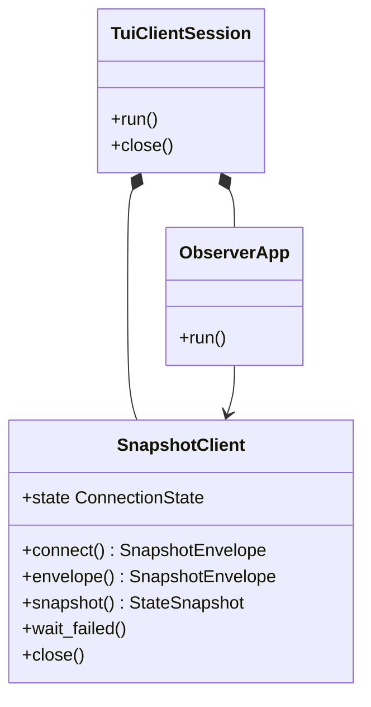
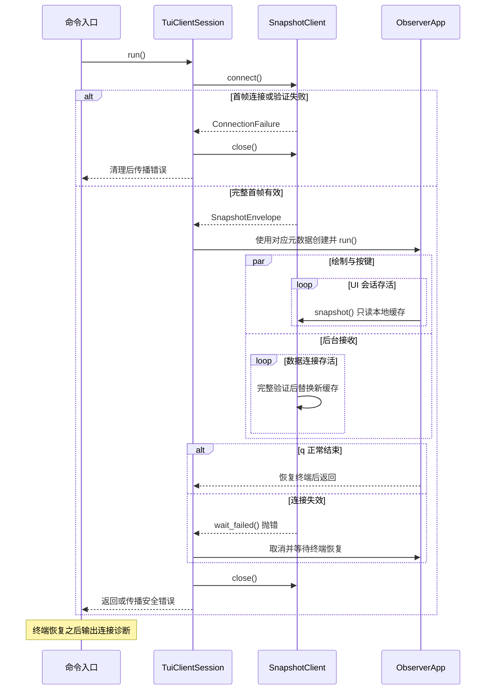

# TUI 客户端会话

- 关联需求：dev-1 / REQ-001，AC-102、103、105～109、112、114。
- 修订：v1.3，2026-11-16；在图前集中说明客户端类、对象别名及命令入口角色。
- 整体设计：[组件边界与依赖](architecture.md)。
- 代码：`ipc/client.py`、`tui/session.py`、`cli.run_command`；既有 `ObserverApp` 和纯视图继续复用。
- 相关设计：[IPC](ipc.md)、[应用外壳](application-shell.md)、[常驻服务](collector-service.md)、[导航](navigation.md)、[vLLM](vllm.md)。

## 类与对象简介

| 图中名称 | 简介 |
| --- | --- |
| `TuiClientSession`（对象别名 `Session`） | TUI 会话编排类，负责连接首帧、并发运行界面与失联监测并收尾本会话资源。 |
| `SnapshotClient`（对象别名 `Client`） | 只读快照客户端类，负责单次连接、后台接收校验、本地不可变缓存及连接状态。 |
| `ObserverApp`（对象别名 `UI`） | TUI 应用类，负责从缓存绘制界面、处理会话输入并恢复终端。 |
| 命令入口（角色别名 `CLI`） | `cli.main()` / `run_command()` 的启动与退出诊断角色，负责分派客户端会话并在终端恢复后输出安全错误。 |

## 简化类图

本会话不持有采集运行期；Connector/ReceiveStream 是唯一传输替换点，测试替换它们，不替换解码、客户端状态机或 UI 编排结果。

## 关键交互时序图

时序图仅列本地会话职责；无 TUI 参与服务退出、重连或来源采集。单个来源 STALE 不走连接失效分支。Unix 端口和编解码交互见 IPC 模块。

## 客户端状态机

| 当前状态 | 事件 | 结果 |
| --- | --- | --- |
| NEW | connect | 进入 CONNECTING，只尝试一次 |
| CONNECTING | 取得首个完整合法帧 | 原子安装缓存，进入 CONNECTED，启动持续接收任务 |
| CONNECTING | 连接/首帧失败 | 进入 FAILED，关闭传输，抛 ConnectionFailure |
| CONNECTED | 合法后续帧 | 完整替换缓存，状态不变 |
| CONNECTED | EOF/超时/协议错误 | 进入 FAILED，关闭接收任务，唤醒 wait_failed 并抛 ConnectionFailure |
| 任意状态 | close | 幂等清理并进入 CLOSED，丢弃有效缓存 |
| 非 NEW | connect | RuntimeError，不再次尝试连接 |

没有 FAILED → CONNECTING 的转换。只有新的命令和新对象才能重新连接。来源 STALE 不触发任何连接状态变化；已连接会话可以持续收到失败对象及其他健康数据。

`connect()` 的五秒预算覆盖连接和首个完整帧；后续从上一完整合法帧起最多五秒。收到部分长度或 body 不重置期限。首帧收到后才允许显示；同步 `snapshot()` / `envelope()` / `state` 不能调用任何 I/O、等待锁内传输或触发采样。缓存内容由协议解码为深不可变值，替换后旧引用仍保持不变。

长度头后按固定工作缓冲分批接收，不按声明的总长度预分配。完整快照没有 8 MiB 业务上限，也没有分片编号/时间段拼装。未收完整或校验失败时不替换旧缓存；失败后会话退出，不把旧缓存继续当作在线数据。缓冲、待发队列和截止时间约束资源增长；完整快照本身仍占与实际对象/历史成比例的内存，需要离线容量验证。

大正文的 JSON 校验/解码通过受控异步执行，不能因 CPU 解码长期占用 ObserverApp 的事件循环。最多一项解码在途，worker 只接收不可变 bytes、返回完整不可变 envelope，主循环验证会话仍有效后才安装缓存。取消等待后丢弃迟到结果；关闭不能因默认线程池排空而突破预算。完整帧预算包含等待解码结果；R4 须连同编码侧验证大快照下的按键响应、worker 清理及内存，而不把异步 read 或简单 to_thread 当作已经保证响应性的证据。

每条连接固定 instance_id、config_revision 和全部 metadata。后续 sequence 严格递增，snapshot.revision 和 published_at 不得倒退；相同 revision 的心跳仍替换快照，因为历史可以随时间裁剪。非法序号、身份或元数据变化立即失败。客户端没有历史追加逻辑，没有计数差分、窗口聚合或配置加载逻辑。FAILED/CLOSED 时读取当前数据抛 ConnectionFailure，旧画面不能继续被当作在线数据。

## 终端编排

TuiClientSession 先等待首帧，再用其 DisplayMetadata 创建独立 ObserverApp、SessionViewActions、HistoryScaleTracker，并从服务 hostname/system 创建 HostInfo。服务时刻与本地 TUI 同属宿主 monotonic 时间域，沿用原来的扫描坐标和最近约 60 秒窗口。

会话同时等待 UI 和 `client.wait_failed()`。UI 按 q 或正常结束时关闭本客户端；连接失败时取消 UI 并等待其 finally 恢复终端，然后向 CLI 传播安全 ConnectionFailure。初次失败不进入全屏。SIGINT/SIGTERM、取消、部分初始化和内部异常沿用恢复路径；一秒清理预算不能被阻塞读占满，关闭连接不影响采集服务或其他客户端。

所有连接错误都由 CLI 在终端恢复之后输出固定信息 `Cannot connect to collector service. Run joi-observer again to retry.`，退出码 4；其他退出码见应用外壳。客户端不准备错误日志，不读宿主配置，不提供重试键，也不启动备用采集器。

## 视图接口迁移

既有纯视图参数名 `config` 保留，声明可接受 AppConfig 或 DisplayMetadata，模型列表参数可接受 ModelConfig 或 ModelDisplay。生产会话只传展示类型，AppConfig 路径用于保留原有有效单元回归；不能构造伪 base_url 或另一套监控配置绕过迁移。

除 `vllm_cells` 的名称/端口访问外，模型选择、硬件关联、容量和历史尺度需要的字段都在展示类型中。vLLM 列表继续显示 name 和显式端口，详情改为 served_model_name（省略时 name）和有效端口。相同名字的不同 id、未知与失败对象、长名称裁切和状态槽都保留既有语义。正文显示映射见 vLLM 设计；采集身份校验不改变。

`cli.main` 和旧 ApplicationRuntime 本轮仍保留可运行基线；新增 `run_command` 是待实现的目标分派入口。R4 完成新分派后让 main 委派，并迁移旧运行期测试到 CollectorRuntime/TuiClientSession；不得长期保留两个可执行采集模式。旧 CLI 中“默认加载配置再采集”的断言属于已确认行为变化，应改为服务命令验证并新增默认客户端验证；采集器、状态、日志和 UI 的未变更断言必须保留。

## 验证

| 入口 | 黑盒覆盖 |
| --- | --- |
| `tests/test_ipc_client.py` | 首帧、分批接收后原子替换、同步缓存无 I/O、不可变旧值、STALE、身份/元数据变化、EOF、非法帧、超时、失败锁存、手动新对象恢复 |
| `tests/test_client_session.py` | 首次失败不进全屏、中途失败恢复后传播、慢传输下主题/q 响应、双会话主题及关闭独立 |
| `tests/test_client_cli_contract.py` | 默认/显式客户端不加载配置、旧参数提示、非 TTY、无 TTY 服务分派、帮助/版本、连接失败不启动服务 |
| `tests/test_display_metadata_view.py` | 无来源 URL 的真实视图入口、列表/详情名称、缺省回退、同名独立 id、长标题槽位、整页组合 |
| `tests/test_snapshot_pipeline.py` | 复用原始硬件、Docker、vLLM 离线样本，贯通真实采集/Monitor/State/codec/客户端/ObserverApp，比较数据与关键画面断言 |
| 既有测试 | 帧调度、历史/主题/导航/硬件/vLLM、curses 清理和本地 PTY 覆盖继续复用；接口迁移保留断言 |

当前测试以字节队列和内存终端隔离外部边界；任何本地或远程服务器连接均禁止。新骨架失败属于待实现，测试断言不接受 NotImplementedError 为成功。R4 还需使用真实客户端编排加离线传输在本地 PTY 验证终端恢复顺序及 SIGINT/SIGTERM；原有旧组合根 PTY 通过不能代替新连接生命周期验证。

R2 提供黑盒及已确认变化的预期迁移；R4 实现入口并使其通过，再补 OS 适配器和本地 PTY 的实现集成验证。原测试的验证意图及未变更业务断言必须保持。具体迁移范围见 [测试迁移记录](../dev-workflow/dev-1/REQ-001/test-migration.md)。

2026-11-16 复查补充：客户端测试显式覆盖 published_at/state revision 倒退失效，以及相同 revision、新 sequence 的心跳仍安装新快照、裁掉已过期历史。不能因 revision 没变化而跳过缓存替换。新连接等待首帧包含服务端过期发布缓存的等待时间，五秒总预算不重置。

## 修订说明

v1.3：2026-11-16，按更新后的 R2 模板集中介绍客户端类与对象，明确命令入口是角色而非新增类，并合并图后的重复职责介绍。
