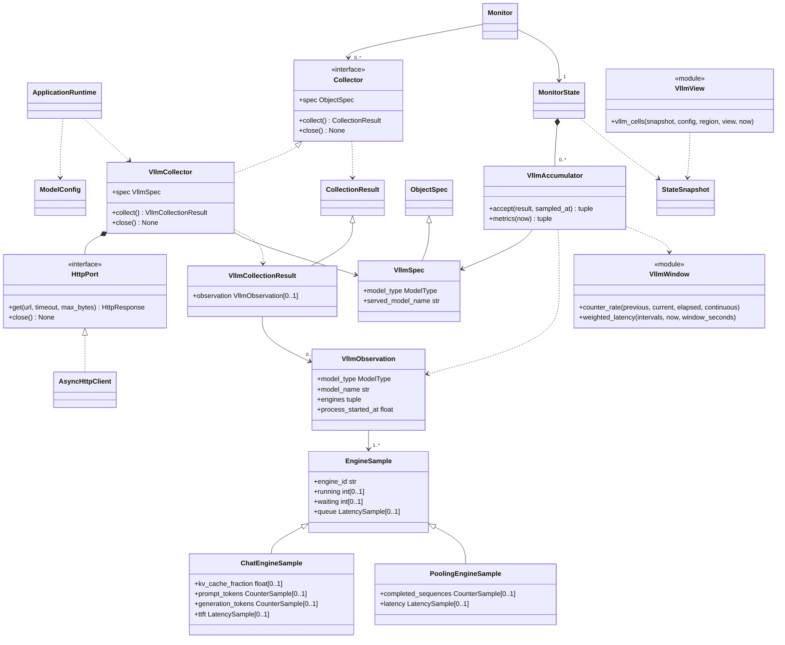

# vLLM 多类型模型负载与历史设计

- 关联需求：dev-0 / REQ-004、REQ-006，`requirements.md` v1.24，AC-401～412、AC-609～616；依赖 REQ-001，复用 REQ-002、REQ-003 运行基础。
- 修订：v1.14，2026-11-09。正式 TUI 使用固定位置扫描折线，统一历史标题的单位分隔符。历史阶段结果见 [`handoff-r5.md`](../dev-workflow/dev-0/REQ-004/handoff-r5.md)。
- 范围：冻结模块职责、数据和接口契约，提供可加载的接口骨架及离线黑盒测试。业务入口留待 R4 实现，不能把导入成功或预期的 `NotImplementedError` 解释为功能已完成。
- 关联文档：[指标证据](../dev-workflow/dev-0/REQ-004/metric-evidence.md)、[配置](configuration.md)、[Monitor / State](monitor-state.md)、[应用外壳](application-shell.md)、[主题](theme.md)、[错误日志](error-logging.md)。原[视图契约路径](../dev-workflow/dev-0/REQ-004/view-contract.md)保留为第10节的兼容入口。

## 1. 证据、兼容性与范围

用户提供的三个端点分别报告 `qwen3.8-flash-next`、`qwen3-embedding-4b`、`qwen3-reranker-0.6b`，服务与安装包版本均为 `0.31.0`。两类 pooling 均提供内部运行/等待数量、正常完成计数、排队和完成延迟。采证只做 GET 与只读源码导出；本轮设计在本地读取资料，没有连接服务器或执行包内源码。

精确指标名、标签、行号、源码哈希及证据边界集中维护在[指标证据](../dev-workflow/dev-0/REQ-004/metric-evidence.md)。本设计只支持已核对的 `0.31.0` profile，不承诺其他版本自动兼容。实采为单 engine 空闲窗口；多 engine、故障、重启和负载增量的确定性规则由源码及离线构造验证支持，不宣称完成这些场景的实机演练。

展示三个模型并持续采集未选中项；直接读取配置的 vLLM origin，不访问 LiteLLM、WebUI、推理接口或其他地址。REQ-004 接收现有模型选择输入；方向键导航和服务入口由 REQ-005 完成，完整视觉主题由 REQ-006 完成。

REQ-005 使用 [SessionViewActions](navigation.md) 维护合法配置 id，并通过 ObserverApp 把同一选择传给本视图与硬件关联。不以健康状态重排或替换选择，不触发采样、清空历史或修改本模块指标。列表容量和无状态可见窗口沿用 `vllm_cells`，不新增滚动缓存。

## 2. 职责与协作

沿用 `Collector → Monitor → MonitorState → TUI`。每个模型配置对应独立 `ObjectKey("vllm", model.id)`、采集器、HTTP 端口及 State 内 accumulator。配置顺序决定展示顺序，同名模型和相同 origin 的不同 id 不自动合并。

采集器执行本轮只读请求、版本/身份核对和字节解析，只返回当前不可变观测。Monitor 独立调度并统一提交、记录错误；MonitorState 独占差分基线、延迟窗口和历史。TUI 只读冻结快照，不持有原始响应、累积计数、HTTP client 或状态写接口。



类图使用 UML 实现、继承、关联、组合和依赖关系，箭头不表示运行时数据流。按已确认的图面偏好，不画 Monitor/MonitorState 到 CollectionResult 的依赖线，也不在连线上加说明文字。公共结果体系见[Monitor / State](monitor-state.md#collection-results)。VllmCollectionResult 与观测使用普通关联：观测是可共享不可变值，不要求与单个结果独占生命周期。

EngineSample 只提供三种模型共有的身份、运行/等待数量和排队延迟。VllmObservation 到 EngineSample 的关联表示使用该继承体系，实际 engines 必须全是与 model_type 匹配的同一种具体子类；裸基类、混合子类及错类型在消费边界拒绝。Embedding 与 Reranker 共享 PoolingEngineSample，不各建一个同结构的类。

构造配置、静态 spec、采集器或 HTTP 适配器时不执行 I/O；关闭一个模型不能关闭其他模型的 HTTP client。数学函数无状态，accumulator 由 State 独占，不能移到 Collector 或 UI。

## 3. 配置、身份与版本

`ModelConfig` 的字段合法性、展示名称与期望服务身份的区分、`served_model_name` 回退及 URL 约束统一见[配置字段契约](configuration.md#configuration-fields)。采集器使用解析后的期望身份执行下述响应核对，不重复配置校验或猜测部署信息。

每次采样依次读取 `/version`、`/v1/models`、`/metrics`，不永久缓存版本或身份。要求版本精确为 `0.31.0`；期望身份必须同时出现在 models 的 `data[].id` 及所用 metrics 的 `model_name` 标签中。只作完整精确匹配，不按子串、GPU、端口或模型类型猜测；同名不同端点不合并，报告身份改变不改绑配置 id。

无模型配置时工厂不创建端口、不发请求；空态及路由呈现见[第10节](#10-展示与固定布局)。

## 4. 冻结的公开接口

| 位置 | 接口 | 契约 |
| --- | --- | --- |
| `data/vllm.py` | `CounterSample(value, created_at=None)` | 非负整数累计量，保留精度；可选指标创建时间只作连续性提示 |
| 同上 | `LatencySample(total_seconds, observations, created_at=None)` | 自身累计 sum/count 的原子组；非负有限秒数、非负整数 count；count=0 时 sum=0 |
| 同上 | `EngineSample(engine_id, running=None, waiting=None, queue=None)` | 公共基类，只含单 engine 身份及共有指标；裸基类不能作为已消费的模型观测 |
| 同上 | `ChatEngineSample(EngineSample)` | 只增加 `kv_cache_fraction/prompt_tokens/generation_tokens/ttft` |
| 同上 | `PoolingEngineSample(EngineSample)` | 只增加 `completed_sequences/latency`，供 Embedding 与 Reranker 共用 |
| 同上 | `VllmObservation(model_type, model_name, engines, process_started_at=None)` | engines 为同类非空 `tuple[ChatEngineSample, ...]` 或 `tuple[PoolingEngineSample, ...]`，按 model_type 匹配，engine_id 唯一；不含速率、均值或 UI 状态 |
| 同上 | `VllmSpec(ObjectSpec)` | 增加模型类型及期望服务身份，不通过 Metric 排列猜测类型 |
| 同上 | `make_vllm_spec(config)` | 静态创建 key、模板与类型；无 I/O |
| `data/vllm.py` | `VllmCollectionResult(key, observation=None, *, failure=None)` | vLLM 专属观测载荷；公共结果构造与 spec 匹配规则见[Monitor / State](monitor-state.md#collection-results) |
| `collectors/vllm.py` | `parse_scrape(config, *, version: bytes, models: bytes, metrics: bytes)` | 纯解析为 VllmCollectionResult；不访问网络、不计算窗口、不打印/写日志 |
| 同上 | `HttpPort.get(url, *, timeout, max_bytes)` / `close()` | 返回 HttpResponse(status, body)；每模型独占，可取消、有界、幂等关闭 |
| 同上 | `AsyncHttpClient(client_factory=None)` | HTTPX 适配骨架；首次请求才创建 client，支持完全离线 factory 替身 |
| 同上 | `VllmCollector(config, http, timeout=3.0)` | 固定三个 GET 路径、共享整轮预算、解析结果交 Monitor |
| 同上 | `build_vllm_collectors(config, *, http_factory=None)` | 按完整模型配置顺序创建，每项独立端口，不按选择或屏幕容量截断 |
| `data/vllm.py` | `VllmAccumulator(spec, *, history_seconds=60.0, max_intervals=602)` | State 持有的每模型/每指标组基线与有界区间 |
| 同上 | `accept(result, *, sampled_at) -> tuple[Metric, ...]` | 原子验证并消费一次结果，返回完整显示字段；非法输入抛 ValueError 且不改状态 |
| 同上 | `metrics(*, now) -> tuple[Metric, ...]` | 纯只读投影，按当前时刻计算过期窗口，不采集、不修改 revision 或历史 |
| `data/vllm_window.py` | `counter_rate(...)` / `weighted_latency(...)` | 无状态、精确计数差分和窗口加权数学 |
| `tui/vllm.py` | `vllm_cells(snapshot, config, region, view, *, now, history_scales=None)` | 返回 `tuple[TextCell, ...]`；输入与呈现契约见[第10节](#10-展示与固定布局) |

公共 `EngineSample` 只保留 `engine_id/running/waiting/queue`。`ChatEngineSample` 继承公共字段并增加 `kv_cache_fraction/prompt_tokens/generation_tokens/ttft`；`PoolingEngineSample` 只增加 `completed_sequences/latency`，其中 completed_sequences 只含正常 STOP 完成量，延迟各带自身 count。Chat 类没有 pooling 专用字段，pooling 类没有 Chat 专用字段，不用 None 为不适用的原始字段占位。

这些原始观测类中的指标字段为 None 仅表示适用字段本次未取得；是否为实际失败仍由 `CollectionResult.failure` 表达，不能从 None 自动推导错误。成功的零观测延迟以合法 `LatencySample(0, 0)` 表达；成功结果必须提供全部适用指标，部分字段未取得的 observation 只能随带 failure 的部分结果提交。类型不适用性仍在最终显示 Metric 模板用 `applicable=False` 表达，原有 N/A、字段槽位及显示规则不变。

Collector、Monitor 与 State 的公共类型边界、无载荷失败和具体结果匹配规则统一见[Monitor / State](monitor-state.md#collection-results)；本模块仅扩展 VllmSpec 对应的语义观测与 accumulator。

VllmSpec 专支由 accumulator 生成展示字段，不将 observation 放入 ObjectSnapshot。Chat observation 的 engines 只接受 ChatEngineSample；Embedding/Reranker 只接受 PoolingEngineSample，且每份 tuple 非空、同类、标识唯一。裸 EngineSample、混合子类、与 model_type 不匹配的子类，以及结果类型、模型类型、身份或 key 不匹配均在消费边界原子拒绝。成功 observation 必须包含每个引擎所有适用字段，缺值只能作为有 failure 的局部失败。快照仍只有既有 Metric、stale、采样时间及 HistoryPoint；错误原因仍只交日志链路。本轮只修订观测类型、接口契约与测试，vLLM accumulator、状态专支及组合接线仍留待 R4 实现；不改变 VllmSpec 默认字段或 Metric 模板。

## 5. 指标投影和类型适用性

| Metric.name | 单位 | Chat | Embedding / Reranker |
| --- | --- | --- | --- |
| `running` / `waiting` / `total` | `seq` | 适用 | 适用 |
| `decode_rate` / `prefill_rate` | `tok/s` | 适用 | 不适用 |
| `rate` | `seq/s` | 不适用 | 正常 STOP 完成速率 |
| `ttft_seconds` | `s` | 适用 | 不适用 |
| `queue_seconds` | `s` | 适用 | 适用 |
| `latency_seconds` | `s` | 不适用 | 适用 |
| `kv_cache_percent` | `%` | 适用 | 不适用 |

模板所有初值为 None；不适用字段另设 `applicable=False`，不能伪造零。RUNNING/WAITING 包括 Chat 在内均表示来源 scheduler 的内部请求/序列数量，不是 HTTP 请求数。Total 只对同一新样本、完整 engine 集合的两个有效计数相加；不能使用新 RUNNING 配旧 WAITING。

Chat DECODE/PREFILL 分别从 `generation_tokens_total`、`prompt_tokens_total` 逐 engine 差分。pooling RATE 只采用 `request_success_total{finished_reason="stop"}`，不包含 abort/error/length/repetition。队列和完成延迟可能包含源码实际记入的其他终止序列，使用自己的 histogram sum/count，不复用 RATE 分母。

KV Cache 来源比例范围为 `[0,1]`，按同模型 engine 的算术平均 ×100。该方式与目标源码聚合日志一致，是 engine 等权平均，不声称是按容量加权的总占用率；与 GPU 显存完全独立。同一快照某指标缺少引擎分片时，不把已知子集当完整服务值；完整engine集合相较上次变化则属于拓扑变化，采用新集合的瞬时计数并重新建立差分基线。

TTFT 和 Avg latency 沿用来源内部请求 `arrival_time` 到相关输出处理时刻的定义；Avg queue 为来源记录的 QUEUED 到首次 SCHEDULED。Avg latency 不包括之后整批结果后处理、完整 HTTP 发送或网关/客户端时间；Embedding 不额外承诺 tokenization 是否计入。精确证据见[指标证据第 4 节](../dev-workflow/dev-0/REQ-004/metric-evidence.md#4-延迟计时范围与分母)。

## 6. 字节解析与资源边界

解析三份 UTF-8 字节，JSON 拒绝重复 key。Prometheus 指标按精确名称、model_name、engine 和允许的额外标签匹配；正确处理引号与转义，不按逗号随意拆标签。target series 在规范化标签顺序后重复、缺少身份标签或多出未定义标签属于整体结构错误，不重复累加；合法未知指标及其他模型独立 series 可忽略。

每份响应最多 2 MiB；metrics 单行最多 64 KiB、样本行最多 50000、每 series 标签最多 **64**。恰好64合法，65及以上为整体`parse/response.invalid`；`MAX_LABELS_PER_SERIES`的目标值统一为64。数字 token 最多 128 字符，十进制指数绝对值最多 400、展开整数最多 400 位；这些限制在转换大整数前检查，避免短字符串表示极大指数消耗无界资源。

该上限是对所有family统一生效的资源边界，不是业务schema宽度。标签格式、转义、重复、数量以及数值词法和资源边界须在丢弃未知family、其他model、bucket或非STOP序列前完成对应检查；不得为`vllm:cache_config_info`添加豁免，也不得跳过未知行验证。目标业务序列仍严格要求原有2个标签（model_name、engine），bucket另加le，完成计数另加finished_reason；多余目标标签仍为整体错误。被忽略序列的合法Prometheus负数/小数/非有限拼写沿用现有规则，适用业务数值的非负/有限/整数及局部失败规则不变。

修订依据：用户已保存的六份0.31.0完整响应均包含36标签的正常`vllm:cache_config_info`；最大正文64449字节、最大行1054字节、最大样本495，其他边界无需扩大。64容纳已确认的正常输出并保留有界余量，单行与总正文限制继续约束分配；这不是对未来版本任意标签数量的承诺。完整fixture与回归由R5/R4保留。R2本轮只确认契约、注释及黑盒测试；运行常量仍为16，须由R4落实64后回验，不能把本设计接受视为旧包已修复。

计数使用精确十进制语义解析，允许整数值科学记数法，不先经过 float；拒绝负值、非整数、bool、NaN/Infinity。延迟总秒数及创建时间有限非负，KV 比例有限且处于合法范围；`le="+Inf"` 是 histogram 标签，不等于允许非有限业务值。bucket 不相加，也不代替 count。

成功结果为 `VllmCollectionResult(key, observation)`。本应支持的字段缺失或非法为局部 `response.invalid`，以 `VllmCollectionResult(key, observation, failure=...)` 保留其他有效原始字段，坏字段为 None；sum/count 任一缺失或非法则整组失效。身份、版本、JSON、整体 exposition、超限等全对象失败返回 `VllmCollectionResult(key, failure=...)`，observation=None。

parser 按配置 model_type 构造 ChatEngineSample 或 PoolingEngineSample；成功和部分失败都保持该具体类型。来源中出现的类型不适用指标不加入原始观测，也不因为对应字段不属于该类而报缺失。消费边界仍独立核验具体子类与 model_type，不能仅依赖 parser 或类型注解保证合法性。

`process_start_time_seconds` 和各目标指标 `_created` 可选；缺失本身不是失败，存在则校验。非法 process marker 属于整体结构失败，非法 `_created` 使所属组局部失败。创建标记不是累计计数，也不是完整 engine 生命周期证明。

<a id="vllm-windows"></a>

## 7. 基线、窗口与原子状态更新

### 每组独立连续性

至少分别维护 prompt、generation、pooling completion、TTFT、queue、latency 基线；延迟 sum/count 永远原子成组。Monitor 将一次 collect 实际完成时的单调时间传给 State，不能用计划时间、配置周期或 UI 刷新间隔替代。

先验证整个结果的 key、类型、服务身份、结构及数值，失败时不部分改变 live state。采样时刻须有限非负且严格递增；每 engine 标识唯一，标识不是 tuple 下标或 GPU 编号。

首次、engine 集合变化、任一成员计数回退、相关 `_created` 的值或可用性变化、进程启动标记的值或可用性变化，均使受影响组不可比较；当前有效样本只建立下一段基线。marker 缺失到存在、存在到缺失也保守断开。只有 `_created` 变化的组不影响其他独立组；进程 marker 变化影响全部差分组。

重置、拓扑或标记变化不属于采集失败，不标 STALE、不记 ERROR；本次不产生该组 rate 或新的延迟区间。已验证的过去延迟区间保留到自然过期，不因新 epoch 被改写或填补。若 count 无增量而 sum 增加，该差分区间也不可比较，重建该组基线，不生成均值或虚构采集失败。

### 计数速率

`counter_rate(previous, current, *, elapsed, continuous=True)` 输入不可变的 `EngineCounter(engine_id, value)` tuple。elapsed 有限且大于 0、continuous 为 bool、计数为非负整数；所有输入先校验，包括返回 None 的不可比较情况。

只有连续、相同 engine 集合且各计数都未回退时计算 `sum(current_i - previous_i) / elapsed`；tuple 顺序不影响结果。必须先逐 engine 判断再求和，防止一个 engine 增长掩盖另一个重置。previous=None、空 engine 集合或连续性断开返回 None；有效比较的零增量返回 `0.0`。结果不能表示为有限 float 时抛 ValueError，不能输出 Infinity 或伪造峰值。

这个数学入口的溢出异常必须由accumulator隔离：在原始输入已通过校验后，某个速率不可表示时仅令该字段为None，当前合法计数作为下一次基线，其他字段及模型继续更新。不把显示数值范围限制伪装成0或采集失败，也不让该异常从State.accept逸出终止Monitor；非法原始类型/身份仍按原子校验错误拒绝。大整数贯通边界由state与integration测试覆盖。

### 延迟窗口

`LatencyInterval(started_at, ended_at, total_seconds, observations)` 表示两个连续可比较采样之间的增量。时间有限非负、结束严格晚于开始；区间有序且不重叠，可首尾相接；count 非负整数，零 count 配零 sum。字段构造不自行执行计算，入口统一验证；区间不是原始累计值，也不假定其中事件均匀发生。

`weighted_latency(intervals, *, now, window_seconds=60.0)` 只纳入完整处于 `[now-window_seconds, now]` 的区间，包含恰好位于两端的边界。跨左边界或尚未结束的区间整体排除，不按重叠时间比例分摊观测。窗口均值为纳入区间的总时长 / 总 count，不对每秒均值或各 engine 均值等权平均；2 次共 4 秒加 1 次 5 秒得到 3 秒。

无区间或零观测时为 None；有观测且总时长确为零可为 0。各延迟独立计数，首个累计样本不产生区间，不能把进程启动以来数据当最近 60 秒。采用稳定求值，避免中间溢出破坏可表示的有限结果。

过去有效区间与新 epoch 之间可以存在缺口；只排除不可验证区间。启动不足 60 秒或排除跨界区间时，实际可证明范围可能更短；时间轴反映已有范围，不补零、不拉伸为完整 60 秒，不增加“窗口不足”诊断行。

### 有界与只读投影

每个延迟组同时按时间和点数有界，默认 `history_seconds=60`、`max_intervals=602`。State 继续维护有界 HistoryPoint，单份差分基线不构成持久化历史。所有监控数据仅在内存，日志只记录采集失败。

`metrics(now)` 对过期窗口只作读取时投影，不改变基线、区间、revision 或旧快照；State的接合及只读snapshot规则见[状态投影](monitor-state.md#vllm-state)。

## 8. 失败、保值与历史缺口

网络/超时/身份/响应错误只影响对应模型；Monitor 沿用已有 Failure → ErrorLog 链路及同对象同错误 60 秒限频。失败详情不进入 Metric、快照或 TUI。

全对象失败保留最后展示值并打断所有基线；初始失败值仍未知。局部失败保留失败字段最后值、打断受影响组，其他组可以正常更新并继续差分。不可用字段不冒充有效零；失败后首个恢复样本仅重建断开的组，不跨故障算差值。仍在窗口内的旧有效延迟区间可继续参与均值，随后自然过期。

只要一次结果存在实际 failure，State 保守记录整点 `HistoryPoint(metrics=None)`。即使本次主吞吐有效，也不把局部失败的整点画成有效柱；这明确舍弃部分可用曲线以沿用通用历史语义。该取舍不意味着对象级 baseline_valid 可以替代各业务组的独立基线。

首次无基线、重置或恢复首点的适用主吞吐为 None，历史图留空；健康可比较的零增量绘制有效 0。保留展示值不能被写成新的有效历史观测；不补零、不延续旧值画新柱。后续正常采样自动清除 STALE，不因模型不可用自动切换选择。

## 9. HTTP、取消与运行期接线

此节定义未来产品行为，不授权本轮连接服务器。

- 每次 collect 严格顺序读取同一配置 origin 的 `/version` → `/v1/models` → `/metrics`。三次请求共享 `collection_timeout` 总预算，后续只获得剩余时间；每份解压后正文最多 2 MiB，不能每个请求重新获得整轮预算。
- `AsyncHttpClient` 使用 `HTTPX>=0.28.1,<0.29`。构造只保存 factory，默认首次 get 才懒加载 HTTPX 并创建 client；注入替身不需要安装或导入 HTTPX。
- 本轮未安装HTTPX，也不单独修改既有依赖清单而使离线锁文件失配。R4实现真实后端时须一并更新`pyproject.toml`、`uv.lock`及离线wheel集合，验证真实HTTPX的stream、取消、TLS和解压行为；当前factory替身验证的是接口契约，不能替代这些依赖集成检查。
- 默认 client 固定 `follow_redirects=False, trust_env=False, verify=True`，不读环境代理或隐式凭据，正常验证 HTTPS 证书。每个 get 只创建一次 `stream("GET", ...)`，不重试、不自动访问重定向地址。
- 按解压后的流式字节检查上限，即使无 Content-Length 也受限；达到上限合法，超过立即中止并关闭流，不先读完无限正文。client 的 stream/response/aclose 接口允许离线替身观察调用与释放行为。
- HTTP 401/403 → `permission/access.denied`，404 → `not_found/object.not_found`；其余非 200，包括 3xx → `unavailable/source.unavailable`。非法状态/载荷与响应超限 → `parse/response.invalid`；TimeoutError → `collection.timeout`，网络/TLS/依赖不可用 → `source.unavailable`。本轮任一请求失败后停止剩余请求。
- CancelledError 是关闭控制流，清理后传播，不变成 CollectionResult failure。get/close 清理遵守 250ms 预算；同实例 get 不重入，close 幂等，关闭后 get 抛 RuntimeError。Monitor 继续执行每对象不重叠、忙时跳过采样槽、统一外层超时与全局退出预算，不留迟到提交。
- Monitor超时/未知异常的公共失败路径遵守[公共结果契约](monitor-state.md#collection-results)，模型基线及历史按[第8节](#8-失败保值与历史缺口)处理。
- 组合根新增 vLLM 工厂依赖注入并调用 `build_vllm_collectors`，与硬件、Docker 交给同一个 Monitor/State。替换旧手工 vLLM 占位 spec，避免重复注册；所有模型持续采集，视图选择不创建请求。

本轮公共结果类型拆分及已有硬件/Docker/普通 State 路径仅作类型迁移，保持原业务行为；vLLM 部分继续只提供依赖声明、字段、接口签名、完整注释及 NotImplementedError 骨架。真实 client、配置解析、vLLM State 专支、组合根和呈现行为由 R4 实现。当前环境不安装或连接服务来掩盖未实现基线。R4 需在本地 Ubuntu/WSL、具备目标依赖后验证真实 HTTPX adapter；本轮 fake client 测试不能替代真实库兼容验证。

<a id="vllm-view"></a>

## 10. 展示与固定布局

本节是服务窗口内部呈现的唯一契约。外部 Region、半页预算、最低终端尺寸及帧调度由[应用外壳](application-shell.md)维护；选择、按键和服务入口由[导航](navigation.md)维护；所有颜色角色、主题默认值及终端字体实现由[主题](theme.md)维护。

### 职责与输入

`vllm_cells(snapshot, config, region, view, *, now, history_scales=None)` 返回服务区内容 `tuple[TextCell, ...]`。只读取 `ObjectKey("vllm", model.id)`，不持有采集器、Monitor 或状态写接口，不计算计数差分、延迟窗口或跨采样 Total。选择、主题和调用次数不会影响采集、历史或快照 revision。

`now` 是与历史点同域的有限非负单调秒数，不能由页眉 datetime 墙钟转换。`compose_frame(..., monotonic_now=None)` 的显式值用于离线时钟，缺省生产路径取 `time.monotonic()` 后传入；应用如何共用帧时刻与冻结尺度见[帧时钟和尺度接线](application-shell.md#帧时钟和尺度接线)。

<a id="vllm-layout"></a>

### 固定槽位

输入 `Region("service", row, column, width, height)` 包含外边框。本函数只写内部，外框和 `column+27` 的栏间分隔由外层绘制；该分隔仅覆盖服务内部行。服务类型、失败、恢复和空字段变化均不改变 Region 或下表槽位。所有文字按终端字符单元宽度裁切，控制字符变为空白，不能跨内部分区或覆盖外边框。

左模型栏内容为 `[column+2, column+26)`，固定24列；右详情为 `[L,R)`，其中 `L=column+30`、`R=column+width-2`。120列服务区对应88列图区。长名称优先裁短，不能覆盖状态或单位。

| 区域 / 相对行 | 内容 |
| --- | --- |
| 左 `+1` | `MODELS / n`；n为配置模型总数 |
| 左第i个可见项 `+2+4i` | `column+2`为选中`›`，名称从`column+4`开始且末端不超过`column+19`；状态槽从`column+20`起占6列，文字右对齐到`column+26` |
| 左名称下一行 | 大写类型和URL显式端口，如`CHAT / :8000`；未写端口则只显示类型，不猜80/443 |
| 左名称后两行 | 左槽`[column+2,column+14)`的`3 running`左齐；空1格；右槽`[column+15,column+26)`的`7 waiting`右齐；数字与标签分别生成cell |
| 左名称后三行 | 分隔留白，不增加独立行框或将三行合为一行 |
| 右 `+1`、`+5`、`+11` | 空行，分别位于模型名、RUNNING/WAITING统计及历史标题上方 |
| 右 `+2` | 模型名左，状态槽`[R-6,R)`右对齐且无尾空格；不重复左栏已有类型 |
| 右 `+3` | 仅显示服务端口，如 `:8000`。若 `base_url` 省略端口，HTTP 显示 `:80`，HTTPS 显示 `:443` |
| 右 `+4`、`+8` | `[L,R)`横向分隔线 |
| 右 `+6` | RUNNING / WAITING 两统计组：标签组内左对齐，至少留1空格，纯数值组内右对齐；无ASCII大数字、分母或Total第三组 |
| 右 `+7` | 左从L起`Total {state.total} seq`；右从`S+2`起Chat的`Avg queue {seconds}s`或pooling的`Unit: seq`；caption限于各自统计组 |
| 右 `+9` | 四列指标标签及单位，具体文案见下节 |
| 右 `+10` | 对应的纯数值，不重复单位、不越列 |
| 右 `+12` | Chat为`DECODE HISTORY \| tok/s`，pooling为`RATE HISTORY \| seq/s`；同一行右端为尺度标签 |
| 右 `+13` | 明亮加粗的 `▼` 标记当前扫描秒位 |
| 右 `+14 ... height-3` | 固定位置点阵折线；服务高度16时仅有 `+13` 一行图区，游标覆盖当前字符 |
| 右 `height-2` | `0s / 15s / 30s / 45s / 59s` 循环秒刻度，见[历史显示](#vllm-history) |

两统计组中间分隔为 `S=L+(R-L)//2`；左组`[L,S-1)`，右组`[S+2,R)`，分隔线位于S列，仅覆盖统计与caption两行。数值不得跨过各组右缘。120列服务区对应L=30、S=74、右组起76、R=118。

四指标列可用宽为`R-L-3`；前三列宽`q=(R-L-3)//4`，每列间留一空格，最后一列接收余数。列起点为`L+i*(q+1)`；120列对应30、52、74、96。标题和数值各自只占固定一行。

左栏容量为`(height-2)//4`。按配置顺序取包含选中项的连续窗口：首项为`max(0, selected_index-capacity+1)`，末端不超过模型总数。窗口不保存滚动偏移；选择靠前可显示更多后续项，靠后可留白，不增加分页、循环、更多标记或滚动条。未知选中id或None回退首模型；无配置只显示一次`No models configured`，不绘制伪造指标或历史。逐模型状态槽必须保留，不能因窄栏隐藏未选中模型的STALE。模型数量不改变外壳的尺寸要求。

<a id="vllm-values"></a>

### 指标和状态

仅呈现[第5节](#5-指标投影和类型适用性)定义的字段与单位，不输出原始字段名或任意附加Metric。显示标签与字段名分离：

| 类型 | 第一列 | 第二列 | 第三列 | 第四列 |
| --- | --- | --- | --- | --- |
| Chat | `DECODE / tok/s` | `PREFILL / tok/s` | `TTFT / s` | `KV CACHE / %` |
| Embedding / Reranker | `RATE / seq/s` | `Avg queue / s` | `Avg latency / s` | `KV CACHE / %`，值为N/A |

None显示`—`，有效0正常显示0，不适用为N/A。仅模型已采样、非stale且RUNNING/WAITING均有效时显示READY/QUEUED：等待大于0为QUEUED，否则READY。首次未采集或缺队列值时状态为`—`，不默认READY；任一实际失败以STALE覆盖状态。状态、标签及新鲜/保留数值的颜色统一见[主题角色规则](theme.md#color-roles)，不从状态名推断额外告警行为。

右侧 RUNNING/WAITING 及四指标的六个数值槽中，真实数字 cell 设置 `bold=True`，包含 0、科学记数和 STALE 保留值。历史扫描游标 `▼` 也使用加粗字重。`—`、`N/A`、`…` 使用普通字重。三种模型类型共用规则，TextCell 与终端字体叠加由[主题字体属性](theme.md#font-rendering)维护。

数值超宽时先用最多3有效数字的科学记数，保留完整指数；不得截取十进制前缀伪装较小完整值。左栏数值加标签仍放不下时，`running/waiting`可缩为`run/wait`；仍不足则数值用明确`…`，不覆盖标签和邻槽。该规则适用于最新统计、指标及caption，不修改原始Metric或公共`format_metric`。正常、0与未知值保持原文案；未知queue caption为`Avg queue —`，不追加虚假的秒数或单位后缀。

Total直接读取状态层按[指标投影](#5-指标投影和类型适用性)计算的字段，不在视图重算。路由仅用配置事实；未知并发/总请求上限不显示分母，不推断TP/EP、量化或上下文参数，不复制设计稿模拟值。不显示样本时间、错误原因、故障持续时间、最后成功时间、异常堆栈、窗口不足或模拟标记，不增加推理、告警或服务管理操作。

<a id="vllm-history"></a>

### 10.1 固定位置扫描折线与显示尺度

正式 TUI 使用固定位置扫描折线。Chat 绘制 decode_rate，单位 tok/s；Embedding 和 Reranker 绘制 rate，单位 seq/s。曲线使用每个字符 2×4 点的 Braille 字形，颜色引用[主题设计](theme.md)。`▼` 使用明亮正文色和加粗字重。图内显示纵轴刻度、曲线、游标及循环秒刻度。

HTML 的 Neon Grid 历史图使用可左右平移的平滑曲线，曲线下以主题主色向下渐隐填充，不使用主副双色渐变。这是设计预览的呈现与交互，正式 TUI 继续遵循本节的固定位置扫描、缺口和显示尺度契约。

**固定秒位**

now 与 sampled_at 使用同一单调时钟。扫描槽覆盖当前整秒及前 59 个整秒，可见样本范围为 `[floor(now)−59, now]`。横坐标由采样整秒模 60 确定，旧样本的位置固定。横轴为 `0s`、`15s`、`30s`、`45s`、`59s`，表示一个 60 秒扫描周期中的位置。

图区左侧预留 6 列纵轴刻度及间距。其余 W 个字符列提供 `2W` 个横向点位。

```text
current_second = floor(now)
slot = floor(sampled_at) % 60
dot_x = round(slot * (2W − 1) / 59)
cursor_slot = current_second % 60
```

`▼` 每秒前进，在 59s 之后回到 0s。新一圈覆盖最旧整秒，即使当前秒尚无样本，旧圈对应槽也会清空。旧样本保持固定横坐标，终端宽度变化时重新映射点阵位置。当前秒立即接收新的真实观测。

同秒的有效值取最大值；存在缺样、未知主字段或不适用字段时，该整秒留白。有效零值在基线画点，正值至少高于基线一个点。仅连续有效秒之间连线，缺秒处断开，游标右侧的新旧圈交界处也断开。没有有效数据时显示 `—`。显示机会由[应用帧调度](application-shell.md#帧截止点与终端写入)提供。

历史标题和尺度共用一行，下一行专用于游标，曲线位于其下方。服务窗口只有 16 行时，曲线及游标共用一行，游标优先显示所在字符。纵轴空间可容纳时显示上限、一半和零值。图底部只显示循环秒刻度。

**纵轴档位与迟降**

尺度用主指标单位表示，按模型id＋指标名独立维护；不同模型或tok/s、seq/s不共享上限。档位为 `{1, 2, 5} × 10^n`（n为非负整数），最小1单位。设M为可绘制有效桶的最大值，目标档T为不小于M的最小档位；例如23→50、121→200，真实全0→1。初次有数据立即采用T；没有任何有效桶时不把未知当0，保持已有上限并清除降档计时，未建上限的空图可暂用1。

- T高于当前上限：本次绘制立即升到T，不裁掉新峰值，清除迟降计时。
- T等于当前上限：保持，并清除迟降计时。
- T低于当前上限：开始/延续连续低档计时；达到 **5秒** 后降到当时T。期间T在更低档位之间变化不重启计时；达到当前档、升档或没有有效桶时清零。时间按单调秒数，不按帧数计算。
- 曲线按真实桶值与上限的比例换算点高。比例上限标签为 `Scale ≤ {upper} {unit}`，使用前文固定槽位；颜色见[主题角色](theme.md#color-roles)。最新数值保留自身精度。

尺度属于展示会话，不放入MonitorState、配置或文件。由UI从同一只读快照推进各配置模型的尺度，未选中模型也保持自己的历史和尺度计时；主题切换、resize、小窗口、再次显示某模型不重建尺度。一次快照重复绘制不能每帧重新启动低档计时。快照/分桶/过期点/5秒截止点不变时可复用呈现结果，避免普通刷新重复计算整段历史。

应用持有尺度状态，并将冻结的尺度值传给 compose_frame/vllm_cells。控制器与曲线使用同一套 60 秒槽数据，窗口宽度变化时尺度保持稳定。

**公开接口与验证**

| 公开入口 | 完整目标契约与测试 |
| --- | --- |
| `history.scan_history(history, field, *, now)` | 返回60个`int/float/None`固定槽，整秒模60定位；缺口优先、回绕、过期及只读输入见 `test_history_presentation.py` |
| `history.bucket_history(history, field, *, now, columns)` | 保留已有滚动分桶接口的兼容性，正式扫描图使用 scan_history |
| `HistoryScale(model_id, field, upper)` | 冻结数据载体，upper为任意精度正整数1/2/5档；构造不执行分桶或业务验证 |
| `HistoryScaleTracker(models).update(snapshot, *, now, columns)` | 按配置顺序返回全部模型尺度；无I/O、同now可重复、拒绝时间回退，校验异常原子不改状态；`test_history_presentation.py` |
| `compose_frame(..., history_scales=None)` / `vllm_cells(..., history_scales=None)` | 可选关键字接收冻结尺度元组；参数在已有参数后追加；显式传递、标签、比例、输入冻结与错误拒绝见`test_vllm_view.py`、`test_theme_view.py` |
| 默认`ObserverApp`→尺度→真实Frame | `test_history_app.py`验证全部模型/时钟接线、5秒、切换/缩放/小窗口和实例隔离；不替换尺度计算或绘图结果 |

两个纯渲染入口没有传入尺度、传空元组或无选中模型＋主字段的匹配项时，只按本帧有效桶峰值选择一次性nice档位，不保存迟降计时。显式元组按model_id＋field匹配，其他模型/字段不能代用；重复键、upper非正int或非1/2/5档、匹配上限低于有效峰值均抛ValueError，不裁峰。正常应用始终使用自己的tracker结果，不能用纯调用的即时尺度替代会话迟降。

上限覆盖真实的int/float数值，不先将float转为有限精度十进制字符串来决定是否覆盖：例如精确整数10**300可用该档，而二进制float(1e300)略大于此整数，覆盖档为2*10**300。尺度用任意精度整数避免溢出；超长标题数字可以科学计数压缩，常规值保持`Scale ≤ 200 tok/s`。渲染高度计算也必须避免把超大整数先转float导致溢出。

| 场景 | 目标观察 |
| --- | --- |
| 只有2秒样本、单点、空图 | 固定循环秒刻度，样本按整秒模60定位，空白保留 |
| now在同一整秒内、进入下一秒、59s回绕0s | 游标每秒前进，已有槽位固定，回绕时新圈覆盖旧槽 |
| 可见首秒及其前后、future点、同秒边界 | 只接纳当前整秒及前59秒内的真实观测 |
| 同桶多值、同桶包含缺口、缺口过期 | 最大值聚合及缺口优先，不把不可见峰值计入尺度 |
| 可绘制桶峰值M先为121，原峰值已离窗或所在桶不可绘后M降到23，持续4.9s/5s | 上限先立即200；从M实际降到23时计时，4.9s仍200，满5s才50；仅最新值降到23而121仍可绘时不降档 |
| 低档期间目标继续降低/回升/无观测/全0 | 计时按上述规则延续或清零，未知与真实0区分 |
| 切模型/主题、宽度变化、未选中模型继续采样 | 尺度按模型指标隔离，重分桶不清历史或重建会话 |

tests/test_vllm_view.py的短轴、共享桶和“峰值填满”断言、test_vllm_pty.py的短轴期待，以及test_navigation_app.py的时序现已按新契约同步；原值/单位、无I/O、失败缺口和终端恢复断言继续保留。新帧调度规则见[应用外壳](application-shell.md)，完整文档修订和历史测试证据边界见[REQ-006 R2交接](../dev-workflow/dev-0/REQ-006/handoff-r2.md)。

## 11. 黑盒测试与验证边界

导航贯穿验证另外位于 `tests/test_navigation.py`、`tests/test_navigation_app.py` 和 `tests/test_navigation_pty.py`；这些新增用例的 R2 未实现基线记录在 [REQ-005 交接](../dev-workflow/dev-0/REQ-005/handoff-r2.md)，不改写 REQ-004 已通过的历史验收。

测试从公开函数、注入字节端口、client factory、State 快照和 TextCell 观察正确业务行为；不模拟被测 parser、reducer 或渲染结果。未实现导致的失败保留为 R2 基线，不以断言 NotImplementedError 的方式“通过”业务验收。

| 入口 | 核心覆盖 | 需求关联 |
| --- | --- | --- |
| `tests/test_state.py`、`tests/test_monitor.py` | 公共结果结构与构造、公共/指标整失败、部分失败保值及gap、空载荷成功拒绝；具体结果原样转交和无载荷超时/异常失败 | 公共状态/调度契约，支撑 AC-401、407、412 |
| `tests/test_vllm_collector.py` | 三类型 exposition 到正确 Chat/Pooling 观测子类、无不适用原始字段、精确计数/转义/身份/版本、局部与全失败、STOP 筛选、多 engine、边界上限、三路径顺序和预算、离线 client factory/流取消/关闭 | AC-401、405、407、409～412 |
| `tests/test_vllm_collector_edges.py`、`tests/test_vllm_full_response_integration.py` | 保留三类型完整正文与来源哈希，完整parser观测和真实Collector→Monitor→State链路回归；与统一64/65标签边界共同验证，不用摘录代替完整兼容性 | AC-401、407、409、412，R5-004-005 |
| `tests/test_vllm_engine_samples.py` | 公共字段、Chat/Pooling专用字段分离、拒绝不适用构造参数、冻结及局部缺失时保留具体子类 | AC-401、409～411 |
| `tests/test_vllm_window.py` | 200/2、1000/2、6/2、有效零、首次/重置/拓扑、加权均值、严格落窗、非法输入及有限计算 | AC-402～404、406、410～411 |
| `tests/test_vllm_state.py` | 观测子类/model_type 匹配、裸基类/混合/错类型原子拒绝、非空同类 tuple、既有 Metric 模板、group 独立基线、重置/epoch、部分失败保值与整点 gap、恢复、只读过期、精确 Total、KV 均值、有界窗口 | AC-401～407、409～411 |
| `tests/test_vllm_config.py` | served_model_name 可选回退、明确展示名/身份、非法字段、无 I/O | AC-401、408、412 |
| `tests/test_vllm_integration.py` | 三模型全部注册/持续采集、仅配置 vLLM 地址、同名不合并、单模型故障隔离、组合根与退出清理 | AC-401、406～408、412 |
| `tests/test_vllm_view.py` | 三类型字段和单位、选择映射、READY/QUEUED/STALE、有效零/未知/N/A、Total不重算与未知上限、历史缺口、Unicode裁切与固定槽位、配置顺序窗口、只读输入和路由 | AC-401、404～411，共同展示约束 |

既有硬件、Docker、Monitor、配置和 TUI 回归用于确认扩展不会破坏已合并能力。数学、parser、State 和 view 使用合成离线值及有来源记录的必要实采摘录，不联网、不发推理请求；`tests/fixtures/vllm/0.31.0/provenance.json` 区分原始正文哈希、保留行号及 fixture 哈希。摘录保留目标模型名称、标签和值，边界变体另行构造；包内源码仅作为文本证据，不导入执行。

`test_vllm_pty.py`和`test_navigation_pty.py`通过本地Ubuntu/WSL真实PTY观察字形、颜色与交互；完成q退出和模式恢复后再执行业务断言。PTY仅在非POSIX环境按平台条件跳过，不以业务未实现为跳过理由；视图测试不使用xfail，不调用真实服务。

必须在本地 Ubuntu/WSL Ubuntu 执行所需验证。R2 记录实际导入、测试计数及失败分类：业务未实现、真实契约/回归问题、环境/依赖问题分开；完整结果与命令由交接单引用。真实服务联调、多 engine 实采和不可见重启检验不属于本轮已完成证据。

## 12. 修订记录

- v0.1～v0.3：先固定独立窗口数学，D-001 等待用户采证；按用户偏好修订 CollectionResult 的类图连线，省略 Monitor/MonitorState 对它的依赖线。
- v1.0：基于用户回传样本及源码冻结 D-001、三类型精确映射与 seq 单位、STOP 完成筛选、独立延迟窗口、KV engine 算术平均、结构化观测/State accumulator、直接 HTTP 和离线黑盒入口。保留既定图面偏好，业务实现仍留 R4。
- v1.1：按用户要求采用公共 CollectionResult 与 MetricCollectionResult、VllmCollectionResult 两个子类；failure 统一为仅关键字参数，vLLM observation 移到专用子类。v1.0 的公共结果可选 vllm 载荷方案已取代；协议/调度仍依赖基类，公共失败可跨 spec，成功或部分结果按具体类型匹配 spec。
- v1.2：仅按用户授权修订 EngineSample 继承体系：公共字段留基类，Chat 专用字段进入 ChatEngineSample，Embedding/Reranker 共用 PoolingEngineSample。engines 使用与 model_type 匹配的同类非空 tuple，消费边界拒绝裸基类、混合和错类型；None 不再承载原始字段不适用含义。VllmSpec 默认字段、最终 Metric 模板及其他审查建议不变，业务仍为 R2 未实现骨架。
- 测试组织整理：公共结果测试分别并入既有State、Monitor和vLLM State测试文件，合并重复场景；接口与类图语义不变。最新计数与去重映射见交接单v1.3。
- v1.3：接受R4-DES-005 / R5-004-005的统一64标签资源契约，明确64/65闭开边界、过滤前统一校验和目标精确schema不变；补充边界黑盒用例，保留完整响应回归。当前R2不改执行常量、解析逻辑或发布包，等待R4实施及确认。

- v1.5：根据用户最终选择保留原柱状图，固定60秒轴与绝对时间桶，按1/2/5档位及5秒迟降稳定纵轴；配合30FPS但不增加采样。点阵/面积方案不采用；本轮只更新文档，旧接口/测试与执行体待后续同步。

- v1.6：新增history.py分桶/冻结尺度/会话骨架及黑盒，compose_frame/vllm_cells追加显式尺度参数并补齐目标注释，同步旧视图/导航/PTY断言；同域单调时间和帧时钟接线由R4实现，不改变旧执行体。

- v1.7：依据用户要求将可表达的HTML排版关系纳入正式契约：24列三层模型栏、逐项状态、双统计块右对齐、四列标签/数值、可靠路由；图区行位和半页保持，宽度随右侧起点改变，已有分桶/导航/PTY期待同步。

- v1.8：逐项审查下半HTML，明确计数子槽/文案/角色、caption归属、线段跨度、标题状态右缘、全类型0/未知及大数值显示；修正测试将外框当指标的观察错误，记录背景/选中框/NOW的有意适配。
