# vLLM 多类型模型负载与历史设计

- 关联需求：dev-0 / REQ-004，`requirements.md` v1.12，AC-401～412；依赖 REQ-001，复用 REQ-002、REQ-003 运行基础。
- 修订：v1.2，2026-11-02。D-001 已根据用户回传的 vLLM 0.31.0 样本及安装源码完成核对；采集结果与引擎观测分别使用公共基类及具体子类。完整阶段结果以 [`handoff-r2.md`](../dev-workflow/dev-0/REQ-004/handoff-r2.md) 为准。
- 范围：冻结模块职责、数据和接口契约，提供可加载的接口骨架及离线黑盒测试。业务入口留待 R4 实现，不能把导入成功或预期的 `NotImplementedError` 解释为功能已完成。
- 关联文档：[指标证据](../dev-workflow/dev-0/REQ-004/metric-evidence.md)、[视图契约](../dev-workflow/dev-0/REQ-004/view-contract.md)、[配置](configuration.md)、[Monitor / State](monitor-state.md)、[应用外壳](application-shell.md)、[错误日志](error-logging.md)。

## 1. 证据、兼容性与范围

用户提供的三个端点分别报告 `qwen3.8-flash-next`、`qwen3-embedding-4b`、`qwen3-reranker-0.6b`，服务与安装包版本均为 `0.31.0`。两类 pooling 均提供内部运行/等待数量、正常完成计数、排队和完成延迟。采证只做 GET 与只读源码导出；本轮设计在本地读取资料，没有连接服务器或执行包内源码。

精确指标名、标签、行号、源码哈希及证据边界集中维护在[指标证据](../dev-workflow/dev-0/REQ-004/metric-evidence.md)。本设计只支持已核对的 `0.31.0` profile，不承诺其他版本自动兼容。实采为单 engine 空闲窗口；多 engine、故障、重启和负载增量的确定性规则由源码及离线构造验证支持，不宣称完成这些场景的实机演练。

展示三个模型并持续采集未选中项；直接读取配置的 vLLM origin，不访问 LiteLLM、WebUI、推理接口或其他地址。REQ-004 接收现有模型选择输入；方向键导航和服务入口由 REQ-005 完成，完整视觉主题由 REQ-006 完成。

## 2. 职责与协作

沿用 `Collector → Monitor → MonitorState → TUI`。每个模型配置对应独立 `ObjectKey("vllm", model.id)`、采集器、HTTP 端口及 State 内 accumulator。配置顺序决定展示顺序，同名模型和相同 origin 的不同 id 不自动合并。

采集器执行本轮只读请求、版本/身份核对和字节解析，只返回当前不可变观测。Monitor 独立调度并统一提交、记录错误；MonitorState 独占差分基线、延迟窗口和历史。TUI 只读冻结快照，不持有原始响应、累积计数、HTTP client 或状态写接口。

```mermaid
classDiagram
    class ApplicationRuntime
    class ModelConfig
    class Collector {
        <<interface>>
        +spec ObjectSpec
        +collect() CollectionResult
        +close() None
    }
    class VllmCollector {
        +spec VllmSpec
        +collect() VllmCollectionResult
        +close() None
    }
    class HttpPort {
        <<interface>>
        +get(url, timeout, max_bytes) HttpResponse
        +close() None
    }
    class AsyncHttpClient
    class CollectionResult {
        +key ObjectKey
        +failure Failure[0..1]
    }
    class MetricCollectionResult {
        +metrics tuple
    }
    class VllmCollectionResult {
        +observation VllmObservation[0..1]
    }
    class VllmObservation {
        +model_type ModelType
        +model_name str
        +engines tuple
        +process_started_at float
    }
    class EngineSample {
        +engine_id str
        +running int[0..1]
        +waiting int[0..1]
        +queue LatencySample[0..1]
    }
    class ChatEngineSample {
        +kv_cache_fraction float[0..1]
        +prompt_tokens CounterSample[0..1]
        +generation_tokens CounterSample[0..1]
        +ttft LatencySample[0..1]
    }
    class PoolingEngineSample {
        +completed_sequences CounterSample[0..1]
        +latency LatencySample[0..1]
    }
    class ObjectSpec
    class VllmSpec {
        +model_type ModelType
        +served_model_name str
    }
    class Monitor
    class MonitorState
    class VllmAccumulator {
        +accept(result, sampled_at) tuple
        +metrics(now) tuple
    }
    class VllmWindow {
        <<module>>
        +counter_rate(previous, current, elapsed, continuous)
        +weighted_latency(intervals, now, window_seconds)
    }
    class StateSnapshot
    class VllmView {
        <<module>>
        +vllm_cells(snapshot, config, region, view, now)
    }
    Collector <|.. VllmCollector
    HttpPort <|.. AsyncHttpClient
    ObjectSpec <|-- VllmSpec
    CollectionResult <|-- MetricCollectionResult
    CollectionResult <|-- VllmCollectionResult
    EngineSample <|-- ChatEngineSample
    EngineSample <|-- PoolingEngineSample
    ApplicationRuntime ..> ModelConfig
    ApplicationRuntime ..> VllmCollector
    VllmCollector *-- HttpPort
    VllmCollector --> VllmSpec
    Collector ..> CollectionResult
    VllmCollector ..> VllmCollectionResult
    VllmCollectionResult --> "0..1" VllmObservation
    VllmObservation --> "1..*" EngineSample
    Monitor --> "0..*" Collector
    Monitor --> "1" MonitorState
    MonitorState *-- "0..*" VllmAccumulator
    VllmAccumulator --> VllmSpec
    VllmAccumulator ..> VllmObservation
    VllmAccumulator ..> VllmWindow
    MonitorState ..> StateSnapshot
    VllmView ..> StateSnapshot
```

类图使用 UML 实现、继承、关联、组合和依赖关系，箭头不表示运行时数据流。按已确认的图面偏好，不画 Monitor/MonitorState 到 CollectionResult 的依赖线，也不在连线上加说明文字。公共结果只声明 key/failure；具体子类分别持有平面指标或类型化观测。VllmCollectionResult 与观测使用普通关联：观测是可共享不可变值，不要求与单个结果独占生命周期。

EngineSample 只提供三种模型共有的身份、运行/等待数量和排队延迟。VllmObservation 到 EngineSample 的关联表示使用该继承体系，实际 engines 必须全是与 model_type 匹配的同一种具体子类；裸基类、混合子类及错类型在消费边界拒绝。Embedding 与 Reranker 共享 PoolingEngineSample，不各建一个同结构的类。

构造配置、静态 spec、采集器或 HTTP 适配器时不执行 I/O；关闭一个模型不能关闭其他模型的 HTTP client。数学函数无状态，accumulator 由 State 独占，不能移到 Collector 或 UI。

## 3. 配置、身份与版本

`ModelConfig` 保留 `id/type/name/base_url/gpu_ids`，新增可选 `served_model_name`。`name` 始终用于展示；期望服务身份为显式 `served_model_name`，省略时回退到 `name`，兼容原有示例。显式字段沿用名称的 1～128 个可打印字符、无首尾空白和控制字符约束，不接受 null 或空串。配置加载只作本地校验，不探测服务。

每次采样依次读取 `/version`、`/v1/models`、`/metrics`，不永久缓存版本或身份。要求版本精确为 `0.31.0`；期望身份必须同时出现在 models 的 `data[].id` 及所用 metrics 的 `model_name` 标签中。只作完整精确匹配，不按子串、GPU、端口或模型类型猜测；同名不同端点不合并，报告身份改变不改绑配置 id。

`base_url` 沿用已验证的 HTTP/HTTPS origin，不接受 userinfo、查询、片段或 `/v1` 等路径。无模型配置时保留空态，工厂不创建端口、不发请求。模型路由展示使用配置事实，未知并发/总请求上限、TP/EP、量化或上下文参数不显示；不从设计稿填入模拟分母。

## 4. 冻结的公开接口

| 位置 | 接口 | 契约 |
| --- | --- | --- |
| `data/vllm.py` | `CounterSample(value, created_at=None)` | 非负整数累计量，保留精度；可选指标创建时间只作连续性提示 |
| 同上 | `LatencySample(total_seconds, observations, created_at=None)` | 自身累计 sum/count 的原子组；非负有限秒数、非负整数 count；count=0 时 sum=0 |
| 同上 | `EngineSample(engine_id, running=None, waiting=None, queue=None)` | 公共基类，只含单 engine 身份及共有指标；裸基类不能作为已消费的模型观测 |
| 同上 | `ChatEngineSample(EngineSample)` | 只增加 `kv_cache_fraction/prompt_tokens/generation_tokens/ttft` |
| 同上 | `PoolingEngineSample(EngineSample)` | 只增加 `completed_sequences/latency`，供 Embedding 与 Reranker 共用 |
| 同上 | `VllmObservation(model_type, model_name, engines, process_started_at=None)` | engines 为同类非空 `tuple[ChatEngineSample, ...]` 或 `tuple[PoolingEngineSample, ...]`，按 model_type 匹配，engine_id 唯一；不含速率、均值或 UI 状态 |
| 同上 | `VllmSpec(ObjectSpec)` | 增加模型类型及期望服务身份，不通过 Metric 排列猜测类型 |
| 同上 | `make_vllm_spec(config)` | 静态创建 key、模板与类型；无 I/O |
| `data/models.py` | `CollectionResult(key, *, failure=None)` | 公共冻结基类，只有 key/failure；无具体载荷的公共失败可用于任意 spec，成功基类结果无效 |
| 同上 | `MetricCollectionResult(key, metrics=(), *, failure=None)` | 继承公共基类，只增加平面 metrics；硬件、Docker 与普通 ObjectSpec 使用 |
| `data/vllm.py` | `VllmCollectionResult(key, observation=None, *, failure=None)` | 继承公共基类，只增加 VllmObservation；vLLM 与 VllmSpec 使用 |
| `collectors/vllm.py` | `parse_scrape(config, *, version: bytes, models: bytes, metrics: bytes)` | 纯解析为 VllmCollectionResult；不访问网络、不计算窗口、不打印/写日志 |
| 同上 | `HttpPort.get(url, *, timeout, max_bytes)` / `close()` | 返回 HttpResponse(status, body)；每模型独占，可取消、有界、幂等关闭 |
| 同上 | `AsyncHttpClient(client_factory=None)` | HTTPX 适配骨架；首次请求才创建 client，支持完全离线 factory 替身 |
| 同上 | `VllmCollector(config, http, timeout=3.0)` | 固定三个 GET 路径、共享整轮预算、解析结果交 Monitor |
| 同上 | `build_vllm_collectors(config, *, http_factory=None)` | 按完整模型配置顺序创建，每项独立端口，不按选择或屏幕容量截断 |
| `data/vllm.py` | `VllmAccumulator(spec, *, history_seconds=60.0, max_intervals=602)` | State 持有的每模型/每指标组基线与有界区间 |
| 同上 | `accept(result, *, sampled_at) -> tuple[Metric, ...]` | 原子验证并消费一次结果，返回完整显示字段；非法输入抛 ValueError 且不改状态 |
| 同上 | `metrics(*, now) -> tuple[Metric, ...]` | 纯只读投影，按当前时刻计算过期窗口，不采集、不修改 revision 或历史 |
| `data/vllm_window.py` | `counter_rate(...)` / `weighted_latency(...)` | 无状态、精确计数差分和窗口加权数学 |
| `tui/vllm.py` | `vllm_cells(snapshot, config, region, view, *, now)` | 返回 `tuple[TextCell, ...]`；只读、固定槽位、不触发采集 |

公共 `EngineSample` 只保留 `engine_id/running/waiting/queue`。`ChatEngineSample` 继承公共字段并增加 `kv_cache_fraction/prompt_tokens/generation_tokens/ttft`；`PoolingEngineSample` 只增加 `completed_sequences/latency`，其中 completed_sequences 只含正常 STOP 完成量，延迟各带自身 count。Chat 类没有 pooling 专用字段，pooling 类没有 Chat 专用字段，不用 None 为不适用的原始字段占位。

这些原始观测类中的指标字段为 None 仅表示适用字段本次未取得；是否为实际失败仍由 `CollectionResult.failure` 表达，不能从 None 自动推导错误。成功的零观测延迟以合法 `LatencySample(0, 0)` 表达；成功结果必须提供全部适用指标，部分字段未取得的 observation 只能随带 failure 的部分结果提交。类型不适用性仍在最终显示 Metric 模板用 `applicable=False` 表达，原有 N/A、字段槽位及显示规则不变。

Collector 协议的返回类型及 Monitor/MonitorState 的接受类型仍为公共 `CollectionResult`。实际硬件、Docker 返回 `MetricCollectionResult`；vLLM parser/collector 返回 `VllmCollectionResult`。`failure` 在基类和两个子类中均为仅关键字参数，避免位置参数与各自载荷混淆；公共 `data/models.py` 不引用 vLLM 观测类型。

State 按 spec 与具体结果类型分支：普通 ObjectSpec 接受 MetricCollectionResult，VllmSpec 接受 VllmCollectionResult；不能只按 key 命名空间切换分支，既有普通 vllm 命名空间声明仍属于普通分支。成功或携带部分结果的具体类型必须与 spec 匹配；纯公共 `CollectionResult(key, failure=...)` 没有载荷，可由 Monitor 用于任意 spec 的超时/未知异常。基类 failure=None 不代表成功结果，应原子拒绝。

VllmSpec 专支由 accumulator 生成展示字段，不将 observation 放入 ObjectSnapshot。Chat observation 的 engines 只接受 ChatEngineSample；Embedding/Reranker 只接受 PoolingEngineSample，且每份 tuple 非空、同类、标识唯一。裸 EngineSample、混合子类、与 model_type 不匹配的子类，以及结果类型、模型类型、身份或 key 不匹配均在消费边界原子拒绝。成功 observation 必须包含每个引擎所有适用字段，缺值只能作为有 failure 的局部失败。快照仍只有既有 Metric、stale、采样时间及 HistoryPoint；错误原因仍只交日志链路。本轮只修订观测类型、接口契约与测试，vLLM accumulator、状态专支及组合接线仍留待 R4 实现；不改变 VllmSpec 默认字段或 Metric 模板。

## 5. 指标投影和类型适用性

| Metric.name | 单位 | Chat | Embedding / Reranker |
| --- | --- | --- | --- |
| `running` / `waiting` / `total` | `seq` | 适用 | 适用 |
| `decode_rate` / `prefill_rate` | `tok/s` | 适用 | 不适用 |
| `rate` | `seq/s` | 不适用 | 正常 STOP 完成速率 |
| `ttft_seconds` | `s` | 适用 | 不适用 |
| `queue_seconds` | `s` | 适用 | 适用 |
| `latency_seconds` | `s` | 不适用 | 适用 |
| `kv_cache_percent` | `%` | 适用 | 不适用 |

模板所有初值为 None；不适用字段另设 `applicable=False`，不能伪造零。RUNNING/WAITING 包括 Chat 在内均表示来源 scheduler 的内部请求/序列数量，不是 HTTP 请求数。Total 只对同一新样本、完整 engine 集合的两个有效计数相加；不能使用新 RUNNING 配旧 WAITING。

Chat DECODE/PREFILL 分别从 `generation_tokens_total`、`prompt_tokens_total` 逐 engine 差分。pooling RATE 只采用 `request_success_total{finished_reason="stop"}`，不包含 abort/error/length/repetition。队列和完成延迟可能包含源码实际记入的其他终止序列，使用自己的 histogram sum/count，不复用 RATE 分母。

KV Cache 来源比例范围为 `[0,1]`，按同模型 engine 的算术平均 ×100。该方式与目标源码聚合日志一致，是 engine 等权平均，不声称是按容量加权的总占用率；与 GPU 显存完全独立。同一快照某指标缺少引擎分片时，不把已知子集当完整服务值；完整engine集合相较上次变化则属于拓扑变化，采用新集合的瞬时计数并重新建立差分基线。

TTFT 和 Avg latency 沿用来源内部请求 `arrival_time` 到相关输出处理时刻的定义；Avg queue 为来源记录的 QUEUED 到首次 SCHEDULED。Avg latency 不包括之后整批结果后处理、完整 HTTP 发送或网关/客户端时间；Embedding 不额外承诺 tokenization 是否计入。精确证据见[指标证据第 4 节](../dev-workflow/dev-0/REQ-004/metric-evidence.md#4-延迟计时范围与分母)。

## 6. 字节解析与资源边界

解析三份 UTF-8 字节，JSON 拒绝重复 key。Prometheus 指标按精确名称、model_name、engine 和允许的额外标签匹配；正确处理引号与转义，不按逗号随意拆标签。target series 在规范化标签顺序后重复、缺少身份标签或多出未定义标签属于整体结构错误，不重复累加；合法未知指标及其他模型独立 series 可忽略。

每份响应最多 2 MiB；metrics 单行最多 64 KiB、样本行最多 50000、每 series 标签最多 16。数字 token 最多 128 字符，十进制指数绝对值最多 400、展开整数最多 400 位；这些限制在转换大整数前检查，避免短字符串表示极大指数消耗无界资源。数值边界与常量以 `collectors/vllm.py` 的公开契约为准。

计数使用精确十进制语义解析，允许整数值科学记数法，不先经过 float；拒绝负值、非整数、bool、NaN/Infinity。延迟总秒数及创建时间有限非负，KV 比例有限且处于合法范围；`le="+Inf"` 是 histogram 标签，不等于允许非有限业务值。bucket 不相加，也不代替 count。

成功结果为 `VllmCollectionResult(key, observation)`。本应支持的字段缺失或非法为局部 `response.invalid`，以 `VllmCollectionResult(key, observation, failure=...)` 保留其他有效原始字段，坏字段为 None；sum/count 任一缺失或非法则整组失效。身份、版本、JSON、整体 exposition、超限等全对象失败返回 `VllmCollectionResult(key, failure=...)`，observation=None。公共基类没有 metrics 或 observation 字段，不再采用单个结果载体中两种可选载荷互斥的策略。

parser 按配置 model_type 构造 ChatEngineSample 或 PoolingEngineSample；成功和部分失败都保持该具体类型。来源中出现的类型不适用指标不加入原始观测，也不因为对应字段不属于该类而报缺失。消费边界仍独立核验具体子类与 model_type，不能仅依赖 parser 或类型注解保证合法性。

`process_start_time_seconds` 和各目标指标 `_created` 可选；缺失本身不是失败，存在则校验。非法 process marker 属于整体结构失败，非法 `_created` 使所属组局部失败。创建标记不是累计计数，也不是完整 engine 生命周期证明。

## 7. 基线、窗口与原子状态更新

### 每组独立连续性

至少分别维护 prompt、generation、pooling completion、TTFT、queue、latency 基线；延迟 sum/count 永远原子成组。Monitor 将一次 collect 实际完成时的单调时间传给 State，不能用计划时间、配置周期或 UI 刷新间隔替代。

先验证整个结果的 key、类型、服务身份、结构及数值，失败时不部分改变 live state。采样时刻须有限非负且严格递增；每 engine 标识唯一，标识不是 tuple 下标或 GPU 编号。

首次、engine 集合变化、任一成员计数回退、相关 `_created` 的值或可用性变化、进程启动标记的值或可用性变化，均使受影响组不可比较；当前有效样本只建立下一段基线。marker 缺失到存在、存在到缺失也保守断开。只有 `_created` 变化的组不影响其他独立组；进程 marker 变化影响全部差分组。

重置、拓扑或标记变化不属于采集失败，不标 STALE、不记 ERROR；本次不产生该组 rate 或新的延迟区间。已验证的过去延迟区间保留到自然过期，不因新 epoch 被改写或填补。若 count 无增量而 sum 增加，该差分区间也不可比较，重建该组基线，不生成均值或虚构采集失败。

### 计数速率

`counter_rate(previous, current, *, elapsed, continuous=True)` 输入不可变的 `EngineCounter(engine_id, value)` tuple。elapsed 有限且大于 0、continuous 为 bool、计数为非负整数；所有输入先校验，包括返回 None 的不可比较情况。

只有连续、相同 engine 集合且各计数都未回退时计算 `sum(current_i - previous_i) / elapsed`；tuple 顺序不影响结果。必须先逐 engine 判断再求和，防止一个 engine 增长掩盖另一个重置。previous=None、空 engine 集合或连续性断开返回 None；有效比较的零增量返回 `0.0`。结果不能表示为有限 float 时抛 ValueError，不能输出 Infinity 或伪造峰值。

这个数学入口的溢出异常必须由accumulator隔离：在原始输入已通过校验后，某个速率不可表示时仅令该字段为None，当前合法计数作为下一次基线，其他字段及模型继续更新。不把显示数值范围限制伪装成0或采集失败，也不让该异常从State.accept逸出终止Monitor；非法原始类型/身份仍按原子校验错误拒绝。大整数贯通边界由state与integration测试覆盖。

### 延迟窗口

`LatencyInterval(started_at, ended_at, total_seconds, observations)` 表示两个连续可比较采样之间的增量。时间有限非负、结束严格晚于开始；区间有序且不重叠，可首尾相接；count 非负整数，零 count 配零 sum。字段构造不自行执行计算，入口统一验证；区间不是原始累计值，也不假定其中事件均匀发生。

`weighted_latency(intervals, *, now, window_seconds=60.0)` 只纳入完整处于 `[now-window_seconds, now]` 的区间，包含恰好位于两端的边界。跨左边界或尚未结束的区间整体排除，不按重叠时间比例分摊观测。窗口均值为纳入区间的总时长 / 总 count，不对每秒均值或各 engine 均值等权平均；2 次共 4 秒加 1 次 5 秒得到 3 秒。

无区间或零观测时为 None；有观测且总时长确为零可为 0。各延迟独立计数，首个累计样本不产生区间，不能把进程启动以来数据当最近 60 秒。采用稳定求值，避免中间溢出破坏可表示的有限结果。

过去有效区间与新 epoch 之间可以存在缺口；只排除不可验证区间。启动不足 60 秒或排除跨界区间时，实际可证明范围可能更短；时间轴反映已有范围，不补零、不拉伸为完整 60 秒，不增加“窗口不足”诊断行。

### 有界与只读投影

每个延迟组同时按时间和点数有界，默认 `history_seconds=60`、`max_intervals=602`。State 继续维护有界 HistoryPoint，单份差分基线不构成持久化历史。所有监控数据仅在内存，日志只记录采集失败。

`metrics(now)` 对过期窗口只作读取时投影，不改变基线、区间、revision 或旧快照。State 的只读 snapshot 同样不能触发采集或写入；UI 选择、主题变化、缩放不重置模型历史。

## 8. 失败、保值与历史缺口

网络/超时/身份/响应错误只影响对应模型；Monitor 沿用已有 Failure → ErrorLog 链路及同对象同错误 60 秒限频。失败详情不进入 Metric、快照或 TUI。

全对象失败保留最后展示值并打断所有基线；初始失败值仍未知。局部失败保留失败字段最后值、打断受影响组，其他组可以正常更新并继续差分。不可用字段不冒充有效零；失败后首个恢复样本仅重建断开的组，不跨故障算差值。仍在窗口内的旧有效延迟区间可继续参与均值，随后自然过期。

只要一次结果存在实际 failure，State 保守记录整点 `HistoryPoint(metrics=None)`。即使本次主吞吐有效，也不把局部失败的整点画成有效柱；这明确舍弃部分可用曲线以沿用通用历史语义。该取舍不意味着对象级 baseline_valid 可以替代各业务组的独立基线。

首次无基线、重置或恢复首点的适用主吞吐为 None，历史图留空；健康可比较的零增量绘制有效 0。保留展示值不能被写成新的有效历史观测；不补零、不延续旧值画新柱。后续正常采样自动清除 STALE，不因模型不可用自动切换选择。

## 9. HTTP、取消与运行期接线

此节定义未来产品行为，不授权本轮连接服务器。

- 每次 collect 严格顺序读取同一配置 origin 的 `/version` → `/v1/models` → `/metrics`。三次请求共享 `collection_timeout` 总预算，后续只获得剩余时间；每份解压后正文最多 2 MiB，不能每个请求重新获得整轮预算。
- `AsyncHttpClient` 使用 `HTTPX>=0.28.1,<0.29`。构造只保存 factory，默认首次 get 才懒加载 HTTPX 并创建 client；注入替身不需要安装或导入 HTTPX。
- 本轮未安装HTTPX，也不单独修改既有依赖清单而使离线锁文件失配。R4实现真实后端时须一并更新`pyproject.toml`、`uv.lock`及离线wheel集合，验证真实HTTPX的stream、取消、TLS和解压行为；当前factory替身验证的是接口契约，不能替代这些依赖集成检查。
- 默认 client 固定 `follow_redirects=False, trust_env=False, verify=True`，不读环境代理或隐式凭据，正常验证 HTTPS 证书。每个 get 只创建一次 `stream("GET", ...)`，不重试、不自动访问重定向地址。
- 按解压后的流式字节检查上限，即使无 Content-Length 也受限；达到上限合法，超过立即中止并关闭流，不先读完无限正文。client 的 stream/response/aclose 接口允许离线替身观察调用与释放行为。
- HTTP 401/403 → `permission/access.denied`，404 → `not_found/object.not_found`；其余非 200，包括 3xx → `unavailable/source.unavailable`。非法状态/载荷与响应超限 → `parse/response.invalid`；TimeoutError → `collection.timeout`，网络/TLS/依赖不可用 → `source.unavailable`。本轮任一请求失败后停止剩余请求。
- CancelledError 是关闭控制流，清理后传播，不变成 CollectionResult failure。get/close 清理遵守 250ms 预算；同实例 get 不重入，close 幂等，关闭后 get 抛 RuntimeError。Monitor 继续执行每对象不重叠、忙时跳过采样槽、统一外层超时与全局退出预算，不留迟到提交。
- Monitor 仅依赖公共 key/failure；超时或未知异常可生成无载荷的 `CollectionResult(key, failure=...)`，不需要知道或伪造具体子类。State 按目标 spec 对该公共失败执行保值、断基线与 gap 处理。
- 组合根新增 vLLM 工厂依赖注入并调用 `build_vllm_collectors`，与硬件、Docker 交给同一个 Monitor/State。替换旧手工 vLLM 占位 spec，避免重复注册；所有模型持续采集，视图选择不创建请求。

本轮公共结果类型拆分及已有硬件/Docker/普通 State 路径仅作类型迁移，保持原业务行为；vLLM 部分继续只提供依赖声明、字段、接口签名、完整注释及 NotImplementedError 骨架。真实 client、配置解析、vLLM State 专支、组合根和呈现行为由 R4 实现。当前环境不安装或连接服务来掩盖未实现基线。R4 需在本地 Ubuntu/WSL、具备目标依赖后验证真实 HTTPX adapter；本轮 fake client 测试不能替代真实库兼容验证。

## 10. 展示与固定布局

完整内部坐标、裁切、图表和 TextCell 契约见[视图契约](../dev-workflow/dev-0/REQ-004/view-contract.md)。视图在既有 service Region 内绘制，服务窗口、切换位、键位提示共同占整页下半区；不因模型类型、故障或模型数量增加最小终端高度，不侵占上半区。

左侧显示配置顺序的模型名称、类型、状态及 RUNNING/WAITING；右侧显示当前选择的适用指标和主要吞吐历史。三类及成功/失败共用固定槽位：不适用字段可以 N/A 或省略，但区域不收缩。无模型显示英文空态。长名称/路由按终端字符宽度单行裁切，不覆盖指标或状态。

| 状态/字段 | 展示规则 |
| --- | --- |
| 初始未知 | 数值 `—`，不标 STALE，不因缺队列数据默认为 READY |
| READY | 对象新鲜，必要负载字段有效且 WAITING=0 |
| QUEUED | 对象本次无 failure 且有效 WAITING>0；只有 QUEUED 与新鲜正等待数用琥珀 |
| STALE | 任一实际字段/对象失败时覆盖原状态位；旧正等待数不继续显示当前 QUEUED |
| WAITING 标签与 0 | 使用普通正文色，不加感叹号 |
| Chat 详情 | DECODE/PREFILL tok/s、TTFT s、Avg queue s、KV CACHE % |
| pooling 详情 | RATE seq/s、Avg queue s、Avg latency s；Chat 专用项不伪造 0 |
| 历史 | Chat 为 DECODE HISTORY，pooling 为 RATE HISTORY；单位匹配主吞吐，空缺与有效 0 区分 |
| 路由/上限 | 只展示配置或可靠来源；未知上限不显示分母，不使用设计稿模拟值 |

不显示错误原因、最后成功时间、距今时长、异常堆栈、窗口不足或模拟标记。历史轴相对时间仅表达图表实际范围。服务切换位保留 vLLM/WebUI，WebUI 禁用；不新增推理、告警或服务管理操作。

## 11. 黑盒测试与验证边界

测试从公开函数、注入字节端口、client factory、State 快照和 TextCell 观察正确业务行为；不模拟被测 parser、reducer 或渲染结果。未实现导致的失败保留为 R2 基线，不以断言 NotImplementedError 的方式“通过”业务验收。

| 入口 | 核心覆盖 | 需求关联 |
| --- | --- | --- |
| `tests/test_state.py`、`tests/test_monitor.py` | 公共结果结构与构造、公共/指标整失败、部分失败保值及gap、空载荷成功拒绝；具体结果原样转交和无载荷超时/异常失败 | 公共状态/调度契约，支撑 AC-401、407、412 |
| `tests/test_vllm_collector.py` | 三类型 exposition 到正确 Chat/Pooling 观测子类、无不适用原始字段、精确计数/转义/身份/版本、局部与全失败、STOP 筛选、多 engine、边界上限、三路径顺序和预算、离线 client factory/流取消/关闭 | AC-401、405、407、409～412 |
| `tests/test_vllm_engine_samples.py` | 公共字段、Chat/Pooling专用字段分离、拒绝不适用构造参数、冻结及局部缺失时保留具体子类 | AC-401、409～411 |
| `tests/test_vllm_window.py` | 200/2、1000/2、6/2、有效零、首次/重置/拓扑、加权均值、严格落窗、非法输入及有限计算 | AC-402～404、406、410～411 |
| `tests/test_vllm_state.py` | 观测子类/model_type 匹配、裸基类/混合/错类型原子拒绝、非空同类 tuple、既有 Metric 模板、group 独立基线、重置/epoch、部分失败保值与整点 gap、恢复、只读过期、精确 Total、KV 均值、有界窗口 | AC-401～407、409～411 |
| `tests/test_vllm_config.py` | served_model_name 可选回退、明确展示名/身份、非法字段、无 I/O | AC-401、408、412 |
| `tests/test_vllm_integration.py` | 三模型全部注册/持续采集、仅配置 vLLM 地址、同名不合并、单模型故障隔离、组合根与退出清理 | AC-401、406～408、412 |
| `tests/test_vllm_view.py` | 三类型字段和单位、选择映射、READY/QUEUED/STALE、有效零/未知/N/A、历史缺口、固定槽位与路由裁切 | AC-401、405～411 |

既有硬件、Docker、Monitor、配置和 TUI 回归用于确认扩展不会破坏已合并能力。数学、parser、State 和 view 使用合成离线值及有来源记录的必要实采摘录，不联网、不发推理请求；`tests/fixtures/vllm/0.31.0/provenance.json` 区分原始正文哈希、保留行号及 fixture 哈希。摘录保留目标模型名称、标签和值，边界变体另行构造；包内源码仅作为文本证据，不导入执行。

必须在本地 Ubuntu/WSL Ubuntu 执行所需验证。R2 记录实际导入、测试计数及失败分类：业务未实现、真实契约/回归问题、环境/依赖问题分开；完整结果与命令由交接单引用。真实服务联调、多 engine 实采和不可见重启检验不属于本轮已完成证据。

## 12. 修订记录

- v0.1～v0.3：先固定独立窗口数学，D-001 等待用户采证；按用户偏好修订 CollectionResult 的类图连线，省略 Monitor/MonitorState 对它的依赖线。
- v1.0：基于用户回传样本及源码冻结 D-001、三类型精确映射与 seq 单位、STOP 完成筛选、独立延迟窗口、KV engine 算术平均、结构化观测/State accumulator、直接 HTTP 和离线黑盒入口。保留既定图面偏好，业务实现仍留 R4。
- v1.1：按用户要求采用公共 CollectionResult 与 MetricCollectionResult、VllmCollectionResult 两个子类；failure 统一为仅关键字参数，vLLM observation 移到专用子类。v1.0 的公共结果可选 vllm 载荷方案已取代；协议/调度仍依赖基类，公共失败可跨 spec，成功或部分结果按具体类型匹配 spec。
- v1.2：仅按用户授权修订 EngineSample 继承体系：公共字段留基类，Chat 专用字段进入 ChatEngineSample，Embedding/Reranker 共用 PoolingEngineSample。engines 使用与 model_type 匹配的同类非空 tuple，消费边界拒绝裸基类、混合和错类型；None 不再承载原始字段不适用含义。VllmSpec 默认字段、最终 Metric 模板及其他审查建议不变，业务仍为 R2 未实现骨架。
- 测试组织整理：公共结果测试分别并入既有State、Monitor和vLLM State测试文件，合并重复场景；接口与类图语义不变。最新计数与去重映射见交接单v1.3。
