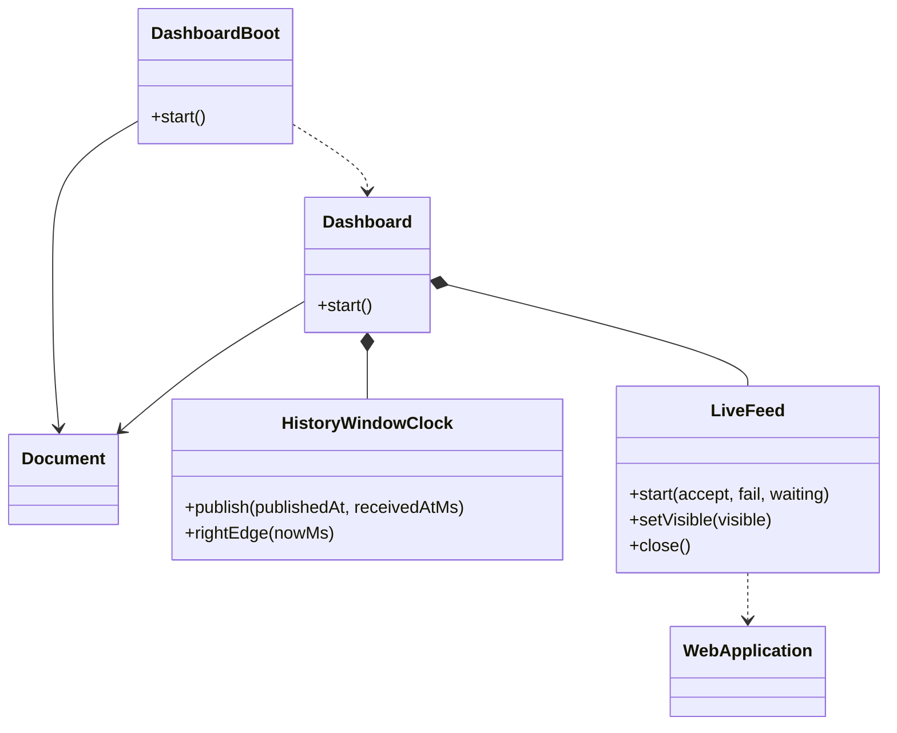
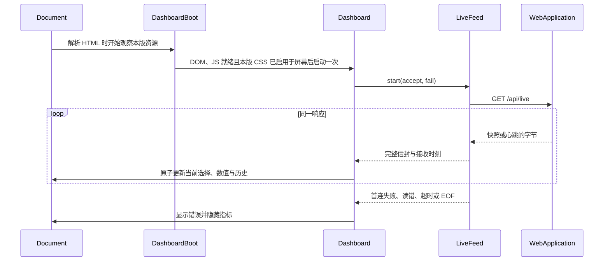

# Neon Grid 浏览器看板

dev-1 / REQ-002，v1.7，2026-11-20。Web 只有一个正式页面，同一地址在两个标签页打开会产生两个独立文档。视觉依据为 [Neon Grid 原稿](joi-observer.html)的第一屏。真实数据、60 秒实时窗口、超量隐藏、模型名称和故障恢复以 [AC-201～215](../dev-workflow/dev-1/requirements.md#req-002-neon-grid-只读-web-看板与同机容器部署) 为准。页面的上下游见[整体架构](architecture.md)、[Web 数据通道](web.md)和 [IPC 白名单](ipc.md)。

## 对象与时序

| 图中名称 | 职责 |
| --- | --- |
| Document（页面） | 每个标签页拥有独立文档并派发启动、键盘、尺寸及卸载事件。 |
| DashboardBoot（启动器） | 随 HTML 内联，观察同版资源及 DOM 就绪，拥有启动期限并呈现资源错误。 |
| Dashboard（视图） | 持有当前完整帧、可见模型选择及主题，绘制加载、实时或错误页面。 |
| HistoryWindowClock（图表时钟） | 根据最近可信的宿主发布时间投影整体延后 1 秒的连续播放坐标，保留上次已显示的右缘。 |
| LiveFeed（数据流） | 读取一次同源 HTTP 响应，按整行交付 UTF-8 JSON，管理超时和关闭。 |
| WebApplication（Web） | 为页面的唯一数据 GET 提供已验证的全帧和心跳。 |

同源 `/` 的 HTML 先显示 “Loading dashboard…”。本版 DOM 和脚本就绪、样式已在屏幕生效后启动一次 Dashboard。模板使用非阻塞的打印媒体链接预取 CSS，加载成功时切到 all，在启动期间即可显示原生状态文字。文档自身从解析起观察资源，加载失败、缺少入口或超过 8 秒时，以原生 HTML 显示 “Dashboard resources unavailable. Refresh this page to retry.”。资源后来就绪时仍保持该终态。pagehide 在加载阶段即撤销启动资格，活动页接手后继续管理同一文档的离开事件。见[同版资源](web.md#http-契约)。

资源就绪后显示 “Connecting to collector…”。LiveFeed 将浏览器原生 fetch 和定时器绑定到当前文档的全局对象。每文档仅用 fetch 的 `mode: "same-origin"`、`redirect: "error"` 发起一次数据请求。重定向即锁存错误，不能先访问 Location 再检查最终响应。流接口 `accept(envelope, receivedAtMs, utcMs)` 原子交付完整记录，后两项是文档单调毫秒与从本次连接 HTTP Date 估算的 UTC 毫秒（未知为 null）。增量解码支持跨块 UTF-8、单块多行与截断末行。非 200、错误 MIME、非法 UTF-8 或记录、EOF、超时统一锁存 “Connection lost. Refresh this page to retry.” 并隐藏仪表。见[接口骨架](../../src/joi_observer/web/static/dashboard.js)。

前台从发起 fetch 起最多等待 12 秒取得首条新鲜整行，此后只有发布时间前进的新鲜记录才延长下次截止时刻。处理响应头或安装记录时检查同一单调期限，前台到期时即使定时回调迟到也进入错误态。失败或主动关闭会释放 reader、定时器和绘制观察器，迟到回调失效。每个新文档默认选择 Hologram 和首个可见模型。普通快照及心跳保留当前文档已选主题和仍可见的模型。随后打开的页面有自己的默认选择。

**普通标签切换。** Dashboard 在 `visibilitychange` 时将当前可见性传给 `LiveFeed.setVisible(visible)`。已经正常展示的文档隐藏后继续读取原流、检查记录年龄，挂起期内由 JS 停顿造成的无进展在恢复可见时判断。首次连接仍遵守首行期限。之前已在等待积压追赶的页面沿用既有截止时刻。EOF、协议错误、读错一旦观测到就锁存，之后任何可见性事件均不能复活页面。

恢复可见时，若原流仍健康且原 12 秒期限已过，`setVisible(true)` 返回 true。Dashboard 收起旧仪表，在仪表外的 `#snapshot-wait` 状态区显示 “Waiting for a fresh snapshot…”。恢复实时画面或进入错误页时收起该提示。原读取器最多再等 **2 秒**，可用于读取已排队的记录或一个正常心跳。只在收到新鲜且发布时间前进的整行后恢复画面。积压的旧记录继续丢弃，静默到期或中途 EOF 显示刷新错误。恢复期间反复隐藏和显示共用已经开始的两秒截止时刻。已经获知的终态始终保留。pagehide 会关闭原流，pageshow.persisted 恢复该文档时直接提示刷新。所有这些动作均使用同一次数据 GET。

**记录新鲜度。** HTTP 200 响应须有唯一的 `X-Joi-Sent-At`，值为发头时的宿主单调秒（有限非负 ASCII 数字）；缺失或非法时停止本次请求。以该时刻作为首个宿主时间下界 F，在收头时绑定浏览器单调时钟。处理每条合法记录前按本地经过秒数 Δ 先算 `F = max(F + 0.999 × Δ, published_at)`，比较 `F − published_at`，并记下本次本地时刻。如果年龄大于 5 秒，丢弃整条记录，保留最近新鲜帧及原截止时刻。已进入实时页时通过 waiting(true) 显示 “Waiting for a fresh snapshot…” 状态提示，仍可辨认上一份有效画面；首次尚无有效帧时继续显示初连加载态。前台原 12 秒期限内（后台恢复见上文）收到新鲜且发布时间严格前进的记录后安装新值并以 waiting(false) 清除提示，持续积压到期则整页锁存刷新错误。相同状态重复通知无需派发；相同发布时间不会使等待提示消失。新鲜但发布时间相等的合法帧可替换数据，不能延长期限。判据针对整帧发布时间，来源的 sampled_at、指标是否变化和对象 STALE 均不影响它。0.999 是保守速率，在浏览器钟相对宿主快至约千分之一时也不会累积虚假年龄；单向响应无法精确测出首个响应头的在途耗时，也无法可靠区分增长速度落在钟差余量内的缓慢积压与正常钟差。5 秒阈值比较的是可推断的年龄下界。页眉与绘图右缘各用自己的时间基准。

## 从原稿落到窗口

优先核对 1280×900 桌面和 390×844 窄屏，使用 CSS 像素、浏览器 100% 缩放。按 2026-11-19 现场反馈，正式画布铺满浏览器内容区，外边距为 0、宽度为 100%，默认内边距 16px。基准字号 12px、行高 1.55，按 Cascadia Code、SFMono-Regular、Consolas、Liberation Mono、monospace 的本地等宽字体栈回退。全页上下区域各占内容高度一半，字符字标使用三行有效图形，省去原稿末尾的空白行，为日常五卡配置保留硬件空间。桌面总高度取 `max(100svh, 73em)`，窄屏取 `max(100svh, 126em)`；独立于条目数量。允许随视口高度产生正常的整页纵向滚动。

| 部位 | 桌面 | 窄屏与变化点 |
| --- | --- | --- |
| 品牌 / 状态行 | 左侧保留分色字符字标和完整 Joi::Observer 可访问名称，右侧主题按钮。下一行左侧 hostname / system，右侧 HH:mm:ss UTC | 画布内容宽度 ≤520px 用文本字标；字标不随窗口高度改变，避免最大化时页眉变高反而减少 GPU 容量。长主机名可省略，保留时钟 |
| 硬件上半屏 | GPU : 主机列 = 1.55 : 1，间隔 12px。右列自上为 Host Resources、Storage、Docker，前两项占所需高度，Docker 使用余量 | 视口 ≤850px 比例 1.3 : 1、间隔 8px、内边距 12px。≤600px 改单列，内边距 10px；GPU 占上半屏硬件内容区的 48%，Host/Storage/Docker 堆叠于余下区域 |
| 下半屏 vLLM | 190px 左模型栏、16px 间隔、余宽详情。两组队列并排、四个指标横排，曲线延展填满详情剩余高度 | ≤850px 左栏 166px、间隔 12px。≤600px 模型按钮为顶端单行三等列；详情置于下一行，指标为二列两行，队列仍并排 |
| 底栏 | vLLM 当前、WebUI 禁用且标记 Planned；末行只提示 ↑↓ Select model 与 t Theme | 相同键义，保留浏览器正常 Tab 导航与整页滚动 |

两个主题共用背景 `#080e18`、表面 `#0d1522`、边框与空轨 `#2d3b50`、正文 `#d4ddeb`、弱文字 `#8a9db5`、告警 `#ffa45b`、选中底色 `#172b40`。Hologram 主色/副色为 `#7b9fff` / `#e570d0`，Moonlight 为 `#7ddfff` / `#c6a7ff`。GPU 标题、选中项边/名、关联卡条、主题按钮、图线和活动服务下划线用主色。模型按钮和底部当前服务按钮的键盘焦点轮廓也使用主色，方向键切换、Tab 导航及点击时保持边框颜色一致。其余硬件面板及 vLLM 的 legend、路由和 CPU/RAM 填充用副色。正常非关联卡用弱色，等待及异常有对应文字提示。详情的 RUNNING/WAITING 数值为 24px、指标值 16px，采用等宽数字、500 字重，标签/标题分别参考原稿 11px 和 14px。缺值的破折号及 N/A 保持普通字重。

## 容量、选择与交互

容量在布局完成后按 CSS 像素确定。在自然布局中，最后一个可见行之后若还能放入下一完整配置行（含组头和间隔），则须继续显示。GPU、Docker、模型各有独立列表轨道 `[data-list-body="gpu|docker|model"]`。legend、标题、面板边距和固定分隔由外层布局先行分配；轨道自身没有内边距和边框，其实际高度就是可用高度 H。条目从顶部开始排列，行间距只在两条之间计一次。保留小数像素，显示有序前缀中能完整容纳的最大项数。组头属于相应首行的占用。数量、名称、状态变化均不能撑高轨道。

| 区域 | 容量与测试边界 |
| --- | --- |
| GPU | 按快照顺序取完整卡片前缀，逐个累加卡片实高、行间距和本组首卡所需的组标题/分隔。第一条放不下即停止，标题随首卡原子出现，只显示完整行。GPU 数量来源为真实 inventory；仅有可靠映射时使用 GPU 范围、TP n / SHARED 组标，组语义沿用[硬件设计](hardware.md)。 |
| Docker | 按 metadata.containers 顺序。行高为 `1lh + 4px`，容量为 `floor(H / rowHeight)`，包含刚好贴合底边的一行。配置 id 占左侧，状态槽右对齐；失败行仍占原位。 |
| 模型 | 桌面列表标题下，若按钮实高 h、间隔 g=5px，容量为 `floor((H+g)/(h+g))`，取有序前缀。窄屏只分配一整行给按钮，能完整容纳该行时显示至多三个，列间隔 5px。标题计所有配置模型。 |

所有可见行分别以 `data-gpu-id`（UUID）、`data-container-id`、`data-model-id` 标识。模型按钮 `aria-pressed` 表示选择，GPU 行 `data-linked` 与实际主色强调同步。隐藏项不进入点击、焦点或 ↑↓ 顺序。容量为零时轨道保持空，Docker 在已有标题区显示配置总数（如 DOCKER / 4），模型标题保留总数。只有真实空配置才显示对应空态。尺寸变化由 ResizeObserver 触发；选中项仍可见时保持其 id，被截掉时改选首个可见项。若键盘焦点在消失的按钮上，将焦点转到新的选中按钮，零容量时转到可编程聚焦的模型标题。面板外已有焦点保持原位。无可见模型时清除详情和 GPU 选择，重新容纳时建立首选。

单击模型或无修饰 ↑↓ 只在可见前缀内移动，末端停止，方向键不循环。无修饰 t 切换 Hologram / Moonlight；按钮支持键盘原生激活，组合键、可编辑输入和浏览器刷新遵循浏览器默认行为。移除 Quit、概念页切换、模拟故障或历史平移提示。名称以文本节点输出，长名称可省略并保留可访问完整文本；同名 id 的选择互不合并。按键、主题、缩放或绘制均不请求数据。

## 指标映射

每条记录须为可解码的 UTF-8 JSON、协议 v1，并具备完整的 metadata、snapshot 及其对象数组。协议或连接失效进入整页错误。合法的空数组、`sampled_at=null`、尚无指标和单一来源 STALE 均进入实时页面；按生效元数据保留配置身份和顺序。每帧原子替换。适用但未知为 `—`，不适用为 `N/A`，有效零显示 0。整数标签按精确十进制值排版；长整数可用带完整指数的科学记数，完整值留在 title 或可访问名称中。浏览器按同一 HTTP 流的顺序消费，避免把 sequence/revision 转为 JS Number 去重。可见详情数值以 `data-metric` 标识协议指标名。四个同屏指标的每个 `data-metric-slot` 包含实际可见的标签 `data-metric-label`、单位 `data-metric-unit` 和相应数值，便于核对三者属于同一槽位。单位、二进制容量与舍入见[硬件](hardware.md)、[vLLM](vllm.md#10-展示与固定布局)。

| 展示 | 取值与失败表现 |
| --- | --- |
| 页眉 | 生效元数据的 hostname/system；收到本次 live 响应头时，以其中 Date 和本地单调钟锚定估计 UTC。显示 HH:mm:ss UTC，在时钟的 title 或可访问名称标注 “Estimated host UTC at connection”。缺失/非法为 `—`。重新打开页面时重新校准；精度见[数据通道](web.md#完整帧时间与失败)。 |
| GPU | 快照 `gpu` 对象的 index、name、显存 used/total、utilization_percent、temperature_c、power_w。沿用原稿的 meter 和 16 个可见色块，填充段数按利用率四舍五入，未知为空轨。卡片上下各留 3px 内边距，温度/功率列固定占用 8ch；相同视口中，GPU 条的轨道宽度不受功率数字长度影响，利用率只改变填充段数。UUID 可精确匹配保留卡，十进制索引只匹配新鲜且唯一的已采样索引。全量身份决定关联，可见前缀决定绘制。首先保留已知 GPU 槽及各自状态；仅当没有已知槽、inventory 已成功采样且 device_count=0 时显示 No NVIDIA GPUs。无槽且未盘点显示未知，盘点失败在标题标 STALE。 |
| Host / Storage | `host/cpu` 的 cpu_percent 及 `host/ram` 的 ram_percent 各用有可访问名称的 20 段 meter，轨道宽度为 Host 面板内容区的 50%，随窗口尺寸变化；填充段数沿用 GPU 的取整规则。CPU 百分比一位小数，RAM 已用/总计 GiB 或 TiB 整数。按 metadata.mount_points 与 `storage/mount-i` 对应，最多三项；GiB 整数、TiB 一位，独立强调一位小数的已用百分比。无挂载为 No mount points configured。局部失败保留合法旧值并标 STALE。 |
| Docker | 按配置 id 显示 Running、Exited 等协议状态，健康 Running 用主色；失败时状态槽改为 STALE。首次未知为 `—`，空配置为 No containers configured。 |
| 模型列表 / 标题 | 按 `models[i].id` 对应 `vllm/<id>`。列表显示 name、类型、可选的显式端口、running/waiting 及该项状态。详情标题显示服务已回退的 served_model_name，路由只显示 `:<effective_port>`。空配置仅有 No models configured。 |
| 状态 / 队列 | 按优先级取状态：stale=true 显示 STALE（包括仍有旧计数时）；否则未采样或缺 running/waiting 为 `—`；其余按 waiting>0 为 QUEUED、等于零为 READY。其他来源继续更新。详情显示 running、waiting 和服务的 total，省略分母。WAITING 下方的说明在 Chat 显示 Avg queue 和 queue_seconds 的秒数，在 pooling 显示 Unit: seq。 |
| 四个指标槽 | Chat 依次 decode_rate、prefill_rate（tok/s）、ttft_seconds（s）、kv_cache_percent（%）；Embedding / Reranker 依次 rate（seq/s）、queue_seconds（s）、latency_seconds（s）、KV CACHE 的 N/A。 |

## 近 60 秒曲线

**窗口位置。** 数值面板及图标题的最新指标在收齐新帧时立即更新，曲线整体延后 1 秒播放，横轴标签和宽度仍为 −60 到 0 秒。`HistoryWindowClock` 保存最近一次可信锚（宿主发布时刻 Pᵢ，本地接收时刻 tᵢ）。首帧和后续严格前进且通过新鲜度检查的帧建立或替换最近锚；不累计历次估算偏移。每次绘制，以本地单调秒 t 求候选 `C = Pᵢ + (t − tᵢ) − 1`，实际右缘 `R = max(上次已显示的右缘, C)`，首次右缘为首帧发布时间减 1。显示闭区间 `[R − 60, R]`，横轴 0 秒代表当前播放时刻。远端时钟较慢或该帧有延迟时，已显示右缘可暂停，直到基于宿主新锚的候选追平；长期微小时钟速率差不会叠加到一个永久偏移。整个计算使用同一 performance.now() 起点，保留秒的小数部分。迟到帧、切换模型、主题及尺寸变化都不得使窗口右缘的时间减小；同一视口内保持绘图区左右边界稳定，纵轴刻度文字变宽时，同一历史点的屏幕横坐标仍只能保持或减小。例如发布时刻 100 首次到达，4 秒后才收到发布时间 101 的帧，此时播放右缘保持 103，采样时间 42 的旧点继续留在窗外。

**动画与绘制。** 每个有图表的可见文档只维持一个 `requestAnimationFrame` 循环。普通动画帧只更新曲线、面积和孤点所在 SVG 组的水平变换，复用路径、固定坐标轴和 60 秒裁切矩形，不读布局、不重建整页，也不增加请求或宿主采样。新快照、模型/尺寸变化和观测进出窗口时重算路径；无新帧无输入时也淘汰过期点。页眉时钟仍每秒更新。文档隐藏时取消动画，恢复时直接绘制当前播放窗口；等待新鲜帧而收起仪表时保持停图，失联和 pagehide 取消动画并释放引用，新文档用其首帧建立新时基。

**右端衔接。** 播放时刻前后的已收真实样本一起参与连续段插值，按原 `sampled_at` 投影，再用固定的 60 秒窗口裁切描边与面积。日常每秒采样且数据按时到达时，最新一秒提供右端插值所需的后一个点，曲线连续贴住右边界，不额外留空。最新样本本身在播放时刻到达它后才进入可见范围。首个孤立样本同样等待一秒；切换模型、心跳及恢复可见都不重启播放，也不取消这一秒延迟。失败、缺值仍分段；数据迟到超过缓冲或停止时，保留真实空白，不外推未知数值。

**曲线形状。** Chat 使用 `decode_rate`（tok/s），Embedding 与 Reranker 使用 `rate`（seq/s）。切换模型时一起更新图标题、单位和该模型的历史。按真实 `sampled_at` 投影观测到坐标轴，遇失败、未知、不适用或缺字段就结束当前段。为稳定窗口左端的交点与切线，每个模型在连续重叠快照之间保留延迟播放所需的一秒边界数据，以及播放窗口首点之前的两条观测，先按连续段生成曲线，再裁切至可见的 60 秒绘图区。边界观测只参与插值；空历史或无重叠快照清除旧边界，缺口始终分段。过期孤点、完全过期段及完全位于播放右缘之后的段不绘制。单点画可见实心圆。对至少两点的连续段，R4 将 [Neon Grid 原稿](joi-observer.html)的纯路径函数 `historyCurve(points)` 移入随包 JS，传入该段的 `{x, y}` 坐标。返回的 SVG 路径用于描边，同一路径末尾闭合至零基线形成该段的填充。两个点连成直线，多点平滑穿过观测值，在局部峰谷共用水平切线，各段保持在相邻样本值域内。插值仅用于绘图。

实际刻度独立确定样本在屏幕的位置。横轴可见的 `data-time-tick` 组内文本以 SVG 文本锚点对齐该时刻；纵轴 `data-value-tick` 组内同时给出可见数字标签和对应水平网格线，用其实际位置作纵向尺度。横轴标 −60、−45、−30、−15、0 秒，图区宽度 <340px 时标 −60、−30、0。纵轴覆盖可见有效值，基线为零；空窗或全零保留非零尺度。描边宽 2px，必须实际可见。每段的 `data-curve` 与 `data-area` 共用同一曲线边界，孤点用 `data-point`。面积实际引用从上向下的单主色渐变，0%/.46、56%/.21、100%/.025 三个 stop；主题切换同时更新实际描边和填充。SVG 有可访问标题、最新指标和单位。无数据保留空轴，无拖动、手动平移或区间选择。

## 黑盒入口与验证边界

| 入口 | 验证对象 |
| --- | --- |
| [首屏测试](../../tests/test_web_dashboard.py) | 从包资源读取正式 HTML 并解析加载/隐藏区域、只读入口和同源资产，未取数时无演示主机或指标。 |
| [流测试](../../tests/browser/live_feed.test.cjs) | Node 原生 fetch/Response/ReadableStream 配内存响应及可控时钟，验证拆分多字节字符、同块多帧、整数标签、两种时间域、首行/续行截止、坏行及 EOF。 |
| [真实浏览器场景](../../tests/browser/dashboard_browser.py)与 [DOM 观察](../../tests/browser/observe_dashboard.js) | 通过 file 文档加载正式 HTML、CSS、JS 和已有 IPC 编码器生成的样本。两种视口测实际盒模型、两主题、超量前缀、模型选择、GPU 联动、有效零/未知/N/A/STALE、曲线缺口、两页故障隔离及同页刷新恢复。fetch 端返回内存 ReadableStream，所有输入来自夹具。 |
| [共享快照对照](../../tests/test_web_snapshot_parity.py) | 已有多来源离线样本与 TUI 使用同一权威快照，复核完整 Web 行中包含的真实业务值。 |

流读取器的积压、追上和超时分支由 Node 的可控时钟验证。Chromium 通过本地 file 文档观察真实绘制。在日常场景核对 Docker 失败行由 Running 改显 STALE、健康行仍显示 Running。双页场景让第一页在非默认模型及主题下接收心跳和普通更新，再打开第二页核对两份选择。后台恢复场景核对旧仪表收起后能看到等待提示，并分别观察原流的新帧、EOF 或静默。[启动验收](../../tests/browser/dashboard_boot.py)用一次缺资源和两种已失去启动资格的文档验证刷新提示。正式采集样本在 Chromium 中以分段响应进入页面一次。

[曲线验收](../../tests/browser/dashboard_chart_checks.js)在代表性的 Chat 场景中完整核对一次采样点位置、平滑转折、断口和面积边界。主题切换只核对实际描边与垂直渐隐填充是否跟随主色。该场景逐动画帧比较同一存留点的屏幕横坐标，检查连续匀速位移、路径与坐标轴复用，并用扩大纵轴范围的迟到帧验证无回弹。桌面与窄屏的缓冲播放场景用受控时钟和真实 SVG 命中测试，核对全图延迟一秒、曲线及面积贴住右边界、数值立即更新、模型切换保留播放时间，数据中断后不外推。生命周期场景核对只有一个动画循环，隐藏时停止、恢复时继续、断线后取消且不复活。三模型选择场景用各自不同的两个点核对速率曲线、图上单位及 WAITING 说明。入口和本轮基线见 [R2 交接](../dev-workflow/dev-1/REQ-002/handoff-r2.md)。

**整页视觉对照。** R4 页面可绘制后，在本地 Ubuntu/WSL 以 `pytest --basetemp=<新临时目录> tests/browser/dashboard_browser.py -k layout` 运行两个参考视口的用例，Chromium 采用同一离线环境。分别在相应临时目录中以 file 地址打开 `page.html?visual`（桌面 1280×900、窄屏 390×844，缩放 100%）。每次打开立即送入与自动检查相同的三模型样本。只有这个离线对照入口每秒更新该样本的时间坐标，使整页在切换视口和滚动时持续可见。退出即停止。用浏览器的全页截图对照原稿 Neon Grid 第一屏，包含窄屏折叠下方的内容。核对字符／窄屏品牌、面板位置、底部服务入口、条形仪表的实际填充与空轨、第一组 TP 2 的两卡关联及可见共享组。在此样本中，GPU 50% 为 8/16 段，CPU 12.5% 为 3/20 段，RAM 25% 为 5/20 段。两种尺寸各保留一张正式画面即可。主机名称、数值、容量内条目和键位按正式语义核对。自动用例核对具名仪表、可见盒和真实百分比。
