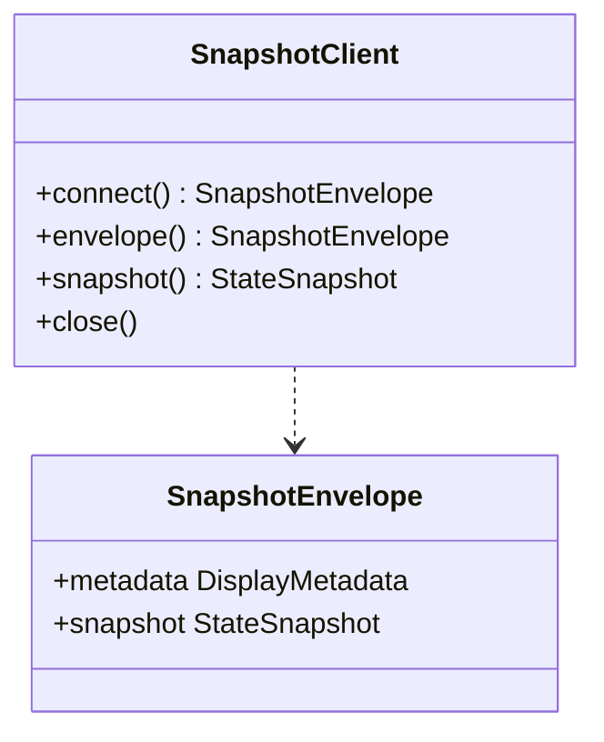
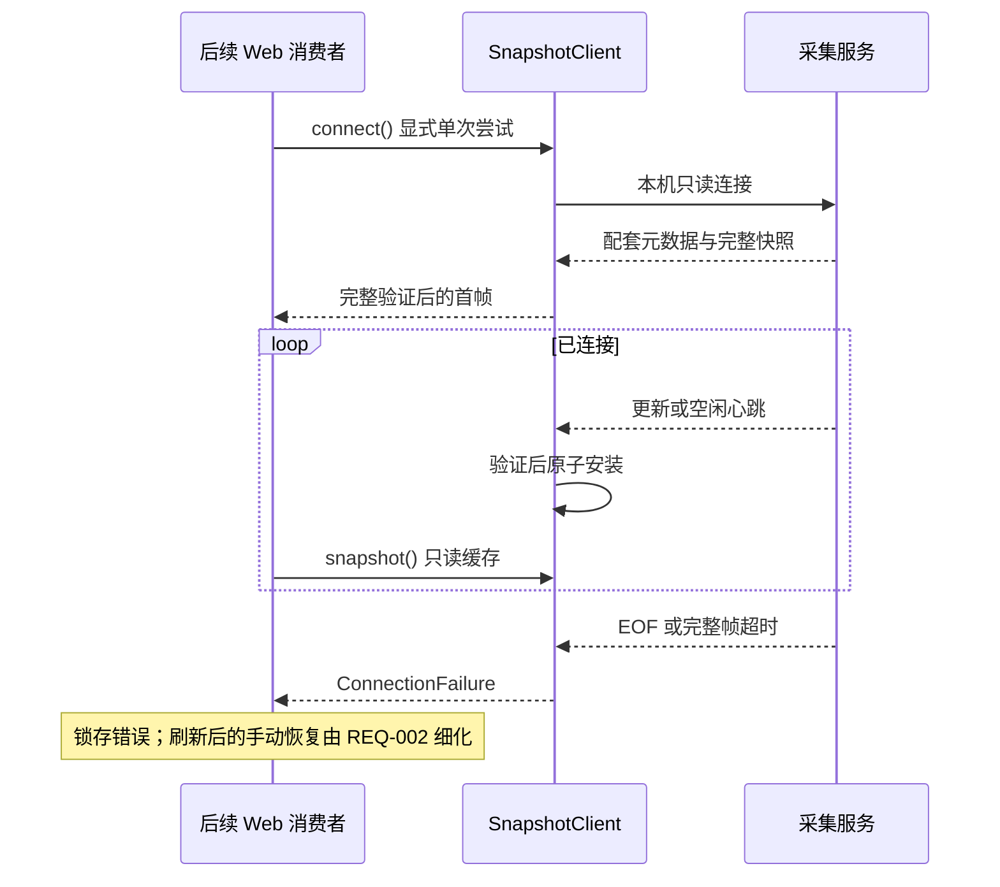

# Web 只读看板的共享边界

- 关联需求：dev-1 / REQ-001 的共享数据能力；后续消费者为 REQ-002。
- 修订：v0.3，2026-11-16，集中说明共享类和消费角色，合并两图中的同名元素与别名。
- 整体设计：[组件边界与依赖](architecture.md)。
- 关联模块：[采集服务](collector-service.md)、[IPC](ipc.md)、[状态](monitor-state.md)、[配置](configuration.md)、[vLLM](vllm.md)。
- 范围：本轮只固定 REQ-001 对 Web 的输入与隔离承诺。Web 框架、浏览器会话实现、像素容量、容器部署文件和视觉测试需在用户启动 REQ-002 设计后细化；本文件不宣称 Web 已实现。

## 职责与协作

宿主机采集服务拥有唯一的采集器、Monitor 和 MonitorState。Web 容器只读取本机 Unix socket 送来的白名单快照及展示元数据，再向浏览器提供页面和只读数据；浏览器不连接采集服务、vLLM 或 Docker。

完整组件关系集中在整体设计；下面只引用现有 IPC 接口，不为尚未选定的 REQ-002 虚构 Web 类、路由或实现。

## 类与对象简介

| 图中名称 | 简介 |
| --- | --- |
| `SnapshotClient`（`Client`） | 接收采集服务的快照并维护本地只读缓存的客户端，供后续 Web 消费者读取已验证的数据。 |
| `SnapshotEnvelope` | 将服务实例身份、配套展示元数据和指标快照封装在一起的不可变数据对象。 |
| `Web`（后续 Web 消费者） | 时序图中代表 REQ-002 将设计的容器内只读消费角色，负责通过共享客户端取得页面所需数据。 |
| `Service`（采集服务） | 时序图中代表宿主机服务的发布角色，负责向已连接客户端推送完整快照和心跳。 |

## 简化类图

## 关键交互时序图

容器只需数据通道目录的受限挂载和 socket 访问权限，不获取 Docker daemon socket、GPU 设备、宿主根目录或 privileged 权限。通道是单向快照流，没有配置修改、采集触发、任意文件访问、容器控制或命令执行操作。具体 socket 权限与白名单字段见 IPC 和服务设计；只读文件挂载本身不能代替协议只读约束。

## 继承的正式行为

| 边界 | 约束 |
| --- | --- |
| 权威数据 | 直接展示服务计算后的指标、单位、未知/N/A、STALE 和失败缺口；不重算原始计数差分或 Total |
| 历史 | 仅约 60 秒，实时跟随；无 180 秒缓存、回看、平移或时间范围选择；HTML 模拟控件不是正式契约 |
| 名称 | 模型列表显示 name，详情显示已回退的 served_model_name；Docker 显示配置 id；配置顺序、同名不同 id 和 GPU 关联来自同一元数据 |
| 原子配置 | 首次完整信封包含配套元数据和快照，同一连接的 instance_id/config_revision 不变；新实例重新建立历史 |
| 失联 | 初次失败或中断后停止自动尝试；局部 STALE 不属于整体失联；Web 后台也不能暗中重连 |
| 手动恢复 | 页面停留错误状态，刷新才发起新尝试；其他用户刷新恢复共享通道时，原错误页面不能自动恢复 |
| 隔离 | Web 容器或浏览器退出不停止宿主采集，增加浏览器不增加采样；主题和模型选择只属于各自会话 |
| 权限与部署 | 内网只读，无登录，无应用内网段管理，不修改防火墙或路由；容器发布端口不能被描述为天然受 UFW 保护 |

IPC 的 published_at 和历史时间是同宿主单调时间域。浏览器自身的 performance.now() 不属于该时间域，REQ-002 须以接收帧的 published_at 与本地 elapsed 建立展示时间映射；不能直接用墙钟或浏览器绝对计时过滤服务历史。客户端缓存仅用于展示，禁止持久化正常监控历史。

## 验证边界

REQ-001 的协议与服务黑盒覆盖白名单、原子元数据、局部失败、多客户端隔离、传输失败后停止尝试和新实例历史隔离；用离线字节/传输端口替身，不连接任何服务器。实际入口和执行结果见[REQ-001 R2交接](../dev-workflow/dev-1/REQ-001/handoff-r2.md)。

浏览器错误会话锁定、刷新恢复、容器到宿主权限、正式 Neon Grid 视觉、离线资源和 Web 只读 API 属于 REQ-002 后续设计及验证，不以 REQ-001 测试通过推定这些能力已交付。
