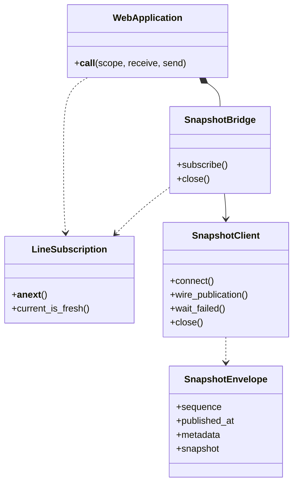
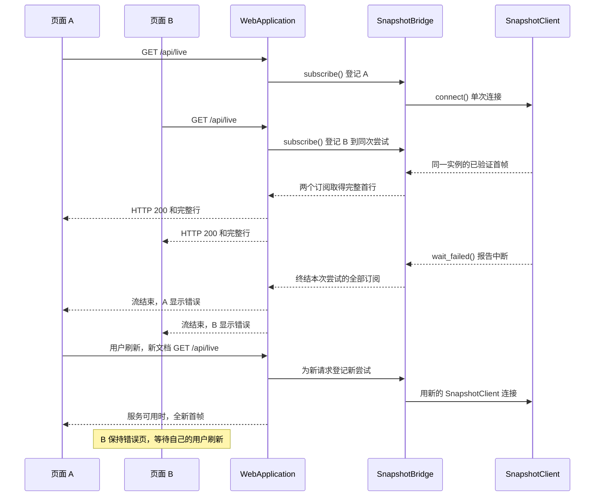

# Web 数据通道与页面会话

dev-1 / REQ-002，v1.5，2026-11-20。本模块承接 REQ-001 的只读 IPC，向普通浏览器提供一个 Neon Grid 页面及其数据流。图中页面 A 和 B 表示两个独立打开此页面的文档。关联设计见[整体架构](architecture.md)、[本机快照协议](ipc.md)、[浏览器呈现](web-dashboard.md)和[容器部署](web-deployment.md)。

## 类与对象

| 图中名称 | 职责 |
| --- | --- |
| 页面 A、页面 B | 两个独立浏览器文档，各自拥有一次数据请求、一次错误终态和视图状态。 |
| WebApplication（Web） | 容器内单个 ASGI 应用，分派固定路由，在每个 HTTP 连接上独立发送响应并处理断开。 |
| SnapshotBridge（桥） | 应用拥有的共享订阅管理器，为并发请求选择一次连接尝试，向属于该次尝试的读者分发完整行。 |
| LineSubscription（读者） | 单次请求的异步行迭代接口，同时保存该读者最近取得的行所属的连接代与发布时间，供 ASGI 同步复检。 |
| SnapshotClient（客户端） | REQ-001 的单次 IPC 客户端，接收并验证完整帧，向 Web 原子提供信封与配套正文，失败或关闭时清除缓存。 |
| SnapshotEnvelope（信封） | 将服务实例、配置身份、发布序号、时间、展示元数据及整份状态绑定在一起的不可变值。 |

## HTTP 契约

生产入口为单 worker Uvicorn 加 `joi_observer.web.app:create_app --factory`，显式启用 lifespan。startup 先取得本版三个静态资源再允许服务页面。包内资源缺失或应用初始化异常时报告 startup.failed 并退出。仅宿主采集服务不可用时，Web 仍可正常启动。ASGI 消息边界与数据行边界独立。

一次启动固定一份 index.html 模板、dashboard.css 和 dashboard.js，使用同一个 64 位小写十六进制发布标识 release。任意一件资源改变，新版便使用不同标识。路由持有启动时的字节，HTML 中的两个资源 URL 引用本标识。收到旧 HTML 的用户只会取得对应版本的文件或资源错误，刷新可取得新版。三个文件均来自包内固定位置。已有浏览器按 HTTP/1.1 建立长流的容量和部署前提见[部署契约](web-deployment.md)。

| 请求 | 成功行为 | 边界 |
| --- | --- | --- |
| `GET /` | UTF-8 HTML，`Cache-Control: no-cache`，立即显示加载态 | 文档声明本版的资源 URL。首屏不建立 IPC |
| `GET /static/<release>/dashboard.css`、`…/dashboard.js` | 当前版本的固定两件资源，正确 MIME，`Cache-Control: public, max-age=31536000, immutable` | 旧版、未知版本及未登记文件均 404、no-store，不回退到本版内容。文档中的启动器独立报告错误 |
| `GET /api/live` | 取得经过验证的新鲜首帧后返回 200，`Content-Type: application/x-ndjson`、`Cache-Control: no-store`，每个完整 JSON 后跟一个 LF | 无查询参数。只向当前 HTTP 请求交付本次宿主连接的后续帧 |
| 错误请求 | 未知路径 404，已知路径的其他方法 405 并声明 `Allow: GET`；携带数据查询参数返回 400 | 在建立订阅前结束。无动态文件目录、代理目标、控制对象或历史查询路由 |

实时流的 200 在提交响应头时给出唯一的标准 Date（IMF-fixdate）和唯一的 `X-Joi-Sent-At`。前者取当前 UTC，供页眉估算时间。后者取同一提交时刻的宿主单调秒，用可往返到 float 的有限非负 ASCII 数字表示，供浏览器判断新鲜度。部署示例关闭 Uvicorn 自动 Date，避免实时流出现重复头。对首页、资源和错误页，由通用 HTTP 响应路径按标准补上日期。页面校时只消费实时响应，验收无需逐个路由检查日期的生成方式。

首帧前失败返回 503、`no-store` 和固定简短正文（例如 `Snapshot unavailable.`）。已开始的 200 响应发生故障时结束流，浏览器将任意 EOF 作为本次数据连接终止。页面显示本地固定错误文案，提示刷新；既有仪表和图表退出实时画面。Web 容器未启动或不可达时，尚未获取页面的浏览器使用自身的连接失败提示。

## 一条宿主订阅如何服务多个页面

1. 页面登记后绑定到本次宿主连接。已有健康连接或正在进行的首连由同时打开的页面共享。新请求在没有可用连接时才能发起一次新的 IPC 连接。订阅的进入、迭代和退出始终属于同一次尝试。上次尝试还在关闭时，新请求可以在自身的首行等待期限内等它释放。旧读者即使稍后才退出，也不会关闭或读到下次连接。
2. 宿主在状态更新时发布，无更新时约每秒发完整心跳。Web 桥使用 `SnapshotClient(retain_body=True)` 读取缓存。同步 `wire_publication()` 原子返回同一条已通过协议白名单和会话检查的 `(SnapshotEnvelope, bytes)`，正文已经去掉 8 字节长度头。宿主产生的单行 JSON 保持原字节，只补一个 LF。合法 IPC JSON 若用 CR 或 LF 排版，这些真实控制字节只可能在字符串外，将它们替换为空格即可组成单行。保留字符串转义、非 ASCII 文本和精确整数标签。所有读者共享这条 NDJSON，普通 TUI 客户端仍只需缓存信封。
3. 桥观察最新已验证的 sequence 和宿主发布时间。序号前进且年龄满足 `0 ≤ host_now − published_at ≤ 5s` 就可以安装最新行，即使其发布时间与上一行相等。只有首份新鲜行及以后发布时间严格前进的新鲜行才重置该连接的 7 秒进展期限。初始期限从登记起计算，以事件循环单调时钟驱动。原期限届满即终结本次尝试，即使稍后收到的整行本身很新鲜。来源的 sampled_at、STALE 及界面是否打开都不影响判断。读者可以跳过中间序号，加入时只取同一连接的最新有效全帧。
4. ASGI 在 `async with bridge.subscribe() as reader` 内用 `await anext(reader)` 选择下一整行，`reader.current_is_fresh()` 同步检验刚选中的行及其连接。其他读者更新不会改变这项检验的对象。登记后至多用 7 秒等待首个可提交的有效行，提交响应头前若已过期就按原等待截止时刻换新。提交 200 头、首行写出共用一个 5 秒绝对写期限。发头返回到写首个正文字节之前再复检，若已过期就用同一响应、同一宿主连接在剩余写期限内取得并发送新鲜首行。已提交的头只发一次。没有合格行可按期交付或宿主连接已失效，结束该响应。开始写某行后必须完成整行或终止响应。
5. 每个 HTTP 读者只持自己的一条在途行，写完取共享的最新行。每次 ASGI body 至多 64 KiB，后续每行所有块也共用 5 秒写期限。有限响应共用 5 秒写头及正文。一个读者暂停接收、发送失败或离开，只释放该读者。正常收尾先解除订阅，再至多用 1 秒发送空结束消息。失败首行先解除订阅，再尝试固定的 503。写失败、写超时或收到 disconnect 后，立即停止向该连接写出。
6. IPC EOF、读错、校验失败、整帧超时或 7 秒内未取得新鲜发布进展，会使该次尝试失效。清空可见缓存，唤醒所属读者，向 IPC 客户端发起关闭。首帧前的失败返回 503，已开始的成功响应结束流。最后一页离开也走同一清理路径，包括首连仍在进行时。应用 shutdown 停止接纳新请求、注销订阅、结束 Web 自己的任务，并与请求退出路径共同等待一次 `SnapshotClient.close()` 的有界关闭。该接口自行处理传输关闭超时或异常，Web 以其返回作为 IPC 清理完成的依据。Web 拥有的工作在共用的 4 秒内完成即确认 shutdown.complete；若这些工作抛错或超时则报告固定诊断和 shutdown.failed。宿主采集和 TUI 独立运行。

## 完整帧、时间与失败

浏览器收到的每行沿用 IPC v1 的顶层、元数据、对象、指标及历史白名单，无额外配置或错误透传。换行、引号等遵循 JSON 字符串转义。模型以配置 ID 区分，名称、端口、类型和 GPU 关联随帧提供；展示文本不用于拼接地址或 HTML。整数指标（包括零）的 `{"integer":"十进制文本"}` 和历史中的同类值保持原样。浏览器处理可跨块的 UTF-8 字符及多行，在完整行可用时一次安装当前视图。主机端以精确整数核对序号及 revision，浏览器可以按同一响应的传输顺序消费。字段和结构见[协议白名单](ipc.md#json-白名单)。

| 时钟或期限 | 起点与用途 |
| --- | --- |
| IPC 首次及后续整帧 | 现有客户端每次 5 秒总预算，包含连接及收齐首帧，零碎字节不续期。协议错误同样结束本次尝试 |
| 浏览器首次及后续整行 | 前台从 fetch 或最近一次有效进展起计 12 秒，部分字节和绘制不会续期。已显示数据且健康的普通标签暂停后，只给原流一次有限的追赶机会。已确认失联或已关闭的文档维持刷新错误，见[页面生命周期](web-dashboard.md#对象与时序) |
| 历史的显示时刻 | 浏览器从最近可信发布估计宿主当前时间，曲线整体延后 1 秒播放，数值面板立即更新、横轴仍为 −60 到 0 秒。用上次已显示的右缘作下限，时钟超前时允许短暂停步；窗口逐动画帧连续推进、过期点不重现，已收的后一个样本提供右端插值。实际算法与边界见[曲线设计](web-dashboard.md#近-60-秒曲线) |
| 页眉时钟 | 收到 live 响应头时用 Date 锚定连接时校准的估计 UTC。HTTP 日期量化到秒且包含传输迟延。长会话内宿主后续校时不会自动反映，刷新时重新校准。缺头或非法时显示未知 |

每个文档对数据使用一次 `fetch('/api/live', {mode:'same-origin', redirect:'error', signal})`；遇 3xx 直接进入同一刷新错误流程。遇 503、错误 MIME、无法读取的流、非法记录、超时或 EOF 时终止读取并停止更新，清除计时器和失效视图。网络恢复通知、切换标签页、操作模型和主题均不能再次建连。不同文档不经 cookie、共享存储或服务端用户记录交换主题、模型和错误状态。部署地址、组权限、HTTP 服务器与内网访问责任见[容器设计](web-deployment.md)。

## 验证入口

Web 验收按 Q-014 使用示例规模的模型、宿主、GPU、挂载点和容器。用正常采样历史验证完整行和每次写入的块大小，用可控的传输延迟验证慢读者。每块至多 64 KiB 是传输契约，不要求整份快照达到某个目标大小，也不限制实际可配置的模型数。

| 入口 | 可观察行为 | 隔离边界 |
| --- | --- | --- |
| [后端骨架](../../src/joi_observer/web/app.py)、[订阅接口](../../src/joi_observer/web/api.py)和[HTTP 黑盒](../../tests/test_web_api.py) | 路由白名单、单次尝试、完整行、503/EOF、跨页锁存、取消和慢读者隔离 | 进程内 ASGI 事件与内存字节流；实际调用正式工厂、桥和 IPC 解码入口 |
| [桥与慢页用例](../../tests/test_web_bridge_edges.py) | 同时间新状态仍交付、期限仅由发布时间前进延长、写头期间首行换新、慢页写完整行后直取最新行及单页故障隔离 | 普通样本、两个读者、可控事件循环时钟和内存 ASGI 写端口 |
| [宿主与 Web 链路](../../tests/test_web_pipeline.py)、[多来源对照](../../tests/test_web_snapshot_parity.py) | 实际服务与发布器的采样次数、同一份指标、独立启停、服务重启后的新元数据和真实样本单位/缺口 | 本地采集来源和字节传输替身，无服务器连接 |
| [页面设计](web-dashboard.md)、[部署设计](web-deployment.md) | 两个主题、窄屏、名称及数值、60 秒窗口、浏览器失联、挂载与服务入口 | 浏览器离线夹具和静态容器声明；实际镜像与宿主权限另行验证 |

R2 交付接口和预期业务断言，既有 IPC、采集和 TUI 实现可直接复用。当前执行结果与后续集成边界见 [REQ-002 R2 交接](../dev-workflow/dev-1/REQ-002/handoff-r2.md)。
